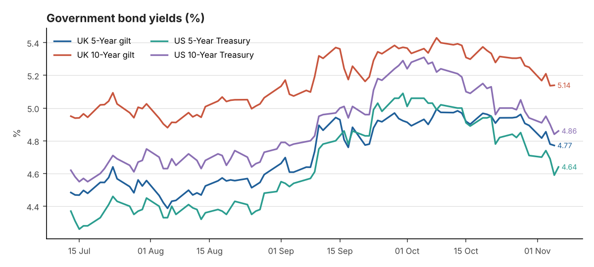
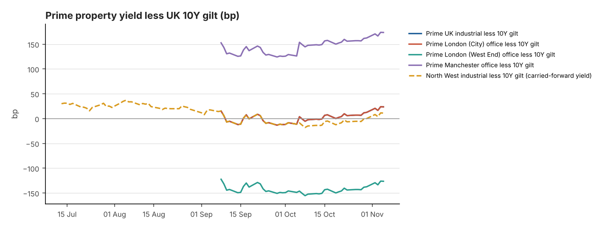

# DAILY FINANCIAL & PROPERTY INVESTMENT BRIEFING

**Date:** 09 November 2026
**Reporting time:** 08:00 UK time
<small>Generated 2026-11-09 12:07 UTC · run `20261109T120734Z` · commentary source: analyst note. Every figure shows its own observation date: markets close the previous business day, inflation is monthly, and property yields are published monthly or quarterly.</small>

## Executive Summary

1. **BoE tightened.** On 5 November the MPC raised Bank Rate 25bp to **4.00%**, by an 8–1 vote, with one member voting for +50bp. It is the first rise since 2023, driven by energy-led inflation. The next decision is on 17 December. ([BoE](https://www.bankofengland.co.uk/monetary-policy-summary-and-minutes/2026/november-2026))
2. **Gilts are lower on the month despite the hike.** The BoE 10Y par yield was **5.14%** on 5 November (−20bp over 30 days) and the 5Y was 4.77% (−13bp), so the 10s–5s curve is +37bp. The benchmark 10Y gilt was quoted at 5.16% on 6 November ([Trading Economics](https://tradingeconomics.com/united-kingdom/government-bond-yield)). The fall tracks a global bond rally: the US 10Y is down 42bp over 30 days to 4.86%.
3. **Inflation is re-accelerating.** UK CPI was 3.5% in September (August 3.1%) and core 2.8%. US CPI was 3.7% and US core 2.6%. US October CPI is due tomorrow (10 November) and UK October CPI on 18 November.
4. **Prime property yields are drifting out.** Knight Frank's October guide puts prime distribution at 5.25–5.50% NIY, adds 25bp to the top of the City prime range, and puts major regional offices at 6.75–7.00% (+25bp). Cushman & Wakefield's average prime logistics NIY rose 15bp to 5.74% in Q3.
5. **The yield gap over gilts is thin.** Prime industrial (range midpoint) now sits about **+24bp** over the 10Y gilt, up from about +4bp on 6 October. That recovery comes from the gilt rally, not from new property repricing. West End offices remain about 126bp *below* gilts, and major regional offices (the Manchester proxy) about 174bp above.

## Table A — Government Bond Markets

| Market | Latest Yield | Daily Change | 7-Day Change | 30-Day Change | Observation Date | Source |
|---|---|---|---|---|---|---|
| UK 5-Year gilt | 4.77% | -0.8bp | -13.5bp | -12.8bp | 05 Nov 2026 | [Bank of England Database (IADB)](https://www.bankofengland.co.uk/boeapps/database/fromshowcolumns.asp?SeriesCodes=IUDSNPY&UsingCodes=Y) |
| UK 10-Year gilt | 5.14% | +0.3bp | -12bp | -19.8bp | 05 Nov 2026 | [Bank of England Database (IADB)](https://www.bankofengland.co.uk/boeapps/database/fromshowcolumns.asp?SeriesCodes=IUDMNPY&UsingCodes=Y) |
| US 5-Year Treasury | 4.64% | +5bp | -7bp | -39bp | 06 Nov 2026 | [US Treasury - Daily Treasury Par Yield Curve Rates](https://home.treasury.gov/resource-center/data-chart-center/interest-rates/TextView?type=daily_treasury_yield_curve&field_tdr_date_value=2026) |
| US 10-Year Treasury | 4.86% | +2bp | -8bp | -42bp | 06 Nov 2026 | [US Treasury - Daily Treasury Par Yield Curve Rates](https://home.treasury.gov/resource-center/data-chart-center/interest-rates/TextView?type=daily_treasury_yield_curve&field_tdr_date_value=2026) |

*Additional reference*

| Market | Latest Yield | Daily Change | 7-Day Change | 30-Day Change | Observation Date | Source |
|---|---|---|---|---|---|---|
| UK 2-Year gilt | 4.76% | Not verified | Not verified | Not verified | 05 Nov 2026 | [News report (rallies.ai) of BoE decision-day trading](https://rallies.ai/news/bank-of-england-delivers-first-rate-hike-in-three-years-gilt-yields-rise-6c4ea0b2eeeccedd) *(secondary)* |
| UK 30-Year gilt | Not verified | Not verified | Not verified | Not verified | — | — |
| US 2-Year Treasury | 4.51% | +5bp | -5bp | -26bp | 06 Nov 2026 | [US Treasury - Daily Treasury Par Yield Curve Rates](https://home.treasury.gov/resource-center/data-chart-center/interest-rates/TextView?type=daily_treasury_yield_curve&field_tdr_date_value=2026) |
| US 30-Year Treasury | 5.26% | +1bp | -5bp | -41bp | 06 Nov 2026 | [US Treasury - Daily Treasury Par Yield Curve Rates](https://home.treasury.gov/resource-center/data-chart-center/interest-rates/TextView?type=daily_treasury_yield_curve&field_tdr_date_value=2026) |

**Yield curve (10Y less 5Y):** UK +36.8bp (05 Nov 2026) · US +22bp (06 Nov 2026)

<small>Changes are in basis points (1 percentage point = 100bp). The 7-day and 30-day changes compare against the last observation on or before that many calendar days earlier. † = the comparison point comes from a different source or instrument than the latest figure, so treat it as indicative. UK gilt figures from the Bank of England's database are fitted par yields, not benchmark-gilt redemption yields. US figures are Treasury constant-maturity par yields.</small>

## Table B — Interest Rates and Inflation

| Indicator | Latest | Previous | Reporting Date | Trend | Source |
|---|---|---|---|---|---|
| BoE Bank Rate | 4.00% | 3.75% | effective 05 Nov 2026 | +25bp | [Bank of England Database (IADB)](https://www.bankofengland.co.uk/boeapps/database/fromshowcolumns.asp?SeriesCodes=IUDBEDR&UsingCodes=Y) |
| SONIA (overnight fixing) | 3.9824% | 3.7335% | 05 Nov 2026 | +24.9bp d/d | [FRED IUDSOIA](https://fred.stlouisfed.org/series/IUDSOIA) |
| 5Y SONIA swap (finance cost reference, not SONIA) | 4.74% | 4.49% | 06 Oct 2026 | Not verified 30d | [Knight Frank Prime Yield Guide (Macrobond/ICAP)](https://www.knightfrank.co.uk/site-assets/research/report-pdfs/yield-guide/10.-kf-final-october-2026-prime-yield-guide.pdf) *(secondary)* |
| US Fed funds target range | 3.75–4.00% | 3.50–3.75% (to 16 Sep 2026) | effective 17 Sep 2026 | — | [FRED DFEDTARU](https://fred.stlouisfed.org/series/DFEDTARU) |
| UK CPI (12m) | 3.5% | 3.1% | September 2026 (published 21 Oct 2026) | Accelerating | [ONS MM23](https://www.ons.gov.uk/economy/inflationandpriceindices/timeseries/d7g7/mm23) |
| UK CPIH (12m) | 3.6% | 3.3% | September 2026 (published 21 Oct 2026) | Accelerating | [ONS MM23](https://www.ons.gov.uk/economy/inflationandpriceindices/timeseries/l55o/mm23) |
| UK core CPI (12m, ex energy, food, alcohol & tobacco) | 2.8% | 2.6% | September 2026 (published 21 Oct 2026) | Accelerating | [ONS MM23](https://www.ons.gov.uk/economy/inflationandpriceindices/timeseries/dko8/mm23) |
| US CPI-U (12m, NSA) | 3.7% | 3.4% | September 2026 | Accelerating | [BLS CPI via FRED CPIAUCNS](https://fred.stlouisfed.org/series/CPIAUCNS) |
| US core CPI-U (12m, NSA) | 2.6% | 2.4% | September 2026 | Broadly stable | [BLS CPI via FRED CPILFENS](https://fred.stlouisfed.org/series/CPILFENS) |

**Next ONS inflation release:** Not verified · **Next MPC decision:** 17 Dec 2026

<small>Trend compares the last three monthly readings: a move of more than 0.15pp is "accelerating" or "moderating"; anything smaller is "broadly stable". US annual rates are calculated from the BLS not-seasonally-adjusted index (via FRED) and rounded to one decimal place, the same way BLS rounds its headline. SONIA here is the overnight fixing, not term SONIA or SONIA swap rates.</small>

### Interest rate outlook

**Confirmed:** Bank Rate is 4.00%, effective 5 November, after an 8–1 vote with one member voting for 4.25%. SONIA reset to 3.98% on 5 November (previously 3.73%). The Fed raised its target range to 3.75–4.00% on 17 September and left it unchanged at the 28 October FOMC (FRED).

**Market-implied expectations for the 17 December MPC: Not verified.** This run had no access to OIS or SONIA futures pricing. A press report says the Bank signalled that at least one further rise is likely if the US–Iran conflict persists ([report](https://rallies.ai/news/bank-of-england-delivers-first-rate-hike-in-three-years-gilt-yields-rise-6c4ea0b2eeeccedd)). This has not been checked against the Monetary Policy Summary text. For context (stale): on 29 September Knight Frank said markets were pricing Bank Rate up to 4.75%, which it considered overpriced.

**Financing read-across (interpretation):** The 5Y SONIA swap, the usual base for fixed-rate investment debt, was 4.74% on 6 October (Knight Frank/ICAP; no current print verified). Add a typical senior margin and all-in fixed debt costs sit well above prime industrial NIYs of about 5.25–5.50%. That means negative leverage, so prime buyers are largely equity-led. A hike plus guidance towards further tightening keeps short-dated swaps elevated even if long gilts rally. Debt availability itself has not been measured here. Savills notes that lender margins remain competitive, but debt is "not currently accretive to returns".

## Table C — UK Prime Property Investment Yields

| Sector | Latest Yield | Basis | Previous Yield | Movement | Evidence Date | Source |
|---|---|---|---|---|---|---|
| UK Industrial & Logistics | 5.25–5.50% | NIY | 5.25% | +12.5bp | Oct 2026 | [Knight Frank Prime Yield Guide](https://www.knightfrank.co.uk/site-assets/research/report-pdfs/yield-guide/10.-kf-final-october-2026-prime-yield-guide.pdf) |
| Prime Distribution Warehouses ‡ | 5.50% | Not stated | 5.25–5.50% | +12.5bp | Oct 2026 | [Knight Frank Prime Yield Guide](https://www.knightfrank.co.uk/site-assets/research/report-pdfs/yield-guide/10.-kf-final-october-2026-prime-yield-guide.pdf) |
| South East Industrial ‡ | 5.25% | Not stated | 5.25% | 0bp | Oct 2026 | [Knight Frank Prime Yield Guide](https://www.knightfrank.co.uk/site-assets/research/report-pdfs/yield-guide/10.-kf-final-october-2026-prime-yield-guide.pdf) |
| Greater London Industrial | 5.00–5.25% | Not stated | 5.00% | +12.5bp | Oct 2026 | [Knight Frank Prime Yield Guide](https://www.knightfrank.co.uk/site-assets/research/report-pdfs/yield-guide/10.-kf-final-october-2026-prime-yield-guide.pdf) |
| Prime Multi-let Industrial (Rest of UK) ‡ | 5.25% | Not stated | 5.25% | 0bp | Oct 2026 | [Knight Frank Prime Yield Guide](https://www.knightfrank.co.uk/site-assets/research/report-pdfs/yield-guide/10.-kf-final-october-2026-prime-yield-guide.pdf) |
| North West Industrial ‡ | 5.25% | NIY | — | — | Q4 2025 ⚠ carried forward (313 days) | [Knight Frank LOGIC: North West 2025 Review](https://www.knightfrank.co.uk/site-assets/research/report-pdfs/logic/2025-review-nw-industrial.pdf) |
| UK Logistics (average of 71 submarkets) ‡ | 5.74% | NIY | 5.59% | +15bp | Q3 2026 | [Cushman & Wakefield UK Industrial MarketBeat](https://www.cushmanwakefield.com/en/united-kingdom/insights/uk-marketbeat/industrial-marketbeat) |
| London West End Offices | 3.75–4.00% | Not stated | 3.75–4.00% | 0bp | Oct 2026 | [Knight Frank Prime Yield Guide](https://www.knightfrank.co.uk/site-assets/research/report-pdfs/yield-guide/10.-kf-final-october-2026-prime-yield-guide.pdf) |
| London City Offices ‡ | 5.25–5.50% | Not stated | 5.25% | +12.5bp | Oct 2026 | [Knight Frank Prime Yield Guide](https://www.knightfrank.co.uk/site-assets/research/report-pdfs/yield-guide/10.-kf-final-october-2026-prime-yield-guide.pdf) |
| Manchester Offices ‡ | 6.75–7.00% | Not stated | 6.50–6.75% | +25bp | Oct 2026 | [Knight Frank Prime Yield Guide](https://www.knightfrank.co.uk/site-assets/research/report-pdfs/yield-guide/10.-kf-final-october-2026-prime-yield-guide.pdf) |
| Regional UK Offices ‡ | 6.75–7.00% | Not stated | 6.50–6.75% | +25bp | Oct 2026 | [Knight Frank Prime Yield Guide](https://www.knightfrank.co.uk/site-assets/research/report-pdfs/yield-guide/10.-kf-final-october-2026-prime-yield-guide.pdf) |

<small>‡ Substitutions and definitions:</small>

- <small>**Prime Distribution Warehouses:** 15-year lease with open-market rent reviews (KF does not state the yield basis for this row)</small>
- <small>**South East Industrial:** KF South East multi-let estates</small>
- <small>**Prime Multi-let Industrial (Rest of UK):** KF 'Good Modern Rest of UK Estates' used as the prime multi-let proxy; Savills reported multi-let yields unchanged in its 19 Oct 2026 update (level not verified)</small>
- <small>**North West Industrial:** Manchester prime (units >50,000 sq ft) used for the North West. No 2026 North West prime yield from KF, Savills, CBRE or C&W was found on 9 Nov 2026, so this Q4 2025 figure is carried forward.</small>
- <small>**UK Logistics (average of 71 submarkets):** An average across 71 submarkets, a wider definition than KF's single prime-distribution benchmark. This is why it reads higher.</small>
- <small>**London City Offices:** In October KF narrowed the definition to lots under £50m, so the move from September is partly a definition change.</small>
- <small>**Manchester Offices:** KF 'Major Regional Cities' (10-year lease) is a composite, not Manchester-specific. Savills (21 Oct 2026) reports Manchester prime offices moved out 25bp in Q3 2026 but gives no level.</small>
- <small>**Regional UK Offices:** KF 'Major Regional Cities' (10-year lease) is a composite, not Manchester-specific. Savills (21 Oct 2026) reports Manchester prime offices moved out 25bp in Q3 2026 but gives no level.</small>

<small>Prime yields come from agents' published research and are carried forward until a newer figure is published. They are **not** daily valuations. Movement is the change between the two latest published figures, using the midpoint where a range is quoted. **Net initial yield (NIY)** is current net income ÷ gross price including purchaser's costs. **Equivalent yield** is the internal rate of return, assuming current rent rises or falls to market rent at review or lease expiry. The two are not interchangeable. Where a source does not state the basis, the table says "Not stated".</small>

## Table D — Property Yield Versus Gilts

| Spread | Property yield (basis) | UK 10Y gilt | Latest spread | Spread at property evidence date | Previous comparable spread | Change | Driver |
|---|---|---|---|---|---|---|---|
| Prime UK industrial less 10Y gilt | 5.25–5.50% (NIY, Oct 2026) | 5.14% (05 Nov 2026) | +23.6bp | +3.8bp (gilt 5.34%, 06 Oct 2026) | +15.2bp (Sep 2026) | +8.4bp (property +12.5bp, gilt -4.1bp) | Both (offsetting) |
| Prime London (City) office less 10Y gilt | 5.25–5.50% (Not stated, Oct 2026) | 5.14% (05 Nov 2026) | +23.6bp | +3.8bp (gilt 5.34%, 06 Oct 2026) | +15.2bp (Sep 2026) | +8.4bp (property +12.5bp, gilt -4.1bp) | Both (offsetting) |
| Prime London (West End) office less 10Y gilt | 3.75–4.00% (Not stated, Oct 2026) | 5.14% (05 Nov 2026) | -126.4bp | -146.2bp (gilt 5.34%, 06 Oct 2026) | -122.3bp (Sep 2026) | -4.1bp (property 0bp, gilt -4.1bp) | Gilt-driven |
| Prime Manchester office less 10Y gilt | 6.75–7.00% (Not stated, Oct 2026) | 5.14% (05 Nov 2026) | +173.6bp | +153.8bp (gilt 5.34%, 06 Oct 2026) | +152.7bp (Sep 2026) | +20.9bp (property +25bp, gilt -4.1bp) | Both (offsetting) |
| North West industrial less 10Y gilt | 5.25% (NIY, Q4 2025) | 5.14% (05 Nov 2026) | +11.1bp | +78.4bp (gilt 4.47%, 31 Dec 2025) | Not verified | Not verified | Not verified |

<small>The spread is a simple yield gap: the property yield (midpoint of any quoted range) minus the UK 10-year gilt yield. It ignores rental growth, depreciation, capex, liquidity and leverage, so it is **not** a complete measure of investment risk or relative value. The gilt contribution has the opposite sign to the gilt move (a higher gilt yield narrows the spread). All rows use Knight Frank prime yields so the source is consistent. Knight Frank states the basis (NIY) only for prime distribution and the North West figure; for the office rows the basis is not stated.</small>

## Trend Charts

<small>Lines overlap where the published yields are identical: Prime UK industrial less 10Y gilt and Prime London (City) office less 10Y gilt.</small>

## Market Commentary

**Confirmed developments (from verified data)**

- UK 10Y gilt 5.14% on 05 Nov 2026: was unchanged on the day, fell 12bp over 7 days, fell 19.8bp over 30 days.
- US 10Y Treasury 4.86% on 06 Nov 2026: rose 2bp on the day, fell 8bp over 7 days, fell 42bp over 30 days.
- Bank Rate 4.00% (effective 05 Nov 2026, changed +25bp from 3.75%).
- UK CPI 3.5% in September 2026 (previous 3.1%); trend: Accelerating.
- US CPI 3.7% in September 2026 (previous 3.4%); trend: Accelerating.
- Latest published prime yield movements: UK Industrial & Logistics +12.5bp to 5.25–5.50% (Knight Frank Prime Yield Guide, Oct 2026); Prime Distribution Warehouses +12.5bp to 5.50% (Knight Frank Prime Yield Guide, Oct 2026); Greater London Industrial +12.5bp to 5.00–5.25% (Knight Frank Prime Yield Guide, Oct 2026); UK Logistics (average of 71 submarkets) +15bp to 5.74% (Cushman & Wakefield UK Industrial MarketBeat, Q3 2026); London City Offices +12.5bp to 5.25–5.50% (Knight Frank Prime Yield Guide, Oct 2026); Manchester Offices +25bp to 6.75–7.00% (Knight Frank Prime Yield Guide, Oct 2026); Regional UK Offices +25bp to 6.75–7.00% (Knight Frank Prime Yield Guide, Oct 2026).

**Interpretation**

The past month has seen two opposing forces. Policy rates moved up: the Bank of England raised Bank Rate to 4.00% and the Fed lifted its range to 3.75–4.00% in September. Long-dated yields fell from their early-October peaks, with the UK 10-year down about 20bp to 5.14% and US 10-year Treasuries down 42bp. That combination flattens the policy-to-long-rate gap but does little for property debt costs, which key off 3–5-year swaps. Those swaps are more sensitive to the Bank's guidance than to the long-end rally.

Agents' published yields still reflect the September–early October gilt sell-off, when the 10-year reached about 5.4%. Knight Frank's October guide pushed prime distribution, Greater London estates and City offices out by up to 25bp, and regional offices by a full 25bp. Savills' October update took its average prime yield to 6%, its biggest monthly outward move since November 2023. C&W's Q3 logistics average rose 15bp. None of these sources yet captures the subsequent gilt rally, so the next round of yield guides (early December) is the test of whether outward movement stalls.

On a simple yield-gap basis, prime industrial offers only about 24bp over gilts. That leaves pricing exposed if gilt yields revisit 5.4–5.5% on stronger inflation data this week or next. For capital values, the bond market still argues for flat-to-softer prime pricing. Income growth, rather than yield compression, has to carry returns for now. Logistics rental growth is still positive (C&W reports 4.4% for big-box units in Q3). Confirmed developments are listed above. This paragraph is interpretation.

## North West Industrial & Logistics Outlook

The latest verified North West benchmark is still Knight Frank's 5.25% NIY for Manchester prime industrial (Q4 2025), carried forward. No 2026 North West-specific prime yield has been published by the agents checked. The national distribution benchmark has since moved to 5.25–5.50%, so a Manchester prime yield around 5.25–5.50% is plausible but **not verified**. With all-in fixed debt costs above income yields, the buyer pool is weighted to equity-rich institutions, overseas capital and private investors. A long-income example is Ponte Gadea's 5.0% NIY purchase of Amazon's Knowsley unit in 2025. Smaller multi-let estates, where reversion can offset negative leverage, should hold appetite better than long-let big boxes. Expect pricing discipline and longer marketing periods until gilts settle below about 5%.

## Key Events Ahead (next 7 days)

| Date | Event |
|---|---|
| Tue 10 Nov | [US CPI (October) - 13:30 UK](https://www.bls.gov/schedule/news_release/cpi.htm) |
| Thu 12 Nov | [UK GDP first quarterly estimate Q3 2026 and monthly GDP (September) - 07:00](https://www.ons.gov.uk/releasecalendar) |
| Fri 13 Nov | [US PPI (October) - 13:30 UK](https://www.bls.gov/schedule/news_release/ppi.htm) |

## Data Quality and Retrieval Failures

- All automated sources responded.
- UK 30-Year gilt: no verified observation held — reported as "Not verified".
- 5Y SONIA swap rate: latest observation (06 Oct 2026) is stale.

**Source discrepancies** (lower-priority figure not used):

- UK 10-Year gilt, 2026-10-06: 5.34% (Bank of England Database (IADB)) vs 5.42% ([Knight Frank Prime Yield Guide (Macrobond/ICAP)](https://www.knightfrank.co.uk/site-assets/research/report-pdfs/yield-guide/10.-kf-final-october-2026-prime-yield-guide.pdf)), a +8.3bp difference. Often a different instrument, e.g. benchmark gilt redemption yield vs BoE fitted par yield.

### Analyst sources

- Bank of England, [Monetary Policy Summary, November 2026](https://www.bankofengland.co.uk/monetary-policy-summary-and-minutes/2026/november-2026). Decision and vote taken from search results that cite this page; the page itself refuses automated access.
- Knight Frank, [Prime Yield Guide October 2026](https://www.knightfrank.co.uk/site-assets/research/report-pdfs/yield-guide/10.-kf-final-october-2026-prime-yield-guide.pdf) (prepared 6 Oct 2026) and [September 2026](https://www.knightfrank.co.uk/site-assets/research/report-pdfs/investment-yield-guide/09.-kf-final-september-2026-prime-yield-guide-1.pdf) (prepared 8 Sep 2026).
- Knight Frank, [LOGIC: North West 2025 Review](https://www.knightfrank.co.uk/site-assets/research/report-pdfs/logic/2025-review-nw-industrial.pdf).
- Cushman & Wakefield, [UK Industrial MarketBeat (Q3 2026)](https://www.cushmanwakefield.com/en/united-kingdom/insights/uk-marketbeat/industrial-marketbeat).
- Savills, [Spotlight: European Office Investment – Q3 2026](https://www.savills.co.uk/research_articles/229130/395748-0) (21 Oct 2026).
- CoStar, [Savills: UK average prime yields move out to highest in two years](https://www.costar.com/article/118101203/uks-average-prime-yields-move-out-to-highest-figure-in-two-years). This reports the Savills Market in Minutes of 19 Oct 2026; the Savills table itself is not verified.
- Trading Economics, [UK 10Y gilt](https://tradingeconomics.com/united-kingdom/government-bond-yield). Bloomberg's UK rates page showed a conflicting 4.88% dated 6 Nov; the discrepancy is unresolved, and the briefing uses the figure consistent with the other sources.

---
<small>Prepared automatically from public sources for professional information. It is not investment advice. Full observation history: `data/observations.csv`; audit trail: `data/audit_log.csv`; property evidence register: `data/property_yields.csv`.</small>
