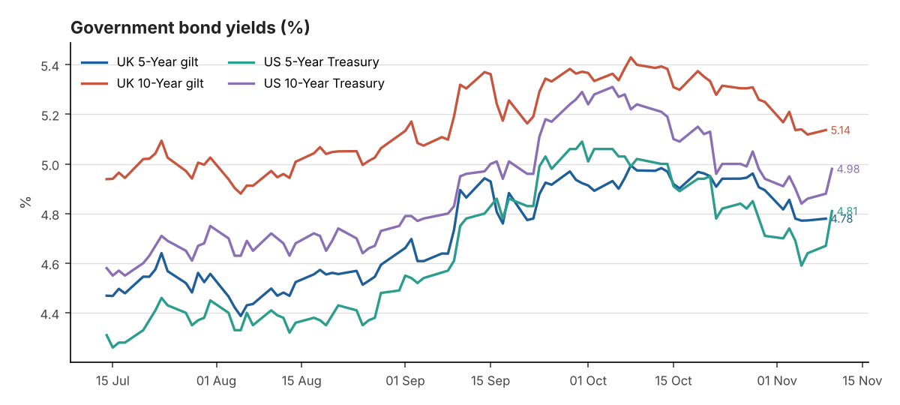
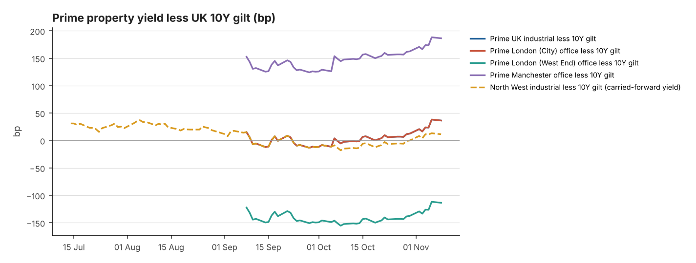

# DAILY FINANCIAL & PROPERTY INVESTMENT BRIEFING

**Date:** 11 November 2026 
**Reporting time:** 08:00 UK time

<small>Generated 2026-11-11 22:27 UTC · run `20261111T222718Z` · commentary: analyst note. Each figure shows its own observation date. Definitions, data-quality notes and full sources are in the appendix.</small>

> **Alerts**
> - Prime yield moves in the last 7 days (Knight Frank Prime Yield Guide, Nov 2026): UK Industrial & Logistics +12.5bp; Prime Distribution Warehouses +12.5bp; South East Industrial +12.5bp; Greater London Industrial +12.5bp; Prime Multi-let Industrial (Rest of UK) +12.5bp; London West End Offices +12.5bp; London City Offices +12.5bp; Manchester Offices +12.5bp; Regional UK Offices +12.5bp.
> - Corporate action — SEGRO: Recommended share offer from Prologis (0.0920 new Prologis shares per SEGRO share, partial cash alternative at 1,031.7p; completion expected H1 2027). Shares trade on deal terms.

## 1. Executive Summary

1. **US inflation surprised higher; yields jumped.** October CPI rose 0.4% m/m (core 0.3%), above consensus. The US 2Y rose 17bp to 4.73% and the 10Y 10bp to 4.98% as December Fed-hike bets rose ([CNBC](https://www.cnbc.com/2026/11/10/cpi-inflation-report-october-2026.html)).
2. **Gilts followed.** The UK 10Y was quoted at 5.21% (+7bp; market quote, as BoE data was unavailable). The prime industrial yield cushion over gilts narrowed to about +29bp from +34bp on 6 November.
3. **Prime yields unchanged since 6 Nov.** Knight Frank's November guide stands: prime distribution 5.50%+ NIY, multi-let estates 5.25–5.50%, regional offices 7.00%+. No newer evidence was found.
4. **Big-box demand holds; North West supply stays thin.** SSS signed 175,356 sq ft at Burton (about 1.75m sq ft taken in 2026). Peel Ports is building 131,730 sq ft in Liverpool, and Aviva's 400,000 sq ft Manchester scheme is back in planning.
5. **SEGRO trades on Prologis deal terms.** The share offer is worth about 895p per SEGRO share, 0.8% below June NTA of 902p. UK share prices are not verified because no licensed London price feed is configured yet.

## 2. Government Bond Yields — UK and US

| Market | Latest Yield | Daily | 7-Day | 30-Day | Observed | Source |
|---|---|---|---|---|---|---|
| UK 5-Year gilt | 4.78% | +0.7bp | -3.7bp | -19.4bp | 09 Nov 2026 | [Bank of England Database (IADB)](https://www.bankofengland.co.uk/boeapps/database/fromshowcolumns.asp?SeriesCodes=IUDSNPY&UsingCodes=Y) |
| UK 10-Year gilt | 5.14% | +1.8bp | -3.1bp | -26.3bp | 09 Nov 2026 | [Bank of England Database (IADB)](https://www.bankofengland.co.uk/boeapps/database/fromshowcolumns.asp?SeriesCodes=IUDMNPY&UsingCodes=Y) |
| US 5-Year Treasury | 4.81% | +14bp | +7bp | -21bp | 10 Nov 2026 | [US Treasury - Daily Treasury Par Yield Curve Rates](https://home.treasury.gov/resource-center/data-chart-center/interest-rates/TextView?type=daily_treasury_yield_curve&field_tdr_date_value=2026) |
| US 10-Year Treasury | 4.98% | +10bp | +3bp | -26bp | 10 Nov 2026 | [US Treasury - Daily Treasury Par Yield Curve Rates](https://home.treasury.gov/resource-center/data-chart-center/interest-rates/TextView?type=daily_treasury_yield_curve&field_tdr_date_value=2026) |
| UK 2-Year gilt | 4.76% ⚠ stale | Not verified | Not verified | Not verified | 05 Nov 2026 | [News report (rallies.ai) of BoE decision-day trading](https://rallies.ai/news/bank-of-england-delivers-first-rate-hike-in-three-years-gilt-yields-rise-6c4ea0b2eeeccedd) *(secondary)* |
| UK 30-Year gilt | 5.63% | Not verified | Not verified | Not verified | 10 Nov 2026 | [Trading Economics](https://tradingeconomics.com/united-kingdom/30-year-bond-yield) *(secondary)* |
| US 2-Year Treasury | 4.73% | +17bp | +12bp | -7bp | 10 Nov 2026 | [US Treasury - Daily Treasury Par Yield Curve Rates](https://home.treasury.gov/resource-center/data-chart-center/interest-rates/TextView?type=daily_treasury_yield_curve&field_tdr_date_value=2026) |
| US 30-Year Treasury | 5.35% | +9bp | +3bp | -25bp | 10 Nov 2026 | [US Treasury - Daily Treasury Par Yield Curve Rates](https://home.treasury.gov/resource-center/data-chart-center/interest-rates/TextView?type=daily_treasury_yield_curve&field_tdr_date_value=2026) |

**10Y less 5Y:** UK +35.7bp (09 Nov 2026) · US +17bp (10 Nov 2026) 
<small>Changes in basis points. † = comparison crosses sources or instruments (indicative).</small>

## 3. Interest Rates — Bank Rate, SONIA and Fed

| Indicator | Latest | Previous | Date | Change | Source |
|---|---|---|---|---|---|
| BoE Bank Rate | 4.00% | 3.75% | effective 05 Nov 2026 | +25bp | [Bank of England Database (IADB)](https://www.bankofengland.co.uk/boeapps/database/fromshowcolumns.asp?SeriesCodes=IUDBEDR&UsingCodes=Y) |
| SONIA (overnight fixing) | 3.9842% | 3.9852% | 09 Nov 2026 | -0.1bp | [FRED IUDSOIA](https://fred.stlouisfed.org/series/IUDSOIA) |
| 5Y SONIA swap (finance-cost reference) | 4.58% ⚠ stale | 4.74% | 04 Nov 2026 | -16bp | [Knight Frank Prime Yield Guide (Macrobond/ICAP)](https://www.knightfrank.co.uk/site-assets/research/report-pdfs/yield-guide/prime-yield-guide-nov-2026.pdf) *(secondary)* |
| Fed funds target range | 3.75–4.00% | 3.50–3.75% | effective 17 Sep 2026 | +25bp | [FRED DFEDTARU](https://fred.stlouisfed.org/series/DFEDTARU) |

**Next MPC decision:** 17 Dec 2026

**Confirmed:**
- Bank Rate 4.00% (since 5 Nov); next MPC decision 17 December.
- Fed range 3.75–4.00%; press reports say markets expect a December Fed hike.

**Not verified:** market-implied pricing for the December MPC.

**Interpretation:** rising US short rates usually lift sterling swaps. The last verified 5Y swap was 4.58% (4 Nov), and fixed-rate debt still costs more than prime industrial yields (negative leverage).

## 4. Inflation — UK and US

| Indicator | Latest | Previous | Period | Trend | Source |
|---|---|---|---|---|---|
| UK CPI (12m) | 3.5% | 3.1% | Sep 2026 (pub. 21 Oct) | Accelerating | [ONS MM23](https://www.ons.gov.uk/economy/inflationandpriceindices/timeseries/d7g7/mm23) |
| UK CPIH (12m) | 3.6% | 3.3% | Sep 2026 (pub. 21 Oct) | Accelerating | [ONS MM23](https://www.ons.gov.uk/economy/inflationandpriceindices/timeseries/l55o/mm23) |
| UK core CPI (12m, ex energy, food, alcohol & tobacco) | 2.8% | 2.6% | Sep 2026 (pub. 21 Oct) | Accelerating | [ONS MM23](https://www.ons.gov.uk/economy/inflationandpriceindices/timeseries/dko8/mm23) |
| US CPI-U (12m, NSA) | 3.7% | 3.4% | Sep 2026 | Accelerating | [BLS CPI via FRED CPIAUCNS](https://fred.stlouisfed.org/series/CPIAUCNS) |
| US core CPI-U (12m, NSA) | 2.6% | 2.4% | Sep 2026 | Broadly stable | [BLS CPI via FRED CPILFENS](https://fred.stlouisfed.org/series/CPILFENS) |

**Next ONS inflation release:** see Section 13

## 5. Prime UK Industrial and Office Investment Yields

| Sector | Latest | Basis | Previous | Move | Evidence | Source |
|---|---|---|---|---|---|---|
| UK Industrial & Logistics | 5.50% | NIY | 5.25–5.50% | +12.5bp | Nov 2026 | [Knight Frank Prime Yield Guide](https://www.knightfrank.co.uk/site-assets/research/report-pdfs/yield-guide/prime-yield-guide-nov-2026.pdf) |
| Prime Distribution Warehouses ‡ | 5.50–5.75% | Not stated | 5.50% | +12.5bp | Nov 2026 | [Knight Frank Prime Yield Guide](https://www.knightfrank.co.uk/site-assets/research/report-pdfs/yield-guide/prime-yield-guide-nov-2026.pdf) |
| South East Industrial ‡ | 5.25–5.50% | Not stated | 5.25% | +12.5bp | Nov 2026 | [Knight Frank Prime Yield Guide](https://www.knightfrank.co.uk/site-assets/research/report-pdfs/yield-guide/prime-yield-guide-nov-2026.pdf) |
| Greater London Industrial | 5.25% | Not stated | 5.00–5.25% | +12.5bp | Nov 2026 | [Knight Frank Prime Yield Guide](https://www.knightfrank.co.uk/site-assets/research/report-pdfs/yield-guide/prime-yield-guide-nov-2026.pdf) |
| Prime Multi-let Industrial (Rest of UK) ‡ | 5.25–5.50% | Not stated | 5.25% | +12.5bp | Nov 2026 | [Knight Frank Prime Yield Guide](https://www.knightfrank.co.uk/site-assets/research/report-pdfs/yield-guide/prime-yield-guide-nov-2026.pdf) |
| North West Industrial ‡ | 5.25% | NIY | — | — | Q4 2025 ⚠ carried forward (315d) | [Knight Frank LOGIC: North West 2025 Review](https://www.knightfrank.co.uk/site-assets/research/report-pdfs/logic/2025-review-nw-industrial.pdf) |
| UK Logistics (average of 71 submarkets) ‡ | 5.74% | NIY | 5.59% | +15bp | Q3 2026 | [Cushman & Wakefield UK Industrial MarketBeat](https://www.cushmanwakefield.com/en/united-kingdom/insights/uk-marketbeat/industrial-marketbeat) |
| London West End Offices | 4.00% | Not stated | 3.75–4.00% | +12.5bp | Nov 2026 | [Knight Frank Prime Yield Guide](https://www.knightfrank.co.uk/site-assets/research/report-pdfs/yield-guide/prime-yield-guide-nov-2026.pdf) |
| London City Offices | 5.50% | Not stated | 5.25–5.50% | +12.5bp | Nov 2026 | [Knight Frank Prime Yield Guide](https://www.knightfrank.co.uk/site-assets/research/report-pdfs/yield-guide/prime-yield-guide-nov-2026.pdf) |
| Manchester Offices ‡ | 7.00% | Not stated | 6.75–7.00% | +12.5bp | Nov 2026 | [Knight Frank Prime Yield Guide](https://www.knightfrank.co.uk/site-assets/research/report-pdfs/yield-guide/prime-yield-guide-nov-2026.pdf) |
| Regional UK Offices ‡ | 7.00% | Not stated | 6.75–7.00% | +12.5bp | Nov 2026 | [Knight Frank Prime Yield Guide](https://www.knightfrank.co.uk/site-assets/research/report-pdfs/yield-guide/prime-yield-guide-nov-2026.pdf) |

<small>Published prime yields, carried forward until new evidence appears — not daily valuations. ‡ = substitution; see appendix.</small>

## 6. Property Yield Spreads Versus UK Gilts

| Spread | Property yield | UK 10Y gilt | Latest spread | At evidence date | Previous comparable | Change (property / gilt) | Driver |
|---|---|---|---|---|---|---|---|
| Prime UK industrial less 10Y gilt | 5.50% (NIY, Nov 2026) | 5.14% (09 Nov) | +36.4bp | +38.2bp | +3.8bp (Oct 2026) | +32.6bp (+12.5bp / +20bp) | Both (reinforcing) |
| Prime London (City) office less 10Y gilt | 5.50% (Not stated, Nov 2026) | 5.14% (09 Nov) | +36.4bp | +38.2bp | +3.8bp (Oct 2026) | +32.6bp (+12.5bp / +20bp) | Both (reinforcing) |
| Prime London (West End) office less 10Y gilt | 4.00% (Not stated, Nov 2026) | 5.14% (09 Nov) | -113.6bp | -111.8bp | -146.2bp (Oct 2026) | +32.6bp (+12.5bp / +20bp) | Both (reinforcing) |
| Prime Manchester office less 10Y gilt | 7.00% (Not stated, Nov 2026) | 5.14% (09 Nov) | +186.4bp | +188.2bp | +153.8bp (Oct 2026) | +32.6bp (+12.5bp / +20bp) | Both (reinforcing) |
| North West industrial less 10Y gilt | 5.25% (NIY, Q4 2025) | 5.14% (09 Nov) | +11.4bp | +78.4bp | Not verified | Not verified | Not verified |

<small>A simple yield gap (property yield midpoint less 10Y gilt) — not a full measure of risk or relative value.</small>

**Market commentary** <small>(confirmed data points are listed in the appendix)</small>

Hotter US inflation drove a front-end-led sell-off: the US 2-year rose 17bp and the 10-year returned to almost 5%. Gilts followed, with the 10-year quoted at 5.21% and the 30-year at 5.63%. Official Bank of England curve data was unavailable, so UK figures after 5 November are market quotes.

UK policy is unchanged at 4.00%. However, with UK CPI at 3.5% and the next print due on 18 November, further tightening looks more plausible, though December pricing is not verified.

No new valuation evidence has appeared since Knight Frank's 6 November guide, so prime yields are carried forward. On a simple yield-gap basis, prime industrial offers about 29bp over gilts. A move back towards 5.4% in the 10-year, the early-October level, would erase that gap and make further outward yield shifts likely in December's agent updates.

Interpretation: bond markets point to continued mild pressure on prime capital values. Returns will depend on rental growth and income, not on yields coming in. Occupier evidence this week, including SSS's 175,000 sq ft letting and long leases at Erith, suggests demand for modern space remains intact. Financing is the swing factor: private lenders are still writing large loans, but at costs above prime yields, which keeps buyer pools narrower and favours equity-rich investors.

## 7. Listed Industrial & Logistics Property Share Prices

| Company | Price | Daily | 5-Day | 1-Month | YTD | Mkt cap | Div. yield | Close | Source |
|---|---|---|---|---|---|---|---|---|---|
| SEGRO (SGRO.L) | Not verified | — | — | — | — | Not verified | — | — | — |
| Tritax Big Box REIT (BBOX.L) | Not verified | — | — | — | — | Not verified | — | — | — |
| LondonMetric Property (LMP.L) | 188.2p | +0.2% | — | — | — | Not verified | 6.7% | 09 Nov | [StockInvest.us; corroborated by AJ Bell last trade 188.2p](https://stockinvest.us/stock-price/LMP.L) *(secondary)* |
| British Land (BLND.L) | Not verified | — | — | — | — | Not verified | — | — | — |
| Landsec (LAND.L) | Not verified | — | — | — | — | Not verified | — | — | — |
| Derwent London (DLN.L) | Not verified | — | — | — | — | Not verified | — | — | — |
| Great Portland Estates (GPE.L) | Not verified | — | — | — | — | Not verified | — | — | — |
| Prologis (PLD) | $130.10 | -0.3% | +0.8% | +0.5% | +1.9% | Not verified | — | 10 Nov | [Nasdaq (official close)](https://www.nasdaq.com/market-activity/stocks/pld/historical) |

*International logistics comparators*

| Company | Price | Daily | 5-Day | 1-Month | YTD | Mkt cap | Div. yield | Close | Source |
|---|---|---|---|---|---|---|---|---|---|
| EastGroup Properties (EGP) | $198.58 | -0.3% | -0.8% | +1.3% | +11.5% | Not verified | — | 10 Nov | [Nasdaq (official close)](https://www.nasdaq.com/market-activity/stocks/egp/historical) |
| First Industrial Realty Trust (FR) | $54.96 | +0.1% | +0.1% | -7.5% | -4.0% | Not verified | — | 10 Nov | [Nasdaq (official close)](https://www.nasdaq.com/market-activity/stocks/fr/historical) |
| Rexford Industrial Realty (REXR) | $37.95 | -1.9% | -0.9% | +3.3% | -2.0% | Not verified | — | 10 Nov | [Nasdaq (official close)](https://www.nasdaq.com/market-activity/stocks/rexr/historical) |
| WDP (Warehouses De Pauw) (WDP.BR) | Not verified | — | — | — | — | Not verified | — | — | — |
| CTP (CTPNV.AS) | Not verified | — | — | — | — | Not verified | — | — | — |

<small>Latest completed trading session before 08:00 UK; end-of-day data, not real-time. London prices are in pence (GBX); US in USD; Euronext in EUR. Changes are share-price returns only, excluding dividends (not total shareholder return). ⚑ = daily move of 3% or more. Market caps from Nasdaq are as at retrieval. Dividend yield = latest annualised dividend from company reports ÷ price, where on file. "Not verified" = no licensed price feed returned data and no cited close is on file.</small>

**SEGRO — Prologis offer look-through:** 0.0920 × Prologis close $130.10 (10 Nov) ÷ $1.3371/£ (06 Nov, FRED) = **895.2p** per SEGRO share in Prologis stock; SEGRO's own price not verified. Partial cash alternative: 1031.7p (capped). <small>The FX rate lags by several days, so this is indicative only.</small>

**Corporate actions on the watchlist**

- **SEGRO** — Listed - in offer period. Recommended share offer from Prologis (0.0920 new Prologis shares per SEGRO share, partial cash alternative at 1,031.7p; completion expected H1 2027). Shares trade on deal terms. ([source](https://www.slaughterandmay.com/recent-work/advising-segro-on-the-recommended-share-offer-by-prologis/))
- **Prologis** — Listed. Acquirer of SEGRO (recommended offer). ([source](https://www.slaughterandmay.com/recent-work/advising-segro-on-the-recommended-share-offer-by-prologis/))
- **WDP (Warehouses De Pauw)** — Listed. Also admitted on Euronext Amsterdam; Euronext information document dated 26 Oct 2026. ([source](https://live.euronext.com/sites/default/files/2026-10/WDP%20Information%20Document%202026%2010%2026.pdf))

## 8. REIT Valuation and Performance Commentary

| Metric | SEGRO | Tritax Big Box REIT | LondonMetric Property | 
|---|---|---|---|
| EPRA NTA per share | 902p | 185.88p | 200.6p | 
| Loan-to-value | 31% | 32.9% | 36.7% | 
| Average cost of debt | 2.8% | 3.6% | 4.0% | 
| WAULT | — | 9.9 yrs | 16+ yrs | 
| Occupancy | 94.5% | 93.5% | 97.4% | 
| Like-for-like rental growth | 5.3% | 5.1% | 5.8% | 
| ERV growth | 1.8% | 1.9% | 3.3% | 
| Development pipeline | £90m potential rent | 507MW secured power | No direct development | 
| Dividend (annualised) | 31.1p | 8.0p | 12.6p | 
| Report basis | [H1 2026 (30 Jun)](https://www.segro.com/media/xlibxjqh/press-release-full-version-final.pdf) | [H1 2026 (30 Jun)](https://www.investegate.co.uk/announcement/rns/tritax-big-box-reit--bbox/half-year-report/9707045) | [FY 2026 (31 Mar)](https://www.investegate.co.uk/announcement/rns/londonmetric-property--lmp/full-year-results-for-the-year-ended-31-march-2026/9578979) | 
| Premium / (discount) to EPRA NTA | Not verified | Not verified | -6.2% <small>(price 09 Nov)</small> | 

<small>Metrics are from each company's latest report (row "Report basis"; some metrics come from later trading updates — full detail in `data/reit_fundamentals.csv`). Share-price dates are shown separately.</small>

Company announcements (last 14 days, routine filings excluded)

| Date | Company | Announcement | Type |
|---|---|---|---|
| 2026-11-05 | DLN | [Third Quarter Business Update](https://www.investegate.co.uk/announcement/rns/derwent-london--dln/third-quarter-business-update-/9859178) | Trading update |
| 2026-11-04 | LMP | [NON-EXECUTIVE DIRECTOR CHANGES](https://www.investegate.co.uk/announcement/rns/londonmetric-property--lmp/non-executive-director-changes/9856840) | Board |
| 2026-11-02 | LMP | [RETIREMENT OF MARTIN MCGANN](https://www.investegate.co.uk/announcement/rns/londonmetric-property--lmp/retirement-of-martin-mcgann/9851889) | Board |
| 2026-10-29 | LAND | [Landsec completes the acquisition of Metrocentre](https://www.investegate.co.uk/announcement/rns/land-securities-group--land/landsec-completes-the-acquisition-of-metrocentre/9848745) | M&A / corporate action |

**Verified:**
- SEGRO: NTA 902p, LTV 31%, cost of debt 2.8% (June 2026).
- Tritax: NTA 185.9p, LTV 32.9%, cost of debt 3.6% (June 2026).
- LondonMetric: NTA 200.6p, LTV 36.7%, cost of debt 4.0% (March 2026). Its October update reported occupancy of 97.4% and WAULT over 16 years.
- US comparators year to date: EastGroup +11.5%, Prologis +1.9%, First Industrial −4.0%, Rexford −2.0%. Drivers not analysed.

**Interpretation:**
- SEGRO now tracks Prologis's share price and sterling, not UK property yields.
- LondonMetric has the highest leverage and cost of debt, so it is the most rate-sensitive of the three. Mostly hedged debt delays the impact until refinancing.
- Gilts, property yields and listed prices tend to move together, but this does not show that one causes the other.

**Next:** LondonMetric half-year results, 24 November: first NTA after the Picton acquisition.

## 9. Top UK Industrial & Logistics Property News

**1. Ecommerce business SSS almost triples footprint at Indurent Park Burton**

`UK INDUSTRIAL` · **▲ 100,000+ sq ft** · **new** · <small>[Property Week](https://www.propertyweek.com/news/e-commerce-business-almost-triples-footprint-at-indurent-park-burton), published 2026-11-10</small>

Super Smart Service (SSS) has signed a 15-year lease on the 175,356 sq ft Unit B173 at Indurent Park Burton, West Midlands, nearly tripling its presence on the park. The unit is EPC A+ and targeting BREEAM Excellent. Indurent says SSS has taken around 1.75m sq ft of UK space this year.

**Why this matters:** One occupier taking about 1.75m sq ft in a year is a material share of UK big-box demand. It supports the case for new-build Grade A space on M6/M1 corridors, which the North West competes for, even as investment yields soften.

Key figures and relevance

- **Key figures:** 175,356 sq ft; 15-year lease; c.1.75m sq ft taken by SSS in 2026; rent not disclosed
- **Relevance:** Big-box take-up by e-commerce on new-build, A-rated stock at a Midlands logistics hub.

**6. L&G and Verdion get green light for £30m Greenwich logistics hub**

`PLANNING / DEVELOPMENT` · 20,000+ sq ft · **new** · <small>[Property Week](https://www.propertyweek.com/markets/industrial-logistics/lg-and-verdion-get-green-light-for-30m-greenwich-log), published 2026-11-11</small>

Legal & General's Industrial Property Investment Fund and Verdion have won consent for LiteHub Greenwich, a £30m multi-let scheme of 78,986 sq ft in six units of 5,555–16,000 sq ft on a 2.6-acre brownfield site in West Thamesmead. Completion is targeted for Q4 2027, aiming for BREEAM Excellent and EPC A+.

Key figures and relevance

- **Key figures:** 78,986 sq ft; 6 units 5,555–16,000 sq ft; £30m; 2.6 acres; ready Q4 2027
- **Relevance:** Institutional capital continuing to back speculative urban multi-let development.

**7. Padrock secures 71,530 sq ft letting of south-east London warehouse**

`UK INDUSTRIAL` · 20,000+ sq ft · **new** · <small>[Property Week](https://www.propertyweek.com/news/padrock-secures-71530-sq-ft-letting-of-south-east-london-unit), published 2026-11-09</small>

Padrock has let Erith Logistics Hub, a 71,530 sq ft single-unit development in south-east London, to tabletop manufacturer Nevilles on a 15-year lease. Nevilles will move from its existing Erith premises in April and use the unit as its headquarters and global distribution centre. Padrock described the market as challenging.

Key figures and relevance

- **Key figures:** 71,530 sq ft; 15-year lease; occupation April 2027; rent not disclosed
- **Relevance:** Long-lease letting of speculative London mid-box space; occupier relocating locally.

## 10. North West Industrial & Logistics News

**2. Glencar progresses construction of bulk storage development for Peel Ports Group**

`NORTH WEST INDUSTRIAL` · **▲ 100,000+ sq ft** · **new** · <small>[TheBusinessDesk.com](https://www.thebusinessdesk.com/northwest/news/2182661-glencar-progresses-construction-of-bulk-storage-develop), published 2026-11-11</small>

Contractor Glencar is building two bulk storage warehouses, Alexandra Warehouses 6 and 7, at Alexandra Dock, Liverpool, for Peel Ports Group. They will provide 131,730 sq ft of internal storage within a wider 249,529 sq ft development including infrastructure and access works, with about 60,000 tonnes of dry-bulk capacity.

**Why this matters:** It is new North West supply above 100,000 sq ft at a time when the region is short of Grade A space. Port-centric storage can relieve inland demand on the M62/M6 corridors, but it is operational space for Peel's own use, not lettable investment stock.

Key figures and relevance

- **Key figures:** 131,730 sq ft storage; 249,529 sq ft wider development; c.60,000 tonnes capacity
- **Relevance:** Port-centric supply adds to constrained Merseyside warehouse stock; owner-occupier development rather than investment stock.

**3. Aviva tables revised plans for 400,000 sq ft Manchester industrial**

`NORTH WEST INDUSTRIAL` · **▲ 100,000+ sq ft** · **new** · <small>[Place North West](https://www.placenorthwest.co.uk/aviva-tables-revised-plans-for-400000-sq-ft-manchester-industrial/), published 2026-11-02</small>

Aviva has submitted revised plans for 400,000 sq ft of industrial space in five units on the former Ferranti factory at Styal Road and Simonsway, near Manchester Airport. A 2023 scheme was refused over Green Belt encroachment and airport safety concerns; the new design has been changed following consultation earlier this year. (Earlier coverage, included in this first news edition.)

**Why this matters:** If approved, this would be one of the largest institutional industrial schemes in Greater Manchester, adding supply to the tight M56 airport sub-market. Its progress will test planning risk for industrial schemes near Green Belt and airport safeguarding zones.

Key figures and relevance

- **Key figures:** 400,000 sq ft across 5 units; site near Manchester Airport; 2023 application refused
- **Relevance:** Potential large-scale institutional-backed supply in the South Manchester / M56 market.

**5. Langtree hands over final £25m phase at Hollinwood Junction**

`NORTH WEST INDUSTRIAL` · **▲ 100,000+ sq ft** · **new** · <small>[Place North West](https://www.placenorthwest.co.uk/langtree-hands-over-final-25m-phase-at-hollinwood-junction/), published 2026-11-03</small>

Russell WBHO has completed 192,000 sq ft of industrial space at Hollinwood Junction, Oldham (M60), forward-funded by Indurent and delivered by Langtree with Oldham Council. The £25m final phase comprises 13 units from about 5,000 sq ft to 42,000 sq ft. (Earlier coverage, included in this first news edition.)

Key figures and relevance

- **Key figures:** 192,000 sq ft; 13 units, 5,000–42,000 sq ft; £25m phase; forward-funded by Indurent
- **Relevance:** New multi-let supply in Greater Manchester; forward funding shows institutional appetite for small/mid-box.

**North West outlook**

There is still no published 2026 North West prime yield. Knight Frank's 5.25% NIY for Manchester (Q4 2025) is carried forward, but sits below the national 5.50%+, so about 5.50% is the realistic working assumption (not verified). Supply remains the region's defining feature: the main new space is port-centric (Peel Ports, Liverpool) or still in planning (Aviva, 400,000 sq ft near Manchester Airport). Hollinwood's 192,000 sq ft completion adds multi-let stock in Oldham. Expect continued rental resilience for Grade A units, and selective, equity-led investment demand. Development viability depends on pre-lets or forward funding while exit yields drift out and build costs stay high, so speculative starts are likely to remain limited in 2027.

## 11. UK Office and Property Investment News

**4. SevenCitiesLdn wins £163m loan against Victoria Street office**

`FINANCE / CAPITAL MARKETS` · **▲ 100,000+ sq ft** · **new** · <small>[Property Week](https://www.propertyweek.com/news/sevencities-wins-163-loan-against-victoria-street-office), published 2026-11-10</small>

SevenCitiesLdn has secured a £163m senior whole loan from Patron Capital to support its £211m acquisition and repositioning of 123 Victoria Street, a fully let 244,000 sq ft office bought from Landsec. The facility comprises a £148m acquisition tranche and £15m for refurbishment, at 70% loan-to-cost and 59% loan-to-projected value.

Key figures and relevance

- **Key figures:** £163m loan; £211m purchase; 244,000 sq ft; 70% LTC; 59% LTV (projected)
- **Relevance:** Evidence that large-ticket office debt is available, from private credit at relatively high leverage.

**8. London leads European investment despite slow recovery, PwC and ULI find**

`PROPERTY INVESTMENT` · **new** · <small>[Property Week](https://www.propertyweek.com/news/london-leads-european-investment-despite-slow-recovery-pwc-and-uli-find), published 2026-11-10</small>

PwC and ULI's Emerging Trends in Real Estate Europe survey of 1,498 professionals keeps London top of the city rankings, but expects recovery to be slower and uneven. Only 45% expect higher profitability in 2027 (50% last year). Construction costs (58%) and interest rates (55%) are the leading concerns for 2027.

Key figures and relevance

- **Key figures:** 1,498 respondents; 45% expect profit growth in 2027 (50% prior); construction costs cited by 58%; interest rates by 55%
- **Relevance:** Sentiment indicator: investor confidence softening as rates and build costs bite.

**9. Seneca acquires Lawnswood Business Park in Leeds**

`PROPERTY INVESTMENT` · **▲ 100,000+ sq ft** · **new** · <small>[Property Week](https://www.propertyweek.com/news/seneca-acquires-lawnswood-business-park), published 2026-11-11</small>

Seneca Property has bought the 150,000 sq ft Lawnswood Business Park, north Leeds, for an undisclosed sum; it was marketed at a £20m guide. The vendor, Hillview Real Estate, paid £26.5m in 2018. The park is 81% let to 17 tenants and will be refurbished into smaller fitted suites.

Key figures and relevance

- **Key figures:** 150,000 sq ft; guide £20m vs £26.5m paid in 2018; 81% occupied; 17 tenants
- **Relevance:** Regional out-of-town office pricing evidence: c.25% below 2018 price on guide basis.

**10. Office owner-occupancy reaches decade high, says Carter Jonas**

`OFFICES` · **new** · <small>[Property Week](https://www.propertyweek.com/markets/offices/office-owner-occupancy-reaches-decade-high-says-carter-jonas), published 2026-11-11</small>

Carter Jonas research shows owner-occupiers took 13.4% of UK office sales by transaction count in 2025, a decade high. Outside London the share rose to 17.8% (2024 to September 2026) from 13.4% (2018–23); in London from 8.5% to 10.6%. It attributes the shift to lower capital values alongside rising rents.

Key figures and relevance

- **Key figures:** 13.4% (2025); regions 17.8% vs 13.4%; London 10.6% vs 8.5%
- **Relevance:** Repriced regional offices are attracting owner-occupier buyers, adding liquidity below institutional lot sizes.

## 12. What This Means for the North West Industrial Market

1. **Pricing and yields.** *Verified:* national prime distribution 5.50%+; North West benchmark 5.25% (Q4 2025). *Interpretation:* appraise North West prime at around 5.50%, and allow 25bp of outward sensitivity while gilts stay above 5.2%.
2. **Rents and demand.** *Verified:* 175k sq ft letting at Burton, and the region's Grade A supply is tight. *Interpretation:* market good modern units on the M62, M6 and M56 with confidence. Prefer longer leases with fixed or indexed uplifts to rent-free incentives.
3. **Viability and supply.** *Verified:* 192k sq ft completed at Hollinwood with forward funding; Aviva's 400k sq ft scheme is still in planning. *Interpretation:* in appraisals, stress-test exit yields at +25 to 50bp. The largest schemes need pre-lets or forward funding to start.
4. **Debt and funding.** *Verified:* 5Y swap 4.58% (4 Nov); Patron lent at 70% loan-to-cost on a London office. *Interpretation:* debt is available but costs more than prime yields. Leveraged buyers will target reversionary or value-add stock.
5. **Appetite.** *Verified:* L&G's industrial fund and Indurent are still funding urban and multi-let schemes. *Interpretation:* the deepest buyer pool is for £10–50m multi-let estates; expect competitive bids for well-let North West lots.

## 13. Upcoming Economic and Property Market Events

| Date | Event |
|---|---|
| Thu 12 Nov | [UK GDP first quarterly estimate Q3 2026 and monthly GDP (September) - 07:00](https://www.ons.gov.uk/releasecalendar) |
| Fri 13 Nov | [US PPI (October) - 13:30 UK](https://www.bls.gov/schedule/news_release/ppi.htm) |
| Tue 17 Nov | [UK labour market overview - 07:00](https://www.ons.gov.uk/releasecalendar) |
| Wed 18 Nov | [UK consumer price inflation (October) - 07:00](https://www.ons.gov.uk/releasecalendar) |

---

## Appendix — Data quality, definitions and sources

Expand: data quality, definitions and full sources

**Confirmed data points used in the commentary**

- UK 10Y gilt 5.14% on 09 Nov 2026: rose 1.8bp on the day, fell 3.1bp over 7 days, fell 26.3bp over 30 days.
- US 10Y Treasury 4.98% on 10 Nov 2026: rose 10bp on the day, rose 3bp over 7 days, fell 26bp over 30 days.
- Bank Rate 4.00% (effective 05 Nov 2026, changed +25bp from 3.75%).
- UK CPI 3.5% in September 2026 (previous 3.1%); trend: Accelerating.
- US CPI 3.7% in September 2026 (previous 3.4%); trend: Accelerating.
- Latest published prime yield movements: UK Industrial & Logistics +12.5bp to 5.50% (Knight Frank Prime Yield Guide, Nov 2026); Prime Distribution Warehouses +12.5bp to 5.50–5.75% (Knight Frank Prime Yield Guide, Nov 2026); South East Industrial +12.5bp to 5.25–5.50% (Knight Frank Prime Yield Guide, Nov 2026); Greater London Industrial +12.5bp to 5.25% (Knight Frank Prime Yield Guide, Nov 2026); Prime Multi-let Industrial (Rest of UK) +12.5bp to 5.25–5.50% (Knight Frank Prime Yield Guide, Nov 2026); UK Logistics (average of 71 submarkets) +15bp to 5.74% (Cushman & Wakefield UK Industrial MarketBeat, Q3 2026); London West End Offices +12.5bp to 4.00% (Knight Frank Prime Yield Guide, Nov 2026); London City Offices +12.5bp to 5.50% (Knight Frank Prime Yield Guide, Nov 2026); Manchester Offices +12.5bp to 7.00% (Knight Frank Prime Yield Guide, Nov 2026); Regional UK Offices +12.5bp to 7.00% (Knight Frank Prime Yield Guide, Nov 2026).

**Retrieval failures and data gaps**

- All automated sources responded.
- UK 2-Year gilt: latest observation (05 Nov 2026) is stale.
- 5Y SONIA swap rate: latest observation (04 Nov 2026) is stale.
- Discrepancy — UK 10-Year gilt, 2026-10-06: 5.34% (Bank of England Database (IADB)) vs 5.42% ([Knight Frank Prime Yield Guide (Macrobond/ICAP)](https://www.knightfrank.co.uk/site-assets/research/report-pdfs/yield-guide/10.-kf-final-october-2026-prime-yield-guide.pdf)), +8.3bp; often a different instrument.
- Discrepancy — UK 10-Year gilt, 2026-11-06: 5.12% (Bank of England Database (IADB)) vs 5.16% ([Trading Economics](https://tradingeconomics.com/united-kingdom/government-bond-yield)), +4.2bp; often a different instrument.

**Property yield substitutions (‡)**

- **Prime Distribution Warehouses:** 15-year lease with open-market rent reviews (KF does not state the yield basis for this row)
- **South East Industrial:** KF South East multi-let estates
- **Prime Multi-let Industrial (Rest of UK):** KF 'Good Modern Rest of UK Estates' used as the prime multi-let proxy
- **North West Industrial:** Manchester prime (units >50,000 sq ft) used for the North West. No 2026 North West prime yield from KF, Savills, CBRE or C&W was found on 9 Nov 2026, so this Q4 2025 figure is carried forward.
- **UK Logistics (average of 71 submarkets):** An average across 71 submarkets, a wider definition than KF's single prime-distribution benchmark. This is why it reads higher.
- **Manchester Offices:** KF 'Major Regional Cities' (10-year lease) is a composite, not Manchester-specific.
- **Regional UK Offices:** KF 'Major Regional Cities' (10-year lease) is a composite, not Manchester-specific.

**Definitions**

- UK gilts from the Bank of England database are fitted nominal par yields; market quotes (e.g. Trading Economics) are benchmark-gilt yields and are labelled secondary. US yields are Treasury constant-maturity par yields.
- Net initial yield (NIY) = net income ÷ gross price including purchaser's costs. Equivalent yield = IRR assuming rent reverts to market at review/expiry. The two are not interchangeable.
- SONIA is the overnight fixing — not term SONIA or SONIA swaps.
- Inflation trend compares the last three monthly readings (±0.15pp threshold). US annual rates are calculated from the BLS NSA index via FRED.
- Share-price changes exclude dividends. 5-day = five trading sessions; 1-month = last close on or before 30 days earlier; YTD = versus the last close of the previous year.
- Correlation between gilts, property yields and listed property prices does not establish causation.

**Analyst sources**

- CNBC, [CPI inflation report: October 2026](https://www.cnbc.com/2026/11/10/cpi-inflation-report-october-2026.html) and [10-year Treasury yield races back to 5%](https://www.cnbc.com/2026/11/10/us-bonds-treasurys-yields.html).
- Trading Economics, [UK 10Y](https://tradingeconomics.com/united-kingdom/government-bond-yield) and [UK 30Y](https://tradingeconomics.com/united-kingdom/30-year-bond-yield) gilt quotes (10 Nov).
- Knight Frank, [Prime Yield Guide November 2026](https://www.knightfrank.co.uk/site-assets/research/report-pdfs/yield-guide/prime-yield-guide-nov-2026.pdf).
- Company results: [SEGRO H1 2026](https://www.segro.com/media/xlibxjqh/press-release-full-version-final.pdf), [Tritax H1 2026](https://www.investegate.co.uk/announcement/rns/tritax-big-box-reit--bbox/half-year-report/9707045), [LondonMetric FY 2026](https://www.investegate.co.uk/announcement/rns/londonmetric-property--lmp/full-year-results-for-the-year-ended-31-march-2026/9578979) and [trading update](https://www.investegate.co.uk/announcement/rns/londonmetric-property--lmp/trading-update/9828217).
- SEGRO offer terms: [Slaughter and May](https://www.slaughterandmay.com/recent-work/advising-segro-on-the-recommended-share-offer-by-prologis/).
- News sources are linked in each story.

<small>Prepared from public sources for professional information; not investment advice. History: `data/observations.csv`, `data/share_prices.csv`, `data/news_log.csv`, `data/announcements.csv`; audit trail: `data/audit_log.csv`.</small>
