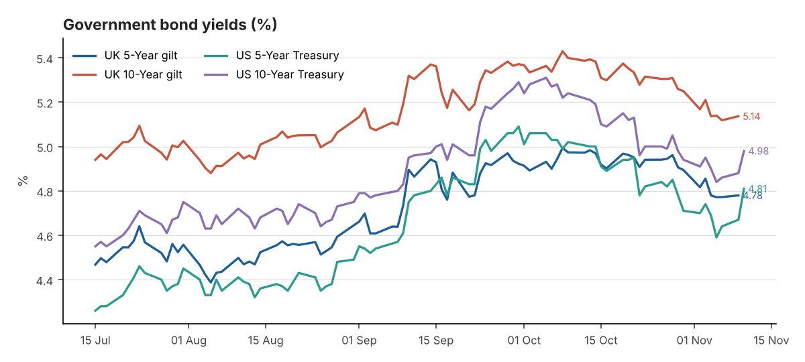
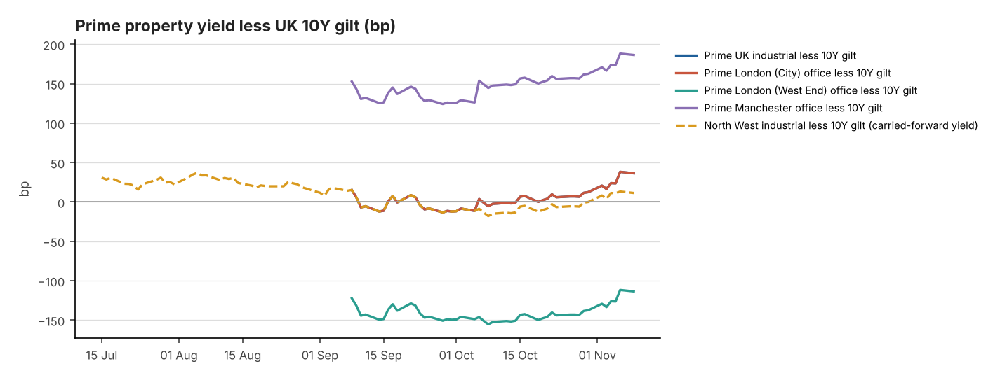

# DAILY FINANCIAL & PROPERTY INVESTMENT BRIEFING

**Date:** 12 November 2026 
**Reporting time:** 06:30 UK time

<small>Generated 2026-11-12 07:31 UTC · run `20261112T073128Z` · commentary: analyst note. Each figure shows its own observation date. Definitions, data-quality notes and full sources are in the appendix.</small>

> **Alerts**
> - Prime yield moves in the last 7 days (Knight Frank Prime Yield Guide, Nov 2026): UK Industrial & Logistics +12.5bp; Prime Distribution Warehouses +12.5bp; South East Industrial +12.5bp; Greater London Industrial +12.5bp; Prime Multi-let Industrial (Rest of UK) +12.5bp; London West End Offices +12.5bp; London City Offices +12.5bp; Manchester Offices +12.5bp; Regional UK Offices +12.5bp.
> - Corporate action — SEGRO: Recommended share offer from Prologis (0.0920 new Prologis shares per SEGRO share, partial cash alternative at 1,031.7p; completion expected H1 2027). Shares trade on deal terms.

## 1. Executive Summary

1. **Development viability is the story of the day.** Berkeley and Birmingham City Council have scrapped the £2.2bn Ladywood regeneration, citing construction and regulatory costs. It is a clear signal that cost inflation is breaking long-dated appraisals ([Property Week](https://www.propertyweek.com/news/birminghams-2-2bn-ladywood-regeneration-plans-canned-over-viability-pressures)).
2. **Grey-belt logistics precedent.** Richborough won outline consent on appeal for up to 700,000 sq ft at M42 J9. It says this is the first major industrial appeal win on grey-belt land since the revised NPPF (4 Nov; not previously reported).
3. **Gilts steady on official data.** The BoE 10Y par yield was 5.14% and the 5Y 4.78% on 9 November. Market quotes for 11 November disagree (5.19% vs 5.23%), so they are not used. US Treasury markets were shut on 11 November for Veterans Day. UK Q3 GDP is out at 07:00 today (consensus +0.7% q/q).
4. **Yield gap holds at about +36bp.** Prime distribution (5.50%+ NIY, Knight Frank, carried forward) less the 10Y gilt. Small-lot regional evidence: Custodian bought an £11m industrial and retail portfolio at a 6.7% NIY.
5. **SEGRO trades above the offer's share value.** SEGRO's 9 November close of 922.6p compares with a look-through of about 895p for the Prologis share offer (Prologis 11 Nov, FX 6 Nov, so the dates differ). The 1,031.7p partial cash alternative is capped. No new company announcements today.

## 2. Government Bond Yields — UK and US

| Market | Latest Yield | Daily | 7-Day | 30-Day | Observed | Source |
|---|---|---|---|---|---|---|
| UK 5-Year gilt | 4.78% | +0.7bp | -3.7bp | -19.4bp | 09 Nov 2026 | [Bank of England Database (IADB)](https://www.bankofengland.co.uk/boeapps/database/fromshowcolumns.asp?SeriesCodes=IUDSNPY&UsingCodes=Y) |
| UK 10-Year gilt | 5.14% | +1.8bp | -3.1bp | -26.3bp | 09 Nov 2026 | [Bank of England Database (IADB)](https://www.bankofengland.co.uk/boeapps/database/fromshowcolumns.asp?SeriesCodes=IUDMNPY&UsingCodes=Y) |
| US 5-Year Treasury | 4.81% | +14bp | +7bp | -21bp | 10 Nov 2026 | [US Treasury - Daily Treasury Par Yield Curve Rates](https://home.treasury.gov/resource-center/data-chart-center/interest-rates/TextView?type=daily_treasury_yield_curve&field_tdr_date_value=2026) |
| US 10-Year Treasury | 4.98% | +10bp | +3bp | -26bp | 10 Nov 2026 | [US Treasury - Daily Treasury Par Yield Curve Rates](https://home.treasury.gov/resource-center/data-chart-center/interest-rates/TextView?type=daily_treasury_yield_curve&field_tdr_date_value=2026) |
| UK 2-Year gilt | 4.76% ⚠ stale | Not verified | Not verified | Not verified | 05 Nov 2026 | [News report (rallies.ai) of BoE decision-day trading](https://rallies.ai/news/bank-of-england-delivers-first-rate-hike-in-three-years-gilt-yields-rise-6c4ea0b2eeeccedd) *(secondary)* |
| UK 30-Year gilt | 5.63% | Not verified | Not verified | Not verified | 10 Nov 2026 | [Trading Economics](https://tradingeconomics.com/united-kingdom/30-year-bond-yield) *(secondary)* |
| US 2-Year Treasury | 4.73% | +17bp | +12bp | -7bp | 10 Nov 2026 | [US Treasury - Daily Treasury Par Yield Curve Rates](https://home.treasury.gov/resource-center/data-chart-center/interest-rates/TextView?type=daily_treasury_yield_curve&field_tdr_date_value=2026) |
| US 30-Year Treasury | 5.35% | +9bp | +3bp | -25bp | 10 Nov 2026 | [US Treasury - Daily Treasury Par Yield Curve Rates](https://home.treasury.gov/resource-center/data-chart-center/interest-rates/TextView?type=daily_treasury_yield_curve&field_tdr_date_value=2026) |

**10Y less 5Y:** UK +35.7bp (09 Nov 2026) · US +17bp (10 Nov 2026) 
<small>Changes in basis points. † = comparison crosses sources or instruments (indicative).</small>

## 3. Interest Rates — Bank Rate, SONIA and Fed

| Indicator | Latest | Previous | Date | Change | Source |
|---|---|---|---|---|---|
| BoE Bank Rate | 4.00% | 3.75% | effective 05 Nov 2026 | +25bp | [Bank of England Database (IADB)](https://www.bankofengland.co.uk/boeapps/database/fromshowcolumns.asp?SeriesCodes=IUDBEDR&UsingCodes=Y) |
| SONIA (overnight fixing) | 3.9842% | 3.9852% | 09 Nov 2026 | -0.1bp | [FRED IUDSOIA](https://fred.stlouisfed.org/series/IUDSOIA) |
| 5Y SONIA swap (finance-cost reference) | 4.58% ⚠ stale | 4.74% | 04 Nov 2026 | -16bp | [Knight Frank Prime Yield Guide (Macrobond/ICAP)](https://www.knightfrank.co.uk/site-assets/research/report-pdfs/yield-guide/prime-yield-guide-nov-2026.pdf) *(secondary)* |
| Fed funds target range | 3.75–4.00% | 3.50–3.75% | effective 17 Sep 2026 | +25bp | [FRED DFEDTARU](https://fred.stlouisfed.org/series/DFEDTARU) |

**Next MPC decision:** 17 Dec 2026

**Confirmed:**
- Bank Rate 4.00%; SONIA 3.98% (9 Nov); next MPC decision 17 December.
- Fed range 3.75–4.00%.
- Today's UK GDP and next week's UK labour market (17 Nov) and CPI (18 Nov) data are the next tests for MPC expectations.

**Not verified:** market-implied pricing for the December MPC.

**Interpretation:** a strong GDP print alongside 3.5% CPI would support a further rise. A weak print would ease pressure on 2–5 year swaps, the base for property debt.

## 4. Inflation — UK and US

| Indicator | Latest | Previous | Period | Trend | Source |
|---|---|---|---|---|---|
| UK CPI (12m) | 3.5% | 3.1% | Sep 2026 (pub. 21 Oct) | Accelerating | [ONS MM23](https://www.ons.gov.uk/economy/inflationandpriceindices/timeseries/d7g7/mm23) |
| UK CPIH (12m) | 3.6% | 3.3% | Sep 2026 (pub. 21 Oct) | Accelerating | [ONS MM23](https://www.ons.gov.uk/economy/inflationandpriceindices/timeseries/l55o/mm23) |
| UK core CPI (12m, ex energy, food, alcohol & tobacco) | 2.8% | 2.6% | Sep 2026 (pub. 21 Oct) | Accelerating | [ONS MM23](https://www.ons.gov.uk/economy/inflationandpriceindices/timeseries/dko8/mm23) |
| US CPI-U (12m, NSA) | 3.7% | 3.4% | Sep 2026 | Accelerating | [BLS CPI via FRED CPIAUCNS](https://fred.stlouisfed.org/series/CPIAUCNS) |
| US core CPI-U (12m, NSA) | 2.6% | 2.4% | Sep 2026 | Broadly stable | [BLS CPI via FRED CPILFENS](https://fred.stlouisfed.org/series/CPILFENS) |

**Next ONS inflation release:** see Section 13

## 5. Prime UK Industrial and Office Investment Yields

| Sector | Latest | Basis | Previous | Move | Evidence | Source |
|---|---|---|---|---|---|---|
| UK Industrial & Logistics | 5.50% | NIY | 5.25–5.50% | +12.5bp | Nov 2026 | [Knight Frank Prime Yield Guide](https://www.knightfrank.co.uk/site-assets/research/report-pdfs/yield-guide/prime-yield-guide-nov-2026.pdf) |
| Prime Distribution Warehouses ‡ | 5.50–5.75% | Not stated | 5.50% | +12.5bp | Nov 2026 | [Knight Frank Prime Yield Guide](https://www.knightfrank.co.uk/site-assets/research/report-pdfs/yield-guide/prime-yield-guide-nov-2026.pdf) |
| South East Industrial ‡ | 5.25–5.50% | Not stated | 5.25% | +12.5bp | Nov 2026 | [Knight Frank Prime Yield Guide](https://www.knightfrank.co.uk/site-assets/research/report-pdfs/yield-guide/prime-yield-guide-nov-2026.pdf) |
| Greater London Industrial | 5.25% | Not stated | 5.00–5.25% | +12.5bp | Nov 2026 | [Knight Frank Prime Yield Guide](https://www.knightfrank.co.uk/site-assets/research/report-pdfs/yield-guide/prime-yield-guide-nov-2026.pdf) |
| Prime Multi-let Industrial (Rest of UK) ‡ | 5.25–5.50% | Not stated | 5.25% | +12.5bp | Nov 2026 | [Knight Frank Prime Yield Guide](https://www.knightfrank.co.uk/site-assets/research/report-pdfs/yield-guide/prime-yield-guide-nov-2026.pdf) |
| North West Industrial ‡ | 5.25% | NIY | — | — | Q4 2025 ⚠ carried forward (316d) | [Knight Frank LOGIC: North West 2025 Review](https://www.knightfrank.co.uk/site-assets/research/report-pdfs/logic/2025-review-nw-industrial.pdf) |
| UK Logistics (average of 71 submarkets) ‡ | 5.74% | NIY | 5.59% | +15bp | Q3 2026 | [Cushman & Wakefield UK Industrial MarketBeat](https://www.cushmanwakefield.com/en/united-kingdom/insights/uk-marketbeat/industrial-marketbeat) |
| London West End Offices | 4.00% | Not stated | 3.75–4.00% | +12.5bp | Nov 2026 | [Knight Frank Prime Yield Guide](https://www.knightfrank.co.uk/site-assets/research/report-pdfs/yield-guide/prime-yield-guide-nov-2026.pdf) |
| London City Offices | 5.50% | Not stated | 5.25–5.50% | +12.5bp | Nov 2026 | [Knight Frank Prime Yield Guide](https://www.knightfrank.co.uk/site-assets/research/report-pdfs/yield-guide/prime-yield-guide-nov-2026.pdf) |
| Manchester Offices ‡ | 7.00% | Not stated | 6.75–7.00% | +12.5bp | Nov 2026 | [Knight Frank Prime Yield Guide](https://www.knightfrank.co.uk/site-assets/research/report-pdfs/yield-guide/prime-yield-guide-nov-2026.pdf) |
| Regional UK Offices ‡ | 7.00% | Not stated | 6.75–7.00% | +12.5bp | Nov 2026 | [Knight Frank Prime Yield Guide](https://www.knightfrank.co.uk/site-assets/research/report-pdfs/yield-guide/prime-yield-guide-nov-2026.pdf) |

<small>Published prime yields, carried forward until new evidence appears — not daily valuations. ‡ = substitution; see appendix.</small>

## 6. Property Yield Spreads Versus UK Gilts

| Spread | Property yield | UK 10Y gilt | Latest spread | At evidence date | Previous comparable | Change (property / gilt) | Driver |
|---|---|---|---|---|---|---|---|
| Prime UK industrial less 10Y gilt | 5.50% (NIY, Nov 2026) | 5.14% (09 Nov) | +36.4bp | +38.2bp | +3.8bp (Oct 2026) | +32.6bp (+12.5bp / +20bp) | Both (reinforcing) |
| Prime London (City) office less 10Y gilt | 5.50% (Not stated, Nov 2026) | 5.14% (09 Nov) | +36.4bp | +38.2bp | +3.8bp (Oct 2026) | +32.6bp (+12.5bp / +20bp) | Both (reinforcing) |
| Prime London (West End) office less 10Y gilt | 4.00% (Not stated, Nov 2026) | 5.14% (09 Nov) | -113.6bp | -111.8bp | -146.2bp (Oct 2026) | +32.6bp (+12.5bp / +20bp) | Both (reinforcing) |
| Prime Manchester office less 10Y gilt | 7.00% (Not stated, Nov 2026) | 5.14% (09 Nov) | +186.4bp | +188.2bp | +153.8bp (Oct 2026) | +32.6bp (+12.5bp / +20bp) | Both (reinforcing) |
| North West industrial less 10Y gilt | 5.25% (NIY, Q4 2025) | 5.14% (09 Nov) | +11.4bp | +78.4bp | Not verified | Not verified | Not verified |

<small>A simple yield gap (property yield midpoint less 10Y gilt) — not a full measure of risk or relative value.</small>

**Market commentary** <small>(confirmed data points are listed in the appendix)</small>

On official data the gilt market has been stable since the Bank of England's hike. The 10-year par yield is 5.14%, 26bp lower over 30 days, and the 5-year is 4.78%. Market quotes for 11 November conflicted, so they are excluded. US Treasuries did not trade on 11 November.

The property news is about cost and viability rather than yields. Berkeley's withdrawal from Ladywood is a residential scheme, but the arithmetic carries over to commercial development. Construction and regulatory costs have risen faster than values, and higher-for-longer rates raise finance costs and exit yields. For industrial, Knight Frank's prime distribution yield of 5.50%+ is 25bp higher than in the summer, and more if measured from early 2025, while build costs have not fallen.

There are two partial offsets. Planning: Richborough's grey-belt appeal win at the M42 suggests the revised NPPF can unlock logistics land. If repeated, that improves land supply and lowers land-promotion risk. Demand: pre-lets such as DHL's conditional 420,000 sq ft at Ansty show occupiers will commit early, which makes large schemes fundable.

Interpretation: bond markets are not adding new pressure this week, but they are not easing appraisal maths either. Expect developers to prioritise pre-let and forward-funded schemes, and investors to price smaller regional lots at 6.5–7% NIY, as in Custodian's portfolio.

## 7. Listed Industrial & Logistics Property Share Prices

| Company | Price | Daily | 5-Day | 1-Month | YTD | Mkt cap | Div. yield | Close | Source |
|---|---|---|---|---|---|---|---|---|---|
| SEGRO (SGRO.L) | 922.6p | — | — | — | — | Not verified | 3.4% | 09 Nov | [StockInvest.us (single dated source)](https://stockinvest.us/stock-price/SGRO.L) *(secondary)* |
| Tritax Big Box REIT (BBOX.L) | 145.4p | — | — | — | — | Not verified | 5.5% | 27 Oct ⚠ stale | [Kalkine Media (dated 27 Oct 2026; single source)](https://kalkinemedia.com/uk/stocks/retail/what-tritax-big-box-reit-lsebbox-says-about-the-current-retail-stocks-story) *(secondary)* |
| LondonMetric Property (LMP.L) | 188.2p | +0.2% | — | — | — | Not verified | 6.7% | 09 Nov | [StockInvest.us; corroborated by AJ Bell last trade 188.2p](https://stockinvest.us/stock-price/LMP.L) *(secondary)* |
| British Land (BLND.L) | Not verified | — | — | — | — | Not verified | — | — | — |
| Landsec (LAND.L) | 659.0p | — | — | — | — | Not verified | — | 27 Oct ⚠ stale | [Kalkine Media (dated 27 Oct 2026; single source)](https://kalkinemedia.com/uk/stocks/industrial/land-securities-lseland-leads-a-fresh-market-look-at-industrial-stocks) *(secondary)* |
| Derwent London (DLN.L) | Not verified | — | — | — | — | Not verified | — | — | — |
| Great Portland Estates (GPE.L) | Not verified | — | — | — | — | Not verified | — | — | — |
| Prologis (PLD) | $130.03 | -0.1% | -1.0% | -1.8% | +1.9% | Not verified | — | 11 Nov | [Nasdaq (official close)](https://www.nasdaq.com/market-activity/stocks/pld/historical) |

*International logistics comparators*

| Company | Price | Daily | 5-Day | 1-Month | YTD | Mkt cap | Div. yield | Close | Source |
|---|---|---|---|---|---|---|---|---|---|
| EastGroup Properties (EGP) | $197.94 | -0.3% | -1.5% | +0.2% | +11.1% | Not verified | — | 11 Nov | [Nasdaq (official close)](https://www.nasdaq.com/market-activity/stocks/egp/historical) |
| First Industrial Realty Trust (FR) | $55.26 | +0.6% | -0.5% | -8.0% | -3.5% | Not verified | — | 11 Nov | [Nasdaq (official close)](https://www.nasdaq.com/market-activity/stocks/fr/historical) |
| Rexford Industrial Realty (REXR) | $37.83 | -0.3% | -3.6% | +0.8% | -2.3% | Not verified | — | 11 Nov | [Nasdaq (official close)](https://www.nasdaq.com/market-activity/stocks/rexr/historical) |
| WDP (Warehouses De Pauw) (WDP.BR) | Not verified | — | — | — | — | Not verified | — | — | — |
| CTP (CTPNV.AS) | Not verified | — | — | — | — | Not verified | — | — | — |

<small>Latest completed trading session before the 06:30 UK briefing; end-of-day data, not real-time. London prices are in pence (GBX); US in USD; Euronext in EUR. Changes are share-price returns only, excluding dividends (not total shareholder return). ⚑ = daily move of 3% or more. Market caps from Nasdaq are as at retrieval. Dividend yield = latest annualised dividend from company reports ÷ price, where on file. "Not verified" = no licensed price feed returned data and no cited close is on file.</small>

**SEGRO — Prologis offer look-through:** 0.0920 × Prologis close $130.03 (11 Nov) ÷ $1.3371/£ (06 Nov, FRED) = **894.7p** per SEGRO share in Prologis stock, vs SEGRO close 922.6p (-3.0% offer spread). Partial cash alternative: 1031.7p (capped). <small>The FX rate lags by several days, so this is indicative only.</small>

**Corporate actions on the watchlist**

- **SEGRO** — Listed - in offer period. Recommended share offer from Prologis (0.0920 new Prologis shares per SEGRO share, partial cash alternative at 1,031.7p; completion expected H1 2027). Shares trade on deal terms. ([source](https://www.slaughterandmay.com/recent-work/advising-segro-on-the-recommended-share-offer-by-prologis/))
- **Prologis** — Listed. Acquirer of SEGRO (recommended offer). ([source](https://www.slaughterandmay.com/recent-work/advising-segro-on-the-recommended-share-offer-by-prologis/))
- **WDP (Warehouses De Pauw)** — Listed. Also admitted on Euronext Amsterdam; Euronext information document dated 26 Oct 2026. ([source](https://live.euronext.com/sites/default/files/2026-10/WDP%20Information%20Document%202026%2010%2026.pdf))

## 8. REIT Valuation and Performance Commentary

| Metric | SEGRO | Tritax Big Box REIT | LondonMetric Property | 
|---|---|---|---|
| EPRA NTA per share | 902p | 185.88p | 200.6p | 
| Loan-to-value | 31% | 32.9% | 36.7% | 
| Average cost of debt | 2.8% | 3.6% | 4.0% | 
| WAULT | — | 9.9 yrs | 16+ yrs | 
| Occupancy | 94.5% | 93.5% | 97.4% | 
| Like-for-like rental growth | 5.3% | 5.1% | 5.8% | 
| ERV growth | 1.8% | 1.9% | 3.3% | 
| Development pipeline | £90m potential rent | 507MW secured power | No direct development | 
| Dividend (annualised) | 31.1p | 8.0p | 12.6p | 
| Report basis | [H1 2026 (30 Jun)](https://www.segro.com/media/xlibxjqh/press-release-full-version-final.pdf) | [H1 2026 (30 Jun)](https://www.investegate.co.uk/announcement/rns/tritax-big-box-reit--bbox/half-year-report/9707045) | [FY 2026 (31 Mar)](https://www.investegate.co.uk/announcement/rns/londonmetric-property--lmp/full-year-results-for-the-year-ended-31-march-2026/9578979) | 
| Premium / (discount) to EPRA NTA | +2.3% <small>(price 09 Nov)</small> | -21.8% <small>(price 27 Oct)</small> | -6.2% <small>(price 09 Nov)</small> | 

<small>Metrics are from each company's latest report (row "Report basis"; some metrics come from later trading updates — full detail in `data/reit_fundamentals.csv`). Share-price dates are shown separately.</small>

Company announcements (last 14 days, routine filings excluded)

| Date | Company | Announcement | Type |
|---|---|---|---|
| 2026-11-05 | DLN | [Third Quarter Business Update](https://www.investegate.co.uk/announcement/rns/derwent-london--dln/third-quarter-business-update-/9859178) | Trading update |
| 2026-11-04 | LMP | [NON-EXECUTIVE DIRECTOR CHANGES](https://www.investegate.co.uk/announcement/rns/londonmetric-property--lmp/non-executive-director-changes/9856840) | Board |
| 2026-11-02 | LMP | [RETIREMENT OF MARTIN MCGANN](https://www.investegate.co.uk/announcement/rns/londonmetric-property--lmp/retirement-of-martin-mcgann/9851889) | Board |
| 2026-10-29 | LAND | [Landsec completes the acquisition of Metrocentre](https://www.investegate.co.uk/announcement/rns/land-securities-group--land/landsec-completes-the-acquisition-of-metrocentre/9848745) | M&A / corporate action |

**Verified:**
- No new SEGRO, Tritax or LondonMetric announcements since yesterday.
- Latest cited closes: SEGRO 922.6p (9 Nov), 2.3% above June NTA of 902p; LondonMetric 188.2p (9 Nov), 6.2% below March NTA. Tritax's latest cited close is 145.4p (27 Oct, stale), 21.8% below June NTA.
- Prologis closed at $130.03 on 11 November (−0.1%).

**Interpretation:**
- SEGRO trading above the share-offer look-through could reflect the 1,031.7p cash alternative, dividends due before completion, or simply the mismatched price dates. Treat the gap as indicative.
- Tritax's apparent discount uses a stale price and should be refreshed before drawing conclusions.
- Correlation between gilts and listed REIT prices does not establish cause.

**Next:** LondonMetric half-year results on 24 November.

## 9. Top UK Industrial & Logistics Property News

**1. Birmingham's £2.2bn Ladywood regeneration plans axed over viability pressures**

`PLANNING / DEVELOPMENT` · **new** · <small>[Property Week](https://www.propertyweek.com/news/birminghams-2-2bn-ladywood-regeneration-plans-canned-over-viability-pressures), published 2026-11-11</small>

Berkeley Group and Birmingham City Council have terminated the development agreement for the £2.2bn Ladywood Estate regeneration, a 148-acre, 20-year scheme for more than 10,000 homes. They cite increased construction and regulatory costs and a more challenged housing market and economy as putting significant pressure on viability.

**Why this matters:** When a developer of Berkeley's scale walks away on viability, it shows that build costs and rates are breaking long-dated appraisals. The same pressures apply to speculative industrial schemes: exit yields are drifting out while costs stay high, so more projects will need pre-lets or forward funding to proceed.

Key figures and relevance

- **Key figures:** £2.2bn; 148 acres; 10,000+ homes; c.20% affordable; 20-year programme
- **Relevance:** Viability failure on a flagship scheme; cost inflation is breaking development appraisals.

**2. Richborough Commercial secures major appeal win on M42 corridor scheme**

`UK INDUSTRIAL` · **▲ 100,000+ sq ft** · **new** · <small>[Property Week](https://www.propertyweek.com/news/richborough-commercial-secures-major-appeal-win-on-m42-corridor), published 2026-11-04</small>

Richborough Commercial has won outline consent at appeal for up to 700,000 sq ft of B2/B8 floorspace near M42 Junction 9 in North Warwickshire, after appealing against non-determination of a June 2024 application. Richborough says it is the first appeal allowing a major industrial and logistics scheme on grey-belt land since the revised NPPF in August. (Published before the last briefing but not previously reported.)

**Why this matters:** A first grey-belt appeal win for logistics could unlock land supply around constrained cores, including Green Belt-heavy Greater Manchester and Cheshire. That raises land-value expectations for promoters but should, over time, ease the supply shortage that has supported North West rents.

Key figures and relevance

- **Key figures:** Up to 700,000 sq ft B2/B8; M42 J9; outline consent on appeal; grey-belt land
- **Relevance:** Planning precedent for logistics on grey-belt land.

**3. BARJANE submits plans for 420,000 sq ft DHL warehouse**

`UK INDUSTRIAL` · **▲ 100,000+ sq ft** · **new** · <small>[Property Week](https://www.propertyweek.com/news/barjane-submits-plans-for-420000-sq-ft-dhl-warehouse), published 2026-11-04</small>

BARJANE has applied for a 420,000 sq ft logistics scheme at Ansty, Coventry, next to Frasers Group's approved 3.3m sq ft headquarters. DHL Supply Chain has agreed to occupy the BREEAM Outstanding, EPC A warehouse if planning permission is granted, giving the scheme a conditional pre-let at the M6/M69 junction. (Published before the last briefing but not previously reported.)

**Why this matters:** Big-box demand is turning into pre-let development rather than speculative space. This is the route North West schemes above 300,000 sq ft are likely to need while exit yields sit at 5.50%+.

Key figures and relevance

- **Key figures:** 420,000 sq ft; conditional pre-let to DHL Supply Chain; Ansty, Coventry; BREEAM Outstanding target
- **Relevance:** Large-format 3PL demand being met by pre-let development rather than existing stock.

## 10. North West Industrial & Logistics News

**6. Bolton pursues legal challenge into national planning changes**

`PLANNING / DEVELOPMENT` · **new** · <small>[Place North West](https://www.placenorthwest.co.uk/bolton-pursues-legal-challenge-into-national-planning-changes/), published 2026-11-11</small>

Bolton Council has complied 'under protest' with the National Scheme of Delegation, which makes planning officers the default decision-makers for most applications. It voted to cost a judicial review and to write to all English planning authorities seeking a coordinated legal challenge against the government.

Key figures and relevance

- **Key figures:** Applies to most planning applications; judicial review being costed
- **Relevance:** Planning-process uncertainty in Greater Manchester; delegation should speed routine industrial consents if upheld.

**7. £2bn Manchester-Sheffield tunnel gets funding boost**

`PLANNING / DEVELOPMENT` · **new** · <small>[Place North West](https://www.placenorthwest.co.uk/2bn-manchester-sheffield-tunnel-gets-funding-boost/), published 2026-11-11</small>

Future Works Infrastructure's Trans-Pennine Connect, a proposed 14-mile tolled dual carriageway with a tunnel between Manchester and Sheffield, has received £500,000 from the UK Dynamism Fund for feasibility work. The scheme, estimated at £2bn, would be funded by tolls and private or local-authority investors rather than central government.

Key figures and relevance

- **Key figures:** £500,000 feasibility funding; 14-mile route; c.£2bn estimated cost
- **Relevance:** Long-term trans-Pennine connectivity for logistics east of Greater Manchester; early-stage only.

**8. B&Q to cut 63,000 sq ft in Bolton as it looks to right-size**

`PLANNING / DEVELOPMENT` · **▲ 100,000+ sq ft** · **new** · <small>[Place North West](https://www.placenorthwest.co.uk/bq-to-cut-63000-sq-ft-in-bolton-as-it-looks-to-right-size/), published 2026-11-11</small>

BNP Paribas has applied to subdivide B&Q's 137,000 sq ft Kay Street store in Bolton into three units, cutting B&Q's space by 63,000 sq ft. Aldi would take a new 20,000 sq ft store, relocating from Higher Bridge Street, using space currently occupied by B&Q's Trade Point facility.

Key figures and relevance

- **Key figures:** 137,000 sq ft store; B&Q to give up 63,000 sq ft; 20,000 sq ft Aldi
- **Relevance:** Retail-warehouse right-sizing in Greater Manchester; large-box space being recycled to discount food.

**9. Mansell collapsed with debts of £4.2m**

`PLANNING / DEVELOPMENT` · **new** · <small>[Place North West](https://www.placenorthwest.co.uk/mansell-collapsed-with-debts-of-4-2m/), published 2026-11-11</small>

An administrator's report from RSM shows Oldham-based off-site construction specialist Mansell Building Solutions collapsed with debts of £4.2m, including £1.3m owed to NatWest. It entered administration in August after 36 years, citing the cost of relocating its headquarters to Oldham, Covid's impact on revenues and planning delays. Creditors include steel-framing supplier Voestalpine Metsec (£550,000).

Key figures and relevance

- **Key figures:** Debts £4.2m; £1.3m owed to NatWest; Voestalpine Metsec £550,000; CCF £220,000
- **Relevance:** Supply-chain fragility in North West construction; contractor insolvency risk for developers.

**10. Meanwhile use put forward ahead of £250m Crompton Place regen**

`PLANNING / DEVELOPMENT` · **new** · <small>[Place North West](https://www.placenorthwest.co.uk/meanwhile-use-put-forward-ahead-of-250m-crompton-place-regen/), published 2026-11-11</small>

Bolton Council plans street-food markets, a big screen and an urban garden on the Victoria Square frontage of the former Crompton Place shopping centre once it is demolished, as MEPC (part of Federated Hermes) leads a £250m regeneration. CBRE and Chapman Taylor designed the meanwhile-use strategy to keep the area active during redevelopment.

Key figures and relevance

- **Key figures:** £250m regeneration; MEPC/Federated Hermes; meanwhile use by CBRE and Chapman Taylor
- **Relevance:** Institutional-backed town-centre regeneration in Greater Manchester; retail space being repurposed.

**All Place North West headlines since the last briefing** <small>(Wed 11 Nov 06:00 onwards; stories summarised above are not repeated; industrial items first)</small>

| Published | Headline | |
|---|---|---|
| Wed 15:14 | [Manchester to splash £4.5m on Holt Town land assembly](https://www.placenorthwest.co.uk/manchester-to-splash-4-5m-on-holt-town-land-assembly/) |  |
| Wed 13:57 | [Trio of major Manchester projects to go back under the microscope](https://www.placenorthwest.co.uk/trio-of-major-manchester-projects-to-go-back-under-the-microscope/) |  |
| Wed 11:49 | [Taylor Wimpey plans 275 homes in Wirral](https://www.placenorthwest.co.uk/taylor-wimpey-plans-275-homes-in-wirral/) |  |
| Wed 11:32 | [Powers to tackle plague of vacant shops approved in Westmorland](https://www.placenorthwest.co.uk/powers-to-tackle-plague-of-vacant-shops-approved-in-westmorland/) |  |
| Wed 11:14 | [Rapleys acquires Northmill Associates](https://www.placenorthwest.co.uk/rapleys-acquires-northmill-associates/) |  |
| Wed 08:20 | [Merebridge takes over 194-flat Liverpool project from Ascot](https://www.placenorthwest.co.uk/merebridge-takes-over-194-flat-liverpool-scheme-from-ascot/) |  |

**North West outlook**

There was no significant new North West industrial transaction in the past 24 hours. Regionally, the news is about planning process. Bolton is challenging national rules that make officers the default decision-makers; if upheld, those rules should speed routine consents. Larger B2/B8 schemes on Green Belt edges could benefit from the grey-belt precedent set at the M42. B&Q's planned subdivision of its 137,000 sq ft Bolton store shows large retail boxes being recycled. The collapse of Oldham contractor Mansell (£4.2m debts) is a reminder to check contractor covenants on development deals. Pricing: the Manchester prime industrial benchmark (5.25%, Q4 2025) is still stale; about 5.50% remains the working assumption (not verified). Equity-led buyers will favour reversionary multi-let estates.

## 11. UK Office and Property Investment News

**4. Custodian REIT acquires £11m portfolio from syndicated investment vehicles**

`PROPERTY INVESTMENT` · **new** · <small>[Property Week](https://www.propertyweek.com/news/custodian-reit-acquires-11m-portfolio-from-syndicated-investment-vehicles), published 2026-11-09</small>

Custodian Property Income REIT has bought eight fully let retail and industrial properties, mainly in the East Midlands, for £11m from syndicates managed by Lincoln Property Syndicates. The £800,000 rent reflects a 6.7% net initial yield and 7.2% reversionary yield, funded largely by issuing 10.6m new shares plus £400,000 cash. (Published before the last briefing but not previously reported.)

Key figures and relevance

- **Key figures:** £11m; 8 assets; NIY 6.7%; reversionary yield 7.2%; WAULT 6 yrs; avg lot £1.4m
- **Relevance:** Pricing evidence for small-lot regional industrial/retail: c.6.7% NIY.

**5. Criterion snaps up New London House for 500-room hotel conversion**

`OFFICES` · 20,000+ sq ft · **new** · <small>[Property Week](https://www.propertyweek.com/news/criterion-snaps-up-new-london-house-for-500-room-hotel-conversion), published 2026-11-10</small>

Criterion Capital's Zedwell Hotels has bought New London House, an 89,722 sq ft office on Fenchurch Street in the City, from Whitbread for an undisclosed sum, and plans to convert it into a 509-room hotel. Zedwell says it targets structurally sound, well-located buildings where conversion unlocks value. (Published before the last briefing but not previously reported.)

Key figures and relevance

- **Key figures:** 89,722 sq ft office; 509-room hotel conversion; price undisclosed
- **Relevance:** Continued removal of secondary City office stock via change of use.

## 12. What This Means for the North West Industrial Market

1. **Pricing and yields.** *Verified:* national prime 5.50%+ NIY; small-lot regional evidence 6.7% NIY (Custodian). *Interpretation:* in investment advice, separate prime (about 5.50%) from secondary multi-let (6.5–7%). Use the gap to position value-add stock for buyers.
2. **Rents and demand.** *Verified:* DHL is committing to 420k sq ft through a conditional pre-let. *Interpretation:* occupiers with large requirements will commit early, so market North West land and design-and-build options to 3PLs now rather than waiting for speculative completions.
3. **Viability and supply.** *Verified:* Ladywood was axed over costs, and grey belt won on appeal at the M42. *Interpretation:* in appraisals, stress-test build costs at +5–10% and exit yields at +25bp. Grey-belt sites near the M6, M56 and M62 may become viable planning plays, so review land options.
4. **Debt and funding.** *Verified:* 10Y gilt 5.14%; 5Y swap 4.58% (4 Nov, stale). *Interpretation:* debt remains more expensive than prime yields. Forward funding from institutions such as Indurent and L&G is the more realistic route for North West speculative schemes than bank development debt.
5. **Appetite.** *Verified:* Custodian is using its shares to buy small regional lots, and Prologis is absorbing SEGRO. *Interpretation:* listed and institutional buyers are selective but active. Well-let North West multi-let lots of £1–10m should find REIT and private buyers at 6.5%+ NIY.

## 13. Upcoming Economic and Property Market Events

| Date | Event |
|---|---|
| Thu 12 Nov | [UK GDP first quarterly estimate Q3 2026 and monthly GDP (September) - 07:00](https://www.ons.gov.uk/releasecalendar) |
| Fri 13 Nov | [US PPI (October) - 13:30 UK](https://www.bls.gov/schedule/news_release/ppi.htm) |
| Tue 17 Nov | [UK labour market overview - 07:00](https://www.ons.gov.uk/releasecalendar) |
| Wed 18 Nov | [UK consumer price inflation (October) - 07:00](https://www.ons.gov.uk/releasecalendar) |

---

## Appendix — Data quality, definitions and sources

Expand: data quality, definitions and full sources

**Confirmed data points used in the commentary**

- UK 10Y gilt 5.14% on 09 Nov 2026: rose 1.8bp on the day, fell 3.1bp over 7 days, fell 26.3bp over 30 days.
- US 10Y Treasury 4.98% on 10 Nov 2026: rose 10bp on the day, rose 3bp over 7 days, fell 26bp over 30 days.
- Bank Rate 4.00% (effective 05 Nov 2026, changed +25bp from 3.75%).
- UK CPI 3.5% in September 2026 (previous 3.1%); trend: Accelerating.
- US CPI 3.7% in September 2026 (previous 3.4%); trend: Accelerating.
- Latest published prime yield movements: UK Industrial & Logistics +12.5bp to 5.50% (Knight Frank Prime Yield Guide, Nov 2026); Prime Distribution Warehouses +12.5bp to 5.50–5.75% (Knight Frank Prime Yield Guide, Nov 2026); South East Industrial +12.5bp to 5.25–5.50% (Knight Frank Prime Yield Guide, Nov 2026); Greater London Industrial +12.5bp to 5.25% (Knight Frank Prime Yield Guide, Nov 2026); Prime Multi-let Industrial (Rest of UK) +12.5bp to 5.25–5.50% (Knight Frank Prime Yield Guide, Nov 2026); UK Logistics (average of 71 submarkets) +15bp to 5.74% (Cushman & Wakefield UK Industrial MarketBeat, Q3 2026); London West End Offices +12.5bp to 4.00% (Knight Frank Prime Yield Guide, Nov 2026); London City Offices +12.5bp to 5.50% (Knight Frank Prime Yield Guide, Nov 2026); Manchester Offices +12.5bp to 7.00% (Knight Frank Prime Yield Guide, Nov 2026); Regional UK Offices +12.5bp to 7.00% (Knight Frank Prime Yield Guide, Nov 2026).

**Retrieval failures and data gaps**

- All automated sources responded.
- UK 2-Year gilt: latest observation (05 Nov 2026) is stale.
- 5Y SONIA swap rate: latest observation (04 Nov 2026) is stale.
- USD per GBP: latest observation (06 Nov 2026) is stale.
- Discrepancy — UK 10-Year gilt, 2026-10-06: 5.34% (Bank of England Database (IADB)) vs 5.42% ([Knight Frank Prime Yield Guide (Macrobond/ICAP)](https://www.knightfrank.co.uk/site-assets/research/report-pdfs/yield-guide/10.-kf-final-october-2026-prime-yield-guide.pdf)), +8.3bp; often a different instrument.
- Discrepancy — UK 10-Year gilt, 2026-11-06: 5.12% (Bank of England Database (IADB)) vs 5.16% ([Trading Economics](https://tradingeconomics.com/united-kingdom/government-bond-yield)), +4.2bp; often a different instrument.

**Property yield substitutions (‡)**

- **Prime Distribution Warehouses:** 15-year lease with open-market rent reviews (KF does not state the yield basis for this row)
- **South East Industrial:** KF South East multi-let estates
- **Prime Multi-let Industrial (Rest of UK):** KF 'Good Modern Rest of UK Estates' used as the prime multi-let proxy
- **North West Industrial:** Manchester prime (units >50,000 sq ft) used for the North West. No 2026 North West prime yield from KF, Savills, CBRE or C&W was found on 9 Nov 2026, so this Q4 2025 figure is carried forward.
- **UK Logistics (average of 71 submarkets):** An average across 71 submarkets, a wider definition than KF's single prime-distribution benchmark. This is why it reads higher.
- **Manchester Offices:** KF 'Major Regional Cities' (10-year lease) is a composite, not Manchester-specific.
- **Regional UK Offices:** KF 'Major Regional Cities' (10-year lease) is a composite, not Manchester-specific.

**Definitions**

- UK gilts from the Bank of England database are fitted nominal par yields; market quotes (e.g. Trading Economics) are benchmark-gilt yields and are labelled secondary. US yields are Treasury constant-maturity par yields.
- Net initial yield (NIY) = net income ÷ gross price including purchaser's costs. Equivalent yield = IRR assuming rent reverts to market at review/expiry. The two are not interchangeable.
- SONIA is the overnight fixing — not term SONIA or SONIA swaps.
- Inflation trend compares the last three monthly readings (±0.15pp threshold). US annual rates are calculated from the BLS NSA index via FRED.
- Share-price changes exclude dividends. 5-day = five trading sessions; 1-month = last close on or before 30 days earlier; YTD = versus the last close of the previous year.
- Correlation between gilts, property yields and listed property prices does not establish causation.

**Analyst sources**

- Property Week: [Ladywood axed](https://www.propertyweek.com/news/birminghams-2-2bn-ladywood-regeneration-plans-canned-over-viability-pressures), [Richborough M42 appeal](https://www.propertyweek.com/news/richborough-commercial-secures-major-appeal-win-on-m42-corridor), [BARJANE/DHL](https://www.propertyweek.com/news/barjane-submits-plans-for-420000-sq-ft-dhl-warehouse), [Custodian](https://www.propertyweek.com/news/custodian-reit-acquires-11m-portfolio-from-syndicated-investment-vehicles).
- Place North West: [Bolton planning challenge](https://www.placenorthwest.co.uk/bolton-pursues-legal-challenge-into-national-planning-changes/), [B&Q Bolton](https://www.placenorthwest.co.uk/bq-to-cut-63000-sq-ft-in-bolton-as-it-looks-to-right-size/).
- FXStreet, [UK GDP Q3 preview](https://www.fxstreet.com/news/uk-gdp-is-set-to-show-that-the-economy-continued-growing-in-q3-202611120300) (consensus 0.7% q/q).
- Trading Economics and Streamline Feed: conflicting 11 Nov UK 10Y quotes (5.23% vs 5.19%), not used.
- Knight Frank, [Prime Yield Guide November 2026](https://www.knightfrank.co.uk/site-assets/research/report-pdfs/yield-guide/prime-yield-guide-nov-2026.pdf).
- Share prices: StockInvest.us, AJ Bell and Kalkine, as cited in the share table (secondary).

<small>Prepared from public sources for professional information; not investment advice. History: `data/observations.csv`, `data/share_prices.csv`, `data/news_log.csv`, `data/announcements.csv`; audit trail: `data/audit_log.csv`.</small>
