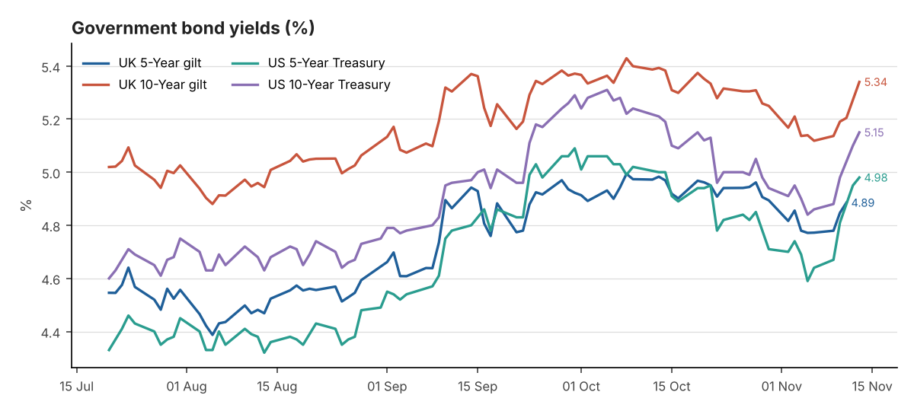
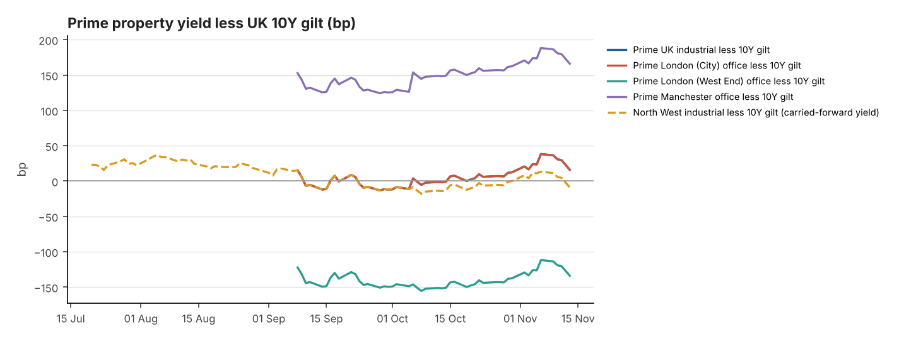

# DAILY FINANCIAL & PROPERTY INVESTMENT BRIEFING

**Date:** 16 November 2026 
**Reporting time:** 06:30 UK time

<small>Generated 2026-11-16 06:30 UTC · run `20261116T063036Z` · commentary: analyst note. Each figure shows its own observation date. Definitions, data-quality notes and full sources are in the appendix.</small>

> **Alerts**
> - New listings: Today's listings sweep did not complete.
> - Corporate action — SEGRO: Recommended share offer from Prologis (0.0920 new Prologis shares per SEGRO share, partial cash alternative at 1,031.7p; completion expected H1 2027). Shares trade on deal terms.

## 1. Executive Summary

1. **Gilts sold off on Friday.** The 2Y reached about 5.0%, its highest since October 2023 (LSEG via [MarketScreener](https://www.marketscreener.com/news/u-k-gilt-yields-accelerate-on-rate-hike-expectations-ce785ed9dc8df620)). The 10Y was quoted at about 5.32–5.34% and the 30Y at 5.75–5.82%; sources differ slightly. Coverage attributes the move to expectations of rapid BoE hikes, after an MPC official said there is likely to be a case for a further rise.
2. **Yield cushion almost gone.** Prime industrial (5.50%+ NIY, carried forward) is now about **+16bp** over the 10Y gilt, using a market quote rather than BoE data. Agents' December yield updates look likely to move out again.
3. **Major North West supply proposal.** Indurent has applied for up to 838,000 sq ft at Heywood Distribution Park (M62 J19), next to a separate 500,000 sq ft plan ([Place North West](https://www.placenorthwest.co.uk/indurent-tables-proposals-for-840000-sq-ft-heywood-shed/)).
4. **Developers pulling back.** Landsec has cut development to under 2% of its portfolio, though it may start a second Mayfield office in Manchester next year. Metsä has scrapped a consented 3m sq ft Goole mill.
5. **Listed and listings.** Landsec NTA rose to 893p. Prologis was flat at $128.67, so the SEGRO share offer is worth about 885p. Today's listings sweep did not complete; the latest sweep is dated 15 November.

## 2. Government Bond Yields — UK and US

| Market | Latest Yield | Daily | 7-Day | 30-Day | Observed | Source |
|---|---|---|---|---|---|---|
| UK 5-Year gilt | 4.89% | +3.8bp | +10.6bp | -8.7bp | 11 Nov 2026 | [Bank of England Database (IADB)](https://www.bankofengland.co.uk/boeapps/database/fromshowcolumns.asp?SeriesCodes=IUDSNPY&UsingCodes=Y) |
| UK 10-Year gilt | 5.34% | +13.6bp† | +22.2bp† | -4.3bp† | 13 Nov 2026 | [Trading Economics](https://tradingeconomics.com/united-kingdom/government-bond-yield) *(secondary)* |
| US 5-Year Treasury | 4.98% | +3bp | +34bp | -2bp | 13 Nov 2026 | [US Treasury - Daily Treasury Par Yield Curve Rates](https://home.treasury.gov/resource-center/data-chart-center/interest-rates/TextView?type=daily_treasury_yield_curve&field_tdr_date_value=2026) |
| US 10-Year Treasury | 5.15% | +5bp | +29bp | -4bp | 13 Nov 2026 | [US Treasury - Daily Treasury Par Yield Curve Rates](https://home.treasury.gov/resource-center/data-chart-center/interest-rates/TextView?type=daily_treasury_yield_curve&field_tdr_date_value=2026) |
| UK 2-Year gilt | 5.00% | Not verified | +24.5bp† | Not verified | 13 Nov 2026 | [LSEG data via MarketScreener (Reuters-style report)](https://www.marketscreener.com/news/u-k-gilt-yields-accelerate-on-rate-hike-expectations-ce785ed9dc8df620) *(secondary)* |
| UK 30-Year gilt | 5.82% | +11bp | Not verified | Not verified | 13 Nov 2026 | [Trading Economics](https://tradingeconomics.com/united-kingdom/30-year-bond-yield) *(secondary)* |
| US 2-Year Treasury | 4.88% | +2bp | +37bp | +6bp | 13 Nov 2026 | [US Treasury - Daily Treasury Par Yield Curve Rates](https://home.treasury.gov/resource-center/data-chart-center/interest-rates/TextView?type=daily_treasury_yield_curve&field_tdr_date_value=2026) |
| US 30-Year Treasury | 5.47% | +4bp | +21bp | -5bp | 13 Nov 2026 | [US Treasury - Daily Treasury Par Yield Curve Rates](https://home.treasury.gov/resource-center/data-chart-center/interest-rates/TextView?type=daily_treasury_yield_curve&field_tdr_date_value=2026) |

**10Y less 5Y:** UK Not verified · US +17bp (13 Nov 2026) 
<small>Changes in basis points. † = comparison crosses sources or instruments (indicative).</small>

## 3. Interest Rates — Bank Rate, SONIA and Fed

| Indicator | Latest | Previous | Date | Change | Source |
|---|---|---|---|---|---|
| BoE Bank Rate | 4.00% | 3.75% | effective 05 Nov 2026 | +25bp | [Bank of England Database (IADB)](https://www.bankofengland.co.uk/boeapps/database/fromshowcolumns.asp?SeriesCodes=IUDBEDR&UsingCodes=Y) |
| SONIA (overnight fixing) | 3.9845% | 3.9837% | 11 Nov 2026 | +0.1bp | [FRED IUDSOIA](https://fred.stlouisfed.org/series/IUDSOIA) |
| 5Y SONIA swap (finance-cost reference) | 4.58% ⚠ stale | 4.74% | 04 Nov 2026 | -16bp | [Knight Frank Prime Yield Guide (Macrobond/ICAP)](https://www.knightfrank.co.uk/site-assets/research/report-pdfs/yield-guide/prime-yield-guide-nov-2026.pdf) *(secondary)* |
| Fed funds target range | 3.75–4.00% | 3.50–3.75% | effective 17 Sep 2026 | +25bp | [FRED DFEDTARU](https://fred.stlouisfed.org/series/DFEDTARU) |

**Next MPC decision:** 17 Dec 2026

**Confirmed:** Bank Rate 4.00%; next MPC decision 17 December. UK labour market data is out tomorrow and October CPI on Wednesday.

**Not verified:** exact market-implied December pricing. Press coverage describes markets as expecting rapid further hikes, consistent with a 2Y gilt at about 5.0%, above Bank Rate.

**Interpretation:** a 2Y gilt about 100bp above Bank Rate implies the market expects several more increases. The 5Y swap is likely well above the last verified 4.58% (4 Nov). Fixed-rate debt for property is now materially more expensive than prime industrial income yields.

## 4. Inflation — UK and US

| Indicator | Latest | Previous | Period | Trend | Source |
|---|---|---|---|---|---|
| UK CPI (12m) | 3.5% | 3.1% | Sep 2026 (pub. 21 Oct) | Accelerating | [ONS MM23](https://www.ons.gov.uk/economy/inflationandpriceindices/timeseries/d7g7/mm23) |
| UK CPIH (12m) | 3.6% | 3.3% | Sep 2026 (pub. 21 Oct) | Accelerating | [ONS MM23](https://www.ons.gov.uk/economy/inflationandpriceindices/timeseries/l55o/mm23) |
| UK core CPI (12m, ex energy, food, alcohol & tobacco) | 2.8% | 2.6% | Sep 2026 (pub. 21 Oct) | Accelerating | [ONS MM23](https://www.ons.gov.uk/economy/inflationandpriceindices/timeseries/dko8/mm23) |
| US CPI-U (12m, NSA) | 3.7% | 3.4% | Sep 2026 | Accelerating | [BLS CPI via FRED CPIAUCNS](https://fred.stlouisfed.org/series/CPIAUCNS) |
| US core CPI-U (12m, NSA) | 2.6% | 2.4% | Sep 2026 | Broadly stable | [BLS CPI via FRED CPILFENS](https://fred.stlouisfed.org/series/CPILFENS) |

**Next ONS inflation release:** see Section 14

## 5. Prime UK Industrial and Office Investment Yields

| Sector | Latest | Basis | Previous | Move | Evidence | Source |
|---|---|---|---|---|---|---|
| UK Industrial & Logistics | 5.50% | NIY | 5.25–5.50% | +12.5bp | Nov 2026 | [Knight Frank Prime Yield Guide](https://www.knightfrank.co.uk/site-assets/research/report-pdfs/yield-guide/prime-yield-guide-nov-2026.pdf) |
| Prime Distribution Warehouses ‡ | 5.50–5.75% | Not stated | 5.50% | +12.5bp | Nov 2026 | [Knight Frank Prime Yield Guide](https://www.knightfrank.co.uk/site-assets/research/report-pdfs/yield-guide/prime-yield-guide-nov-2026.pdf) |
| South East Industrial ‡ | 5.25–5.50% | Not stated | 5.25% | +12.5bp | Nov 2026 | [Knight Frank Prime Yield Guide](https://www.knightfrank.co.uk/site-assets/research/report-pdfs/yield-guide/prime-yield-guide-nov-2026.pdf) |
| Greater London Industrial | 5.25% | Not stated | 5.00–5.25% | +12.5bp | Nov 2026 | [Knight Frank Prime Yield Guide](https://www.knightfrank.co.uk/site-assets/research/report-pdfs/yield-guide/prime-yield-guide-nov-2026.pdf) |
| Prime Multi-let Industrial (Rest of UK) ‡ | 5.25–5.50% | Not stated | 5.25% | +12.5bp | Nov 2026 | [Knight Frank Prime Yield Guide](https://www.knightfrank.co.uk/site-assets/research/report-pdfs/yield-guide/prime-yield-guide-nov-2026.pdf) |
| North West Industrial ‡ | 5.25% | NIY | — | — | Q4 2025 ⚠ carried forward (320d) | [Knight Frank LOGIC: North West 2025 Review](https://www.knightfrank.co.uk/site-assets/research/report-pdfs/logic/2025-review-nw-industrial.pdf) |
| UK Logistics (average of 71 submarkets) ‡ | 5.74% | NIY | 5.59% | +15bp | Q3 2026 ⚠ carried forward (47d) | [Cushman & Wakefield UK Industrial MarketBeat](https://www.cushmanwakefield.com/en/united-kingdom/insights/uk-marketbeat/industrial-marketbeat) |
| London West End Offices | 4.00% | Not stated | 3.75–4.00% | +12.5bp | Nov 2026 | [Knight Frank Prime Yield Guide](https://www.knightfrank.co.uk/site-assets/research/report-pdfs/yield-guide/prime-yield-guide-nov-2026.pdf) |
| London City Offices | 5.50% | Not stated | 5.25–5.50% | +12.5bp | Nov 2026 | [Knight Frank Prime Yield Guide](https://www.knightfrank.co.uk/site-assets/research/report-pdfs/yield-guide/prime-yield-guide-nov-2026.pdf) |
| Manchester Offices ‡ | 7.00% | Not stated | 6.75–7.00% | +12.5bp | Nov 2026 | [Knight Frank Prime Yield Guide](https://www.knightfrank.co.uk/site-assets/research/report-pdfs/yield-guide/prime-yield-guide-nov-2026.pdf) |
| Regional UK Offices ‡ | 7.00% | Not stated | 6.75–7.00% | +12.5bp | Nov 2026 | [Knight Frank Prime Yield Guide](https://www.knightfrank.co.uk/site-assets/research/report-pdfs/yield-guide/prime-yield-guide-nov-2026.pdf) |

<small>Published prime yields, carried forward until new evidence appears — not daily valuations. ‡ = substitution; see appendix.</small>

## 6. Property Yield Spreads Versus UK Gilts

| Spread | Property yield | UK 10Y gilt | Latest spread | At evidence date | Previous comparable | Change (property / gilt) | Driver |
|---|---|---|---|---|---|---|---|
| Prime UK industrial less 10Y gilt | 5.50% (NIY, Nov 2026) | 5.34% (13 Nov) | +16bp | +38.2bp | +3.8bp (Oct 2026) | +12.2bp (+12.5bp / -0.3bp) | Property-yield-driven |
| Prime London (City) office less 10Y gilt | 5.50% (Not stated, Nov 2026) | 5.34% (13 Nov) | +16bp | +38.2bp | +3.8bp (Oct 2026) | +12.2bp (+12.5bp / -0.3bp) | Property-yield-driven |
| Prime London (West End) office less 10Y gilt | 4.00% (Not stated, Nov 2026) | 5.34% (13 Nov) | -134bp | -111.8bp | -146.2bp (Oct 2026) | +12.2bp (+12.5bp / -0.3bp) | Property-yield-driven |
| Prime Manchester office less 10Y gilt | 7.00% (Not stated, Nov 2026) | 5.34% (13 Nov) | +166bp | +188.2bp | +153.8bp (Oct 2026) | +12.2bp (+12.5bp / -0.3bp) | Property-yield-driven |
| North West industrial less 10Y gilt | 5.25% (NIY, Q4 2025) | 5.34% (13 Nov) | -9bp | +78.4bp | Not verified | Not verified | Not verified |

<small>A simple yield gap (property yield midpoint less 10Y gilt) — not a full measure of risk or relative value.</small>

**Market commentary** <small>(confirmed data points are listed in the appendix)</small>

Friday's gilt sell-off is the main event for property pricing. On market quotes, the 10-year rose about 14bp over the two sessions to roughly 5.33%. The 2-year reached about 5.0%, a three-year high, and the 30-year about 5.8%. Official Bank of England data, which lags, showed the 10-year at 5.20% on 11 November, so the comparison crosses sources. The direction is still clear: markets are pricing further Bank of England hikes after strong Q3 GDP and a hawkish signal from the MPC, ahead of this week's labour and inflation data.

For property, prime industrial at 5.50%+ now yields only about 16bp more than gilts, while debt costs sit above income yields. That combination usually forces repricing in the most bond-like stock first: long-let big boxes, then prime multi-let. Agents' early-December yield updates are the next test; another 25bp of outward movement for prime distribution would be consistent with current gilt levels.

Development appetite is weakening further. Landsec has cut its development exposure to under 2%, citing rates, building-safety regulation and cost inflation, and Metsä has abandoned a 3m sq ft mill only two months after consent. Against that, Indurent's 838,000 sq ft Heywood application shows large owners are still positioning for the next cycle on well-located land.

Interpretation: expect a quieter investment market into year-end, with pricing set by equity buyers. Pre-let development will continue; speculative development will not.

## 7. Listed Industrial & Logistics Property Share Prices

| Company | Price | Daily | 5-Day | 1-Month | YTD | Mkt cap | Div. yield | Close | Source |
|---|---|---|---|---|---|---|---|---|---|
| SEGRO (SGRO.L) | 922.6p | — | — | — | — | Not verified | 3.4% | 09 Nov ⚠ stale | [StockInvest.us (single dated source)](https://stockinvest.us/stock-price/SGRO.L) *(secondary)* |
| Tritax Big Box REIT (BBOX.L) | 145.4p | — | — | — | — | Not verified | 5.5% | 27 Oct ⚠ stale | [Kalkine Media (dated 27 Oct 2026; single source)](https://kalkinemedia.com/uk/stocks/retail/what-tritax-big-box-reit-lsebbox-says-about-the-current-retail-stocks-story) *(secondary)* |
| LondonMetric Property (LMP.L) | 188.2p | +0.2% | — | — | — | Not verified | 6.7% | 09 Nov ⚠ stale | [StockInvest.us; corroborated by AJ Bell last trade 188.2p](https://stockinvest.us/stock-price/LMP.L) *(secondary)* |
| British Land (BLND.L) | Not verified | — | — | — | — | Not verified | — | — | — |
| Landsec (LAND.L) | 659.0p | — | — | — | — | Not verified | — | 27 Oct ⚠ stale | [Kalkine Media (dated 27 Oct 2026; single source)](https://kalkinemedia.com/uk/stocks/industrial/land-securities-lseland-leads-a-fresh-market-look-at-industrial-stocks) *(secondary)* |
| Derwent London (DLN.L) | Not verified | — | — | — | — | Not verified | — | — | — |
| Great Portland Estates (GPE.L) | Not verified | — | — | — | — | Not verified | — | — | — |
| Prologis (PLD) | $128.67 | +0.1% | +1.4% | -1.4% | +0.8% | Not verified | — | 13 Nov | [Nasdaq (official close)](https://www.nasdaq.com/market-activity/stocks/pld/historical) |

*International logistics comparators*

| Company | Price | Daily | 5-Day | 1-Month | YTD | Mkt cap | Div. yield | Close | Source |
|---|---|---|---|---|---|---|---|---|---|
| EastGroup Properties (EGP) | $197.62 | -0.2% | +2.0% | +2.1% | +10.9% | Not verified | — | 13 Nov | [Nasdaq (official close)](https://www.nasdaq.com/market-activity/stocks/egp/historical) |
| First Industrial Realty Trust (FR) | $55.18 | -0.1% | +2.6% | -6.2% | -3.6% | Not verified | — | 13 Nov | [Nasdaq (official close)](https://www.nasdaq.com/market-activity/stocks/fr/historical) |
| Rexford Industrial Realty (REXR) | $37.55 | -0.2% | -0.7% | +0.1% | -3.0% | Not verified | — | 13 Nov | [Nasdaq (official close)](https://www.nasdaq.com/market-activity/stocks/rexr/historical) |
| WDP (Warehouses De Pauw) (WDP.BR) | Not verified | — | — | — | — | Not verified | — | — | — |
| CTP (CTPNV.AS) | Not verified | — | — | — | — | Not verified | — | — | — |

<small>Latest completed trading session before the 06:30 UK briefing; end-of-day data, not real-time. London prices are in pence (GBX); US in USD; Euronext in EUR. Changes are share-price returns only, excluding dividends (not total shareholder return). ⚑ = daily move of 3% or more. Market caps from Nasdaq are as at retrieval. Dividend yield = latest annualised dividend from company reports ÷ price, where on file. "Not verified" = no licensed price feed returned data and no cited close is on file.</small>

**SEGRO — Prologis offer look-through:** 0.0920 × Prologis close $128.67 (13 Nov) ÷ $1.3371/£ (06 Nov, FRED) = **885.3p** per SEGRO share in Prologis stock, vs SEGRO close 922.6p (-4.0% offer spread). Partial cash alternative: 1031.7p (capped). <small>The FX rate lags by several days, so this is indicative only.</small>

**Corporate actions on the watchlist**

- **SEGRO** — Listed - in offer period. Recommended share offer from Prologis (0.0920 new Prologis shares per SEGRO share, partial cash alternative at 1,031.7p; completion expected H1 2027). Shares trade on deal terms. ([source](https://www.slaughterandmay.com/recent-work/advising-segro-on-the-recommended-share-offer-by-prologis/))
- **Prologis** — Listed. Acquirer of SEGRO (recommended offer). ([source](https://www.slaughterandmay.com/recent-work/advising-segro-on-the-recommended-share-offer-by-prologis/))
- **WDP (Warehouses De Pauw)** — Listed. Also admitted on Euronext Amsterdam; Euronext information document dated 26 Oct 2026. ([source](https://live.euronext.com/sites/default/files/2026-10/WDP%20Information%20Document%202026%2010%2026.pdf))

## 8. REIT Valuation and Performance Commentary

| Metric | SEGRO | Tritax Big Box REIT | LondonMetric Property | 
|---|---|---|---|
| EPRA NTA per share | 902p | 185.88p | 200.6p | 
| Loan-to-value | 31% | 32.9% | 36.7% | 
| Average cost of debt | 2.8% | 3.6% | 4.0% | 
| WAULT | — | 9.9 yrs | 16+ yrs | 
| Occupancy | 94.5% | 93.5% | 97.4% | 
| Like-for-like rental growth | 5.3% | 5.1% | 5.8% | 
| ERV growth | 1.8% | 1.9% | 3.3% | 
| Development pipeline | £90m potential rent | 507MW secured power | No direct development | 
| Dividend (annualised) | 31.1p | 8.0p | 12.6p | 
| Report basis | [H1 2026 (30 Jun)](https://www.segro.com/media/xlibxjqh/press-release-full-version-final.pdf) | [H1 2026 (30 Jun)](https://www.investegate.co.uk/announcement/rns/tritax-big-box-reit--bbox/half-year-report/9707045) | [FY 2026 (31 Mar)](https://www.investegate.co.uk/announcement/rns/londonmetric-property--lmp/full-year-results-for-the-year-ended-31-march-2026/9578979) | 
| Premium / (discount) to EPRA NTA | +2.3% <small>(price 09 Nov)</small> | -21.8% <small>(price 27 Oct)</small> | -6.2% <small>(price 09 Nov)</small> | 

<small>Metrics are from each company's latest report (row "Report basis"; some metrics come from later trading updates — full detail in `data/reit_fundamentals.csv`). Share-price dates are shown separately.</small>

Company announcements (last 14 days, routine filings excluded)

| Date | Company | Announcement | Type |
|---|---|---|---|
| 2026-11-13 | LAND | [Half-year Financial Report](https://www.investegate.co.uk/announcement/rns/land-securities-group--land/half-year-financial-report/9873573) | Results |
| 2026-11-05 | DLN | [Third Quarter Business Update](https://www.investegate.co.uk/announcement/rns/derwent-london--dln/third-quarter-business-update-/9859178) | Trading update |
| 2026-11-04 | LMP | [NON-EXECUTIVE DIRECTOR CHANGES](https://www.investegate.co.uk/announcement/rns/londonmetric-property--lmp/non-executive-director-changes/9856840) | Board |
| 2026-11-02 | LMP | [RETIREMENT OF MARTIN MCGANN](https://www.investegate.co.uk/announcement/rns/londonmetric-property--lmp/retirement-of-martin-mcgann/9851889) | Board |

**Verified:**
- Landsec half-year (to 30 Sep): EPRA NTA 893p (882p), or 863p pro forma after its £500m equity raise. Pro forma LTV 37.1% (38.7%). ERV growth 2.9% over six months.
- No new SEGRO, Tritax or LondonMetric announcements.
- Prologis $128.67 (+0.1%). No verified UK closes since 9 November.

**Interpretation:**
- Landsec's NTA rise came from retail valuation gains, not offices or development, which supports the view that income-led assets are holding value best.
- Rising gilts typically weigh on long-income UK REITs; correlation, not established cause.
- SEGRO's look-through (about 885p) is stable but compared with a stale SEGRO price.

**Next:** LondonMetric half-year results on 24 November.

## 9. Top UK Industrial & Logistics Property News

**3. Plans for jumbo tissue manufacturing plant in Yorkshire binned**

`UK INDUSTRIAL` · **▲ 100,000+ sq ft** · **new** · <small>[Property Week](https://www.propertyweek.com/news/plans-for-jumbo-tissue-manufacturing-plant-in-yorkshire-scrapped), published 2026-11-13</small>

Finnish manufacturer Metsä Tissue has abandoned plans for the UK's largest tissue paper mill, a 3m sq ft facility on a 211-acre site in Goole, East Yorkshire, only two months after planning approval in September. First announced in 2023, the project had been described as an investment of several hundred million pounds.

Key figures and relevance

- **Key figures:** 3m sq ft; 211 acres; consented September 2026; investment 'several hundred million pounds'
- **Relevance:** Large manufacturing investment withdrawn; signals cost and demand caution among industrial occupiers.

## 10. North West Industrial & Logistics News

**1. Indurent tables proposals for 840,000 sq ft Heywood shed**

`NORTH WEST INDUSTRIAL` · **▲ 100,000+ sq ft** · **new** · <small>[Place North West](https://www.placenorthwest.co.uk/indurent-tables-proposals-for-840000-sq-ft-heywood-shed/), published 2026-11-13</small>

Blackstone-backed Indurent has applied to Rochdale Council for up to 838,000 sq ft of industrial space on a 40-acre plot at Heywood Distribution Park (M62 J19). Three existing units, including the 108,000 sq ft Great Bear shed, would be demolished. One option shows three units of 418,000, 286,000 and 106,000 sq ft, alongside separate plans for 500,000 sq ft to the east.

**Why this matters:** It is the largest North West industrial proposal for some time, and together with the 500,000 sq ft to the east it could add over 1.3m sq ft of modern space on the M62. It eases the region's Grade A shortage over time, but delivery will depend on pre-lets while exit yields sit at 5.50%+ and gilts above 5.3%.

Key figures and relevance

- **Key figures:** Up to 838,000 sq ft; 40 acres; option of 418k/286k/106k sq ft units; adjacent 500,000 sq ft plans; Heywood Distribution Park 200 acres
- **Relevance:** Major big-box supply pipeline on the M62 corridor; redevelopment of obsolete stock.

**2. Landsec 'optimistic' about Mayfield in face of development challenges**

`PLANNING / DEVELOPMENT` · **new** · <small>[Place North West](https://www.placenorthwest.co.uk/landsec-optimistic-about-mayfield-in-face-of-development-challenges/), published 2026-11-13</small>

Reporting stable half-year profits of £192m, Landsec said the second office at its Mayfield scheme in Manchester could start next year, but its 900 homes will not begin before 2028. Citing high interest rates, the Building Safety Act and construction cost inflation, it has cut development to under 2% of its portfolio. Retail rents rose 6.3%.

**Why this matters:** A FTSE 100 developer is cutting development to under 2% of its book on rates and costs while still advancing a Manchester office. That shows where conviction remains: prime city-centre offices with pre-let prospects. It is the same logic that will govern speculative North West industrial starts.

Key figures and relevance

- **Key figures:** Half-year earnings £192m; EPRA NTA 893p (882p); development <2% of portfolio; Mayfield homes not before 2028; retail rents +6.3%
- **Relevance:** Manchester office pipeline timing; major REIT retreating from development on cost and rates.

**4. First phase of delayed £40m Leyland industrial completes**

`NORTH WEST INDUSTRIAL` · 20,000+ sq ft · **new** · <small>[Place North West](https://www.placenorthwest.co.uk/first-phase-of-delayed-40m-leyland-industrial-completes/), published 2026-11-13</small>

About 23,000 sq ft across 19 units has been handed over at the 190,000 sq ft Titan Business Park, Leyland, which was originally due in 2022. Funder Pitalia has taken control from developer Providence Gate. Six units of about 2,300 sq ft are to let and 13 of 750 sq ft are for sale; the remaining 167,000 sq ft is due to start next year.

Key figures and relevance

- **Key figures:** Phase 1 c.23,000 sq ft / 19 units; scheme 190,000 sq ft; £40m; 167,000 sq ft to start 2027; agents Turner Westwell, Robert Pinkus & Co
- **Relevance:** Small-unit supply in Lancashire; delivery delays and funder step-in show development risk.

**All Place North West headlines since the last briefing** <small>(Fri 13 Nov 06:00 onwards; stories summarised above are not repeated; industrial items first)</small>

| Published | Headline | |
|---|---|---|
| Fri 16:32 | [Search starts in earnest for Martins Bank restaurant operator](https://www.placenorthwest.co.uk/search-starts-in-earnest-for-martins-bank-restaurant-operator/) |  |
| Fri 16:31 | [GALLERY | The North readies for MIPIM 2027 as delegation grows](https://www.placenorthwest.co.uk/gallery-yorkshire-readies-for-mipim/) |  |
| Fri 14:30 | [BOOK NOW | The North in 2027](https://www.placenorthwest.co.uk/big-predictions-on-the-menu-at-economic-forecast-lunch/) |  |
| Fri 13:30 | [Liverpool rubber stamps 434-apartment scheme](https://www.placenorthwest.co.uk/liverpool-rubber-stamps-434-apartment-scheme/) |  |
| Fri 11:55 | [THING OF THE WEEK](https://www.placenorthwest.co.uk/thing-of-the-week-473/) |  |
| Fri 11:43 | [Cheshire East serves up Crewe padel approval](https://www.placenorthwest.co.uk/cheshire-east-serves-up-crewe-padel-approval/) |  |
| Fri 11:42 | [Waitrose opens at Hale Barns](https://www.placenorthwest.co.uk/waitrose-opens-at-hale-barns/) |  |
| Fri 11:19 | [RSK acquires ABS Commercial Solutions](https://www.placenorthwest.co.uk/rsk-acquires-abs-commercial-solutions/) |  |
| Fri 11:11 | [Vision for St Helens pub site toned down](https://www.placenorthwest.co.uk/vision-for-st-helens-pub-site-toned-down/) |  |
| Fri 11:03 | [Walker Sime doubles down on infrastructure with director appointment](https://www.placenorthwest.co.uk/walker-sime-doubles-down-on-infrastructure-with-director-appointment/) |  |

**North West outlook**

Indurent's Heywood application is the standout North West news: up to 838,000 sq ft on 40 acres at M62 J19, plus 500,000 sq ft proposed next door. If delivered, that is a material addition to Greater Manchester's big-box supply, but timing will depend on pre-lets given current yields and debt costs. In Lancashire, the delayed Titan Business Park in Leyland has delivered its first 23,000 sq ft of small units after the funder took control. That shows stalled schemes need fresh capital to complete. Landsec's planned Mayfield office start points to continued confidence in central Manchester. Today's listings sweep did not complete, so availability changes could not be assessed.

## 11. New North West Industrial Listings

**Today's listings sweep did not complete.** <small>Latest available sweep: 2026-11-15 09:34 UTC.</small>

## 12. UK Office and Property Investment News

**5. London's office market take-up hits two year high of 3m sq ft, C&W finds**

`OFFICES` · **new** · <small>[Property Week](https://www.propertyweek.com/news/londons-office-market-take-up-hits-two-year-high-of-3m-sq-ft-cw-finds), published 2026-11-13</small>

Cushman & Wakefield's Central London Offices Marketbeat shows Q3 take-up above 3m sq ft, up 25% on Q2 and 24% ahead of the five-year average. The City took 1.9m sq ft and the West End 1.1m sq ft. Year-to-date take-up of nearly 7.5m sq ft is 11% higher than a year earlier.

Key figures and relevance

- **Key figures:** Q3 3m+ sq ft (+25% q/q; +24% vs 5-yr avg); City 1.9m; West End 1.1m; YTD 7.5m sq ft (+11%)
- **Relevance:** Strong occupier demand for London offices despite higher rates.

## 13. What This Means for the North West Industrial Market

1. **Pricing and yields.** *Verified:* 10Y gilt about 5.33% (market quote); prime distribution 5.50%+. *Interpretation:* the cushion has almost gone. Prepare vendors of prime long-let North West stock for bids at 5.75%+. Value reversionary multi-let on income growth rather than yield compression.
2. **Rents and demand.** *Verified:* no new North West lettings this period; London office take-up at a two-year high. *Interpretation:* occupier demand is not the constraint. Hold asking rents on Grade A units and avoid incentive creep; occupiers face the same higher financing costs for owner-occupation.
3. **Viability and supply.** *Verified:* Indurent's 838k sq ft Heywood plans; Landsec's development cut; Metsä mill scrapped. *Interpretation:* appraisals should use exit yields of 5.75–6.0% for big boxes. Large North West schemes should be marketed as design-and-build or pre-let opportunities, not speculative starts.
4. **Debt and funding.** *Verified:* 2Y gilt about 5.0%, a three-year high. *Interpretation:* fixed-rate quotes will reprice upwards this week. Buyers relying on debt should lock rates or restructure bids, and vendors should expect more financing conditions and retrades.
5. **Appetite.** *Verified:* Indurent (Blackstone) is advancing land; Landsec is favouring retail income over development. *Interpretation:* well-capitalised owners will keep adding to land and pre-let pipelines. Investment volumes for North West lots above £20m are likely to be thin until gilts stabilise; smaller private-buyer lots should keep trading.

## 14. Upcoming Economic and Property Market Events

| Date | Event |
|---|---|
| Tue 17 Nov | [UK labour market overview - 07:00](https://www.ons.gov.uk/releasecalendar) |
| Wed 18 Nov | [UK consumer price inflation (October) - 07:00](https://www.ons.gov.uk/releasecalendar) |

---

## Appendix — Data quality, definitions and sources

Expand: data quality, definitions and full sources

**Confirmed data points used in the commentary**

- UK 10Y gilt 5.34% on 13 Nov 2026: rose 13.6bp on the day, rose 22.2bp over 7 days, fell 4.3bp over 30 days (mixed sources - see Table A notes).
- US 10Y Treasury 5.15% on 13 Nov 2026: rose 5bp on the day, rose 29bp over 7 days, fell 4bp over 30 days.
- Bank Rate 4.00% (effective 05 Nov 2026, changed +25bp from 3.75%).
- UK CPI 3.5% in September 2026 (previous 3.1%); trend: Accelerating.
- US CPI 3.7% in September 2026 (previous 3.4%); trend: Accelerating.
- Latest published prime yield movements: UK Industrial & Logistics +12.5bp to 5.50% (Knight Frank Prime Yield Guide, Nov 2026); Prime Distribution Warehouses +12.5bp to 5.50–5.75% (Knight Frank Prime Yield Guide, Nov 2026); South East Industrial +12.5bp to 5.25–5.50% (Knight Frank Prime Yield Guide, Nov 2026); Greater London Industrial +12.5bp to 5.25% (Knight Frank Prime Yield Guide, Nov 2026); Prime Multi-let Industrial (Rest of UK) +12.5bp to 5.25–5.50% (Knight Frank Prime Yield Guide, Nov 2026); UK Logistics (average of 71 submarkets) +15bp to 5.74% (Cushman & Wakefield UK Industrial MarketBeat, Q3 2026); London West End Offices +12.5bp to 4.00% (Knight Frank Prime Yield Guide, Nov 2026); London City Offices +12.5bp to 5.50% (Knight Frank Prime Yield Guide, Nov 2026); Manchester Offices +12.5bp to 7.00% (Knight Frank Prime Yield Guide, Nov 2026); Regional UK Offices +12.5bp to 7.00% (Knight Frank Prime Yield Guide, Nov 2026).

**Retrieval failures and data gaps**

- All automated sources responded.
- 5Y SONIA swap rate: latest observation (04 Nov 2026) is stale.
- USD per GBP: latest observation (06 Nov 2026) is stale.
- UK CPI (12m): latest observation (01 Sep 2026) is stale.
- UK CPIH (12m): latest observation (01 Sep 2026) is stale.
- UK core CPI (12m, ex energy, food, alcohol & tobacco): latest observation (01 Sep 2026) is stale.
- US CPI-U (12m, NSA): latest observation (01 Sep 2026) is stale.
- US core CPI-U (12m, NSA): latest observation (01 Sep 2026) is stale.
- Discrepancy — UK 10-Year gilt, 2026-10-06: 5.34% (Bank of England Database (IADB)) vs 5.42% ([Knight Frank Prime Yield Guide (Macrobond/ICAP)](https://www.knightfrank.co.uk/site-assets/research/report-pdfs/yield-guide/10.-kf-final-october-2026-prime-yield-guide.pdf)), +8.3bp; often a different instrument.
- Discrepancy — UK 10-Year gilt, 2026-11-06: 5.12% (Bank of England Database (IADB)) vs 5.16% ([Trading Economics](https://tradingeconomics.com/united-kingdom/government-bond-yield)), +4.2bp; often a different instrument.

**Property yield substitutions (‡)**

- **Prime Distribution Warehouses:** 15-year lease with open-market rent reviews (KF does not state the yield basis for this row)
- **South East Industrial:** KF South East multi-let estates
- **Prime Multi-let Industrial (Rest of UK):** KF 'Good Modern Rest of UK Estates' used as the prime multi-let proxy
- **North West Industrial:** Manchester prime (units >50,000 sq ft) used for the North West. No 2026 North West prime yield from KF, Savills, CBRE or C&W was found on 9 Nov 2026, so this Q4 2025 figure is carried forward.
- **UK Logistics (average of 71 submarkets):** An average across 71 submarkets, a wider definition than KF's single prime-distribution benchmark. This is why it reads higher.
- **Manchester Offices:** KF 'Major Regional Cities' (10-year lease) is a composite, not Manchester-specific.
- **Regional UK Offices:** KF 'Major Regional Cities' (10-year lease) is a composite, not Manchester-specific.

**Definitions**

- UK gilts from the Bank of England database are fitted nominal par yields; market quotes (e.g. Trading Economics) are benchmark-gilt yields and are labelled secondary. US yields are Treasury constant-maturity par yields.
- Net initial yield (NIY) = net income ÷ gross price including purchaser's costs. Equivalent yield = IRR assuming rent reverts to market at review/expiry. The two are not interchangeable.
- SONIA is the overnight fixing — not term SONIA or SONIA swaps.
- Inflation trend compares the last three monthly readings (±0.15pp threshold). US annual rates are calculated from the BLS NSA index via FRED.
- Share-price changes exclude dividends. 5-day = five trading sessions; 1-month = last close on or before 30 days earlier; YTD = versus the last close of the previous year.
- Correlation between gilts, property yields and listed property prices does not establish causation.

**Analyst sources**

- MarketScreener, [U.K. gilt yields accelerate on rate-hike expectations](https://www.marketscreener.com/news/u-k-gilt-yields-accelerate-on-rate-hike-expectations-ce785ed9dc8df620) (LSEG data).
- Trading Economics, [UK 10Y](https://tradingeconomics.com/united-kingdom/government-bond-yield) and [30Y](https://tradingeconomics.com/united-kingdom/30-year-bond-yield) gilt quotes, 13 Nov (other outlets differ by 2–7bp).
- Place North West: [Indurent Heywood](https://www.placenorthwest.co.uk/indurent-tables-proposals-for-840000-sq-ft-heywood-shed/), [Titan Business Park Leyland](https://www.placenorthwest.co.uk/first-phase-of-delayed-40m-leyland-industrial-completes/), [Landsec Mayfield](https://www.placenorthwest.co.uk/landsec-optimistic-about-mayfield-in-face-of-development-challenges/).
- Property Week: [Metsä Goole](https://www.propertyweek.com/news/plans-for-jumbo-tissue-manufacturing-plant-in-yorkshire-scrapped), [C&W London take-up](https://www.propertyweek.com/news/londons-office-market-take-up-hits-two-year-high-of-3m-sq-ft-cw-finds).
- Landsec, [Half-year Financial Report](https://www.investegate.co.uk/announcement/rns/land-securities-group--land/half-year-financial-report/9873573) (13 Nov 2026).
- Listings sweep: branch `claude/magical-ride-4nijqh`, `output/daily/Latest New Listings.md` (latest sweep 15 Nov 2026 09:34 UTC).

<small>Prepared from public sources for professional information; not investment advice. History: `data/observations.csv`, `data/share_prices.csv`, `data/news_log.csv`, `data/announcements.csv`; audit trail: `data/audit_log.csv`.</small>
