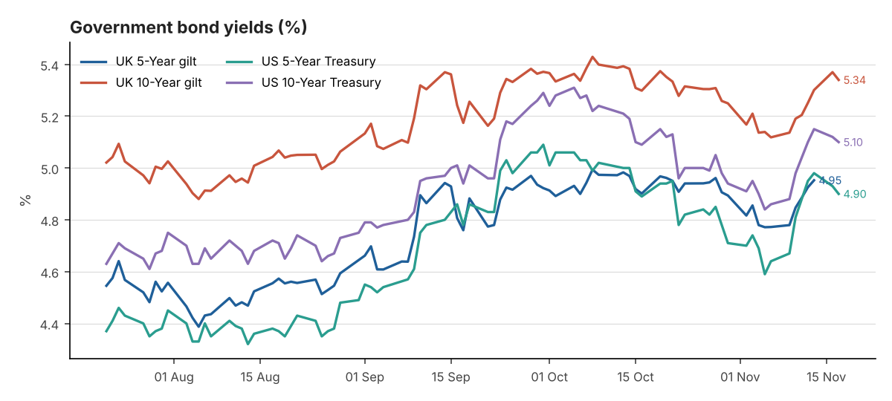
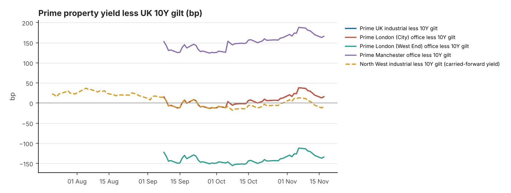

# DAILY FINANCIAL & PROPERTY INVESTMENT BRIEFING

**Date:** 18 November 2026 
**Reporting time:** 06:30 UK time

<small>Generated 2026-11-18 06:30 UTC · run `20261118T063014Z` · commentary: analyst note. Each figure shows its own observation date. Definitions, data-quality notes and full sources are in the appendix.</small>

> **Alerts**
> - New listings: 5 new North West industrial listings (58,840 sq ft); largest Unit 41 Road One, Winsford, Cheshire, 33,585 sq ft.
> - ⚑ Rexford Industrial Realty moved -3.3% on 17 Nov 2026.
> - North West deal: New home for saved gas meter outfit (17,000 sq ft).
> - Corporate action — SEGRO: Recommended share offer from Prologis (0.0920 new Prologis shares per SEGRO share, partial cash alternative at 1,031.7p; completion expected H1 2027). Shares trade on deal terms.

## 1. Executive Summary

1. **Mixed UK jobs data; gilts steady near highs.** Unemployment fell to 4.6% (July–September) and regular pay growth cooled to 3.5%, but payrolls and vacancies weakened, and the ONS flags survey-sample effects ([FE News](https://www.fenews.co.uk/fe-voices/ons-labour-market-november-2026-uk-unemployment-rate-falls-to-4-6/)). The 10Y gilt was quoted at about 5.34–5.37% on 17 November. UK October CPI is out at 07:00 today.
2. **Trafford Park rental evidence.** Utility Meters Warehouse signed five years on 17,000 sq ft at Kiwi Court at **£13 per sq ft** ([Place North West](https://www.placenorthwest.co.uk/new-home-for-saved-gas-meter-outfit/)).
3. **North West supply pipeline reshaped.** Peel has cut Liverpool Waters by about 8m sq ft, including about 2m sq ft of offices. Warrington's draft local plan allocates 586 acres of employment land and identifies 362 potential Grey Belt areas.
4. **New listings sweep (today).** Five new North West industrial listings totalling 58,840 sq ft; the largest is Unit 41 Road One, Winsford (33,585 sq ft). The sweep also shows 96 removals (5.69m sq ft), mostly large Savills listings, which needs checking (see the North West outlook).
5. **Listed logistics weaker.** Rexford fell 3.3% and Prologis 1.6% ($125.56), so the SEGRO share offer is now worth about 874p. Landsec has confirmed an 18-month freeze on major office and residential development, citing London office build costs up 41% in five years.

## 2. Government Bond Yields — UK and US

| Market | Latest Yield | Daily | 7-Day | 30-Day | Observed | Source |
|---|---|---|---|---|---|---|
| UK 5-Year gilt | 4.95% | +2.7bp | +18bp | -1.7bp | 13 Nov 2026 | [Bank of England Database (IADB)](https://www.bankofengland.co.uk/boeapps/database/fromshowcolumns.asp?SeriesCodes=IUDSNPY&UsingCodes=Y) |
| UK 10-Year gilt | 5.34% | -3bp† | +14.9bp† | +4.1bp† | 17 Nov 2026 | [Trading Economics (table dated Nov/17)](https://tradingeconomics.com/united-kingdom/government-bond-yield) *(secondary)* |
| US 5-Year Treasury | 4.90% | -3bp | +9bp | +1bp | 17 Nov 2026 | [US Treasury - Daily Treasury Par Yield Curve Rates](https://home.treasury.gov/resource-center/data-chart-center/interest-rates/TextView?type=daily_treasury_yield_curve&field_tdr_date_value=2026) |
| US 10-Year Treasury | 5.10% | -2bp | +12bp | +1bp | 17 Nov 2026 | [US Treasury - Daily Treasury Par Yield Curve Rates](https://home.treasury.gov/resource-center/data-chart-center/interest-rates/TextView?type=daily_treasury_yield_curve&field_tdr_date_value=2026) |
| UK 2-Year gilt | 5.04% | +3.5bp† | +28bp† | Not verified | 16 Nov 2026 | [Trading Economics; Reuters-sourced report says back above 5%](https://www.tradingandinvestmentnews.co.uk/gilt-yields-spike-rate-bets/) *(secondary)* |
| UK 30-Year gilt | 5.79% | -3bp | Not verified | Not verified | 16 Nov 2026 | [Trading Economics](https://tradingeconomics.com/united-kingdom/30-year-bond-yield) *(secondary)* |
| US 2-Year Treasury | 4.80% | -3bp | +7bp | +6bp | 17 Nov 2026 | [US Treasury - Daily Treasury Par Yield Curve Rates](https://home.treasury.gov/resource-center/data-chart-center/interest-rates/TextView?type=daily_treasury_yield_curve&field_tdr_date_value=2026) |
| US 30-Year Treasury | 5.46% | 0bp | +11bp | +3bp | 17 Nov 2026 | [US Treasury - Daily Treasury Par Yield Curve Rates](https://home.treasury.gov/resource-center/data-chart-center/interest-rates/TextView?type=daily_treasury_yield_curve&field_tdr_date_value=2026) |

**10Y less 5Y:** UK Not verified · US +20bp (17 Nov 2026) 
<small>Changes in basis points. † = comparison crosses sources or instruments (indicative).</small>

## 3. Interest Rates — Bank Rate, SONIA and Fed

| Indicator | Latest | Previous | Date | Change | Source |
|---|---|---|---|---|---|
| BoE Bank Rate | 4.00% | 3.75% | effective 05 Nov 2026 | +25bp | [Bank of England Database (IADB)](https://www.bankofengland.co.uk/boeapps/database/fromshowcolumns.asp?SeriesCodes=IUDBEDR&UsingCodes=Y) |
| SONIA (overnight fixing) | 3.9832% | 3.9846% | 13 Nov 2026 | -0.1bp | [FRED IUDSOIA](https://fred.stlouisfed.org/series/IUDSOIA) |
| 5Y SONIA swap (finance-cost reference) | 4.58% ⚠ stale | 4.74% | 04 Nov 2026 | -16bp | [Knight Frank Prime Yield Guide (Macrobond/ICAP)](https://www.knightfrank.co.uk/site-assets/research/report-pdfs/yield-guide/prime-yield-guide-nov-2026.pdf) *(secondary)* |
| Fed funds target range | 3.75–4.00% | 3.50–3.75% | effective 17 Sep 2026 | +25bp | [FRED DFEDTARU](https://fred.stlouisfed.org/series/DFEDTARU) |

**Next MPC decision:** 17 Dec 2026

**Confirmed:**
- Bank Rate 4.00%; next MPC decision 17 December.
- The labour data was mixed: lower unemployment and softer pay growth.
- October CPI at 07:00 today is the last major inflation print before the MPC.

**Not verified:** market-implied pricing.

**Interpretation:** softer pay growth slightly weakens the case for rapid hikes. The 2Y gilt at about 5.0% still prices further tightening, so CPI today is pivotal for swap rates and property debt costs.

## 4. Inflation — UK and US

| Indicator | Latest | Previous | Period | Trend | Source |
|---|---|---|---|---|---|
| UK CPI (12m) | 3.5% | 3.1% | Sep 2026 (pub. 21 Oct) | Accelerating | [ONS MM23](https://www.ons.gov.uk/economy/inflationandpriceindices/timeseries/d7g7/mm23) |
| UK CPIH (12m) | 3.6% | 3.3% | Sep 2026 (pub. 21 Oct) | Accelerating | [ONS MM23](https://www.ons.gov.uk/economy/inflationandpriceindices/timeseries/l55o/mm23) |
| UK core CPI (12m, ex energy, food, alcohol & tobacco) | 2.8% | 2.6% | Sep 2026 (pub. 21 Oct) | Accelerating | [ONS MM23](https://www.ons.gov.uk/economy/inflationandpriceindices/timeseries/dko8/mm23) |
| US CPI-U (12m, NSA) | 3.7% | 3.4% | Sep 2026 | Accelerating | [BLS CPI via FRED CPIAUCNS](https://fred.stlouisfed.org/series/CPIAUCNS) |
| US core CPI-U (12m, NSA) | 2.6% | 2.4% | Sep 2026 | Broadly stable | [BLS CPI via FRED CPILFENS](https://fred.stlouisfed.org/series/CPILFENS) |

**Next ONS inflation release:** see Section 14

## 5. Prime UK Industrial and Office Investment Yields

| Sector | Latest | Basis | Previous | Move | Evidence | Source |
|---|---|---|---|---|---|---|
| UK Industrial & Logistics | 5.50% | NIY | 5.25–5.50% | +12.5bp | Nov 2026 | [Knight Frank Prime Yield Guide](https://www.knightfrank.co.uk/site-assets/research/report-pdfs/yield-guide/prime-yield-guide-nov-2026.pdf) |
| Prime Distribution Warehouses ‡ | 5.50–5.75% | Not stated | 5.50% | +12.5bp | Nov 2026 | [Knight Frank Prime Yield Guide](https://www.knightfrank.co.uk/site-assets/research/report-pdfs/yield-guide/prime-yield-guide-nov-2026.pdf) |
| South East Industrial ‡ | 5.25–5.50% | Not stated | 5.25% | +12.5bp | Nov 2026 | [Knight Frank Prime Yield Guide](https://www.knightfrank.co.uk/site-assets/research/report-pdfs/yield-guide/prime-yield-guide-nov-2026.pdf) |
| Greater London Industrial | 5.25% | Not stated | 5.00–5.25% | +12.5bp | Nov 2026 | [Knight Frank Prime Yield Guide](https://www.knightfrank.co.uk/site-assets/research/report-pdfs/yield-guide/prime-yield-guide-nov-2026.pdf) |
| Prime Multi-let Industrial (Rest of UK) ‡ | 5.25–5.50% | Not stated | 5.25% | +12.5bp | Nov 2026 | [Knight Frank Prime Yield Guide](https://www.knightfrank.co.uk/site-assets/research/report-pdfs/yield-guide/prime-yield-guide-nov-2026.pdf) |
| North West Industrial ‡ | 5.25% | NIY | — | — | Q4 2025 ⚠ carried forward (322d) | [Knight Frank LOGIC: North West 2025 Review](https://www.knightfrank.co.uk/site-assets/research/report-pdfs/logic/2025-review-nw-industrial.pdf) |
| UK Logistics (average of 71 submarkets) ‡ | 5.74% | NIY | 5.59% | +15bp | Q3 2026 ⚠ carried forward (49d) | [Cushman & Wakefield UK Industrial MarketBeat](https://www.cushmanwakefield.com/en/united-kingdom/insights/uk-marketbeat/industrial-marketbeat) |
| London West End Offices | 4.00% | Not stated | 3.75–4.00% | +12.5bp | Nov 2026 | [Knight Frank Prime Yield Guide](https://www.knightfrank.co.uk/site-assets/research/report-pdfs/yield-guide/prime-yield-guide-nov-2026.pdf) |
| London City Offices | 5.50% | Not stated | 5.25–5.50% | +12.5bp | Nov 2026 | [Knight Frank Prime Yield Guide](https://www.knightfrank.co.uk/site-assets/research/report-pdfs/yield-guide/prime-yield-guide-nov-2026.pdf) |
| Manchester Offices ‡ | 7.00% | Not stated | 6.75–7.00% | +12.5bp | Nov 2026 | [Knight Frank Prime Yield Guide](https://www.knightfrank.co.uk/site-assets/research/report-pdfs/yield-guide/prime-yield-guide-nov-2026.pdf) |
| Regional UK Offices ‡ | 7.00% | Not stated | 6.75–7.00% | +12.5bp | Nov 2026 | [Knight Frank Prime Yield Guide](https://www.knightfrank.co.uk/site-assets/research/report-pdfs/yield-guide/prime-yield-guide-nov-2026.pdf) |

<small>Published prime yields, carried forward until new evidence appears — not daily valuations. ‡ = substitution; see appendix.</small>

## 6. Property Yield Spreads Versus UK Gilts

| Spread | Property yield | UK 10Y gilt | Latest spread | At evidence date | Previous comparable | Change (property / gilt) | Driver |
|---|---|---|---|---|---|---|---|
| Prime UK industrial less 10Y gilt | 5.50% (NIY, Nov 2026) | 5.34% (17 Nov) | +16bp | +38.2bp | +3.8bp (Oct 2026) | +12.2bp (+12.5bp / -0.3bp) | Property-yield-driven |
| Prime London (City) office less 10Y gilt | 5.50% (Not stated, Nov 2026) | 5.34% (17 Nov) | +16bp | +38.2bp | +3.8bp (Oct 2026) | +12.2bp (+12.5bp / -0.3bp) | Property-yield-driven |
| Prime London (West End) office less 10Y gilt | 4.00% (Not stated, Nov 2026) | 5.34% (17 Nov) | -134bp | -111.8bp | -146.2bp (Oct 2026) | +12.2bp (+12.5bp / -0.3bp) | Property-yield-driven |
| Prime Manchester office less 10Y gilt | 7.00% (Not stated, Nov 2026) | 5.34% (17 Nov) | +166bp | +188.2bp | +153.8bp (Oct 2026) | +12.2bp (+12.5bp / -0.3bp) | Property-yield-driven |
| North West industrial less 10Y gilt | 5.25% (NIY, Q4 2025) | 5.34% (17 Nov) | -9bp | +78.4bp | Not verified | Not verified | Not verified |

<small>A simple yield gap (property yield midpoint less 10Y gilt) — not a full measure of risk or relative value.</small>

**Market commentary** <small>(confirmed data points are listed in the appendix)</small>

Gilts held near their highs after the labour data. The 10-year was quoted at about 5.34–5.37% on 17 November, depending on source, against prime industrial yields of 5.50%+, a simple gap of about 16bp. The jobs report was mixed. Unemployment fell to 4.6%, but payrolls were down about 95,000 year on year and vacancies fell to 690,000. Regular pay growth eased to 3.5%. That leaves today's CPI print to decide whether markets extend or trim expectations of further Bank of England hikes.

Property evidence was mostly about income rather than yields. Custodian reported 1.7% ERV growth over six months, led by industrial at 1.3% for the quarter. Henry Boot let a further 39,000 sq ft at Walsall, taking its Origin portfolio to 67% let. Aberdeen bought a fully let, EPC A industrial estate at Crawley for £25m for a pension fund, though the yield was not disclosed. Landsec's development freeze quantifies the squeeze: London office build costs are up 41% in five years against flat prime values.

Listed logistics fell in the US. Rexford dropped 3.3% and Prologis 1.6%, which lowers the SEGRO offer value. UK prices are not verified.

Interpretation: occupier-side data remains healthy, with rents still growing and lettings completing. Pricing remains hostage to gilts. Expect valuers to hold ERVs while moving yields out at the December valuation date.

## 7. Listed Industrial & Logistics Property Share Prices

| Company | Price | Daily | 5-Day | 1-Month | YTD | Mkt cap | Div. yield | Close | Source |
|---|---|---|---|---|---|---|---|---|---|
| SEGRO (SGRO.L) | 922.6p | — | — | — | — | Not verified | 3.4% | 09 Nov ⚠ stale | [StockInvest.us (single dated source)](https://stockinvest.us/stock-price/SGRO.L) *(secondary)* |
| Tritax Big Box REIT (BBOX.L) | 145.4p | — | — | — | — | Not verified | 5.5% | 27 Oct ⚠ stale | [Kalkine Media (dated 27 Oct 2026; single source)](https://kalkinemedia.com/uk/stocks/retail/what-tritax-big-box-reit-lsebbox-says-about-the-current-retail-stocks-story) *(secondary)* |
| LondonMetric Property (LMP.L) | 188.2p | +0.2% | — | — | — | Not verified | 6.7% | 09 Nov ⚠ stale | [StockInvest.us; corroborated by AJ Bell last trade 188.2p](https://stockinvest.us/stock-price/LMP.L) *(secondary)* |
| British Land (BLND.L) | Not verified | — | — | — | — | Not verified | — | — | — |
| Landsec (LAND.L) | 659.0p | — | — | — | — | Not verified | — | 27 Oct ⚠ stale | [Kalkine Media (dated 27 Oct 2026; single source)](https://kalkinemedia.com/uk/stocks/industrial/land-securities-lseland-leads-a-fresh-market-look-at-industrial-stocks) *(secondary)* |
| Derwent London (DLN.L) | Not verified | — | — | — | — | Not verified | — | — | — |
| Great Portland Estates (GPE.L) | Not verified | — | — | — | — | Not verified | — | — | — |
| Prologis (PLD) | $125.56 | -1.6% | -3.5% | -0.1% | -1.6% | Not verified | — | 17 Nov | [Nasdaq (official close)](https://www.nasdaq.com/market-activity/stocks/pld/historical) |

*International logistics comparators*

| Company | Price | Daily | 5-Day | 1-Month | YTD | Mkt cap | Div. yield | Close | Source |
|---|---|---|---|---|---|---|---|---|---|
| EastGroup Properties (EGP) | $193.89 | -1.2% | -2.4% | -1.3% | +8.8% | Not verified | — | 17 Nov | [Nasdaq (official close)](https://www.nasdaq.com/market-activity/stocks/egp/historical) |
| First Industrial Realty Trust (FR) | $54.42 | -0.9% | -1.0% | -7.4% | -5.0% | Not verified | — | 17 Nov | [Nasdaq (official close)](https://www.nasdaq.com/market-activity/stocks/fr/historical) |
| Rexford Industrial Realty (REXR) | $36.19 | -3.3% ⚑ | -4.6% | -1.8% | -6.5% | Not verified | — | 17 Nov | [Nasdaq (official close)](https://www.nasdaq.com/market-activity/stocks/rexr/historical) |
| WDP (Warehouses De Pauw) (WDP.BR) | Not verified | — | — | — | — | Not verified | — | — | — |
| CTP (CTPNV.AS) | Not verified | — | — | — | — | Not verified | — | — | — |

<small>Latest completed trading session before the 06:30 UK briefing; end-of-day data, not real-time. London prices are in pence (GBX); US in USD; Euronext in EUR. Changes are share-price returns only, excluding dividends (not total shareholder return). ⚑ = daily move of 3% or more. Market caps from Nasdaq are as at retrieval. Dividend yield = latest annualised dividend from company reports ÷ price, where on file. "Not verified" = no licensed price feed returned data and no cited close is on file.</small>

**SEGRO — Prologis offer look-through:** 0.0920 × Prologis close $125.56 (17 Nov) ÷ $1.3212/£ (13 Nov, FRED) = **874.3p** per SEGRO share in Prologis stock, vs SEGRO close 922.6p (-5.2% offer spread). Partial cash alternative: 1031.7p (capped). <small>The FX rate lags by several days, so this is indicative only.</small>

**Corporate actions on the watchlist**

- **SEGRO** — Listed - in offer period. Recommended share offer from Prologis (0.0920 new Prologis shares per SEGRO share, partial cash alternative at 1,031.7p; completion expected H1 2027). Shares trade on deal terms. ([source](https://www.slaughterandmay.com/recent-work/advising-segro-on-the-recommended-share-offer-by-prologis/))
- **Prologis** — Listed. Acquirer of SEGRO (recommended offer). ([source](https://www.slaughterandmay.com/recent-work/advising-segro-on-the-recommended-share-offer-by-prologis/))
- **WDP (Warehouses De Pauw)** — Listed. Also admitted on Euronext Amsterdam; Euronext information document dated 26 Oct 2026. ([source](https://live.euronext.com/sites/default/files/2026-10/WDP%20Information%20Document%202026%2010%2026.pdf))

## 8. REIT Valuation and Performance Commentary

| Metric | SEGRO | Tritax Big Box REIT | LondonMetric Property | 
|---|---|---|---|
| EPRA NTA per share | 902p | 185.88p | 200.6p | 
| Loan-to-value | 31% | 32.9% | 36.7% | 
| Average cost of debt | 2.8% | 3.6% | 4.0% | 
| WAULT | — | 9.9 yrs | 16+ yrs | 
| Occupancy | 94.5% | 93.5% | 97.4% | 
| Like-for-like rental growth | 5.3% | 5.1% | 5.8% | 
| ERV growth | 1.8% | 1.9% | 3.3% | 
| Development pipeline | £90m potential rent | 507MW secured power | No direct development | 
| Dividend (annualised) | 31.1p | 8.0p | 12.6p | 
| Report basis | [H1 2026 (30 Jun)](https://www.segro.com/media/xlibxjqh/press-release-full-version-final.pdf) | [H1 2026 (30 Jun)](https://www.investegate.co.uk/announcement/rns/tritax-big-box-reit--bbox/half-year-report/9707045) | [FY 2026 (31 Mar)](https://www.investegate.co.uk/announcement/rns/londonmetric-property--lmp/full-year-results-for-the-year-ended-31-march-2026/9578979) | 
| Premium / (discount) to EPRA NTA | +2.3% <small>(price 09 Nov)</small> | -21.8% <small>(price 27 Oct)</small> | -6.2% <small>(price 09 Nov)</small> | 

<small>Metrics are from each company's latest report (row "Report basis"; some metrics come from later trading updates — full detail in `data/reit_fundamentals.csv`). Share-price dates are shown separately.</small>

Company announcements (last 14 days, routine filings excluded)

| Date | Company | Announcement | Type |
|---|---|---|---|
| 2026-11-16 | GPE | [GPE sells 2 Aldermanbury Square to Rothesay](https://www.investegate.co.uk/announcement/rns/great-portland-estates--gpe/gpe-sells-2-aldermanbury-square-to-rothesay-/9875715) | Other |
| 2026-11-13 | LAND | [Half-year Financial Report](https://www.investegate.co.uk/announcement/rns/land-securities-group--land/half-year-financial-report/9873573) | Results |
| 2026-11-05 | DLN | [Third Quarter Business Update](https://www.investegate.co.uk/announcement/rns/derwent-london--dln/third-quarter-business-update-/9859178) | Trading update |
| 2026-11-04 | LMP | [NON-EXECUTIVE DIRECTOR CHANGES](https://www.investegate.co.uk/announcement/rns/londonmetric-property--lmp/non-executive-director-changes/9856840) | Board |

**Verified:**
- No new SEGRO, Tritax or LondonMetric announcements.
- Custodian: H1 ERV +1.7%; industrial +1.3% in the quarter.
- Landsec: 18-month freeze on major office and residential development.
- US: Prologis $125.56 (−1.6%), Rexford −3.3%, EastGroup −1.2%.
- No verified UK closes since 9 November.

**Interpretation:**
- The US logistics REIT sell-off coincided with higher rate expectations rather than any company-specific news; that is correlation, not established cause.
- SEGRO's look-through value (about 874p) is falling with Prologis. A current SEGRO close would show whether the stock is trading off the share offer or the 1,031.7p cash alternative.

**Next:** LondonMetric half-year results on 24 November.

## 9. Top UK Industrial & Logistics Property News

**4. Aberdeen Investments buys £25m Arrow Point industrial asset in Crawley**

`UK INDUSTRIAL` · **new** · <small>[Property Week](https://www.propertyweek.com/news/aberdeen-investments-acquires-25m-industrial-asset-in-crawley), published 2026-11-17</small>

Aberdeen Investments has bought Arrow Point in Crawley's Manor Royal Business District for £25m for the Standard Life Pooled Pension Property Fund. The modern units, with 8–12m eaves, 30–40m yards, EPC A and BREEAM Very Good ratings, are fully let to Blueleaf and Leo Cancer Care. The yield was not disclosed.

Key figures and relevance

- **Key figures:** £25m; fully let; EPC A; BREEAM Very Good; yield undisclosed
- **Relevance:** Institutional pension capital still buying modern multi-let industrial in the South East.

**5. Henry Boot secures Walsall warehouse letting for Origin portfolio**

`UK INDUSTRIAL` · 20,000+ sq ft · **new** · <small>[Property Week](https://www.propertyweek.com/news/676869), published 2026-11-17</small>

HBD, Henry Boot's development arm, has let a 39,000 sq ft warehouse at SPARK Walsall to wholesaler Tican, after deals with Relay Tech and E.ON UK. The scheme is part of Origin, its industrial joint venture with Feldberg Capital, which is now 67% let across its 711,000 sq ft portfolio.

Key figures and relevance

- **Key figures:** 39,000 sq ft letting; Origin portfolio 711,000 sq ft, 67% let
- **Relevance:** Speculative Midlands mid-box space letting steadily but with a third still vacant.

**7. Landsec puts 18-month freeze on major residential and office developments**

`PLANNING / DEVELOPMENT` · *follow-up* · <small>[Property Week](https://www.propertyweek.com/news/landsec-freezes-major-residential-and-office-development), published 2026-11-17</small>

Follow-up to Landsec's results: Landsec will freeze major new residential and office development for 18 months, saying returns no longer offer sufficient upside. Its results presentation cited a 41% rise in London office construction costs over five years while prime London office values have been flat.

Key figures and relevance

- **Key figures:** 18-month freeze; London office build costs +41% in 5 years; prime values flat
- **Relevance:** Quantifies the cost-versus-value squeeze on development.

## 10. North West Industrial & Logistics News

**1. New home for saved gas meter outfit**

`NORTH WEST INDUSTRIAL` · **new** · <small>[Place North West](https://www.placenorthwest.co.uk/new-home-for-saved-gas-meter-outfit/), published 2026-11-17</small>

Utility Meters Warehouse, bought out of administration by Energy Assets, has signed a five-year lease on 17,000 sq ft (15,600 sq ft warehouse, 1,000 sq ft office) at Unit 6 Kiwi Court, Trafford Park, at £13 per sq ft. It relocates from Leo Industrial Estate nearby and roughly doubles its space. Davies Harrison advised the private landlord.

**Why this matters:** It is fresh Trafford Park rental evidence: £13 per sq ft for a 17,000 sq ft second-hand unit on a five-year lease. That supports current North West mid-box ERVs despite the rates shock and is a direct comparable for lettings and rent reviews in the M60 core.

Key figures and relevance

- **Key figures:** 17,000 sq ft; £13.00/sq ft; 5-year lease; Kiwi Court, Trafford Park; landlord agent Davies Harrison
- **Relevance:** Trafford Park mid-box rental evidence at £13/sq ft on a short lease.

**2. Liverpool to run rule over Peel's scaled back vision for Liverpool Waters**

`PLANNING / DEVELOPMENT` · **new** · <small>[Place North West](https://www.placenorthwest.co.uk/liverpool-to-run-rule-over-peels-scaled-back-vision-for-liverpool-waters/), published 2026-11-17</small>

Peel Waters has cut the total development in its 150-acre Liverpool Waters masterplan, adopted 13 years ago, by about 8m sq ft. Changes include about 2m sq ft less office space and homes reduced to 7,111 from 9,000, partly because Everton's stadium occupies former residential land. Liverpool's planning committee considers the changes next week.

**Why this matters:** Cutting about 2m sq ft of planned offices recognises weaker long-run office demand and viability on the waterfront. Less future supply supports existing Liverpool city-centre office stock, but it also signals that big masterplans are being right-sized to today's costs and rates.

Key figures and relevance

- **Key figures:** c.8m sq ft reduction; offices down c.2m sq ft; homes 7,111 (from 9,000); c.1,300 homes delivered since 2013
- **Relevance:** Long-term Liverpool supply pipeline shrinking, especially offices.

**3. Feedback wanted on Warrington local plan**

`PLANNING / DEVELOPMENT` · **new** · <small>[Place North West](https://www.placenorthwest.co.uk/feedback-wanted-on-warrington-local-plan/), published 2026-11-17</small>

Warrington has opened its second consultation, running to 11 January, on a local plan to 2039 allocating land for 13,250 homes and 586 acres of employment space. It accepts some Green Belt release is needed, and an AECOM study identified 362 areas of existing Green Belt that could qualify as Grey Belt.

**Why this matters:** With 586 acres of employment land at the M6/M62/M56 junction, Warrington's plan will shape North West logistics supply for a decade. The Grey Belt assessment, after two appeal wins this month, gives landowners and promoters a window to put forward sites before 11 January.

Key figures and relevance

- **Key figures:** 586 acres employment land; 13,250 homes; plan to 2039; 362 potential Grey Belt areas; consultation closes 11 Jan
- **Relevance:** Major future employment-land supply on the M6/M62 hub.

**All Place North West headlines since the last briefing** <small>(Tue 17 Nov 06:00 onwards; stories summarised above are not repeated; industrial items first)</small>

| Published | Headline | |
|---|---|---|
| Tue 16:13 | [Consent for upgrades at one of Manchester’s first BTR schemes](https://www.placenorthwest.co.uk/consent-for-upgrades-at-one-of-manchesters-first-btr-schemes/) |  |
| Tue 11:43 | [VIDEO | Creating places where benefits ripple out beyond the red line](https://www.placenorthwest.co.uk/video-creating-places-where-benefits-ripple-out-beyond-the-red-line/) |  |
| Tue 11:18 | [Flats on vacant Liverpool waterfront site given go-ahead again](https://www.placenorthwest.co.uk/plans-for-flats-on-vacant-liverpool-waterfront-given-go-ahead-again/) |  |
| Tue 10:47 | [Gwynedd unanimously approves Crown Building resi conversion](https://www.placenorthwest.co.uk/gwynedd-unanimously-approves-crown-building-resi-conversion/) |  |

**North West outlook**

Fresh North West evidence is positive on rents. The Trafford Park letting at £13 per sq ft on a 17,000 sq ft unit supports mid-box ERVs in the M60 core. Today's sweep added five new listings (58,840 sq ft), led by 33,585 sq ft at Winsford, plus 16,714 sq ft coming at Dukinfield. The sweep also reports 96 removals totalling 5.69m sq ft, almost all large Savills listings such as X-Dock 549 and Burnley 543. A drop of that size in a few days more likely reflects a change in the Savills source than lettings, so treat it as unverified until it is checked. Warrington's 586-acre employment allocation and Grey Belt review point to substantial future supply on the M6/M62.

## 11. New North West Industrial Listings

<small>Agents' listings sweep of 2026-11-18 05:08 UTC (source: tracker branch `claude/magical-ride-4nijqh`, `output/daily/Latest New Listings.md`).</small>

Compared with the sweep of 2026-11-15 09:34 UTC.

- **New to market:** 5 properties, 58,840 sq ft (existing 56,476 / pipeline 16,990)
- **Returned to market:** 1
- **Removed (let, sold or withdrawn):** 96 properties, 5,686,554 sq ft
- **Advertised available now:** 851 properties, 40,344,639 sq ft

| Property | Location | sq ft | Status | Agents |
|---|---|---:|---|---|
| [Unit 41 Road One](https://legatowen.co.uk/property/unit-41-road-one-a533-winsford-industrial-estate-winsford-cheshire-cw7-3qb/) | Winsford, Cheshire | 33,585 | Availability Unconfirmed | Legat Owen |
| [Tameside Court, Fifth Avenue, Dukinfield, SK16 4PW](https://www.commercialpropertypartners.co.uk/properties/tameside-court-fifth-avenue-dukinfield-sk16-4pw) | Tameside, Greater Manchester | 16,714 | Available at a Future Date | CPP (Commercial Property Partners) |
| [Unit 8, Rupert Park, London Road South, Poynton, SK12 1](https://www.willsill.co.uk/property/unit-8-rupert-park-london-road-south-poynton-sk12-1pq/) | Cheshire East, Cheshire | 6,383 | Availability Unconfirmed | Williams Sillitoe |
| [Unit 24 Webber Estate, Webber Rd](https://lm6.co.uk/property/unit-24-webber-estate-webber-rd-liverpool-l33/11605/) | Knowsley Industrial Park, Merseyside | 1,882 | Availability Unconfirmed | LM6 |
| [Suite 6E, Knowsley Moorgate Point](https://www.indurent.com/industrial-estates/knowsley-moorgate-point/suite-6e/) | Knowsley Industrial Park, Merseyside | 276 | Available at a Future Date | Indurent (landlord) |

**Returned to market:** Units 6-8 Brookfield Business Park, Muir Road, Liverpool, L9 7AR (14,626 sq ft, CPP (Commercial Property Partners))
**Removed:** X-Dock 549 (549,400 sq ft, Savills); Burnley 543 (543,269 sq ft, Savills); Atlantic Park, Liverpool, L30 4AB (388,000 sq ft, Savills); Atlantic Park, Liverpool, L30 4AB (351,389 sq ft, Savills); Voltage Park (284,000 sq ft, Savills); Bolton 280 (280,619 sq ft, Savills); Widnes 258 (257,500 sq ft, Savills); Units 1 & 2  Royce Trading Estate, Ashburton Road West, Trafford Park, Manchester, M17 1RY (215,708 sq ft, Savills); Symmetry Park (190,000 sq ft, Savills); Sambro International (184,422 sq ft, Savills) … and 86 more
**New joint agents:** Unit 8, Jensen Court (+Legat Owen); Unit D6, Europa Trading Estate, Kearsley, Greater Manchester (+CPP (Commercial Property Partners))
**Sources not fully checked:** Cushman & Wakefield – Failed

Full schedule: North West Industrial & Logistics Availability.xlsx (tracker branch claude/magical-ride-4nijqh).

## 12. UK Office and Property Investment News

**6. Custodian REIT reports robust performance with steady rental growth**

`PROPERTY INVESTMENT` · **new** · <small>[Property Week](https://www.propertyweek.com/news/custodian-reit-reports-robust-performance-with-steady-rental-growth), published 2026-11-17</small>

Custodian Property Income REIT reported 0.7% like-for-like ERV growth in the quarter to September and 1.7% for the first half of its financial year. Industrial, 42% of income, led with 1.3% quarterly ERV growth, despite what the REIT called ongoing macroeconomic uncertainty.

Key figures and relevance

- **Key figures:** ERV +0.7% (quarter), +1.7% (H1); industrial ERV +1.3% (quarter); industrial 42% of income
- **Relevance:** Regional multi-sector rental growth continues, led by industrial.

**8. GREYKITE sells minority stake in pan-European logistics platform to BSP**

`FINANCE / CAPITAL MARKETS` · **new** · <small>[Property Week](https://www.propertyweek.com/news/greykite-sells-minority-stake-in-pan-european-logistics-platform-to-bsp), published 2026-11-17</small>

Greykite European Real Estate Fund I has sold a minority stake in its Silverdock pan-European logistics platform to Benefit Street Partners, part of Franklin Templeton, for an undisclosed sum. Silverdock has assembled 26 assets totalling over 7.53m sq ft since late 2024, mainly in Germany, France and the UK.

Key figures and relevance

- **Key figures:** 26 assets; 7.53m sq ft; launched late 2024; price undisclosed
- **Relevance:** Private credit and equity still committing to logistics platforms.

## 13. What This Means for the North West Industrial Market

1. **Pricing and yields.** *Verified:* 10Y gilt about 5.34–5.37%; prime distribution 5.50%+. *Interpretation:* keep advising that prime North West yields face outward pressure into the December valuations. Rental growth evidence (Custodian, Trafford Park) can partly offset this in reversionary assets.
2. **Rents and demand.** *Verified:* Trafford Park £13/sq ft (17,000 sq ft, 5 years); Custodian industrial ERV +1.3% in the quarter. *Interpretation:* use £13/sq ft as a floor for good second-hand Trafford Park mid-box quoting rents, and resist rent-free creep.
3. **Viability and supply.** *Verified:* Liverpool Waters cut by about 8m sq ft; Warrington allocating 586 acres. *Interpretation:* Warrington landowners should submit sites by 11 January. Developers' appraisals should assume a sizeable Warrington pipeline will cap long-term rental growth there.
4. **Debt and funding.** *Verified:* 2Y gilt about 5.0%; CPI is out today. *Interpretation:* hold off fixing debt until after today's CPI if timing allows, but stress-test at 5Y swaps of around 4.75–5.0%.
5. **Appetite.** *Verified:* Aberdeen (pension money) buying modern industrial; BSP investing in a logistics platform. *Interpretation:* institutional appetite for well-specified, EPC A industrial remains. Market North West Grade A product on its ESG credentials and covenant strength, not just yield.

## 14. Upcoming Economic and Property Market Events

| Date | Event |
|---|---|
| Wed 18 Nov | [UK consumer price inflation (October) - 07:00](https://www.ons.gov.uk/releasecalendar) |
| Tue 24 Nov | [LondonMetric half-year results](https://www.investegate.co.uk/company/LMP) |

---

## Appendix — Data quality, definitions and sources

Expand: data quality, definitions and full sources

**Confirmed data points used in the commentary**

- UK 10Y gilt 5.34% on 17 Nov 2026: fell 3bp on the day, rose 14.9bp over 7 days, rose 4.1bp over 30 days (mixed sources - see Table A notes).
- US 10Y Treasury 5.10% on 17 Nov 2026: fell 2bp on the day, rose 12bp over 7 days, rose 1bp over 30 days.
- Bank Rate 4.00% (effective 05 Nov 2026, changed +25bp from 3.75%).
- UK CPI 3.5% in September 2026 (previous 3.1%); trend: Accelerating.
- US CPI 3.7% in September 2026 (previous 3.4%); trend: Accelerating.
- Latest published prime yield movements: UK Industrial & Logistics +12.5bp to 5.50% (Knight Frank Prime Yield Guide, Nov 2026); Prime Distribution Warehouses +12.5bp to 5.50–5.75% (Knight Frank Prime Yield Guide, Nov 2026); South East Industrial +12.5bp to 5.25–5.50% (Knight Frank Prime Yield Guide, Nov 2026); Greater London Industrial +12.5bp to 5.25% (Knight Frank Prime Yield Guide, Nov 2026); Prime Multi-let Industrial (Rest of UK) +12.5bp to 5.25–5.50% (Knight Frank Prime Yield Guide, Nov 2026); UK Logistics (average of 71 submarkets) +15bp to 5.74% (Cushman & Wakefield UK Industrial MarketBeat, Q3 2026); London West End Offices +12.5bp to 4.00% (Knight Frank Prime Yield Guide, Nov 2026); London City Offices +12.5bp to 5.50% (Knight Frank Prime Yield Guide, Nov 2026); Manchester Offices +12.5bp to 7.00% (Knight Frank Prime Yield Guide, Nov 2026); Regional UK Offices +12.5bp to 7.00% (Knight Frank Prime Yield Guide, Nov 2026).

**Retrieval failures and data gaps**

- All automated sources responded.
- 5Y SONIA swap rate: latest observation (04 Nov 2026) is stale.
- UK CPI (12m): latest observation (01 Sep 2026) is stale.
- UK CPIH (12m): latest observation (01 Sep 2026) is stale.
- UK core CPI (12m, ex energy, food, alcohol & tobacco): latest observation (01 Sep 2026) is stale.
- US CPI-U (12m, NSA): latest observation (01 Sep 2026) is stale.
- US core CPI-U (12m, NSA): latest observation (01 Sep 2026) is stale.
- Discrepancy — UK 10-Year gilt, 2026-10-06: 5.34% (Bank of England Database (IADB)) vs 5.42% ([Knight Frank Prime Yield Guide (Macrobond/ICAP)](https://www.knightfrank.co.uk/site-assets/research/report-pdfs/yield-guide/10.-kf-final-october-2026-prime-yield-guide.pdf)), +8.3bp; often a different instrument.
- Discrepancy — UK 10-Year gilt, 2026-11-06: 5.12% (Bank of England Database (IADB)) vs 5.16% ([Trading Economics](https://tradingeconomics.com/united-kingdom/government-bond-yield)), +4.2bp; often a different instrument.
- Discrepancy — UK 10-Year gilt, 2026-11-13: 5.30% (Bank of England Database (IADB)) vs 5.34% ([Trading Economics](https://tradingeconomics.com/united-kingdom/government-bond-yield)), +3.9bp; often a different instrument.

**Property yield substitutions (‡)**

- **Prime Distribution Warehouses:** 15-year lease with open-market rent reviews (KF does not state the yield basis for this row)
- **South East Industrial:** KF South East multi-let estates
- **Prime Multi-let Industrial (Rest of UK):** KF 'Good Modern Rest of UK Estates' used as the prime multi-let proxy
- **North West Industrial:** Manchester prime (units >50,000 sq ft) used for the North West. No 2026 North West prime yield from KF, Savills, CBRE or C&W was found on 9 Nov 2026, so this Q4 2025 figure is carried forward.
- **UK Logistics (average of 71 submarkets):** An average across 71 submarkets, a wider definition than KF's single prime-distribution benchmark. This is why it reads higher.
- **Manchester Offices:** KF 'Major Regional Cities' (10-year lease) is a composite, not Manchester-specific.
- **Regional UK Offices:** KF 'Major Regional Cities' (10-year lease) is a composite, not Manchester-specific.

**Definitions**

- UK gilts from the Bank of England database are fitted nominal par yields; market quotes (e.g. Trading Economics) are benchmark-gilt yields and are labelled secondary. US yields are Treasury constant-maturity par yields.
- Net initial yield (NIY) = net income ÷ gross price including purchaser's costs. Equivalent yield = IRR assuming rent reverts to market at review/expiry. The two are not interchangeable.
- SONIA is the overnight fixing — not term SONIA or SONIA swaps.
- Inflation trend compares the last three monthly readings (±0.15pp threshold). US annual rates are calculated from the BLS NSA index via FRED.
- Share-price changes exclude dividends. 5-day = five trading sessions; 1-month = last close on or before 30 days earlier; YTD = versus the last close of the previous year.
- Correlation between gilts, property yields and listed property prices does not establish causation.

**Analyst sources**

- [FE News](https://www.fenews.co.uk/fe-voices/ons-labour-market-november-2026-uk-unemployment-rate-falls-to-4-6/) and [ONS labour market release](https://www.ons.gov.uk/employmentandlabourmarket/peopleinwork/employmentandemployeetypes/bulletins/employmentintheuk/november2026).
- [Mortgage Soup](https://mortgagesoup.co.uk/walters-watch-mixed-jobs-data-leaves-bank-facing-rate-dilemma/) (10Y about 5.37%) and [Trading Economics](https://tradingeconomics.com/united-kingdom/government-bond-yield) (5.34%), 17 Nov.
- Place North West: [UMW Trafford Park](https://www.placenorthwest.co.uk/new-home-for-saved-gas-meter-outfit/), [Liverpool Waters](https://www.placenorthwest.co.uk/liverpool-to-run-rule-over-peels-scaled-back-vision-for-liverpool-waters/), [Warrington local plan](https://www.placenorthwest.co.uk/feedback-wanted-on-warrington-local-plan/).
- Property Week: [Aberdeen Crawley](https://www.propertyweek.com/news/aberdeen-investments-acquires-25m-industrial-asset-in-crawley), [Henry Boot Walsall](https://www.propertyweek.com/news/676869), [Custodian](https://www.propertyweek.com/news/custodian-reit-reports-robust-performance-with-steady-rental-growth), [Landsec freeze](https://www.propertyweek.com/news/landsec-freezes-major-residential-and-office-development), [GREYKITE](https://www.propertyweek.com/news/greykite-sells-minority-stake-in-pan-european-logistics-platform-to-bsp).
- Listings sweep: branch `claude/magical-ride-4nijqh`, sweep of 18 Nov 2026 05:08 UTC.

<small>Prepared from public sources for professional information; not investment advice. History: `data/observations.csv`, `data/share_prices.csv`, `data/news_log.csv`, `data/announcements.csv`; audit trail: `data/audit_log.csv`.</small>
