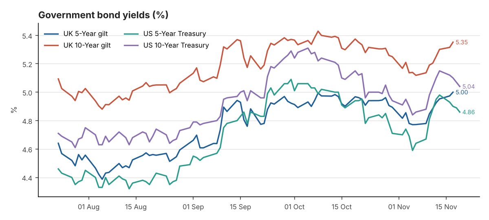
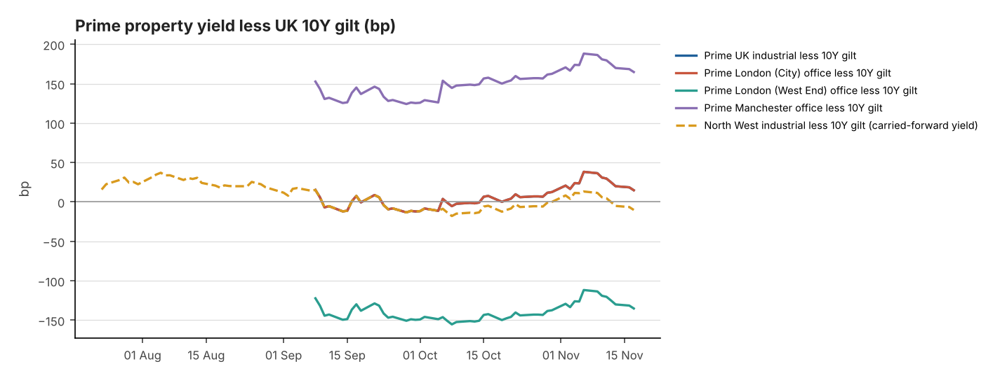

# DAILY FINANCIAL & PROPERTY INVESTMENT BRIEFING

**Date:** 20 November 2026 
**Reporting time:** 06:30 UK time

<small>Generated 2026-11-20 06:30 UTC · run `20261120T063015Z` · commentary: analyst note. Each figure shows its own observation date. Definitions, data-quality notes and full sources are in the appendix.</small>

> **Alerts**
> - New listings: 2 new North West industrial listings (34,732 sq ft); largest Units 5 & 6 Premier Park, Trafford Park, Greater Manchester, 26,583 sq ft.
> - Corporate action — SEGRO: Recommended share offer from Prologis (0.0920 new Prologis shares per SEGRO share, partial cash alternative at 1,031.7p; completion expected H1 2027). Shares trade on deal terms.

## 1. Executive Summary

1. **Gilts high but steady on official data.** The BoE 10Y par yield was 5.35% on 17 November (+16bp over 7 days) and the 5Y 5.00%. No reliable market close was found for 18–19 November, although CPI-day coverage reported a six-day low. The US 10Y eased to 5.04% and the 2Y to 4.76%.
2. **Prime London offices letting above ERV.** GPE's half-year results show NTA +3.2% to 541p, like-for-like income +11.9%, and new lettings 4.1% above ERV ([GPE RNS](https://www.investegate.co.uk/announcement/rns/great-portland-estates--gpe/another-strong-half-year-performance/9882939)).
3. **Developers sharing risk.** British Land and GIC sold 50% of the £273m, 360,000 sq ft 1 Appold Street redevelopment to Mitsui Fudosan ([Property Week](https://www.propertyweek.com/news/british-land-and-gic-sell-50-stake-in-broadgate-scheme)).
4. **New listings sweep.** Two new North West listings totalling 34,732 sq ft; the largest is **Units 5 & 6 Premier Park, Trafford Park (26,583 sq ft)**. Bolton 280 (280,619 sq ft) is back on the market.
5. **US logistics REITs sold off.** Prologis fell 1.5% to $123.36 (−4.0% over 5 days) and Rexford is −5.6% over 5 days. The SEGRO share offer is now worth about 859p.

## 2. Government Bond Yields — UK and US

| Market | Latest Yield | Daily | 7-Day | 30-Day | Observed | Source |
|---|---|---|---|---|---|---|
| UK 5-Year gilt | 5.00% | +2.7bp | +15.3bp | +9.9bp | 17 Nov 2026 | [Bank of England Database (IADB)](https://www.bankofengland.co.uk/boeapps/database/fromshowcolumns.asp?SeriesCodes=IUDSNPY&UsingCodes=Y) |
| UK 10-Year gilt | 5.35% | +3.7bp | +16.1bp | +5.3bp | 17 Nov 2026 | [Bank of England Database (IADB)](https://www.bankofengland.co.uk/boeapps/database/fromshowcolumns.asp?SeriesCodes=IUDMNPY&UsingCodes=Y) |
| US 5-Year Treasury | 4.86% | -3bp | -9bp | -8bp | 19 Nov 2026 | [US Treasury - Daily Treasury Par Yield Curve Rates](https://home.treasury.gov/resource-center/data-chart-center/interest-rates/TextView?type=daily_treasury_yield_curve&field_tdr_date_value=2026) |
| US 10-Year Treasury | 5.04% | -3bp | -6bp | -8bp | 19 Nov 2026 | [US Treasury - Daily Treasury Par Yield Curve Rates](https://home.treasury.gov/resource-center/data-chart-center/interest-rates/TextView?type=daily_treasury_yield_curve&field_tdr_date_value=2026) |
| UK 2-Year gilt | 5.04% ⚠ stale | +3.5bp† | +28bp† | Not verified | 16 Nov 2026 | [Trading Economics; Reuters-sourced report says back above 5%](https://www.tradingandinvestmentnews.co.uk/gilt-yields-spike-rate-bets/) *(secondary)* |
| UK 30-Year gilt | 5.79% ⚠ stale | -3bp | Not verified | Not verified | 16 Nov 2026 | [Trading Economics](https://tradingeconomics.com/united-kingdom/30-year-bond-yield) *(secondary)* |
| US 2-Year Treasury | 4.76% | -4bp | -10bp | -3bp | 19 Nov 2026 | [US Treasury - Daily Treasury Par Yield Curve Rates](https://home.treasury.gov/resource-center/data-chart-center/interest-rates/TextView?type=daily_treasury_yield_curve&field_tdr_date_value=2026) |
| US 30-Year Treasury | 5.40% | -1bp | -3bp | -2bp | 19 Nov 2026 | [US Treasury - Daily Treasury Par Yield Curve Rates](https://home.treasury.gov/resource-center/data-chart-center/interest-rates/TextView?type=daily_treasury_yield_curve&field_tdr_date_value=2026) |

**10Y less 5Y:** UK +35.2bp (17 Nov 2026) · US +18bp (19 Nov 2026) 
<small>Changes in basis points. † = comparison crosses sources or instruments (indicative).</small>

## 3. Interest Rates — Bank Rate, SONIA and Fed

| Indicator | Latest | Previous | Date | Change | Source |
|---|---|---|---|---|---|
| BoE Bank Rate | 4.00% | 3.75% | effective 05 Nov 2026 | +25bp | [Bank of England Database (IADB)](https://www.bankofengland.co.uk/boeapps/database/fromshowcolumns.asp?SeriesCodes=IUDBEDR&UsingCodes=Y) |
| SONIA (overnight fixing) | 3.9840% | 3.9833% | 17 Nov 2026 | +0.1bp | [FRED IUDSOIA](https://fred.stlouisfed.org/series/IUDSOIA) |
| 5Y SONIA swap (finance-cost reference) | 4.58% ⚠ stale | 4.74% | 04 Nov 2026 | -16bp | [Knight Frank Prime Yield Guide (Macrobond/ICAP)](https://www.knightfrank.co.uk/site-assets/research/report-pdfs/yield-guide/prime-yield-guide-nov-2026.pdf) *(secondary)* |
| Fed funds target range | 3.75–4.00% | 3.50–3.75% | effective 17 Sep 2026 | +25bp | [FRED DFEDTARU](https://fred.stlouisfed.org/series/DFEDTARU) |

**Next MPC decision:** 17 Dec 2026

**Confirmed:**
- Bank Rate 4.00%; SONIA 3.98% (17 Nov).
- 5Y gilt 5.00% (17 Nov, BoE).
- Next MPC decision 17 December.

**Press-reported, not verified:** December hike odds about 80% after CPI (Reuters, reported 18 Nov).

**Interpretation:** with UK data now digested, the December decision hinges on Bank communication. A 5Y gilt at about 5% implies fixed-rate property debt above 6.5–7% all-in, still above prime industrial yields.

## 4. Inflation — UK and US

| Indicator | Latest | Previous | Period | Trend | Source |
|---|---|---|---|---|---|
| UK CPI (12m) | 3.6% | 3.5% | Oct 2026 (pub. 18 Nov) | Accelerating | [ONS MM23](https://www.ons.gov.uk/economy/inflationandpriceindices/timeseries/d7g7/mm23) |
| UK CPIH (12m) | 3.7% | 3.6% | Oct 2026 (pub. 18 Nov) | Accelerating | [ONS MM23](https://www.ons.gov.uk/economy/inflationandpriceindices/timeseries/l55o/mm23) |
| UK core CPI (12m, ex energy, food, alcohol & tobacco) | 2.8% | 2.8% | Oct 2026 (pub. 18 Nov) | Accelerating | [ONS MM23](https://www.ons.gov.uk/economy/inflationandpriceindices/timeseries/dko8/mm23) |
| US CPI-U (12m, NSA) | 3.7% | 3.4% | Sep 2026 | Accelerating | [BLS CPI via FRED CPIAUCNS](https://fred.stlouisfed.org/series/CPIAUCNS) |
| US core CPI-U (12m, NSA) | 2.6% | 2.4% | Sep 2026 | Broadly stable | [BLS CPI via FRED CPILFENS](https://fred.stlouisfed.org/series/CPILFENS) |

**Next ONS inflation release:** see Section 14

## 5. Prime UK Industrial and Office Investment Yields

| Sector | Latest | Basis | Previous | Move | Evidence | Source |
|---|---|---|---|---|---|---|
| UK Industrial & Logistics | 5.50% | NIY | 5.25–5.50% | +12.5bp | Nov 2026 | [Knight Frank Prime Yield Guide](https://www.knightfrank.co.uk/site-assets/research/report-pdfs/yield-guide/prime-yield-guide-nov-2026.pdf) |
| Prime Distribution Warehouses ‡ | 5.50–5.75% | Not stated | 5.50% | +12.5bp | Nov 2026 | [Knight Frank Prime Yield Guide](https://www.knightfrank.co.uk/site-assets/research/report-pdfs/yield-guide/prime-yield-guide-nov-2026.pdf) |
| South East Industrial ‡ | 5.25–5.50% | Not stated | 5.25% | +12.5bp | Nov 2026 | [Knight Frank Prime Yield Guide](https://www.knightfrank.co.uk/site-assets/research/report-pdfs/yield-guide/prime-yield-guide-nov-2026.pdf) |
| Greater London Industrial | 5.25% | Not stated | 5.00–5.25% | +12.5bp | Nov 2026 | [Knight Frank Prime Yield Guide](https://www.knightfrank.co.uk/site-assets/research/report-pdfs/yield-guide/prime-yield-guide-nov-2026.pdf) |
| Prime Multi-let Industrial (Rest of UK) ‡ | 5.25–5.50% | Not stated | 5.25% | +12.5bp | Nov 2026 | [Knight Frank Prime Yield Guide](https://www.knightfrank.co.uk/site-assets/research/report-pdfs/yield-guide/prime-yield-guide-nov-2026.pdf) |
| North West Industrial ‡ | 5.25% | NIY | — | — | Q4 2025 ⚠ carried forward (324d) | [Knight Frank LOGIC: North West 2025 Review](https://www.knightfrank.co.uk/site-assets/research/report-pdfs/logic/2025-review-nw-industrial.pdf) |
| UK Logistics (average of 71 submarkets) ‡ | 5.74% | NIY | 5.59% | +15bp | Q3 2026 ⚠ carried forward (51d) | [Cushman & Wakefield UK Industrial MarketBeat](https://www.cushmanwakefield.com/en/united-kingdom/insights/uk-marketbeat/industrial-marketbeat) |
| London West End Offices | 4.00% | Not stated | 3.75–4.00% | +12.5bp | Nov 2026 | [Knight Frank Prime Yield Guide](https://www.knightfrank.co.uk/site-assets/research/report-pdfs/yield-guide/prime-yield-guide-nov-2026.pdf) |
| London City Offices | 5.50% | Not stated | 5.25–5.50% | +12.5bp | Nov 2026 | [Knight Frank Prime Yield Guide](https://www.knightfrank.co.uk/site-assets/research/report-pdfs/yield-guide/prime-yield-guide-nov-2026.pdf) |
| Manchester Offices ‡ | 7.00% | Not stated | 6.75–7.00% | +12.5bp | Nov 2026 | [Knight Frank Prime Yield Guide](https://www.knightfrank.co.uk/site-assets/research/report-pdfs/yield-guide/prime-yield-guide-nov-2026.pdf) |
| Regional UK Offices ‡ | 7.00% | Not stated | 6.75–7.00% | +12.5bp | Nov 2026 | [Knight Frank Prime Yield Guide](https://www.knightfrank.co.uk/site-assets/research/report-pdfs/yield-guide/prime-yield-guide-nov-2026.pdf) |

<small>Published prime yields, carried forward until new evidence appears — not daily valuations. ‡ = substitution; see appendix.</small>

## 6. Property Yield Spreads Versus UK Gilts

| Spread | Property yield | UK 10Y gilt | Latest spread | At evidence date | Previous comparable | Change (property / gilt) | Driver |
|---|---|---|---|---|---|---|---|
| Prime UK industrial less 10Y gilt | 5.50% (NIY, Nov 2026) | 5.35% (17 Nov) | +14.8bp | +38.2bp | +3.8bp (Oct 2026) | +11bp (+12.5bp / -1.5bp) | Both (offsetting) |
| Prime London (City) office less 10Y gilt | 5.50% (Not stated, Nov 2026) | 5.35% (17 Nov) | +14.8bp | +38.2bp | +3.8bp (Oct 2026) | +11bp (+12.5bp / -1.5bp) | Both (offsetting) |
| Prime London (West End) office less 10Y gilt | 4.00% (Not stated, Nov 2026) | 5.35% (17 Nov) | -135.2bp | -111.8bp | -146.2bp (Oct 2026) | +11bp (+12.5bp / -1.5bp) | Both (offsetting) |
| Prime Manchester office less 10Y gilt | 7.00% (Not stated, Nov 2026) | 5.35% (17 Nov) | +164.8bp | +188.2bp | +153.8bp (Oct 2026) | +11bp (+12.5bp / -1.5bp) | Both (offsetting) |
| North West industrial less 10Y gilt | 5.25% (NIY, Q4 2025) | 5.35% (17 Nov) | -10.2bp | +78.4bp | Not verified | Not verified | Not verified |

<small>A simple yield gap (property yield midpoint less 10Y gilt) — not a full measure of risk or relative value.</small>

**Market commentary** <small>(confirmed data points are listed in the appendix)</small>

The week ends with UK yields close to their highs on official data. The 10-year par yield was 5.35% on 17 November, and markets are still pricing a probable December rise. US yields drifted lower, with the 10-year at 5.04%, but listed US logistics REITs fell sharply. Prologis is down 4% over five days and Rexford almost 6%, which takes the SEGRO share-offer value down to about 859p, below SEGRO's June NTA of 902p.

The UK listed-property results season has a clear message: rental growth on scarce, prime space is beating the rise in yields. GPE grew values 2.5% while letting new space 4.1% above estimated rental value. British Land reported 3% ERV growth earlier this week. The weaker parts of the market, such as Workspace's flexible offices, are still losing value. Capital is also restructuring development risk: British Land and GIC brought in Mitsui Fudosan for half of a £273m City redevelopment, and Aberdeen merged its retail property funds into a £675m global vehicle.

For industrial, the parallel is direct. Low-vacancy, Grade A logistics with reversionary rents should hold value as ERV growth offsets a modest outward yield shift. Secondary stock without rental growth will bear the full effect of higher gilts.

Interpretation: the December valuation round is likely to show yields drifting out by 0–25bp for prime industrial, offset by ERV growth, so values broadly flat. Secondary values look likely to fall further.

## 7. Listed Industrial & Logistics Property Share Prices

| Company | Price | Daily | 5-Day | 1-Month | YTD | Mkt cap | Div. yield | Close | Source |
|---|---|---|---|---|---|---|---|---|---|
| SEGRO (SGRO.L) | 922.6p | — | — | — | — | Not verified | 3.4% | 09 Nov ⚠ stale | [StockInvest.us (single dated source)](https://stockinvest.us/stock-price/SGRO.L) *(secondary)* |
| Tritax Big Box REIT (BBOX.L) | 145.4p | — | — | — | — | Not verified | 5.5% | 27 Oct ⚠ stale | [Kalkine Media (dated 27 Oct 2026; single source)](https://kalkinemedia.com/uk/stocks/retail/what-tritax-big-box-reit-lsebbox-says-about-the-current-retail-stocks-story) *(secondary)* |
| LondonMetric Property (LMP.L) | 188.2p | +0.2% | — | — | — | Not verified | 6.7% | 09 Nov ⚠ stale | [StockInvest.us; corroborated by AJ Bell last trade 188.2p](https://stockinvest.us/stock-price/LMP.L) *(secondary)* |
| British Land (BLND.L) | Not verified | — | — | — | — | Not verified | — | — | — |
| Landsec (LAND.L) | 659.0p | — | — | — | — | Not verified | — | 27 Oct ⚠ stale | [Kalkine Media (dated 27 Oct 2026; single source)](https://kalkinemedia.com/uk/stocks/industrial/land-securities-lseland-leads-a-fresh-market-look-at-industrial-stocks) *(secondary)* |
| Derwent London (DLN.L) | Not verified | — | — | — | — | Not verified | — | — | — |
| Great Portland Estates (GPE.L) | Not verified | — | — | — | — | Not verified | — | — | — |
| Prologis (PLD) | $123.36 | -1.5% | -4.0% | -3.2% | -3.4% | Not verified | — | 19 Nov | [Nasdaq (official close)](https://www.nasdaq.com/market-activity/stocks/pld/historical) |

*International logistics comparators*

| Company | Price | Daily | 5-Day | 1-Month | YTD | Mkt cap | Div. yield | Close | Source |
|---|---|---|---|---|---|---|---|---|---|
| EastGroup Properties (EGP) | $192.88 | -1.7% | -2.6% | -4.2% | +8.3% | Not verified | — | 19 Nov | [Nasdaq (official close)](https://www.nasdaq.com/market-activity/stocks/egp/historical) |
| First Industrial Realty Trust (FR) | $53.88 | -1.4% | -2.4% | -9.0% | -5.9% | Not verified | — | 19 Nov | [Nasdaq (official close)](https://www.nasdaq.com/market-activity/stocks/fr/historical) |
| Rexford Industrial Realty (REXR) | $35.52 | -1.7% | -5.6% | -4.3% | -8.3% | Not verified | — | 19 Nov | [Nasdaq (official close)](https://www.nasdaq.com/market-activity/stocks/rexr/historical) |
| WDP (Warehouses De Pauw) (WDP.BR) | Not verified | — | — | — | — | Not verified | — | — | — |
| CTP (CTPNV.AS) | Not verified | — | — | — | — | Not verified | — | — | — |

<small>Latest completed trading session before the 06:30 UK briefing; end-of-day data, not real-time. London prices are in pence (GBX); US in USD; Euronext in EUR. Changes are share-price returns only, excluding dividends (not total shareholder return). ⚑ = daily move of 3% or more. Market caps from Nasdaq are as at retrieval. Dividend yield = latest annualised dividend from company reports ÷ price, where on file. "Not verified" = no licensed price feed returned data and no cited close is on file.</small>

**SEGRO — Prologis offer look-through:** 0.0920 × Prologis close $123.36 (19 Nov) ÷ $1.3212/£ (13 Nov, FRED) = **859.0p** per SEGRO share in Prologis stock, vs SEGRO close 922.6p (-6.9% offer spread). Partial cash alternative: 1031.7p (capped). <small>The FX rate lags by several days, so this is indicative only.</small>

**Corporate actions on the watchlist**

- **SEGRO** — Listed - in offer period. Recommended share offer from Prologis (0.0920 new Prologis shares per SEGRO share, partial cash alternative at 1,031.7p; completion expected H1 2027). Shares trade on deal terms. ([source](https://www.slaughterandmay.com/recent-work/advising-segro-on-the-recommended-share-offer-by-prologis/))
- **Prologis** — Listed. Acquirer of SEGRO (recommended offer). ([source](https://www.slaughterandmay.com/recent-work/advising-segro-on-the-recommended-share-offer-by-prologis/))
- **WDP (Warehouses De Pauw)** — Listed. Also admitted on Euronext Amsterdam; Euronext information document dated 26 Oct 2026. ([source](https://live.euronext.com/sites/default/files/2026-10/WDP%20Information%20Document%202026%2010%2026.pdf))

## 8. REIT Valuation and Performance Commentary

| Metric | SEGRO | Tritax Big Box REIT | LondonMetric Property | 
|---|---|---|---|
| EPRA NTA per share | 902p | 185.88p | 200.6p | 
| Loan-to-value | 31% | 32.9% | 36.7% | 
| Average cost of debt | 2.8% | 3.6% | 4.0% | 
| WAULT | — | 9.9 yrs | 16+ yrs | 
| Occupancy | 94.5% | 93.5% | 97.4% | 
| Like-for-like rental growth | 5.3% | 5.1% | 5.8% | 
| ERV growth | 1.8% | 1.9% | 3.3% | 
| Development pipeline | £90m potential rent | 507MW secured power | No direct development | 
| Dividend (annualised) | 31.1p | 8.0p | 12.6p | 
| Report basis | [H1 2026 (30 Jun)](https://www.segro.com/media/xlibxjqh/press-release-full-version-final.pdf) | [H1 2026 (30 Jun)](https://www.investegate.co.uk/announcement/rns/tritax-big-box-reit--bbox/half-year-report/9707045) | [FY 2026 (31 Mar)](https://www.investegate.co.uk/announcement/rns/londonmetric-property--lmp/full-year-results-for-the-year-ended-31-march-2026/9578979) | 
| Premium / (discount) to EPRA NTA | +2.3% <small>(price 09 Nov)</small> | -21.8% <small>(price 27 Oct)</small> | -6.2% <small>(price 09 Nov)</small> | 

<small>Metrics are from each company's latest report (row "Report basis"; some metrics come from later trading updates — full detail in `data/reit_fundamentals.csv`). Share-price dates are shown separately.</small>

Company announcements (last 14 days, routine filings excluded)

| Date | Company | Announcement | Type |
|---|---|---|---|
| 2026-11-19 | GPE | [Another strong half-year performance](https://www.investegate.co.uk/announcement/rns/great-portland-estates--gpe/another-strong-half-year-performance/9882939) | Results |
| 2026-11-18 | DLN | [Admission to Trading](https://www.investegate.co.uk/announcement/rns/derwent-london--dln/admission-to-trading/9882705) | M&A / corporate action |
| 2026-11-18 | BLND | [Half-year Financial Report](https://www.investegate.co.uk/announcement/rns/british-land-company--blnd/half-year-financial-report/9880519) | Results |
| 2026-11-16 | GPE | [GPE sells 2 Aldermanbury Square to Rothesay](https://www.investegate.co.uk/announcement/rns/great-portland-estates--gpe/gpe-sells-2-aldermanbury-square-to-rothesay-/9875715) | Other |
| 2026-11-13 | LAND | [Half-year Financial Report](https://www.investegate.co.uk/announcement/rns/land-securities-group--land/half-year-financial-report/9873573) | Results |

**Verified:**
- GPE: NTA 541p (+3.2%), pro forma LTV 21.9%, like-for-like income +11.9%.
- British Land and GIC: 50% of 1 Appold Street sold to Mitsui Fudosan.
- No new SEGRO, Tritax or LondonMetric announcements; LondonMetric reports on Tuesday 24 November.
- US logistics REITs fell 1.4–1.7% on 19 November.
- No verified UK closes since 9 November.

**Interpretation:**
- The SEGRO look-through (about 859p) is now below June NTA, reflecting Prologis's fall. If SEGRO trades near its last cited close (922.6p, 9 Nov, stale), the market is valuing the cash alternative or a higher offer. This cannot be confirmed without current prices.
- The US REIT weakness coincided with higher US rate expectations; that is correlation, not established cause.

## 9. Top UK Industrial & Logistics Property News

No significant new UK industrial and logistics stories were found for this period.

## 10. North West Industrial & Logistics News

**2. Brother relocates sales division to Hyde**

`OFFICES` · **new** · <small>[Place North West](https://www.placenorthwest.co.uk/brother-relocates-sales-division-to-hyde/), published 2026-11-19</small>

Brother UK is moving 110 staff from its long-standing Shepley Street headquarters in Audenshaw to a more modern 17,000 sq ft office at Quantum Point, Hyde, owned by Findel Education. The move runs from February to April, and Brother UK's part of the Shepley Street site is to be sold; Brother International Europe will remain there.

**Why this matters:** A major Tameside occupier consolidating into modern space will release part of its Audenshaw headquarters site near the M60. It is a potential redevelopment or industrial opportunity in a supply-constrained east Manchester sub-market.

Key figures and relevance

- **Key figures:** 17,000 sq ft lease; 110 staff; Quantum Point, Hyde; part of Shepley Street HQ to be sold
- **Relevance:** Tameside occupier upgrade and a pending Audenshaw site disposal.

**4. Handforth Garden Village updates pass muster**

`PLANNING / DEVELOPMENT` · **new** · <small>[Place North West](https://www.placenorthwest.co.uk/handforth-garden-village-updates-pass-muster/), published 2026-11-19</small>

Cheshire East's strategic planning board has approved Section 73 amendments to the 1,500-home Garden Village at Handforth. MADE Partnership, a joint venture of Barratt Redrow, Homes England and Lloyds Banking Group, now aims to start in 2027, subject to a new Section 106 agreement.

Key figures and relevance

- **Key figures:** 1,500 homes; MADE Partnership; start targeted 2027
- **Relevance:** Major Cheshire East growth location moving towards delivery near the A34/M56.

**5. Eight-building Manchester student cluster given green light**

`PLANNING / DEVELOPMENT` · **new** · <small>[Place North West](https://www.placenorthwest.co.uk/eight-building-manchester-student-cluster-given-green-light/), published 2026-11-19</small>

Manchester planners have approved RG Real Estate's three buildings rising to 38 storeys and IQ Student Accommodation's five-tower scheme, including a 50-storey building, on Charles Street in the Oxford Road Corridor. Together they provide 3,500 homes across eight buildings on four acres, despite residents' daylight objections.

Key figures and relevance

- **Key figures:** 3,500 student beds/homes; 8 buildings; up to 50 storeys; 4 acres
- **Relevance:** Large-scale institutional living-sector investment in central Manchester.

**All Place North West headlines since the last briefing** <small>(Thu 19 Nov 06:00 onwards; stories summarised above are not repeated; industrial items first)</small>

| Published | Headline | |
|---|---|---|
| Thu 16:11 | [SuperPark chooses Trafford Palazzo for third UK venue](https://www.placenorthwest.co.uk/superpark-chooses-trafford-palazzo-for-third-uk-venue/) |  |
| Thu 13:59 | [Denbighshire moves to restart local plan development](https://www.placenorthwest.co.uk/denbighshire-moves-to-restart-local-plan-development/) |  |
| Thu 11:55 | [Hale hotel to be refurbished after asylum contract ends](https://www.placenorthwest.co.uk/hale-hotel-to-be-refurbished-after-asylum-contract-ends/) |  |
| Thu 11:53 | [Bellway tables plans for 526 homes in Burnham’s backyard](https://www.placenorthwest.co.uk/bellway-tables-plans-for-526-homes-in-burnhams-backyard/) |  |
| Thu 11:25 | [Stanley Land and Homes takes on St Helens school site](https://www.placenorthwest.co.uk/stanley-land-and-homes-takes-on-st-helens-school-site/) |  |
| Thu 10:27 | [First images of Seven Sisters rebirth](https://www.placenorthwest.co.uk/first-images-of-seven-sisters-rebirth/) |  |
| Thu 09:50 | [BEC lines up bath house demolition in Whitehaven](https://www.placenorthwest.co.uk/bec-lines-up-bath-house-demolition-in-whitehaven/) |  |
| Thu 08:18 | [Westshield, MSV to deliver social homes in Stockport town centre](https://www.placenorthwest.co.uk/westshield-msv-to-deliver-social-homes-in-stockport-town-centre/) |  |

**North West outlook**

Today's sweep added two North West industrial listings (34,732 sq ft). The larger, Units 5 & 6 Premier Park on Acheson Way, Trafford Park (26,583 sq ft), adds mid-box supply in the core M60 market where a 17,000 sq ft unit recently let at £13 per sq ft. Bolton 280 (280,619 sq ft) has returned after a sweep glitch, so big-box availability on the M61 is unchanged. Brother UK's move to 17,000 sq ft in Hyde will release part of its Audenshaw headquarters, a potential east Manchester redevelopment site. Handforth Garden Village's approval and Manchester's 3,500-bed student scheme show residential pipelines advancing faster than employment ones. Availability is stable at 43.4m sq ft.

## 11. New North West Industrial Listings

<small>Agents' listings sweep of 2026-11-20 05:08 UTC (source: tracker branch `claude/magical-ride-4nijqh`, `output/daily/Latest New Listings.md`).</small>

Compared with the sweep of 2026-11-19 05:08 UTC.

- **New to market:** 2 properties, 34,732 sq ft (existing 38,654 / pipeline 280,619)
- **Returned to market:** 2
- **Removed (let, sold or withdrawn):** 3 properties, 18,134 sq ft
- **Advertised available now:** 922 properties, 43,429,678 sq ft

| Property | Location | sq ft | Status | Agents |
|---|---|---:|---|---|
| [Units 5 & 6 Premier Park, Acheson Way, Manchester, Grea](https://www.b8re.com/properties/units-5-6-premier-park-acheson-way-manchester-greater-manchester/) | Trafford Park, Greater Manchester | 26,583 | Availability Unconfirmed | B8 Real Estate |
| [Unit 7 Bumpers Lane](https://legatowen.co.uk/property/unit-7-bumpers-lane-former-ats-tyres-sealand-trading-estate-chester-cheshire-ch1-4lt/) | Cheshire West and Chester, Cheshire | 8,149 | Availability Unconfirmed | Legat Owen |

**Returned to market:** The Croft - Unit 3B Phase 2 (3,922 sq ft, Legat Owen); Bolton 280 (280,619 sq ft, Savills)
**Removed:** Unit D2 (9,234 sq ft, Savills); Unit 7 Bumpers Lane (8,149 sq ft, Legat Owen); Zone 3 – Unit 32B, Bradley Hall Trading Estate (751 sq ft, Indurent (landlord))
**New joint agents:** Unit 4 Aston Way, Midpoint 18 (+Legat Owen); Unit A18 (+B8 Real Estate)

Full schedule: North West Industrial & Logistics Availability.xlsx (tracker branch claude/magical-ride-4nijqh).

## 12. UK Office and Property Investment News

**1. GPE reports record office demand after £422.1m sale of City asset**

`OFFICES` · **new** · <small>[Great Portland Estates RNS via Investegate](https://www.investegate.co.uk/announcement/rns/great-portland-estates--gpe/another-strong-half-year-performance/9882939), published 2026-11-19</small>

GPE's half-year results show EPRA NTA up 3.2% to 541p, portfolio value up 2.5% to £3.16bn and like-for-like rental income up 11.9%. It signed £19.0m of new annual rent at 4.1% above ERV, and its rent roll rose 13% to £173.6m. Pro forma LTV is 21.9% after the 2 Aldermanbury Square sale.

**Why this matters:** GPE is letting space above ERV and growing values while gilts sit above 5.3%. Rental growth on genuinely prime, scarce space is still beating rates, which is the same case that applies to Grade A North West logistics with low vacancy.

Key figures and relevance

- **Key figures:** NTA 541p (+3.2%); valuation £3.16bn (+2.5%); new rent £19.0m, 4.1% above ERV; like-for-like income +11.9%; pro forma LTV 21.9%
- **Relevance:** Prime London office rental growth is outrunning yield pressure.

**3. British Land and GIC sell 50% stake in Broadgate office redevelopment**

`FINANCE / CAPITAL MARKETS` · **▲ 100,000+ sq ft** · **new** · <small>[Property Week](https://www.propertyweek.com/news/british-land-and-gic-sell-50-stake-in-broadgate-scheme), published 2026-11-19</small>

Broadgate REIT, British Land's 50/50 joint venture with GIC, has agreed a JV with Mitsui Fudosan UK on the £273m redevelopment of 1 Appold Street, a 360,000 sq ft City office. Mitsui takes 50%, leaving British Land and GIC with 25% each. Separately, a completed Broadgate scheme has been sold to Hines.

**Why this matters:** Even well-capitalised REITs are bringing in partners to share development risk and cost, which is a template for large North West industrial schemes. Forward funding or JV equity, not balance-sheet speculation, will drive the next starts.

Key figures and relevance

- **Key figures:** £273m redevelopment; 360,000 sq ft; Mitsui Fudosan 50%; BL and GIC 25% each; separate sale to Hines
- **Relevance:** Developers sharing development risk with overseas capital rather than going alone.

**6. Aberdeen completes £675m real estate fund merger**

`PROPERTY INVESTMENT` · **new** · <small>[Property Week](https://www.propertyweek.com/news/aberdeen-completes-675m-real-estate-fund-merger), published 2026-11-19</small>

Aberdeen Investments has merged the abrdn Real Estate Fund and its feeder fund into the abrdn Global Real Estate Fund, a £675m hybrid vehicle combining UK and international direct property with listed real estate securities. The former UK portfolio now sits alongside the existing international direct holdings.

Key figures and relevance

- **Key figures:** £675m combined assets; UK and international direct property plus listed REITs
- **Relevance:** Consolidation of retail-investor property funds; UK direct exposure diluted.

## 13. What This Means for the North West Industrial Market

1. **Pricing and yields.** *Verified:* 10Y gilt 5.35% (BoE); GPE and BLND values up on rental growth. *Interpretation:* in December valuations, argue for ERV growth offsetting yield drift on Grade A North West stock. Accept softer values for secondary units with limited reversion.
2. **Rents and demand.** *Verified:* GPE lettings 4.1% above ERV; new Trafford Park supply (26,583 sq ft). *Interpretation:* new Trafford Park availability may slow mid-box rent growth locally. Quote competitively against the £13/sq ft evidence to let quickly, rather than chasing headline rents.
3. **Viability and supply.** *Verified:* British Land is sharing development risk with Mitsui Fudosan; Brother is vacating part of its Audenshaw site. *Interpretation:* structure large North West schemes as joint ventures or forward funds. Watch Audenshaw for an infill industrial opportunity.
4. **Debt and funding.** *Verified:* 5Y gilt 5.00%; December hike likely (press). *Interpretation:* all-in fixed debt around 6.5–7% means leveraged buyers need yields of 6.5%+ or strong reversion. Price vendor expectations accordingly.
5. **Appetite.** *Verified:* overseas capital (Mitsui Fudosan, Hines) is buying into London offices; US logistics REITs are under pressure. *Interpretation:* international capital is selective but active for prime. For North West industrial, the main buyers are domestic institutions and private investors, and lot size and income security will determine depth of bidding.

## 14. Upcoming Economic and Property Market Events

| Date | Event |
|---|---|
| Tue 24 Nov | [LondonMetric half-year results](https://www.investegate.co.uk/company/LMP) |

---

## Appendix — Data quality, definitions and sources

Expand: data quality, definitions and full sources

**Confirmed data points used in the commentary**

- UK 10Y gilt 5.35% on 17 Nov 2026: rose 3.7bp on the day, rose 16.1bp over 7 days, rose 5.3bp over 30 days.
- US 10Y Treasury 5.04% on 19 Nov 2026: fell 3bp on the day, fell 6bp over 7 days, fell 8bp over 30 days.
- Bank Rate 4.00% (effective 05 Nov 2026, changed +25bp from 3.75%).
- UK CPI 3.6% in October 2026 (previous 3.5%); trend: Accelerating.
- US CPI 3.7% in September 2026 (previous 3.4%); trend: Accelerating.
- Latest published prime yield movements: UK Industrial & Logistics +12.5bp to 5.50% (Knight Frank Prime Yield Guide, Nov 2026); Prime Distribution Warehouses +12.5bp to 5.50–5.75% (Knight Frank Prime Yield Guide, Nov 2026); South East Industrial +12.5bp to 5.25–5.50% (Knight Frank Prime Yield Guide, Nov 2026); Greater London Industrial +12.5bp to 5.25% (Knight Frank Prime Yield Guide, Nov 2026); Prime Multi-let Industrial (Rest of UK) +12.5bp to 5.25–5.50% (Knight Frank Prime Yield Guide, Nov 2026); UK Logistics (average of 71 submarkets) +15bp to 5.74% (Cushman & Wakefield UK Industrial MarketBeat, Q3 2026); London West End Offices +12.5bp to 4.00% (Knight Frank Prime Yield Guide, Nov 2026); London City Offices +12.5bp to 5.50% (Knight Frank Prime Yield Guide, Nov 2026); Manchester Offices +12.5bp to 7.00% (Knight Frank Prime Yield Guide, Nov 2026); Regional UK Offices +12.5bp to 7.00% (Knight Frank Prime Yield Guide, Nov 2026).

**Retrieval failures and data gaps**

- All automated sources responded.
- UK 2-Year gilt: latest observation (16 Nov 2026) is stale.
- UK 30-Year gilt: latest observation (16 Nov 2026) is stale.
- 5Y SONIA swap rate: latest observation (04 Nov 2026) is stale.
- USD per GBP: latest observation (13 Nov 2026) is stale.
- US CPI-U (12m, NSA): latest observation (01 Sep 2026) is stale.
- US core CPI-U (12m, NSA): latest observation (01 Sep 2026) is stale.
- Discrepancy — UK 10-Year gilt, 2026-10-06: 5.34% (Bank of England Database (IADB)) vs 5.42% ([Knight Frank Prime Yield Guide (Macrobond/ICAP)](https://www.knightfrank.co.uk/site-assets/research/report-pdfs/yield-guide/10.-kf-final-october-2026-prime-yield-guide.pdf)), +8.3bp; often a different instrument.
- Discrepancy — UK 10-Year gilt, 2026-11-06: 5.12% (Bank of England Database (IADB)) vs 5.16% ([Trading Economics](https://tradingeconomics.com/united-kingdom/government-bond-yield)), +4.2bp; often a different instrument.
- Discrepancy — UK 10-Year gilt, 2026-11-13: 5.30% (Bank of England Database (IADB)) vs 5.34% ([Trading Economics](https://tradingeconomics.com/united-kingdom/government-bond-yield)), +3.9bp; often a different instrument.
- Discrepancy — UK 10-Year gilt, 2026-11-16: 5.32% (Bank of England Database (IADB)) vs 5.37% ([Trading Economics](https://tradingeconomics.com/united-kingdom/government-bond-yield)), +5.5bp; often a different instrument.

**Property yield substitutions (‡)**

- **Prime Distribution Warehouses:** 15-year lease with open-market rent reviews (KF does not state the yield basis for this row)
- **South East Industrial:** KF South East multi-let estates
- **Prime Multi-let Industrial (Rest of UK):** KF 'Good Modern Rest of UK Estates' used as the prime multi-let proxy
- **North West Industrial:** Manchester prime (units >50,000 sq ft) used for the North West. No 2026 North West prime yield from KF, Savills, CBRE or C&W was found on 9 Nov 2026, so this Q4 2025 figure is carried forward.
- **UK Logistics (average of 71 submarkets):** An average across 71 submarkets, a wider definition than KF's single prime-distribution benchmark. This is why it reads higher.
- **Manchester Offices:** KF 'Major Regional Cities' (10-year lease) is a composite, not Manchester-specific.
- **Regional UK Offices:** KF 'Major Regional Cities' (10-year lease) is a composite, not Manchester-specific.

**Definitions**

- UK gilts from the Bank of England database are fitted nominal par yields; market quotes (e.g. Trading Economics) are benchmark-gilt yields and are labelled secondary. US yields are Treasury constant-maturity par yields.
- Net initial yield (NIY) = net income ÷ gross price including purchaser's costs. Equivalent yield = IRR assuming rent reverts to market at review/expiry. The two are not interchangeable.
- SONIA is the overnight fixing — not term SONIA or SONIA swaps.
- Inflation trend compares the last three monthly readings (±0.15pp threshold). US annual rates are calculated from the BLS NSA index via FRED.
- Share-price changes exclude dividends. 5-day = five trading sessions; 1-month = last close on or before 30 days earlier; YTD = versus the last close of the previous year.
- Correlation between gilts, property yields and listed property prices does not establish causation.

**Analyst sources**

- Bank of England IADB and US Treasury data (tables); Reuters via [Trading & Investment News](https://www.tradingandinvestmentnews.co.uk/uk-core-inflation-sterling/) for the December hike odds.
- GPE, [Another strong half-year performance](https://www.investegate.co.uk/announcement/rns/great-portland-estates--gpe/another-strong-half-year-performance/9882939).
- Property Week: [British Land/GIC Broadgate](https://www.propertyweek.com/news/british-land-and-gic-sell-50-stake-in-broadgate-scheme), [Aberdeen fund merger](https://www.propertyweek.com/news/aberdeen-completes-675m-real-estate-fund-merger).
- Place North West: [Brother to Hyde](https://www.placenorthwest.co.uk/brother-relocates-sales-division-to-hyde/), [Handforth Garden Village](https://www.placenorthwest.co.uk/handforth-garden-village-updates-pass-muster/), [Manchester student cluster](https://www.placenorthwest.co.uk/eight-building-manchester-student-cluster-given-green-light/).
- Listings sweep: branch `claude/magical-ride-4nijqh`, sweep of 20 Nov 2026 05:08 UTC.

<small>Prepared from public sources for professional information; not investment advice. History: `data/observations.csv`, `data/share_prices.csv`, `data/news_log.csv`, `data/announcements.csv`; audit trail: `data/audit_log.csv`.</small>
