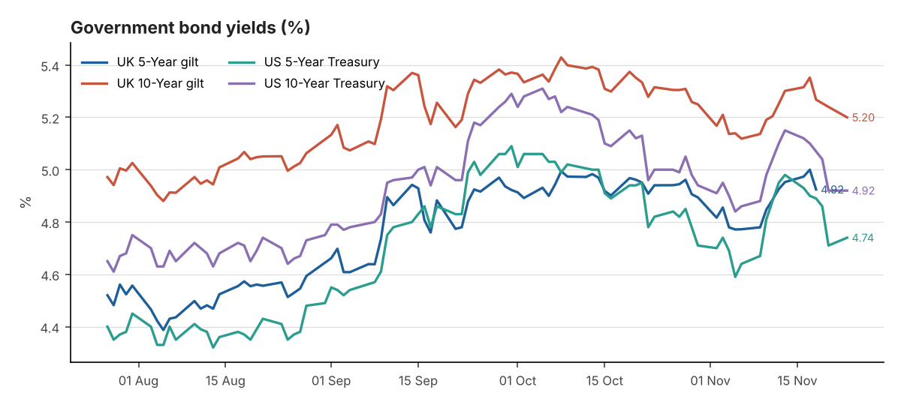
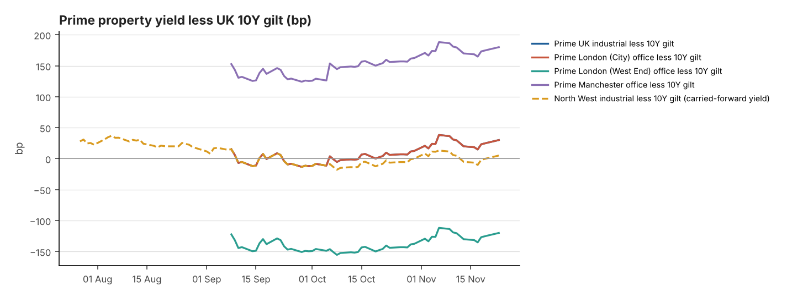

# DAILY FINANCIAL & PROPERTY INVESTMENT BRIEFING

**Date:** 24 November 2026 
**Reporting time:** 06:30 UK time

<small>Generated 2026-11-24 06:32 UTC · run `20261124T063201Z` · commentary: analyst note. Each figure shows its own observation date. Definitions, data-quality notes and full sources are in the appendix.</small>

> **Alerts**
> - New listings: 7 new North West industrial listings (19,403 sq ft); largest Land & Premises at Gawsworth, Macclesfield, Cheshire, 6,438 sq ft.
> - Corporate action — SEGRO: Recommended share offer from Prologis (0.0920 new Prologis shares per SEGRO share, partial cash alternative at 1,031.7p; completion expected H1 2027). Shares trade on deal terms.

## 1. Executive Summary

1. **Gilts edged lower again.** Trading Economics quoted the 10Y at **5.20%** (−4bp) and the 30Y at about 5.69% on 23 November (market quotes; other tables show 5.23% and 5.66%). The 2Y held at about 4.89%. Official BoE data was unavailable today. The US 10Y was 4.92%, flat on the day.
2. **Yield cushion about +30bp.** Prime distribution (5.50%+ NIY, carried forward) against the 10Y at about 5.20%, the widest since early November.
3. **New Greater Manchester big box.** Muse is preparing plans for a **300,000 sq ft** unit on 20 acres at Ashton Moss (M60 J23), part of a 1.3m sq ft innovation park ([Place North West](https://www.placenorthwest.co.uk/muse-readies-plans-for-300000-sq-ft-shed-at-ashton-moss/)).
4. **Planning shake-up mooted.** The government is considering abolishing Natural England and the Environment Agency, statutory consultees behind many development delays ([Property Week](https://www.propertyweek.com/news/environment-agency-and-natural-england-could-face-axe-in-labour-quango-shake-up)).
5. **Listed logistics rebounded; LondonMetric reports today.** US logistics REITs rose 2–3% on 23 November, and Prologis gained 2.2% to $125.14, so the SEGRO share offer is worth about 879p. LondonMetric's half-year results are due this morning, after this briefing.

## 2. Government Bond Yields — UK and US

| Market | Latest Yield | Daily | 7-Day | 30-Day | Observed | Source |
|---|---|---|---|---|---|---|
| UK 5-Year gilt | 4.92% ⚠ stale | -7.6bp | +3.9bp | -4.3bp | 18 Nov 2026 | [Bank of England Database (IADB)](https://www.bankofengland.co.uk/boeapps/database/fromshowcolumns.asp?SeriesCodes=IUDSNPY&UsingCodes=Y) |
| UK 10-Year gilt | 5.20% | -4bp | -11.5bp† | -11.5bp† | 23 Nov 2026 | [Trading Economics](https://tradingeconomics.com/united-kingdom/government-bond-yield) *(secondary)* |
| US 5-Year Treasury | 4.74% | +3bp | -19bp | -8bp | 23 Nov 2026 | [US Treasury - Daily Treasury Par Yield Curve Rates](https://home.treasury.gov/resource-center/data-chart-center/interest-rates/TextView?type=daily_treasury_yield_curve&field_tdr_date_value=2026) |
| US 10-Year Treasury | 4.92% | 0bp | -20bp | -8bp | 23 Nov 2026 | [US Treasury - Daily Treasury Par Yield Curve Rates](https://home.treasury.gov/resource-center/data-chart-center/interest-rates/TextView?type=daily_treasury_yield_curve&field_tdr_date_value=2026) |
| UK 2-Year gilt | 4.89% | +1bp | -15bp† | Not verified | 23 Nov 2026 | [Trading Economics (table)](https://tradingeconomics.com/united-kingdom/government-bond-yield) *(secondary)* |
| UK 30-Year gilt | 5.69% | Not verified | -10bp | Not verified | 23 Nov 2026 | [Trading Economics](https://tradingeconomics.com/united-kingdom/30-year-bond-yield) *(secondary)* |
| US 2-Year Treasury | 4.63% | 0bp | -20bp | -6bp | 23 Nov 2026 | [US Treasury - Daily Treasury Par Yield Curve Rates](https://home.treasury.gov/resource-center/data-chart-center/interest-rates/TextView?type=daily_treasury_yield_curve&field_tdr_date_value=2026) |
| US 30-Year Treasury | 5.29% | -2bp | -17bp | -4bp | 23 Nov 2026 | [US Treasury - Daily Treasury Par Yield Curve Rates](https://home.treasury.gov/resource-center/data-chart-center/interest-rates/TextView?type=daily_treasury_yield_curve&field_tdr_date_value=2026) |

**10Y less 5Y:** UK Not verified · US +18bp (23 Nov 2026) 
<small>Changes in basis points. † = comparison crosses sources or instruments (indicative).</small>

## 3. Interest Rates — Bank Rate, SONIA and Fed

| Indicator | Latest | Previous | Date | Change | Source |
|---|---|---|---|---|---|
| BoE Bank Rate | 4.00% | 3.75% | effective 05 Nov 2026 | +25bp | [Bank of England Database (IADB)](https://www.bankofengland.co.uk/boeapps/database/fromshowcolumns.asp?SeriesCodes=IUDBEDR&UsingCodes=Y) |
| SONIA (overnight fixing) | 3.9841% | 3.9840% | 19 Nov 2026 | 0bp | [FRED IUDSOIA](https://fred.stlouisfed.org/series/IUDSOIA) |
| 5Y SONIA swap (finance-cost reference) | 4.58% ⚠ stale | 4.74% | 04 Nov 2026 | -16bp | [Knight Frank Prime Yield Guide (Macrobond/ICAP)](https://www.knightfrank.co.uk/site-assets/research/report-pdfs/yield-guide/prime-yield-guide-nov-2026.pdf) *(secondary)* |
| Fed funds target range | 3.75–4.00% | 3.50–3.75% | effective 17 Sep 2026 | +25bp | [FRED DFEDTARU](https://fred.stlouisfed.org/series/DFEDTARU) |

**Next MPC decision:** 17 Dec 2026

**Confirmed:** Bank Rate 4.00%; next MPC decision 17 December. The 2Y gilt is about 4.89% on market quotes, below its 5.04% peak on 16 November.

**Not verified:** OIS pricing. The last press-reported December hike probability was about 80% (Reuters, 18 Nov).

**Interpretation:** short rates have stabilised below their peak. With no major UK data before the MPC, the Bank's own communication will drive December expectations and the swap rates that set property debt costs.

## 4. Inflation — UK and US

| Indicator | Latest | Previous | Period | Trend | Source |
|---|---|---|---|---|---|
| UK CPI (12m) | 3.6% | 3.5% | Oct 2026 (pub. 18 Nov) | Accelerating | [ONS MM23](https://www.ons.gov.uk/economy/inflationandpriceindices/timeseries/d7g7/mm23) |
| UK CPIH (12m) | 3.7% | 3.6% | Oct 2026 (pub. 18 Nov) | Accelerating | [ONS MM23](https://www.ons.gov.uk/economy/inflationandpriceindices/timeseries/l55o/mm23) |
| UK core CPI (12m, ex energy, food, alcohol & tobacco) | 2.8% | 2.8% | Oct 2026 (pub. 18 Nov) | Accelerating | [ONS MM23](https://www.ons.gov.uk/economy/inflationandpriceindices/timeseries/dko8/mm23) |
| US CPI-U (12m, NSA) | 3.7% | 3.4% | Sep 2026 | Accelerating | [BLS CPI via FRED CPIAUCNS](https://fred.stlouisfed.org/series/CPIAUCNS) |
| US core CPI-U (12m, NSA) | 2.6% | 2.4% | Sep 2026 | Broadly stable | [BLS CPI via FRED CPILFENS](https://fred.stlouisfed.org/series/CPILFENS) |

**Next ONS inflation release:** see Section 14

## 5. Prime UK Industrial and Office Investment Yields

| Sector | Latest | Basis | Previous | Move | Evidence | Source |
|---|---|---|---|---|---|---|
| UK Industrial & Logistics | 5.50% | NIY | 5.25–5.50% | +12.5bp | Nov 2026 | [Knight Frank Prime Yield Guide](https://www.knightfrank.co.uk/site-assets/research/report-pdfs/yield-guide/prime-yield-guide-nov-2026.pdf) |
| Prime Distribution Warehouses ‡ | 5.50–5.75% | Not stated | 5.50% | +12.5bp | Nov 2026 | [Knight Frank Prime Yield Guide](https://www.knightfrank.co.uk/site-assets/research/report-pdfs/yield-guide/prime-yield-guide-nov-2026.pdf) |
| South East Industrial ‡ | 5.25–5.50% | Not stated | 5.25% | +12.5bp | Nov 2026 | [Knight Frank Prime Yield Guide](https://www.knightfrank.co.uk/site-assets/research/report-pdfs/yield-guide/prime-yield-guide-nov-2026.pdf) |
| Greater London Industrial | 5.25% | Not stated | 5.00–5.25% | +12.5bp | Nov 2026 | [Knight Frank Prime Yield Guide](https://www.knightfrank.co.uk/site-assets/research/report-pdfs/yield-guide/prime-yield-guide-nov-2026.pdf) |
| Prime Multi-let Industrial (Rest of UK) ‡ | 5.25–5.50% | Not stated | 5.25% | +12.5bp | Nov 2026 | [Knight Frank Prime Yield Guide](https://www.knightfrank.co.uk/site-assets/research/report-pdfs/yield-guide/prime-yield-guide-nov-2026.pdf) |
| North West Industrial ‡ | 5.25% | NIY | — | — | Q4 2025 ⚠ carried forward (328d) | [Knight Frank LOGIC: North West 2025 Review](https://www.knightfrank.co.uk/site-assets/research/report-pdfs/logic/2025-review-nw-industrial.pdf) |
| UK Logistics (average of 71 submarkets) ‡ | 5.74% | NIY | 5.59% | +15bp | Q3 2026 ⚠ carried forward (55d) | [Cushman & Wakefield UK Industrial MarketBeat](https://www.cushmanwakefield.com/en/united-kingdom/insights/uk-marketbeat/industrial-marketbeat) |
| London West End Offices | 4.00% | Not stated | 3.75–4.00% | +12.5bp | Nov 2026 | [Knight Frank Prime Yield Guide](https://www.knightfrank.co.uk/site-assets/research/report-pdfs/yield-guide/prime-yield-guide-nov-2026.pdf) |
| London City Offices | 5.50% | Not stated | 5.25–5.50% | +12.5bp | Nov 2026 | [Knight Frank Prime Yield Guide](https://www.knightfrank.co.uk/site-assets/research/report-pdfs/yield-guide/prime-yield-guide-nov-2026.pdf) |
| Manchester Offices ‡ | 7.00% | Not stated | 6.75–7.00% | +12.5bp | Nov 2026 | [Knight Frank Prime Yield Guide](https://www.knightfrank.co.uk/site-assets/research/report-pdfs/yield-guide/prime-yield-guide-nov-2026.pdf) |
| Regional UK Offices ‡ | 7.00% | Not stated | 6.75–7.00% | +12.5bp | Nov 2026 | [Knight Frank Prime Yield Guide](https://www.knightfrank.co.uk/site-assets/research/report-pdfs/yield-guide/prime-yield-guide-nov-2026.pdf) |

<small>Published prime yields, carried forward until new evidence appears — not daily valuations. ‡ = substitution; see appendix.</small>

## 6. Property Yield Spreads Versus UK Gilts

| Spread | Property yield | UK 10Y gilt | Latest spread | At evidence date | Previous comparable | Change (property / gilt) | Driver |
|---|---|---|---|---|---|---|---|
| Prime UK industrial less 10Y gilt | 5.50% (NIY, Nov 2026) | 5.20% (23 Nov) | +30bp | +38.2bp | +3.8bp (Oct 2026) | +26.2bp (+12.5bp / +13.7bp) | Both (reinforcing) |
| Prime London (City) office less 10Y gilt | 5.50% (Not stated, Nov 2026) | 5.20% (23 Nov) | +30bp | +38.2bp | +3.8bp (Oct 2026) | +26.2bp (+12.5bp / +13.7bp) | Both (reinforcing) |
| Prime London (West End) office less 10Y gilt | 4.00% (Not stated, Nov 2026) | 5.20% (23 Nov) | -120bp | -111.8bp | -146.2bp (Oct 2026) | +26.2bp (+12.5bp / +13.7bp) | Both (reinforcing) |
| Prime Manchester office less 10Y gilt | 7.00% (Not stated, Nov 2026) | 5.20% (23 Nov) | +180bp | +188.2bp | +153.8bp (Oct 2026) | +26.2bp (+12.5bp / +13.7bp) | Both (reinforcing) |
| North West industrial less 10Y gilt | 5.25% (NIY, Q4 2025) | 5.20% (23 Nov) | +5bp | +78.4bp | Not verified | Not verified | Not verified |

<small>A simple yield gap (property yield midpoint less 10Y gilt) — not a full measure of risk or relative value.</small>

**Market commentary** <small>(confirmed data points are listed in the appendix)</small>

The rally in gilts continued, though more slowly. The 10-year was quoted at about 5.20% on 23 November, against roughly 5.37% a week earlier, and the 30-year eased to about 5.69%. Official Bank of England data could not be retrieved, so these are market quotes. US Treasuries were flat, and listed logistics REITs rebounded sharply. EastGroup rose 3.0% and Prologis 2.2%, recovering part of last week's fall. The sector's moves continue to be larger than rates alone would explain.

For property pricing, the prime industrial cushion over gilts has rebuilt to about 30bp, the widest since early November. If that holds into December, agents' yield updates are more likely to show prime distribution stable or only marginally weaker than the 25bp outward move that looked likely a week ago.

Development news is about supply. Muse's 300,000 sq ft plan at Ashton Moss joins Indurent's 838,000 sq ft Heywood proposals, giving Greater Manchester two significant big-box pipelines on the M60 and M62. Both will need pre-lets. Peel's completed £632m takeover of Harworth, marked by the chief executive's departure, consolidates a large strategic land bank, including North West employment land, under private ownership.

On policy, abolishing or merging Natural England and the Environment Agency could shorten planning timelines significantly, but nothing is decided.

Interpretation: the market backdrop has improved modestly. Supply proposals are rising, so occupier pre-lets, not speculative starts, will determine what actually gets built.

## 7. Listed Industrial & Logistics Property Share Prices

| Company | Price | Daily | 5-Day | 1-Month | YTD | Mkt cap | Div. yield | Close | Source |
|---|---|---|---|---|---|---|---|---|---|
| SEGRO (SGRO.L) | 922.6p | — | — | — | — | Not verified | 3.4% | 09 Nov ⚠ stale | [StockInvest.us (single dated source)](https://stockinvest.us/stock-price/SGRO.L) *(secondary)* |
| Tritax Big Box REIT (BBOX.L) | 145.4p | — | — | — | — | Not verified | 5.5% | 27 Oct ⚠ stale | [Kalkine Media (dated 27 Oct 2026; single source)](https://kalkinemedia.com/uk/stocks/retail/what-tritax-big-box-reit-lsebbox-says-about-the-current-retail-stocks-story) *(secondary)* |
| LondonMetric Property (LMP.L) | 188.2p | +0.2% | — | — | — | Not verified | 6.7% | 09 Nov ⚠ stale | [StockInvest.us; corroborated by AJ Bell last trade 188.2p](https://stockinvest.us/stock-price/LMP.L) *(secondary)* |
| British Land (BLND.L) | Not verified | — | — | — | — | Not verified | — | — | — |
| Landsec (LAND.L) | 659.0p | — | — | — | — | Not verified | — | 27 Oct ⚠ stale | [Kalkine Media (dated 27 Oct 2026; single source)](https://kalkinemedia.com/uk/stocks/industrial/land-securities-lseland-leads-a-fresh-market-look-at-industrial-stocks) *(secondary)* |
| Derwent London (DLN.L) | Not verified | — | — | — | — | Not verified | — | — | — |
| Great Portland Estates (GPE.L) | Not verified | — | — | — | — | Not verified | — | — | — |
| Prologis (PLD) | $125.14 | +2.2% | -1.9% | -1.0% | -2.0% | Not verified | — | 23 Nov | [Nasdaq (official close)](https://www.nasdaq.com/market-activity/stocks/pld/historical) |

*International logistics comparators*

| Company | Price | Daily | 5-Day | 1-Month | YTD | Mkt cap | Div. yield | Close | Source |
|---|---|---|---|---|---|---|---|---|---|
| EastGroup Properties (EGP) | $197.37 | +3.0% | +0.6% | -0.8% | +10.8% | Not verified | — | 23 Nov | [Nasdaq (official close)](https://www.nasdaq.com/market-activity/stocks/egp/historical) |
| First Industrial Realty Trust (FR) | $54.06 | +1.9% | -1.6% | -0.7% | -5.6% | Not verified | — | 23 Nov | [Nasdaq (official close)](https://www.nasdaq.com/market-activity/stocks/fr/historical) |
| Rexford Industrial Realty (REXR) | $36.36 | +2.0% | -2.9% | -6.1% | -6.1% | Not verified | — | 23 Nov | [Nasdaq (official close)](https://www.nasdaq.com/market-activity/stocks/rexr/historical) |
| WDP (Warehouses De Pauw) (WDP.BR) | Not verified | — | — | — | — | Not verified | — | — | — |
| CTP (CTPNV.AS) | Not verified | — | — | — | — | Not verified | — | — | — |

<small>Latest completed trading session before the 06:30 UK briefing; end-of-day data, not real-time. London prices are in pence (GBX); US in USD; Euronext in EUR. Changes are share-price returns only, excluding dividends (not total shareholder return). ⚑ = daily move of 3% or more. Market caps from Nasdaq are as at retrieval. Dividend yield = latest annualised dividend from company reports ÷ price, where on file. "Not verified" = no licensed price feed returned data and no cited close is on file.</small>

**SEGRO — Prologis offer look-through:** 0.0920 × Prologis close $125.14 (23 Nov) ÷ $1.3104/£ (20 Nov, FRED) = **878.6p** per SEGRO share in Prologis stock, vs SEGRO close 922.6p (-4.8% offer spread). Partial cash alternative: 1031.7p (capped). <small>The FX rate lags by several days, so this is indicative only.</small>

**Corporate actions on the watchlist**

- **SEGRO** — Listed - in offer period. Recommended share offer from Prologis (0.0920 new Prologis shares per SEGRO share, partial cash alternative at 1,031.7p; completion expected H1 2027). Shares trade on deal terms. ([source](https://www.slaughterandmay.com/recent-work/advising-segro-on-the-recommended-share-offer-by-prologis/))
- **Prologis** — Listed. Acquirer of SEGRO (recommended offer). ([source](https://www.slaughterandmay.com/recent-work/advising-segro-on-the-recommended-share-offer-by-prologis/))
- **WDP (Warehouses De Pauw)** — Listed. Also admitted on Euronext Amsterdam; Euronext information document dated 26 Oct 2026. ([source](https://live.euronext.com/sites/default/files/2026-10/WDP%20Information%20Document%202026%2010%2026.pdf))

## 8. REIT Valuation and Performance Commentary

| Metric | SEGRO | Tritax Big Box REIT | LondonMetric Property | 
|---|---|---|---|
| EPRA NTA per share | 902p | 185.88p | 200.6p | 
| Loan-to-value | 31% | 32.9% | 36.7% | 
| Average cost of debt | 2.8% | 3.6% | 4.0% | 
| WAULT | — | 9.9 yrs | 16+ yrs | 
| Occupancy | 94.5% | 93.5% | 97.4% | 
| Like-for-like rental growth | 5.3% | 5.1% | 5.8% | 
| ERV growth | 1.8% | 1.9% | 3.3% | 
| Development pipeline | £90m potential rent | 507MW secured power | No direct development | 
| Dividend (annualised) | 31.1p | 8.0p | 12.6p | 
| Report basis | [H1 2026 (30 Jun)](https://www.segro.com/media/xlibxjqh/press-release-full-version-final.pdf) | [H1 2026 (30 Jun)](https://www.investegate.co.uk/announcement/rns/tritax-big-box-reit--bbox/half-year-report/9707045) | [FY 2026 (31 Mar)](https://www.investegate.co.uk/announcement/rns/londonmetric-property--lmp/full-year-results-for-the-year-ended-31-march-2026/9578979) | 
| Premium / (discount) to EPRA NTA | +2.3% <small>(price 09 Nov)</small> | -21.8% <small>(price 27 Oct)</small> | -6.2% <small>(price 09 Nov)</small> | 

<small>Metrics are from each company's latest report (row "Report basis"; some metrics come from later trading updates — full detail in `data/reit_fundamentals.csv`). Share-price dates are shown separately.</small>

Company announcements (last 14 days, routine filings excluded)

| Date | Company | Announcement | Type |
|---|---|---|---|
| 2026-11-19 | GPE | [Another strong half-year performance](https://www.investegate.co.uk/announcement/rns/great-portland-estates--gpe/another-strong-half-year-performance/9882939) | Results |
| 2026-11-18 | DLN | [Admission to Trading](https://www.investegate.co.uk/announcement/rns/derwent-london--dln/admission-to-trading/9882705) | M&A / corporate action |
| 2026-11-18 | BLND | [Half-year Financial Report](https://www.investegate.co.uk/announcement/rns/british-land-company--blnd/half-year-financial-report/9880519) | Results |
| 2026-11-16 | GPE | [GPE sells 2 Aldermanbury Square to Rothesay](https://www.investegate.co.uk/announcement/rns/great-portland-estates--gpe/gpe-sells-2-aldermanbury-square-to-rothesay-/9875715) | Other |
| 2026-11-13 | LAND | [Half-year Financial Report](https://www.investegate.co.uk/announcement/rns/land-securities-group--land/half-year-financial-report/9873573) | Results |

**Verified:**
- LondonMetric half-year results are due at 07:00 today and are not yet in this briefing.
- No new SEGRO or Tritax announcements.
- US logistics REITs rebounded: EastGroup +3.0%, Prologis +2.2%, Rexford +2.0%.
- No verified UK closes since 9 November.

**Interpretation:**
- The US rebound accompanied stable Treasury yields, which suggests sector sentiment rather than rates drove last week's sell-off and this week's bounce; correlation is not causation.
- For LondonMetric, the key numbers are the NTA (200.6p at March, before Picton), LTV (36.7%) and any change in its 4.0% cost of debt. These will appear in tomorrow's briefing.

## 9. Top UK Industrial & Logistics Property News

**2. Environment Agency and Natural England could face axe in Labour quango shake-up**

`PLANNING / DEVELOPMENT` · **new** · <small>[Property Week](https://www.propertyweek.com/news/environment-agency-and-natural-england-could-face-axe-in-labour-quango-shake-up), published 2026-11-23</small>

First secretary of state Louise Haigh told the CBI the government is reviewing the functions of Natural England and the Environment Agency and is considering abolishing them as part of a 'rewiring of the state'. The two bodies are statutory consultees on flood risk, ecology and nutrient issues in planning decisions.

**Why this matters:** Natural England and the EA are behind many of the delays developers face, such as the four years Wrexham's 80,700 sq ft scheme spent on nutrient neutrality. Abolition or merger could shorten planning timelines, but transition could create a period of uncertainty for live applications.

Key figures and relevance

- **Key figures:** Review under way; both bodies may be abolished
- **Relevance:** Potential to speed environmental sign-off on development, including industrial schemes.

## 10. North West Industrial & Logistics News

**1. Muse readies plans for 300,000 sq ft shed at Ashton Moss**

`NORTH WEST INDUSTRIAL` · **▲ 100,000+ sq ft** · **new** · <small>[Place North West](https://www.placenorthwest.co.uk/muse-readies-plans-for-300000-sq-ft-shed-at-ashton-moss/), published 2026-11-23</small>

Muse is preparing a planning application, with Stantec and AEW, for a 300,000 sq ft unit on 20 acres of the eastern parcel at Ashton Moss, north of Lord Sheldon Way in Tameside, near M60 J23. The site is part of the wider 1.3m sq ft Ashton Moss Innovation Park and was in a 1999 outline consent that delivered the leisure park, Sainsbury's and Nexus House.

**Why this matters:** A 300,000 sq ft unit at M60 J23 would be one of very few big boxes inside the M60 ring. It competes directly with Indurent's Heywood proposals and will test whether occupiers pre-let at today's rents. Expect it to be pitched to occupiers as a design-and-build or pre-let opportunity.

Key figures and relevance

- **Key figures:** 300,000 sq ft single unit; 20 acres; part of 1.3m sq ft Ashton Moss Innovation Park; M60 J23
- **Relevance:** New big-box proposal in east Greater Manchester, a supply-constrained sub-market.

**3. Harworth chief executive announces departure following Peel takeover**

`FINANCE / CAPITAL MARKETS` · *follow-up* · <small>[Property Week](https://www.propertyweek.com/news/harworth-ceo-lynda-shillaw-announces-departer-following-peel-takeover), published 2026-11-23</small>

Follow-up to Peel's takeover of Harworth: chief executive Lynda Shillaw has left Harworth Group after six years, following its £632m takeover by Peel's vehicle Peel Pepper, accepted by Harworth's board in September. Harworth is a major promoter of industrial and logistics land, including in the North West.

**Why this matters:** Peel's ownership of Harworth's land bank, including North West logistics sites, concentrates control of strategic employment land in one private owner. That could change how quickly Harworth sites are brought forward and on what terms.

Key figures and relevance

- **Key figures:** £632m takeover by Peel Pepper; CEO departure
- **Relevance:** Consolidation of North West industrial land ownership under Peel.

**4. Widnes West Bank comes under regen microscope**

`PLANNING / DEVELOPMENT` · **new** · <small>[Place North West](https://www.placenorthwest.co.uk/widnes-west-bank-comes-under-regen-microscope/), published 2026-11-23</small>

Halton Council will enter a collaboration agreement with Halton Housing, which owns about a quarter of the 750 homes at West Bank near the Silver Jubilee Bridge, to develop a long-term regeneration strategy. Options include a new retail centre, retrofitting housing and new homes, and the strategy will underpin future business cases and grant bids.

Key figures and relevance

- **Key figures:** 750 homes in area; Halton Housing owns c.25%; strategy stage
- **Relevance:** Early-stage Halton regeneration near a key logistics location (Widnes/Mersey Gateway).

**5. Barratt Redrow to acquire 44 acres in Sandbach**

`PLANNING / DEVELOPMENT` · **new** · <small>[Place North West](https://www.placenorthwest.co.uk/barratt-redrow-to-acquire-44-acres-in-sandbach/), published 2026-11-23</small>

Wain Estates has exchanged contracts to sell a 44-acre site off Crewe Road, Sandbach, to Barratt Redrow. It has consent for 160 houses, a 70-bed care home and a 30-acre park, granted on appeal in April after Cheshire East refused the plans against officers' advice.

Key figures and relevance

- **Key figures:** 44 acres; 160 homes + 70-bed care home; consent won on appeal
- **Relevance:** Land promoters continuing to win appeals in Cheshire East.

**All Place North West headlines since the last briefing** <small>(Mon 23 Nov 06:00 onwards; stories summarised above are not repeated; industrial items first)</small>

| Published | Headline | |
|---|---|---|
| Mon 14:50 | [Gabrilatsou among 12 JLL planners heading to Rapleys](https://www.placenorthwest.co.uk/gabrilatsou-among-12-jll-planners-heading-to-rapleys/) |  |
| Mon 13:30 | [Directors take the helm at FBI](https://www.placenorthwest.co.uk/directors-take-the-helm-at-fbi/) |  |
| Mon 10:40 | [Applications open for person to lead ‘once-in-a-lifetime’ Liverpool regen](https://www.placenorthwest.co.uk/applications-open-for-person-to-lead-once-in-a-lifetime-liverpool-regen/) |  |
| Mon 10:15 | [INTERVIEW | Paul Richards: I am not ready to ease off](https://www.placenorthwest.co.uk/interview-paul-richards-i-am-not-ready-to-ease-off/) |  |
| Mon 10:10 | [Club de Padel submits Mayfield proposals](https://www.placenorthwest.co.uk/club-de-padel-submits-mayfield-proposals/) |  |
| Mon 10:01 | [Pringle Homes hopeful after halving Ribble Valley plans](https://www.placenorthwest.co.uk/pringle-homes-hopeful-after-halving-ribble-valley-plans/) |  |
| Mon 10:00 | [Turning public land into long-term income: how Wildstone partners with the public sector](https://www.placenorthwest.co.uk/turning-public-land-into-long-term-income-how-wildstone-partners-with-the-public-sector/) |  |

**North West outlook**

Today's sweep added seven small North West listings (19,403 sq ft), the largest being 6,438 sq ft at Gawsworth, Macclesfield, plus several Indurent units at Speke and Knowsley. The 75 Savills listings that dropped out yesterday have returned, so availability is back at about 43.1m sq ft; that source glitch is now confirmed as recurring. The larger story is pipeline. Muse's 300,000 sq ft Ashton Moss proposal adds to Indurent's Heywood plans and Aviva's 400,000 sq ft Manchester Airport scheme, so Greater Manchester now has over 1.5m sq ft of big-box proposals in planning. Peel's ownership of Harworth adds another large land holder. Expect landlords to compete for a limited pool of large occupiers.

## 11. New North West Industrial Listings

<small>Agents' listings sweep of 2026-11-24 05:08 UTC (source: tracker branch `claude/magical-ride-4nijqh`, `output/daily/Latest New Listings.md`).</small>

Compared with the sweep of 2026-11-23 05:08 UTC.

- **New to market:** 7 properties, 19,403 sq ft (existing 4,452,215 / pipeline 789,433)
- **Returned to market:** 75
- **Removed (let, sold or withdrawn):** 7 properties, 359,463 sq ft
- **Advertised available now:** 928 properties, 43,134,271 sq ft

| Property | Location | sq ft | Status | Agents |
|---|---|---:|---|---|
| [Land & Premises at Gawsworth](https://www.fishergerman.co.uk/commercial-property-lettings/industrial-industriallogistics-industrial-storage-livework-unit-open-storage-industrial-warehouse-workshops-to-rent-in-land-premises-at-gawsworth-congleton-road-gawsworth-macclesfield-cheshire-sk11-9et/50959) | Macclesfield, Cheshire | 6,438 | Availability Unconfirmed | Fisher German |
| [Unit 36](https://lm6.co.uk/property/unit-36-liverpool-l20/11900/) | Bootle / Liverpool Docks, Merseyside | 4,279 | Availability Unconfirmed | LM6 |
| [West Unit 35, Compass Industrial Park](https://www.indurent.com/industrial-estates/compass-industrial-park/west-unit-35/) | Speke / Halewood, Merseyside | 2,894 | Available at a Future Date | Indurent (landlord) |
| [West Unit 33, Compass Industrial Park](https://www.indurent.com/industrial-estates/compass-industrial-park/west-unit-33/) | Speke / Halewood, Merseyside | 2,875 | Available at a Future Date | Indurent (landlord) |
| [Suite 6J, Knowsley Moorgate Point](https://www.indurent.com/industrial-estates/knowsley-moorgate-point/suite-6j/) | Knowsley Industrial Park, Merseyside | 1,400 | Available at a Future Date | Indurent (landlord) |
| [Unit 207 – Site B, Phoenix Close Industrial Estate](https://www.indurent.com/industrial-estates/phoenix-close-industrial-estate/unit-207-site-b/) | Heywood (M62 J19), Greater Manchester | 1,069 | Available Now | Indurent (landlord) |
| [North West Unit 92, Compass Industrial Park](https://www.indurent.com/industrial-estates/compass-industrial-park/north-west-unit-92/) | Speke / Halewood, Merseyside | 448 | Available Now | Indurent (landlord) |

**Returned to market:** Unit 12B (3,732 sq ft, Savills); WG225 Winsford Gateway (225,067 sq ft, Legat Owen); Manchester Road, Ashton-Under-Lyne, Greater Manchester, OL7 0DA (10,746 sq ft, CPP (Commercial Property Partners)); Crumpsall Lane (62,867 sq ft, Savills); Unit D3 (8,794 sq ft, Savills); Unit D5 (9,472 sq ft, Savills); Unit 3 (8,542 sq ft, Savills); Unit 17-18 Wingates Industrial Estate, Barrs Fold Road, Bolton, BL5 3XP (20,235 sq ft, Savills); D1 Nasmyth Business Centre, Eccles, M30 OSN (9,277 sq ft, Savills); Bower Street (size n/d sq ft, Savills); Unit 7 Port Road, Port Road Business Park, Carlisle, CA2 7AF (9,743 sq ft, Savills); Air 66 & Air 84 (152,286 sq ft, Savills); Trafford 150, Longbridge Road, Manchester, M17 1SN (148,240 sq ft, Savills); Unit A1 / A6 - A9 (9,609 sq ft, Savills); Sambro International (184,422 sq ft, Savills); Foundry Point (49,606 sq ft, Savills); Unit 1 (20,653 sq ft, Savills); Unit 9 & 19 (10,534 sq ft, Savills); Symmetry Park (size n/d sq ft, Savills); Neon (74,000 sq ft, Savills); Units 1 & 2  Royce Trading Estate, Ashburton Road West, Trafford Park, Manchester, M17 1RY (215,708 sq ft, Savills); Atlantic Park, Liverpool, L30 4AB (388,000 sq ft, Savills); Unit 2, Prince Mead Place, Kings Park, Manchester, M17 1PN (23,992 sq ft, Savills); Mill Lane Industrial Estate, Stanney Mill Road, Chester, CH2 4HX (37,300 sq ft, Savills); Unit 235 - Europa Trade Park (3,955 sq ft, Savills); Units 4 & 5 Clayton Road Industrial Estate (23,005 sq ft, Savills); Unit 7 (5,942 sq ft, Savills); Unit 8, Gemini Trade Park, Warrington, WA5 7YF (6,526 sq ft, Savills); Unit 6 (8,072 sq ft, Savills); Velocity (Unit A) (31,500 sq ft, Savills); Jensen Court (26,456 sq ft, Savills); Knowsley 120, Acornfield Road, Knowsley Industrial Park, Liverpool, L33 7UF (119,941 sq ft, Savills); Atlantic Park, Liverpool, L30 4AB (351,389 sq ft, Savills); Kings Park, Trafford Park, Manchester, M17 1QA (63,060 sq ft, Savills); Unit 6 Millbrook Industrial Estate (5,995 sq ft, Savills); 4B Eagle Park Drive, Warrington, WA2 8JA (6,370 sq ft, Savills); Widnes 258 (257,500 sq ft, Savills); Unit 336 (85,757 sq ft, Savills); B2 (5,480 sq ft, Savills); Unit E7A (77,000 sq ft, Savills); Unit E8 (11,915 sq ft, Savills); Trade City Sharston (62,662 sq ft, Savills); Unit C3 (4,390 sq ft, Savills); Unit C5 (4,390 sq ft, Savills); Unit C10 (4,390 sq ft, Savills); Unit C7 (4,390 sq ft, Savills); Unit C12 (4,390 sq ft, Savills); Unit C13 (4,390 sq ft, Savills); Unit 62 (52,065 sq ft, Savills); Unit 39 (4,938 sq ft, Savills); Unit 1, 2 & 3 Millbrook Industrial Estate (26,221 sq ft, Savills); Stainburn Road, Openshaw, M11 2QA (101,316 sq ft, Savills); B10-12 (25,107 sq ft, Savills); Trafford Gate (58,211 sq ft, Savills); Unit 12-15 Stakehill Industrial Estate, Middleton, M24 2FL (23,480 sq ft, Savills); 14 Calver Road, Winwick Quay, Warrington, WA2 8UD (44,246 sq ft, Savills); Burnley 543 (543,269 sq ft, Savills); Unit A12 Barton Business Park, Manchester, M30 0QR (1,192 sq ft, Savills); Unit A6 Barton Business Park, Manchester, M30 0QR (2,854 sq ft, Savills); Unit A7-A9 Barton Business Park, Manchester, M30 0QR (5,568 sq ft, Savills); Unit 4 Melford Court, Warrington, WA1 4RZ (7,794 sq ft, Savills); Bolton 280 (280,619 sq ft, Savills); Unit 224 - Europa Trade Park, Warrington, WA5 7TN (3,144 sq ft, Savills); Unit 5B (32,613 sq ft, Savills); Avro Business Park (170,048 sq ft, Savills); Voltage Park (284,000 sq ft, Savills); Symmetry Park (149,000 sq ft, Savills); Symmetry Park (190,000 sq ft, Savills); X-Dock 549 (549,400 sq ft, Savills); Albert Road, Bollington, Macclesfield, SK10 5HS (28,732 sq ft, Savills); Knowsley Park (size n/d sq ft, Savills); Unit 4, 10, 11 and 15, Shepley Industrial Estate North, Manchester, M34 5DR (19,816 sq ft, Savills); Bell Lane, Bury, BL9 6DL (10,534 sq ft, Savills); Queens Rd, Manchester, M40 8RR (size n/d sq ft, Savills); Unit 8 Alexandria Court, Ashton-under-Lyne, OL7 0QN (4,650 sq ft, Savills)
**Removed:** Oxw327, Fraser Place (327,561 sq ft, DTRE); Unit 6A, Ashcroft Road (10,667 sq ft, LM6); Unit 560, Metroplex Business Park, Salford, M50 2UE (7,571 sq ft, BC Real Estate); Unit 3B Crewe Trade Park (6,073 sq ft, Legat Owen); WGT Winsford Gateway (3,058 sq ft, Legat Owen); Unit 3A, Broadoak Business Park, Ashburton Road West, Trafford Park, M17 1RW (2,850 sq ft, BC Real Estate); Zone 5 – Unit S16, Bradley Hall Trading Estate (1,683 sq ft, Indurent (landlord))
**New joint agents:** Haydock 23, Haydock, Merseyside (+Savills); Unit G Roundthorn Industrial Estate, Ennis Close, Manchester, M23 9LE (+Savills); Titan (+Savills); C Block (+Savills); Unit D1, Ennis Close, Manchester, M23 9LE (+Savills); Unit C2 Penrhyn Court (+Savills); Park Parade Industrial Estate, Ashton-Under-Lyne, OL6 7PP (+Savills); Urban X (+Savills); Viking Park (+Savills); Unit 4A Aston Way (+Savills); Brookside Business Park (+Savills); Melford Court (+B8 Real Estate, Savills); Logistics City Sharston (+Savills); Kingsland Grange Industrial Estate (+Savills); Altitude (+Savills); Apex (+Savills); Beacon Point (+Savills); Units 5B, 5D, 5F (+Savills); Central 600, Lancashire Central, Preston, PR5 6BZ (+Savills); West Unit 39, Compass Industrial Park (+Indurent (landlord)); Unit 2, Connect Park, St. Helens, WA11 9TH (+Savills); Unit 15, Gawsworth Court (+Savills); Millfield Park (+Savills); Satellite Park, Chadderton, Manchester, M24 1RU (+Savills); Unit 1 Atlantic Park (+Savills); Northbank Industrial Estate (+Savills); Unit 1 Walker Park (+Savills); Boston Court, Salford, M50 2GN (+Savills); Unit 17, Gemini Business Park, Europa Boulevard, Warrington, WA5 7TP (+Savills); Unit 2 Atlantic Park (+Savills); Unit 245 - Europa Trade Park, Warrington, WA5 7TN (+Savills); Unit 3 Atlantic Park (+Savills); Unit 4 Atlantic Park (+Savills); Unit 74 Venture Point West (+Savills); Unit 76 Venture Point West (+LM6, Savills); Unit 8, Walker Industrial Estate, Blackburn, BB1 2QE (+Savills); Unit 80 Venture Point West (+Savills); Unit 90 - 92 Venture Point West (+Savills); Unit A18 (+Savills); Unit E7B (+Savills); Trafford Wharf Industrial Estate (+Savills); Unit B Barton Business Park, Cawdor Street, Manchester, M30 0QR (+Savills); Venture Court (+Savills); Crewe 335 (+Savills); Unit 10 Dalton Way (+Savills); Unit 9, Gawsworth Court (+Savills)
**Sources not fully checked:** BC Real Estate – Partial

Full schedule: North West Industrial & Logistics Availability.xlsx (tracker branch claude/magical-ride-4nijqh).

## 12. UK Office and Property Investment News

**6. Native Land secures £226m development financing for Belgravia scheme**

`FINANCE / CAPITAL MARKETS` · **new** · <small>[Property Week](https://www.propertyweek.com/news/native-land-secures-226m-development-financing-for-belgravia-scheme), published 2026-11-23</small>

Native Land has secured £226m of refinancing for a super-prime Belgravia development, including a £160m senior facility from Barclays alongside capital from Malaysia's Amcorp Group and a Qatar-based family office. It funds completion of the £41m freehold purchase of Kilmuir House and 62 South Eaton Place from Grosvenor.

Key figures and relevance

- **Key figures:** £226m total; Barclays £160m senior debt; £41m freehold acquisition
- **Relevance:** Clearing bank still lending senior development debt on prime London schemes.

## 13. What This Means for the North West Industrial Market

1. **Pricing and yields.** *Verified:* 10Y gilt about 5.20%; cushion about +30bp. *Interpretation:* December valuations look less likely to show sharp outward moves. Prime North West industrial can be marketed at about 5.50% NIY with more confidence than a week ago.
2. **Rents and demand.** *Verified:* only small new listings; big-box proposals rising (Muse 300k, Indurent 838k). *Interpretation:* large occupiers will have more choice in 2027–28. Landlords of existing North West big boxes should consider securing renewals and pre-emptive re-gears now.
3. **Viability and supply.** *Verified:* possible abolition of Natural England and the EA. *Interpretation:* if it proceeds, planning risk premia in appraisals could shrink. For now, keep allowing for nutrient, ecology and flood delays on Cheshire and Merseyside sites.
4. **Debt and funding.** *Verified:* 2Y gilt about 4.89%; Barclays lending £160m senior on a London scheme. *Interpretation:* bank development debt is available for prime, well-capitalised sponsors. North West speculative industrial will still lean on forward funding.
5. **Appetite.** *Verified:* Peel has completed the Harworth takeover; listed logistics rebounded. *Interpretation:* private, long-term owners are accumulating North West land. Agents should engage Peel and Harworth on pre-let and land-sale opportunities across their combined holdings.

## 14. Upcoming Economic and Property Market Events

| Date | Event |
|---|---|
| Tue 24 Nov | [LondonMetric half-year results](https://www.investegate.co.uk/company/LMP) |

---

## Appendix — Data quality, definitions and sources

Expand: data quality, definitions and full sources

**Confirmed data points used in the commentary**

- UK 10Y gilt 5.20% on 23 Nov 2026: fell 4bp on the day, fell 11.5bp over 7 days, fell 11.5bp over 30 days (mixed sources - see Table A notes).
- US 10Y Treasury 4.92% on 23 Nov 2026: was unchanged on the day, fell 20bp over 7 days, fell 8bp over 30 days.
- Bank Rate 4.00% (effective 05 Nov 2026, changed +25bp from 3.75%).
- UK CPI 3.6% in October 2026 (previous 3.5%); trend: Accelerating.
- US CPI 3.7% in September 2026 (previous 3.4%); trend: Accelerating.
- Latest published prime yield movements: UK Industrial & Logistics +12.5bp to 5.50% (Knight Frank Prime Yield Guide, Nov 2026); Prime Distribution Warehouses +12.5bp to 5.50–5.75% (Knight Frank Prime Yield Guide, Nov 2026); South East Industrial +12.5bp to 5.25–5.50% (Knight Frank Prime Yield Guide, Nov 2026); Greater London Industrial +12.5bp to 5.25% (Knight Frank Prime Yield Guide, Nov 2026); Prime Multi-let Industrial (Rest of UK) +12.5bp to 5.25–5.50% (Knight Frank Prime Yield Guide, Nov 2026); UK Logistics (average of 71 submarkets) +15bp to 5.74% (Cushman & Wakefield UK Industrial MarketBeat, Q3 2026); London West End Offices +12.5bp to 4.00% (Knight Frank Prime Yield Guide, Nov 2026); London City Offices +12.5bp to 5.50% (Knight Frank Prime Yield Guide, Nov 2026); Manchester Offices +12.5bp to 7.00% (Knight Frank Prime Yield Guide, Nov 2026); Regional UK Offices +12.5bp to 7.00% (Knight Frank Prime Yield Guide, Nov 2026).

**Retrieval failures and data gaps**

- All automated sources responded.
- UK 5-Year gilt: latest observation (18 Nov 2026) is stale.
- 5Y SONIA swap rate: latest observation (04 Nov 2026) is stale.
- US CPI-U (12m, NSA): latest observation (01 Sep 2026) is stale.
- US core CPI-U (12m, NSA): latest observation (01 Sep 2026) is stale.
- Discrepancy — UK 10-Year gilt, 2026-11-06: 5.12% (Bank of England Database (IADB)) vs 5.16% ([Trading Economics](https://tradingeconomics.com/united-kingdom/government-bond-yield)), +4.2bp; often a different instrument.
- Discrepancy — UK 10-Year gilt, 2026-11-13: 5.30% (Bank of England Database (IADB)) vs 5.34% ([Trading Economics](https://tradingeconomics.com/united-kingdom/government-bond-yield)), +3.9bp; often a different instrument.
- Discrepancy — UK 10-Year gilt, 2026-11-16: 5.32% (Bank of England Database (IADB)) vs 5.37% ([Trading Economics](https://tradingeconomics.com/united-kingdom/government-bond-yield)), +5.5bp; often a different instrument.

**Property yield substitutions (‡)**

- **Prime Distribution Warehouses:** 15-year lease with open-market rent reviews (KF does not state the yield basis for this row)
- **South East Industrial:** KF South East multi-let estates
- **Prime Multi-let Industrial (Rest of UK):** KF 'Good Modern Rest of UK Estates' used as the prime multi-let proxy
- **North West Industrial:** Manchester prime (units >50,000 sq ft) used for the North West. No 2026 North West prime yield from KF, Savills, CBRE or C&W was found on 9 Nov 2026, so this Q4 2025 figure is carried forward.
- **UK Logistics (average of 71 submarkets):** An average across 71 submarkets, a wider definition than KF's single prime-distribution benchmark. This is why it reads higher.
- **Manchester Offices:** KF 'Major Regional Cities' (10-year lease) is a composite, not Manchester-specific.
- **Regional UK Offices:** KF 'Major Regional Cities' (10-year lease) is a composite, not Manchester-specific.

**Definitions**

- UK gilts from the Bank of England database are fitted nominal par yields; market quotes (e.g. Trading Economics) are benchmark-gilt yields and are labelled secondary. US yields are Treasury constant-maturity par yields.
- Net initial yield (NIY) = net income ÷ gross price including purchaser's costs. Equivalent yield = IRR assuming rent reverts to market at review/expiry. The two are not interchangeable.
- SONIA is the overnight fixing — not term SONIA or SONIA swaps.
- Inflation trend compares the last three monthly readings (±0.15pp threshold). US annual rates are calculated from the BLS NSA index via FRED.
- Share-price changes exclude dividends. 5-day = five trading sessions; 1-month = last close on or before 30 days earlier; YTD = versus the last close of the previous year.
- Correlation between gilts, property yields and listed property prices does not establish causation.

**Analyst sources**

- Trading Economics, [UK 10Y](https://tradingeconomics.com/united-kingdom/government-bond-yield) and [30Y](https://tradingeconomics.com/united-kingdom/30-year-bond-yield) gilt quotes (23 Nov); US Treasury and Nasdaq data (tables).
- Place North West: [Muse Ashton Moss](https://www.placenorthwest.co.uk/muse-readies-plans-for-300000-sq-ft-shed-at-ashton-moss/), [Widnes West Bank](https://www.placenorthwest.co.uk/widnes-west-bank-comes-under-regen-microscope/), [Barratt Redrow Sandbach](https://www.placenorthwest.co.uk/barratt-redrow-to-acquire-44-acres-in-sandbach/).
- Property Week: [EA/Natural England review](https://www.propertyweek.com/news/environment-agency-and-natural-england-could-face-axe-in-labour-quango-shake-up), [Harworth CEO departs](https://www.propertyweek.com/news/harworth-ceo-lynda-shillaw-announces-departer-following-peel-takeover), [Native Land financing](https://www.propertyweek.com/news/native-land-secures-226m-development-financing-for-belgravia-scheme).
- Listings sweep: branch `claude/magical-ride-4nijqh`, sweep of 24 Nov 2026 05:08 UTC.

<small>Prepared from public sources for professional information; not investment advice. History: `data/observations.csv`, `data/share_prices.csv`, `data/news_log.csv`, `data/announcements.csv`; audit trail: `data/audit_log.csv`.</small>
