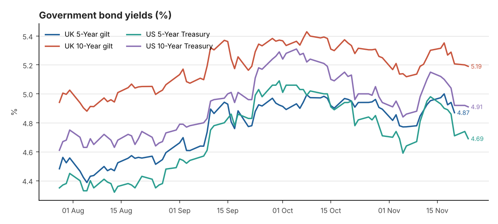
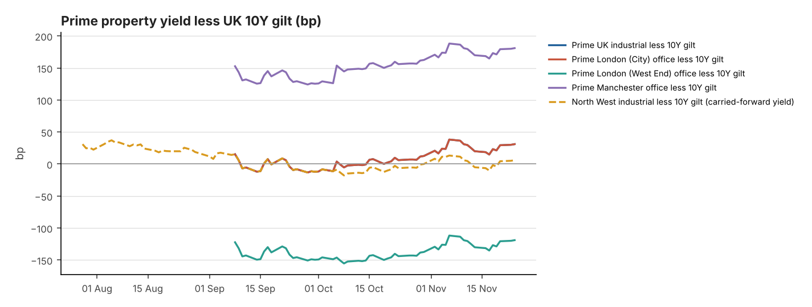

# DAILY FINANCIAL & PROPERTY INVESTMENT BRIEFING

**Date:** 25 November 2026 
**Reporting time:** 06:30 UK time

<small>Generated 2026-11-25 06:31 UTC · run `20261125T063141Z` · commentary: analyst note. Each figure shows its own observation date. Definitions, data-quality notes and full sources are in the appendix.</small>

> **Alerts**
> - New listings: 6 new North West industrial listings (133,926 sq ft); largest Interchange 81, Huyton, Merseyside, 83,165 sq ft.
> - Corporate action — SEGRO: Recommended share offer from Prologis (0.0920 new Prologis shares per SEGRO share, partial cash alternative at 1,031.7p; completion expected H1 2027). Shares trade on deal terms.

## 1. Executive Summary

1. **LondonMetric results show yields moving out.** EPRA NTA fell 1.0% to **198.5p**. Yields moved out 18bp, ERV growth of 2.3% partly offset it, and the valuation fell 0.3%. Earnings rose 9.8% after the Picton takeover. LTV is 36.6% and cost of debt 3.9% ([RNS](https://www.investegate.co.uk/announcement/rns/londonmetric-property--lmp/half-year-financial-report/9889964)).
2. **Gilts steady.** Trading Economics quoted the 10Y at **5.19%** on 24 November (−1bp; a market quote, and one headline shows about 5.23%). The US 10Y was 4.91% and the 2Y 4.63%. The cushion over prime distribution (5.50%+ NIY, carried forward) is about **+31bp**.
3. **New North West listings.** The sweep found six new listings totalling 133,926 sq ft. The largest is **Interchange 81, Huyton Business Park, Merseyside (83,165 sq ft)**. The sweep also shows 20 removals (1.67m sq ft), including Omega 420 at Warrington and Oldham 369. These are not confirmed as lettings.
4. **Liverpool Waters scaled back.** Liverpool approved Peel's revised masterplan, which cuts the maximum development by about 8m sq ft for deliverability ([Place North West](https://www.placenorthwest.co.uk/updated-liverpool-waters-masterplan-approved/)).
5. **Capital markets.** British Land priced £375m of 2031 convertibles at a **3.75%** coupon, well below gilt yields. Prologis rose 1.7% to $127.32, so the SEGRO share offer is worth about 894p. Prologis UK has refurbished a record 2.7m sq ft this year.

## 2. Government Bond Yields — UK and US

| Market | Latest Yield | Daily | 7-Day | 30-Day | Observed | Source |
|---|---|---|---|---|---|---|
| UK 5-Year gilt | 4.87% | -7.1bp | -8.3bp | -8.1bp | 20 Nov 2026 | [Bank of England Database (IADB)](https://www.bankofengland.co.uk/boeapps/database/fromshowcolumns.asp?SeriesCodes=IUDSNPY&UsingCodes=Y) |
| UK 10-Year gilt | 5.19% | -1bp | -16.2bp† | -12.5bp† | 24 Nov 2026 | [Trading Economics](https://tradingeconomics.com/united-kingdom/government-bond-yield) *(secondary)* |
| US 5-Year Treasury | 4.69% | -5bp | -21bp | -13bp | 24 Nov 2026 | [US Treasury - Daily Treasury Par Yield Curve Rates](https://home.treasury.gov/resource-center/data-chart-center/interest-rates/TextView?type=daily_treasury_yield_curve&field_tdr_date_value=2026) |
| US 10-Year Treasury | 4.91% | -1bp | -19bp | -9bp | 24 Nov 2026 | [US Treasury - Daily Treasury Par Yield Curve Rates](https://home.treasury.gov/resource-center/data-chart-center/interest-rates/TextView?type=daily_treasury_yield_curve&field_tdr_date_value=2026) |
| UK 2-Year gilt | 4.89% | +1bp | -15bp† | Not verified | 23 Nov 2026 | [Trading Economics (table)](https://tradingeconomics.com/united-kingdom/government-bond-yield) *(secondary)* |
| UK 30-Year gilt | 5.69% | Not verified | -10bp | Not verified | 23 Nov 2026 | [Trading Economics](https://tradingeconomics.com/united-kingdom/30-year-bond-yield) *(secondary)* |
| US 2-Year Treasury | 4.63% | 0bp | -17bp | -6bp | 24 Nov 2026 | [US Treasury - Daily Treasury Par Yield Curve Rates](https://home.treasury.gov/resource-center/data-chart-center/interest-rates/TextView?type=daily_treasury_yield_curve&field_tdr_date_value=2026) |
| US 30-Year Treasury | 5.30% | +1bp | -16bp | -3bp | 24 Nov 2026 | [US Treasury - Daily Treasury Par Yield Curve Rates](https://home.treasury.gov/resource-center/data-chart-center/interest-rates/TextView?type=daily_treasury_yield_curve&field_tdr_date_value=2026) |

**10Y less 5Y:** UK Not verified · US +22bp (24 Nov 2026) 
<small>Changes in basis points. † = comparison crosses sources or instruments (indicative).</small>

## 3. Interest Rates — Bank Rate, SONIA and Fed

| Indicator | Latest | Previous | Date | Change | Source |
|---|---|---|---|---|---|
| BoE Bank Rate | 4.00% | 3.75% | effective 05 Nov 2026 | +25bp | [Bank of England Database (IADB)](https://www.bankofengland.co.uk/boeapps/database/fromshowcolumns.asp?SeriesCodes=IUDBEDR&UsingCodes=Y) |
| SONIA (overnight fixing) | 3.9837% | 3.9841% | 20 Nov 2026 | 0bp | [FRED IUDSOIA](https://fred.stlouisfed.org/series/IUDSOIA) |
| 5Y SONIA swap (finance-cost reference) | 4.58% ⚠ stale | 4.74% | 04 Nov 2026 | -16bp | [Knight Frank Prime Yield Guide (Macrobond/ICAP)](https://www.knightfrank.co.uk/site-assets/research/report-pdfs/yield-guide/prime-yield-guide-nov-2026.pdf) *(secondary)* |
| Fed funds target range | 3.75–4.00% | 3.50–3.75% | effective 17 Sep 2026 | +25bp | [FRED DFEDTARU](https://fred.stlouisfed.org/series/DFEDTARU) |

**Next MPC decision:** 17 Dec 2026

**Confirmed:** Bank Rate 4.00%; next MPC decision 17 December. SONIA was 3.98% (20 Nov) and the BoE 5Y par yield 4.87% (20 Nov).

**Not verified:** OIS pricing. The last press-reported December hike probability was about 80% (Reuters, 18 Nov).

**Interpretation:** rates are stable ahead of the MPC. REITs are using equity-linked debt such as British Land's 3.75% convertible to borrow below gilt yields. That route is open only to large listed balance sheets, not to private North West investors.

## 4. Inflation — UK and US

| Indicator | Latest | Previous | Period | Trend | Source |
|---|---|---|---|---|---|
| UK CPI (12m) | 3.6% | 3.5% | Oct 2026 (pub. 18 Nov) | Accelerating | [ONS MM23](https://www.ons.gov.uk/economy/inflationandpriceindices/timeseries/d7g7/mm23) |
| UK CPIH (12m) | 3.7% | 3.6% | Oct 2026 (pub. 18 Nov) | Accelerating | [ONS MM23](https://www.ons.gov.uk/economy/inflationandpriceindices/timeseries/l55o/mm23) |
| UK core CPI (12m, ex energy, food, alcohol & tobacco) | 2.8% | 2.8% | Oct 2026 (pub. 18 Nov) | Accelerating | [ONS MM23](https://www.ons.gov.uk/economy/inflationandpriceindices/timeseries/dko8/mm23) |
| US CPI-U (12m, NSA) | 3.7% | 3.4% | Sep 2026 | Accelerating | [BLS CPI via FRED CPIAUCNS](https://fred.stlouisfed.org/series/CPIAUCNS) |
| US core CPI-U (12m, NSA) | 2.6% | 2.4% | Sep 2026 | Broadly stable | [BLS CPI via FRED CPILFENS](https://fred.stlouisfed.org/series/CPILFENS) |

**Next ONS inflation release:** see Section 14

## 5. Prime UK Industrial and Office Investment Yields

| Sector | Latest | Basis | Previous | Move | Evidence | Source |
|---|---|---|---|---|---|---|
| UK Industrial & Logistics | 5.50% | NIY | 5.25–5.50% | +12.5bp | Nov 2026 | [Knight Frank Prime Yield Guide](https://www.knightfrank.co.uk/site-assets/research/report-pdfs/yield-guide/prime-yield-guide-nov-2026.pdf) |
| Prime Distribution Warehouses ‡ | 5.50–5.75% | Not stated | 5.50% | +12.5bp | Nov 2026 | [Knight Frank Prime Yield Guide](https://www.knightfrank.co.uk/site-assets/research/report-pdfs/yield-guide/prime-yield-guide-nov-2026.pdf) |
| South East Industrial ‡ | 5.25–5.50% | Not stated | 5.25% | +12.5bp | Nov 2026 | [Knight Frank Prime Yield Guide](https://www.knightfrank.co.uk/site-assets/research/report-pdfs/yield-guide/prime-yield-guide-nov-2026.pdf) |
| Greater London Industrial | 5.25% | Not stated | 5.00–5.25% | +12.5bp | Nov 2026 | [Knight Frank Prime Yield Guide](https://www.knightfrank.co.uk/site-assets/research/report-pdfs/yield-guide/prime-yield-guide-nov-2026.pdf) |
| Prime Multi-let Industrial (Rest of UK) ‡ | 5.25–5.50% | Not stated | 5.25% | +12.5bp | Nov 2026 | [Knight Frank Prime Yield Guide](https://www.knightfrank.co.uk/site-assets/research/report-pdfs/yield-guide/prime-yield-guide-nov-2026.pdf) |
| North West Industrial ‡ | 5.25% | NIY | — | — | Q4 2025 ⚠ carried forward (329d) | [Knight Frank LOGIC: North West 2025 Review](https://www.knightfrank.co.uk/site-assets/research/report-pdfs/logic/2025-review-nw-industrial.pdf) |
| UK Logistics (average of 71 submarkets) ‡ | 5.74% | NIY | 5.59% | +15bp | Q3 2026 ⚠ carried forward (56d) | [Cushman & Wakefield UK Industrial MarketBeat](https://www.cushmanwakefield.com/en/united-kingdom/insights/uk-marketbeat/industrial-marketbeat) |
| London West End Offices | 4.00% | Not stated | 3.75–4.00% | +12.5bp | Nov 2026 | [Knight Frank Prime Yield Guide](https://www.knightfrank.co.uk/site-assets/research/report-pdfs/yield-guide/prime-yield-guide-nov-2026.pdf) |
| London City Offices | 5.50% | Not stated | 5.25–5.50% | +12.5bp | Nov 2026 | [Knight Frank Prime Yield Guide](https://www.knightfrank.co.uk/site-assets/research/report-pdfs/yield-guide/prime-yield-guide-nov-2026.pdf) |
| Manchester Offices ‡ | 7.00% | Not stated | 6.75–7.00% | +12.5bp | Nov 2026 | [Knight Frank Prime Yield Guide](https://www.knightfrank.co.uk/site-assets/research/report-pdfs/yield-guide/prime-yield-guide-nov-2026.pdf) |
| Regional UK Offices ‡ | 7.00% | Not stated | 6.75–7.00% | +12.5bp | Nov 2026 | [Knight Frank Prime Yield Guide](https://www.knightfrank.co.uk/site-assets/research/report-pdfs/yield-guide/prime-yield-guide-nov-2026.pdf) |

<small>Published prime yields, carried forward until new evidence appears — not daily valuations. ‡ = substitution; see appendix.</small>

## 6. Property Yield Spreads Versus UK Gilts

| Spread | Property yield | UK 10Y gilt | Latest spread | At evidence date | Previous comparable | Change (property / gilt) | Driver |
|---|---|---|---|---|---|---|---|
| Prime UK industrial less 10Y gilt | 5.50% (NIY, Nov 2026) | 5.19% (24 Nov) | +31bp | +38.2bp | +3.8bp (Oct 2026) | +27.2bp (+12.5bp / +14.7bp) | Both (reinforcing) |
| Prime London (City) office less 10Y gilt | 5.50% (Not stated, Nov 2026) | 5.19% (24 Nov) | +31bp | +38.2bp | +3.8bp (Oct 2026) | +27.2bp (+12.5bp / +14.7bp) | Both (reinforcing) |
| Prime London (West End) office less 10Y gilt | 4.00% (Not stated, Nov 2026) | 5.19% (24 Nov) | -119bp | -111.8bp | -146.2bp (Oct 2026) | +27.2bp (+12.5bp / +14.7bp) | Both (reinforcing) |
| Prime Manchester office less 10Y gilt | 7.00% (Not stated, Nov 2026) | 5.19% (24 Nov) | +181bp | +188.2bp | +153.8bp (Oct 2026) | +27.2bp (+12.5bp / +14.7bp) | Both (reinforcing) |
| North West industrial less 10Y gilt | 5.25% (NIY, Q4 2025) | 5.19% (24 Nov) | +6bp | +78.4bp | Not verified | Not verified | Not verified |

<small>A simple yield gap (property yield midpoint less 10Y gilt) — not a full measure of risk or relative value.</small>

**Market commentary** <small>(confirmed data points are listed in the appendix)</small>

Gilts were steady, with the 10-year quoted at about 5.19% on 24 November, close to the low of the past fortnight. US Treasuries were flat, and US logistics REITs extended their rebound: Prologis +1.7%, First Industrial +2.0%.

LondonMetric's half-year results are the first hard evidence of how this autumn's gilt sell-off is reaching valuations. Its portfolio yields moved out 18bp in six months and ERV growth of 2.3% almost fully offset it, leaving values down just 0.3% and NTA down 1.0% to 198.5p. Its EPRA NIY of 5.4% (equivalent yield 6.6%) gives a useful benchmark. Earnings rose almost 10% on acquisitions, and the balance sheet is conservative: LTV 36.6%, cost of debt 3.9%, 99% hedged, and no refinancing until FY30.

Elsewhere, landlords with pricing power continue to let above ERV. Shaftesbury Capital lets West End space 7.3% above December ERV, and Knight Frank reports prime industrial rents in Edinburgh and Glasgow up 14% over two years, against 9% nationally. Prologis UK's record 2.7m sq ft refurbishment programme shows landlords upgrading second-hand stock rather than relying on new build.

Interpretation: the evidence supports the view that December valuations will show prime industrial roughly flat, with modest yield expansion offset by rent growth. Assets without reversion will show the yield move in full.

## 7. Listed Industrial & Logistics Property Share Prices

| Company | Price | Daily | 5-Day | 1-Month | YTD | Mkt cap | Div. yield | Close | Source |
|---|---|---|---|---|---|---|---|---|---|
| SEGRO (SGRO.L) | 922.6p | — | — | — | — | Not verified | 3.4% | 09 Nov ⚠ stale | [StockInvest.us (single dated source)](https://stockinvest.us/stock-price/SGRO.L) *(secondary)* |
| Tritax Big Box REIT (BBOX.L) | 145.4p | — | — | — | — | Not verified | 5.5% | 27 Oct ⚠ stale | [Kalkine Media (dated 27 Oct 2026; single source)](https://kalkinemedia.com/uk/stocks/retail/what-tritax-big-box-reit-lsebbox-says-about-the-current-retail-stocks-story) *(secondary)* |
| LondonMetric Property (LMP.L) | 188.2p | +0.2% | — | — | — | Not verified | 6.7% | 09 Nov ⚠ stale | [StockInvest.us; corroborated by AJ Bell last trade 188.2p](https://stockinvest.us/stock-price/LMP.L) *(secondary)* |
| British Land (BLND.L) | Not verified | — | — | — | — | Not verified | — | — | — |
| Landsec (LAND.L) | 659.0p | — | — | — | — | Not verified | — | 27 Oct ⚠ stale | [Kalkine Media (dated 27 Oct 2026; single source)](https://kalkinemedia.com/uk/stocks/industrial/land-securities-lseland-leads-a-fresh-market-look-at-industrial-stocks) *(secondary)* |
| Derwent London (DLN.L) | Not verified | — | — | — | — | Not verified | — | — | — |
| Great Portland Estates (GPE.L) | Not verified | — | — | — | — | Not verified | — | — | — |
| Prologis (PLD) | $127.32 | +1.7% | +1.4% | +0.7% | -0.3% | Not verified | — | 24 Nov | [Nasdaq (official close)](https://www.nasdaq.com/market-activity/stocks/pld/historical) |

*International logistics comparators*

| Company | Price | Daily | 5-Day | 1-Month | YTD | Mkt cap | Div. yield | Close | Source |
|---|---|---|---|---|---|---|---|---|---|
| EastGroup Properties (EGP) | $200.56 | +1.6% | +3.4% | +0.8% | +12.6% | Not verified | — | 24 Nov | [Nasdaq (official close)](https://www.nasdaq.com/market-activity/stocks/egp/historical) |
| First Industrial Realty Trust (FR) | $55.15 | +2.0% | +1.3% | +1.3% | -3.7% | Not verified | — | 24 Nov | [Nasdaq (official close)](https://www.nasdaq.com/market-activity/stocks/fr/historical) |
| Rexford Industrial Realty (REXR) | $36.82 | +1.3% | +1.7% | -4.9% | -4.9% | Not verified | — | 24 Nov | [Nasdaq (official close)](https://www.nasdaq.com/market-activity/stocks/rexr/historical) |
| WDP (Warehouses De Pauw) (WDP.BR) | Not verified | — | — | — | — | Not verified | — | — | — |
| CTP (CTPNV.AS) | Not verified | — | — | — | — | Not verified | — | — | — |

<small>Latest completed trading session before the 06:30 UK briefing; end-of-day data, not real-time. London prices are in pence (GBX); US in USD; Euronext in EUR. Changes are share-price returns only, excluding dividends (not total shareholder return). ⚑ = daily move of 3% or more. Market caps from Nasdaq are as at retrieval. Dividend yield = latest annualised dividend from company reports ÷ price, where on file. "Not verified" = no licensed price feed returned data and no cited close is on file.</small>

**SEGRO — Prologis offer look-through:** 0.0920 × Prologis close $127.32 (24 Nov) ÷ $1.3104/£ (20 Nov, FRED) = **893.9p** per SEGRO share in Prologis stock, vs SEGRO close 922.6p (-3.1% offer spread). Partial cash alternative: 1031.7p (capped). <small>The FX rate lags by several days, so this is indicative only.</small>

**Corporate actions on the watchlist**

- **SEGRO** — Listed - in offer period. Recommended share offer from Prologis (0.0920 new Prologis shares per SEGRO share, partial cash alternative at 1,031.7p; completion expected H1 2027). Shares trade on deal terms. ([source](https://www.slaughterandmay.com/recent-work/advising-segro-on-the-recommended-share-offer-by-prologis/))
- **Prologis** — Listed. Acquirer of SEGRO (recommended offer). ([source](https://www.slaughterandmay.com/recent-work/advising-segro-on-the-recommended-share-offer-by-prologis/))
- **WDP (Warehouses De Pauw)** — Listed. Also admitted on Euronext Amsterdam; Euronext information document dated 26 Oct 2026. ([source](https://live.euronext.com/sites/default/files/2026-10/WDP%20Information%20Document%202026%2010%2026.pdf))

## 8. REIT Valuation and Performance Commentary

| Metric | SEGRO | Tritax Big Box REIT | LondonMetric Property | 
|---|---|---|---|
| EPRA NTA per share | 902p | 185.88p | 198.5p | 
| Loan-to-value | 31% | 32.9% | 36.6% | 
| Average cost of debt | 2.8% | 3.6% | 3.9% | 
| WAULT | — | 9.9 yrs | 16.4yrs | 
| Occupancy | 94.5% | 93.5% | 97.4% | 
| Like-for-like rental growth | 5.3% | 5.1% | 5.8% | 
| ERV growth | 1.8% | 1.9% | 2.3% | 
| Development pipeline | £90m potential rent | 507MW secured power | No direct development; c.£350m acquisition pipeline | 
| Dividend (annualised) | 31.1p | 8.0p | 12.6p | 
| Report basis | [H1 2026 (30 Jun)](https://www.segro.com/media/xlibxjqh/press-release-full-version-final.pdf) | [H1 2026 (30 Jun)](https://www.investegate.co.uk/announcement/rns/tritax-big-box-reit--bbox/half-year-report/9707045) | [H1 FY27 (30 Sep)](https://www.investegate.co.uk/announcement/rns/londonmetric-property--lmp/half-year-financial-report/9889964) | 
| Premium / (discount) to EPRA NTA | +2.3% <small>(price 09 Nov)</small> | -21.8% <small>(price 27 Oct)</small> | -5.2% <small>(price 09 Nov)</small> | 

<small>Metrics are from each company's latest report (row "Report basis"; some metrics come from later trading updates — full detail in `data/reit_fundamentals.csv`). Share-price dates are shown separately.</small>

Company announcements (last 14 days, routine filings excluded)

| Date | Company | Announcement | Type |
|---|---|---|---|
| 2026-11-24 | BLND | [Convertible Bond Pricing](https://www.investegate.co.uk/announcement/rns/british-land-company--blnd/convertible-bond-pricing/9891952) | Capital / debt |
| 2026-11-24 | LMP | [Half-year Financial Report](https://www.investegate.co.uk/announcement/rns/londonmetric-property--lmp/half-year-financial-report/9889964) | Results |
| 2026-11-24 | BLND | [Issue of Debt](https://www.investegate.co.uk/announcement/rns/british-land-company--blnd/issue-of-debt/9889892) | Capital / debt |
| 2026-11-19 | GPE | [Another strong half-year performance](https://www.investegate.co.uk/announcement/rns/great-portland-estates--gpe/another-strong-half-year-performance/9882939) | Results |
| 2026-11-18 | DLN | [Admission to Trading](https://www.investegate.co.uk/announcement/rns/derwent-london--dln/admission-to-trading/9882705) | M&A / corporate action |
| 2026-11-18 | BLND | [Half-year Financial Report](https://www.investegate.co.uk/announcement/rns/british-land-company--blnd/half-year-financial-report/9880519) | Results |
| 2026-11-16 | GPE | [GPE sells 2 Aldermanbury Square to Rothesay](https://www.investegate.co.uk/announcement/rns/great-portland-estates--gpe/gpe-sells-2-aldermanbury-square-to-rothesay-/9875715) | Other |
| 2026-11-13 | LAND | [Half-year Financial Report](https://www.investegate.co.uk/announcement/rns/land-securities-group--land/half-year-financial-report/9873573) | Results |

**Verified:**
- LondonMetric: EPRA NTA 198.5p (−1.0%), LTV 36.6%, cost of debt 3.9%, WAULT 16.4 years, occupancy 97.4%, ERV +2.3%, NIY 5.4%, dividend 6.3p (+3.3%).
- British Land: £375m convertible bonds, 3.75% coupon, due 2031, conversion price 554.57p.
- US logistics REITs up 1.3–2.0% on 24 November.
- No verified UK closes since 9 November. The last press quote for LondonMetric (178.4p, Alliance News, believed 23 Nov) is not verified and not recorded.

**Interpretation:**
- At about 178p, LondonMetric would trade at roughly a 10% discount to its new NTA. This is indicative only, given the unverified price.
- British Land's convertible locks in cheap funding but signals that management sees limited upside to the share price at the conversion premium. This is an inference, not stated by the company.

## 9. Top UK Industrial & Logistics Property News

**2. Prologis UK refurbishes a record 2.7m sq ft in 2026**

`UK INDUSTRIAL` · **▲ 100,000+ sq ft** · **new** · <small>[Property Week](https://www.propertyweek.com/news/prologis-uk-hits-2-7m-sq-ft-refurbishment-milestone), published 2026-11-24</small>

Prologis UK has completed or started 2.72m sq ft of refurbishment across 18 units this year, its largest annual volume, with 1.61m sq ft completed since January, mostly in the Midlands golden triangle. Works include the 356,310 sq ft DC2 at Wellingborough Victoria Park: new offices, floors, dock doors, LED lighting, solar and EV charging.

**Why this matters:** Refurbishing second-hand sheds is becoming a significant source of Grade A-equivalent supply. For North West owners of 1990s–2000s stock, a refurbishment (solar, LED, EPC uplift) is likely to be needed to hold rents against new schemes such as Ashton Moss and Heywood.

Key figures and relevance

- **Key figures:** 2.72m sq ft across 18 units; 1.61m sq ft completed; 356,310 sq ft DC2 Wellingborough
- **Relevance:** Major landlord upgrading second-hand stock to compete with new build and meet ESG and EPC requirements.

**3. Prime industrial rents in Edinburgh and Glasgow beat UK average**

`UK INDUSTRIAL` · **new** · <small>[Property Week](https://www.propertyweek.com/news/prime-industrial-rents-in-scotlands-central-belt-outpace-uk-average), published 2026-11-24</small>

Knight Frank analysis shows prime industrial rents in Edinburgh and Glasgow rose 14% over two years against 9% across the UK, and 23% against 17% over three years; over five years the gap narrows to 42% against 40%. Knight Frank cites little pre-Covid development, high build costs and sustained demand for Grade A sheds.

Key figures and relevance

- **Key figures:** +14% vs UK +9% (2 yrs); +23% vs +17% (3 yrs); +42% vs +40% (5 yrs)
- **Relevance:** Undersupplied regional markets are still producing above-average rental growth.

**11. MHCLG consults on single digital standard for planning applications**

`PLANNING / DEVELOPMENT` · **new** · <small>[Property Week](https://www.propertyweek.com/news/mhclg-seeks-views-on-plans-to-speed-up-the-planning-process), published 2026-11-24</small>

MHCLG has launched a consultation on replacing varied application formats with one digital data standard to speed up planning and reduce council administration. It would first cover common applications, including householder, listed building consent and prior approvals, and councils would have to process, store and publish decisions in line with the standard.

Key figures and relevance

- **Key figures:** Consultation launched; initial scope householder, LBC, prior approvals
- **Relevance:** Process reform aimed at planning delays.

## 10. North West Industrial & Logistics News

**1. Liverpool approves slimmed-down Liverpool Waters masterplan**

`NORTH WEST INDUSTRIAL` · **new** · <small>[Place North West](https://www.placenorthwest.co.uk/updated-liverpool-waters-masterplan-approved/), published 2026-11-24</small>

Liverpool City Council has approved Peel Waters' revised masterplan for the 150 acres north of Pier Head. The changes reduce the maximum number of homes, parking and office space, cutting the overall maximum development by about 8m sq ft to make the 30-year scheme, consented in 2013, more deliverable in today's market.

**Why this matters:** It shows viability, not planning, is the constraint on large North West regeneration: Peel is cutting office and residential volume to fit current costs and demand. Expect similar re-plans on other large mixed-use schemes, and keep employment land assumptions conservative.

Key figures and relevance

- **Key figures:** 150 acres; c.8m sq ft reduction in maximum quantum; 2013 outline consent
- **Relevance:** Peel is cutting the scale of a flagship Merseyside scheme to make it viable; mixed-use, not industrial.

**4. Lidl scraps later-living and pitches from Bolton plan on viability**

`PLANNING / DEVELOPMENT` · **new** · <small>[Place North West](https://www.placenorthwest.co.uk/lidl-slims-down-bolton-vision-to-unlock-foodstore/), published 2026-11-24</small>

Lidl has dropped 43 retirement apartments and football pitches from its consented plan for the former Hollands Nurseries site at Bromley Cross, Bolton, and is consulting on a foodstore with 121 parking spaces only. It says rising construction costs made the original proposal no longer financially viable, leaving the rest of the 11-acre site with no plans.

Key figures and relevance

- **Key figures:** 11-acre site; 121 spaces; 43 retirement flats dropped
- **Relevance:** Build-cost inflation is stripping secondary uses out of consented North West schemes.

**6. McDermott buys 21 acres in Clitheroe for 200 homes**

`PLANNING / DEVELOPMENT` · **new** · <small>[Place North West](https://www.placenorthwest.co.uk/mcdermott-acquires-21-acres-in-clitheroe/), published 2026-11-24</small>

Lancashire housebuilder McDermott has bought a 21-acre site off Pendle Road, Clitheroe, earmarked for 200 homes, from a private owner and land promoter Richborough. The deal, brokered by Savills, completed 19 days after the offer was accepted. Savills also advised Richborough through planning.

Key figures and relevance

- **Key figures:** 21 acres; 200 homes; completed in 19 days
- **Relevance:** Regional housebuilders still buying consented Lancashire land quickly.

**All Place North West headlines since the last briefing** <small>(Tue 24 Nov 06:00 onwards; stories summarised above are not repeated; industrial items first)</small>

| Published | Headline | |
|---|---|---|
| Tue 10:08 | [Maier takes on No10 North role](https://www.placenorthwest.co.uk/maier-takes-on-no10-north-role/) | industrial |
| Tue 11:57 | [Blunstone takes on expanded CBRE brief](https://www.placenorthwest.co.uk/blunstone-takes-on-expanded-cbre-brief/) |  |
| Tue 10:53 | [Taylor Wimpey pursues Shavington consent](https://www.placenorthwest.co.uk/taylor-wimpey-pursues-shavington-consent/) |  |
| Tue 10:44 | [£84m Carlisle Citadels refresh to secure £1.4m from CCA](https://www.placenorthwest.co.uk/84m-carlisle-citadels-refresh-to-secure-1-4m-from-cca/) |  |
| Tue 10:39 | [Will Man United’s new stadium be ready for the 2035 World Cup?](https://www.placenorthwest.co.uk/will-man-uniteds-new-stadium-be-ready-for-the-2035-world-cup/) |  |
| Tue 10:03 | [Bethell picked for £3.1m Oldfield Road contract](https://www.placenorthwest.co.uk/bethell-picked-for-3-1m-oldfield-road-contract/) |  |

**North West outlook**

Today's sweep is the busiest in a week: six new listings totalling 133,926 sq ft, led by Interchange 81 at Huyton Business Park (83,165 sq ft), plus 25,090 sq ft at Rhodes Business Park, Middleton, and 16,148 sq ft at Thornton Park, Ellesmere Port. The sweep also shows 20 removals (1.67m sq ft), including Omega 420 at Warrington (420,872 sq ft), Oldham 369 and Stakehill 295. Until the agents confirm these, treat them as withdrawals or data changes, not take-up. Availability is now 41.5m sq ft. On Merseyside, Peel's 8m sq ft cut to Liverpool Waters, and Lidl dropping uses from its Bolton scheme, show that build costs, not planning, are limiting North West schemes.

## 11. New North West Industrial Listings

<small>Agents' listings sweep of 2026-11-25 05:19 UTC (source: tracker branch `claude/magical-ride-4nijqh`, `output/daily/Latest New Listings.md`).</small>

Compared with the sweep of 2026-11-24 05:08 UTC.

- **New to market:** 6 properties, 133,926 sq ft (existing 130,210 / pipeline 3,716)
- **Returned to market:** 2
- **Removed (let, sold or withdrawn):** 20 properties, 1,669,734 sq ft
- **Advertised available now:** 915 properties, 41,540,737 sq ft

| Property | Location | sq ft | Status | Agents |
|---|---|---:|---|---|
| [Interchange 81, Huyton Business Park, Huyton, Merseysid](https://www.b8re.com/properties/interchange-81-huyton-business-park-huyton-merseyside/) | Huyton, Merseyside | 83,165 | Availability Unconfirmed | B8 Real Estate |
| [Unit 3, Rhodes Business Park, Manchester Old Road](https://dtre.com/search/properties/370994-unit-3-rhodes-business-park-manchester-old-road-middleton) | Middleton / Stakehill, Greater Manchester | 25,090 | Availability Unconfirmed | DTRE |
| [Unit 3, Thornton Park](https://lm6.co.uk/property/unit-3-thornton-park-ellesmere-port-ch65/6471/) | Ellesmere Port, Cheshire | 16,148 | Availability Unconfirmed | LM6 |
| [Oakbank Bolesworth](https://legatowen.co.uk/property/oakbank-bolesworth-bolesworth-road-tattenhall-cheshire-ch3-9hl/) | Cheshire West and Chester, Cheshire | 5,587 | Availability Unconfirmed | Legat Owen |
| [Unit 1](https://www.taylorweaver.co.uk/property/details/5950/unit-1-vale-business-centre-emerald-street-blackburn-lancashire-industrial) | Blackburn, Lancashire | 3,716 | Proposed / Design and Build | Taylor Weaver |
| [Storage Unit 13 New Russia Hall](https://legatowen.co.uk/property/storage-unit-13-new-russia-hall-bolesworth-gatesheath-chester-cheshire-ch3-9ah/) | Cheshire West and Chester, Cheshire | 220 | Availability Unconfirmed | Legat Owen |

**Returned to market:** Unit 3B Crewe Trade Park (6,073 sq ft, Legat Owen); WGT Winsford Gateway (3,058 sq ft, Legat Owen)
**Removed:** Indurent Omega 420, Omega Warrington (420,872 sq ft, DTRE); Oldham 369, Lydia Becker Way (369,251 sq ft, DTRE); Stakehill 295, Stakehill Industrial Estate (294,458 sq ft, DTRE); Air 66 & Air 84 (152,286 sq ft, Savills); Unit M1, Heywood Distribution Park (101,243 sq ft, DTRE); Green Lane / Sefton Street, Heywood (70,000 sq ft, BC Real Estate); Units 8&9, Lowry Park, Grimshaw Lane (56,009 sq ft, DTRE); Omega Drive, Northbank Industrial Estate, Irlam (45,000 sq ft, BC Real Estate); 620 Europa Boulevard (44,351 sq ft, DTRE); Unit 3 & 4, Rhodes Business Park, Manchester Old Road (30,327 sq ft, DTRE) … and 10 more
**New joint agents:** Unit 31, Stakehill Industrial Estate, Middleton, Greater Manchester (+BC Real Estate); Unit 4D, Transpennine Trading Estate (+BC Real Estate); Unit 14, Jensen Court (+Legat Owen)

Full schedule: North West Industrial & Logistics Availability.xlsx (tracker branch claude/magical-ride-4nijqh).

## 12. UK Office and Property Investment News

**5. LondonMetric earnings up 9.8% after Picton takeover; NTA down 1%**

`FINANCE / CAPITAL MARKETS` · **new** · <small>[Property Week / LondonMetric RNS](https://www.propertyweek.com/news/londonmetric-delivers-earnings-growth-on-the-back-of-picton-takeover), published 2026-11-24</small>

LondonMetric's EPRA earnings rose 9.8% to £163.1m in the six months to 30 September, helped by the £307m Picton takeover and rental growth. EPRA NTA fell 1.0% to 198.5p as 18bp of yield expansion outweighed 2.3% ERV growth. LTV is 36.6% and cost of debt 3.9%. The dividend rose 3.3% to 6.3p, and a £350m acquisition pipeline includes £200m under offer.

**Why this matters:** LondonMetric's 18bp yield expansion, offset by ERV growth to leave values down 0.3%, is the first hard evidence of how higher gilts are feeding into valuations. It matches our expectation of flat to slightly lower prime industrial values in the December round.

Key figures and relevance

- **Key figures:** EPRA earnings £163.1m (+9.8%); NTA 198.5p (−1.0%); LTV 36.6%; cost of debt 3.9%; NIY 5.4%; ERV +2.3%
- **Relevance:** First listed logistics-heavy REIT results to show valuation yield expansion this autumn.

**7. British Land raises £375m in 3.75% convertible bonds**

`FINANCE / CAPITAL MARKETS` · **new** · <small>[Investegate (RNS)](https://www.investegate.co.uk/announcement/rns/british-land-company--blnd/convertible-bond-pricing/9891952), published 2026-11-24</small>

British Land has priced £375m of senior unsecured convertible bonds due 2031 with a 3.75% semi-annual coupon, settling around 1 December. They convert at £5.5457 per share, a 30% premium to the VWAP, equal to about 6.6% of issued share capital. British Land can settle conversions in shares, cash or a mix.

Key figures and relevance

- **Key figures:** £375m; 3.75% coupon; due 2031; conversion £5.5457 (30% premium)
- **Relevance:** REITs are using convertibles to borrow below gilt yields.

**8. Google buys its 6 Pancras Square King's Cross HQ**

`OFFICES` · **new** · <small>[Property Week](https://www.propertyweek.com/news/google-plans-to-buy-its-london-kings-cross-headquarters), published 2026-11-24</small>

BNP Paribas AM Alts and PSP Investments have agreed to sell 6 Pancras Square to its occupier, Google. The building has 371,000 sq ft of Grade A offices and 32,000 sq ft of retail across six units, and forms part of Google's King's Cross campus. Price not disclosed in the article.

Key figures and relevance

- **Key figures:** 371,000 sq ft offices + 32,000 sq ft retail; price not disclosed
- **Relevance:** Occupier buying its own prime London HQ.

**9. Heineken buys 304 Stonegate pubs for about £300m**

`PROPERTY INVESTMENT` · **new** · <small>[Property Week](https://www.propertyweek.com/news/heineken-snaps-up-300-strong-stonegate-pub-portfolio), published 2026-11-24</small>

Heineken UK has bought 304 pubs from Stonegate Group in a deal reported at around £300m, which it calls the most significant UK pub investment in recent years. It adds to £380m invested in its estate since 2018. The price is a reported figure, not confirmed by the parties.

Key figures and relevance

- **Key figures:** 304 pubs; c.£300m (reported); £380m invested since 2018
- **Relevance:** Large operational real estate portfolio sale to a trade buyer.

**10. Shaftesbury Capital lets West End space 7.3% above ERV**

`OFFICES` · **new** · <small>[Property Week](https://www.propertyweek.com/news/shaftesbury-capital-secures-39m-rent-from-leasing-deals), published 2026-11-24</small>

Shaftesbury Capital has signed 383 leasing deals worth £38.8m of contracted rent so far this year, on average 7.3% above December 2025 ERV. In the four months to 31 October it completed 157 deals worth £15.6m, 4.8% above June ERV and 19.9% above previous passing rents.

Key figures and relevance

- **Key figures:** £38.8m from 383 deals; +7.3% vs Dec-25 ERV; 157 deals £15.6m (Jul–Oct)
- **Relevance:** Prime, supply-constrained London retail and leisure rents still rising.

## 13. What This Means for the North West Industrial Market

1. **Pricing and yields.** *Verified:* LondonMetric saw 18bp of yield expansion offset by 2.3% ERV growth; 10Y gilt about 5.19%. *Interpretation:* expect December valuations of prime North West stock to show a 10–25bp outward yield move, offset by rents. Price reversionary lots on rental growth, not yield compression.
2. **Rents and demand.** *Verified:* Central Belt prime rents +14% over two years against +9% for the UK; six new North West listings (133,926 sq ft). *Interpretation:* undersupplied regional markets still deliver above-average growth. New supply at Huyton and Middleton is mid-box, so it will compete with Merseyside and Rochdale second-hand units more than with big boxes.
3. **Viability and supply.** *Verified:* Liverpool Waters cut by about 8m sq ft; Lidl dropped uses at Bolton on cost; Prologis UK refurbished 2.7m sq ft. *Interpretation:* upgrading existing North West stock is often more viable than new build. Owners of older units should budget for refurbishment to EPC B or better.
4. **Debt and funding.** *Verified:* British Land is borrowing at 3.75% via a convertible; LondonMetric's cost of debt is 3.9%. *Interpretation:* listed REITs have a funding advantage of 150–250bp over private buyers. Expect them to win competitive bids for prime, long-let North West assets.
5. **Appetite.** *Verified:* LondonMetric has a £350m acquisition pipeline, £200m of it under offer. *Interpretation:* long-income buyers are active. Long-let North West industrial with indexed reviews should be marketed to LondonMetric and similar buyers.

## 14. Upcoming Economic and Property Market Events

No scheduled events on file for the next seven days.

---

## Appendix — Data quality, definitions and sources

Expand: data quality, definitions and full sources

**Confirmed data points used in the commentary**

- UK 10Y gilt 5.19% on 24 Nov 2026: fell 1bp on the day, fell 16.2bp over 7 days, fell 12.5bp over 30 days (mixed sources - see Table A notes).
- US 10Y Treasury 4.91% on 24 Nov 2026: fell 1bp on the day, fell 19bp over 7 days, fell 9bp over 30 days.
- Bank Rate 4.00% (effective 05 Nov 2026, changed +25bp from 3.75%).
- UK CPI 3.6% in October 2026 (previous 3.5%); trend: Accelerating.
- US CPI 3.7% in September 2026 (previous 3.4%); trend: Accelerating.
- Latest published prime yield movements: UK Industrial & Logistics +12.5bp to 5.50% (Knight Frank Prime Yield Guide, Nov 2026); Prime Distribution Warehouses +12.5bp to 5.50–5.75% (Knight Frank Prime Yield Guide, Nov 2026); South East Industrial +12.5bp to 5.25–5.50% (Knight Frank Prime Yield Guide, Nov 2026); Greater London Industrial +12.5bp to 5.25% (Knight Frank Prime Yield Guide, Nov 2026); Prime Multi-let Industrial (Rest of UK) +12.5bp to 5.25–5.50% (Knight Frank Prime Yield Guide, Nov 2026); UK Logistics (average of 71 submarkets) +15bp to 5.74% (Cushman & Wakefield UK Industrial MarketBeat, Q3 2026); London West End Offices +12.5bp to 4.00% (Knight Frank Prime Yield Guide, Nov 2026); London City Offices +12.5bp to 5.50% (Knight Frank Prime Yield Guide, Nov 2026); Manchester Offices +12.5bp to 7.00% (Knight Frank Prime Yield Guide, Nov 2026); Regional UK Offices +12.5bp to 7.00% (Knight Frank Prime Yield Guide, Nov 2026).

**Retrieval failures and data gaps**

- All automated sources responded.
- 5Y SONIA swap rate: latest observation (04 Nov 2026) is stale.
- US CPI-U (12m, NSA): latest observation (01 Sep 2026) is stale.
- US core CPI-U (12m, NSA): latest observation (01 Sep 2026) is stale.
- Discrepancy — UK 10-Year gilt, 2026-11-06: 5.12% (Bank of England Database (IADB)) vs 5.16% ([Trading Economics](https://tradingeconomics.com/united-kingdom/government-bond-yield)), +4.2bp; often a different instrument.
- Discrepancy — UK 10-Year gilt, 2026-11-13: 5.30% (Bank of England Database (IADB)) vs 5.34% ([Trading Economics](https://tradingeconomics.com/united-kingdom/government-bond-yield)), +3.9bp; often a different instrument.
- Discrepancy — UK 10-Year gilt, 2026-11-16: 5.32% (Bank of England Database (IADB)) vs 5.37% ([Trading Economics](https://tradingeconomics.com/united-kingdom/government-bond-yield)), +5.5bp; often a different instrument.
- Discrepancy — UK 10-Year gilt, 2026-11-20: 5.21% (Bank of England Database (IADB)) vs 5.24% ([Trading Economics](https://tradingeconomics.com/united-kingdom/government-bond-yield)), +3.3bp; often a different instrument.

**Property yield substitutions (‡)**

- **Prime Distribution Warehouses:** 15-year lease with open-market rent reviews (KF does not state the yield basis for this row)
- **South East Industrial:** KF South East multi-let estates
- **Prime Multi-let Industrial (Rest of UK):** KF 'Good Modern Rest of UK Estates' used as the prime multi-let proxy
- **North West Industrial:** Manchester prime (units >50,000 sq ft) used for the North West. No 2026 North West prime yield from KF, Savills, CBRE or C&W was found on 9 Nov 2026, so this Q4 2025 figure is carried forward.
- **UK Logistics (average of 71 submarkets):** An average across 71 submarkets, a wider definition than KF's single prime-distribution benchmark. This is why it reads higher.
- **Manchester Offices:** KF 'Major Regional Cities' (10-year lease) is a composite, not Manchester-specific.
- **Regional UK Offices:** KF 'Major Regional Cities' (10-year lease) is a composite, not Manchester-specific.

**Definitions**

- UK gilts from the Bank of England database are fitted nominal par yields; market quotes (e.g. Trading Economics) are benchmark-gilt yields and are labelled secondary. US yields are Treasury constant-maturity par yields.
- Net initial yield (NIY) = net income ÷ gross price including purchaser's costs. Equivalent yield = IRR assuming rent reverts to market at review/expiry. The two are not interchangeable.
- SONIA is the overnight fixing — not term SONIA or SONIA swaps.
- Inflation trend compares the last three monthly readings (±0.15pp threshold). US annual rates are calculated from the BLS NSA index via FRED.
- Share-price changes exclude dividends. 5-day = five trading sessions; 1-month = last close on or before 30 days earlier; YTD = versus the last close of the previous year.
- Correlation between gilts, property yields and listed property prices does not establish causation.

**Analyst sources**

- LondonMetric, [Half-year Financial Report](https://www.investegate.co.uk/announcement/rns/londonmetric-property--lmp/half-year-financial-report/9889964); British Land, [Convertible Bond Pricing](https://www.investegate.co.uk/announcement/rns/british-land-company--blnd/convertible-bond-pricing/9891952).
- Trading Economics, [UK 10Y gilt](https://tradingeconomics.com/united-kingdom/government-bond-yield) (24 Nov quote); US Treasury and Nasdaq data (tables).
- Alliance News via [AJ Bell](https://www.ajbell.co.uk/news/articles/londonmetric-rental-income-rises-8-property-portfolio-grows), pre-results LMP price (not verified).
- Property Week: [LondonMetric](https://www.propertyweek.com/news/londonmetric-delivers-earnings-growth-on-the-back-of-picton-takeover), [Prologis UK refurbishment](https://www.propertyweek.com/news/prologis-uk-hits-2-7m-sq-ft-refurbishment-milestone), [Central Belt rents](https://www.propertyweek.com/news/prime-industrial-rents-in-scotlands-central-belt-outpace-uk-average), [Shaftesbury Capital](https://www.propertyweek.com/news/shaftesbury-capital-secures-39m-rent-from-leasing-deals).
- Place North West: [Liverpool Waters](https://www.placenorthwest.co.uk/updated-liverpool-waters-masterplan-approved/), [Lidl Bolton](https://www.placenorthwest.co.uk/lidl-slims-down-bolton-vision-to-unlock-foodstore/), [McDermott Clitheroe](https://www.placenorthwest.co.uk/mcdermott-acquires-21-acres-in-clitheroe/).
- Listings sweep: branch `claude/magical-ride-4nijqh`, sweep of 25 Nov 2026 05:19 UTC.

<small>Prepared from public sources for professional information; not investment advice. History: `data/observations.csv`, `data/share_prices.csv`, `data/news_log.csv`, `data/announcements.csv`; audit trail: `data/audit_log.csv`.</small>
