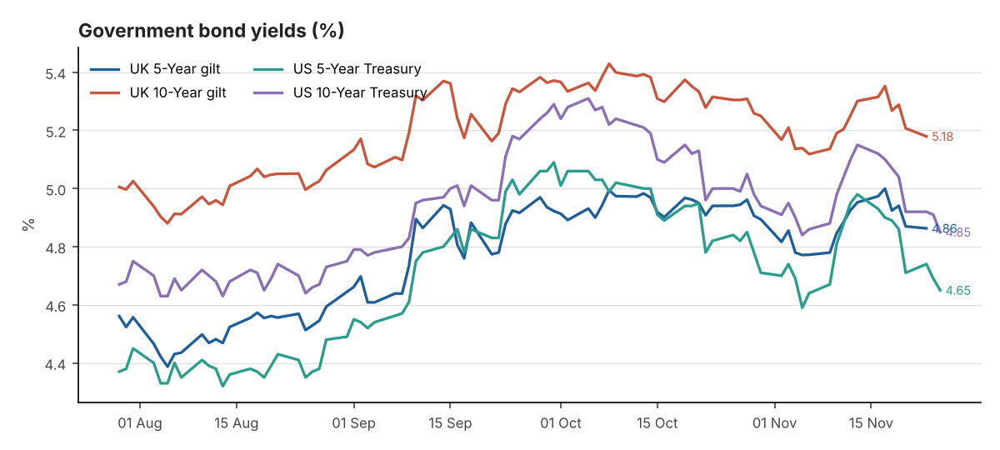
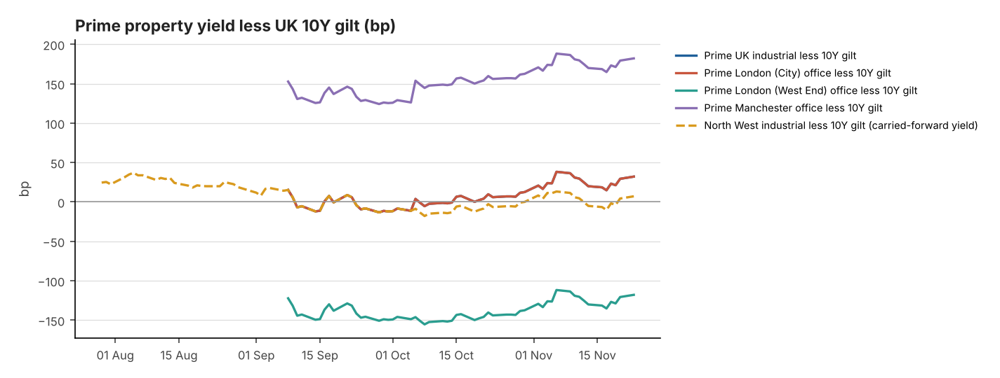

# DAILY FINANCIAL & PROPERTY INVESTMENT BRIEFING

**Date:** 26 November 2026 
**Reporting time:** 06:30 UK time

<small>Generated 2026-11-26 06:30 UTC · run `20261126T063020Z` · commentary: analyst note. Each figure shows its own observation date. Definitions, data-quality notes and full sources are in the appendix.</small>

> **Alerts**
> - New listings: 1 new North West industrial listings (1,690 sq ft); largest Unit 23-24, South Ribble (Bamber Bridge / Walton Summit), Lancashire, 1,690 sq ft.
> - Corporate action — SEGRO: Recommended share offer from Prologis (0.0920 new Prologis shares per SEGRO share, partial cash alternative at 1,031.7p; completion expected H1 2027). Shares trade on deal terms.

## 1. Executive Summary

1. **New M62 big-box site.** Richborough Commercial will promote **Richborough Park**, a 56-acre site at M62 J7 in St Helens with potential for about **649,000 sq ft** of industrial and logistics space ([TheBusinessDesk](https://www.thebusinessdesk.com/northwest/news/2183411-new-site-with-potential-for-significant-employment-secured-in-st-helens)). St Helens also approved a £147m transport package.
2. **Gilts confirmed lower on official data.** The BoE 10Y par yield was **5.18%** on 23 November (−14bp over 7 days) and the 5Y 4.86%. The US 10Y fell 6bp to 4.85% on 25 November. Prime distribution (5.50%+ NIY, carried forward) is about **+32bp** above the 10Y gilt.
3. **Refurbished and converted logistics in demand.** Network International Cargo took a refurbished 53,950 sq ft Coventry unit on a 15-year lease, and Tungsten and Bridges will turn a Hemel Hempstead office site into an 83,600 sq ft warehouse (£35m GDV).
4. **Distress.** Poundland has entered administration (stores and distribution centres still trading). Henry Boot warned of an underlying loss of up to £10m.
5. **Quiet listings day.** One new North West listing (1,690 sq ft, Bamber Bridge). Eight listings returned, including Green Lane, Heywood (70,000 sq ft) and Omega Drive, Irlam (45,000 sq ft), which reverses part of yesterday's removals.

## 2. Government Bond Yields — UK and US

| Market | Latest Yield | Daily | 7-Day | 30-Day | Observed | Source |
|---|---|---|---|---|---|---|
| UK 5-Year gilt | 4.86% | -0.7bp | -11bp | -7.7bp | 23 Nov 2026 | [Bank of England Database (IADB)](https://www.bankofengland.co.uk/boeapps/database/fromshowcolumns.asp?SeriesCodes=IUDSNPY&UsingCodes=Y) |
| UK 10-Year gilt | 5.18% | -2.8bp | -13.6bp | -13.6bp | 23 Nov 2026 | [Bank of England Database (IADB)](https://www.bankofengland.co.uk/boeapps/database/fromshowcolumns.asp?SeriesCodes=IUDMNPY&UsingCodes=Y) |
| US 5-Year Treasury | 4.65% | -4bp | -24bp | -19bp | 25 Nov 2026 | [US Treasury - Daily Treasury Par Yield Curve Rates](https://home.treasury.gov/resource-center/data-chart-center/interest-rates/TextView?type=daily_treasury_yield_curve&field_tdr_date_value=2026) |
| US 10-Year Treasury | 4.85% | -6bp | -22bp | -15bp | 25 Nov 2026 | [US Treasury - Daily Treasury Par Yield Curve Rates](https://home.treasury.gov/resource-center/data-chart-center/interest-rates/TextView?type=daily_treasury_yield_curve&field_tdr_date_value=2026) |
| UK 2-Year gilt | 4.89% | +1bp | -15bp† | Not verified | 23 Nov 2026 | [Trading Economics (table)](https://tradingeconomics.com/united-kingdom/government-bond-yield) *(secondary)* |
| UK 30-Year gilt | 5.69% | Not verified | -10bp | Not verified | 23 Nov 2026 | [Trading Economics](https://tradingeconomics.com/united-kingdom/30-year-bond-yield) *(secondary)* |
| US 2-Year Treasury | 4.61% | -2bp | -19bp | -7bp | 25 Nov 2026 | [US Treasury - Daily Treasury Par Yield Curve Rates](https://home.treasury.gov/resource-center/data-chart-center/interest-rates/TextView?type=daily_treasury_yield_curve&field_tdr_date_value=2026) |
| US 30-Year Treasury | 5.24% | -6bp | -17bp | -7bp | 25 Nov 2026 | [US Treasury - Daily Treasury Par Yield Curve Rates](https://home.treasury.gov/resource-center/data-chart-center/interest-rates/TextView?type=daily_treasury_yield_curve&field_tdr_date_value=2026) |

**10Y less 5Y:** UK +31.6bp (23 Nov 2026) · US +20bp (25 Nov 2026) 
<small>Changes in basis points. † = comparison crosses sources or instruments (indicative).</small>

## 3. Interest Rates — Bank Rate, SONIA and Fed

| Indicator | Latest | Previous | Date | Change | Source |
|---|---|---|---|---|---|
| BoE Bank Rate | 4.00% | 3.75% | effective 05 Nov 2026 | +25bp | [Bank of England Database (IADB)](https://www.bankofengland.co.uk/boeapps/database/fromshowcolumns.asp?SeriesCodes=IUDBEDR&UsingCodes=Y) |
| SONIA (overnight fixing) | 3.9847% | 3.9837% | 23 Nov 2026 | +0.1bp | [FRED IUDSOIA](https://fred.stlouisfed.org/series/IUDSOIA) |
| 5Y SONIA swap (finance-cost reference) | 4.58% ⚠ stale | 4.74% | 04 Nov 2026 | -16bp | [Knight Frank Prime Yield Guide (Macrobond/ICAP)](https://www.knightfrank.co.uk/site-assets/research/report-pdfs/yield-guide/prime-yield-guide-nov-2026.pdf) *(secondary)* |
| Fed funds target range | 3.75–4.00% | 3.50–3.75% | effective 17 Sep 2026 | +25bp | [FRED DFEDTARU](https://fred.stlouisfed.org/series/DFEDTARU) |

**Next MPC decision:** 17 Dec 2026

**Confirmed:** Bank Rate 4.00%; SONIA 3.98% (23 Nov); next MPC decision 17 December. The BoE 5Y par yield is 4.86%, down 11bp over 7 days.

**Not verified:** OIS pricing. The last press-reported December hike probability was about 80% (Reuters, 18 Nov). The fall in short gilts since then suggests it has eased, but this is not confirmed.

**Interpretation:** five-year swaps are probably lower than the stale 4.58% figure we hold (4 Nov), which helps property debt costs slightly. US markets are closed today for Thanksgiving, so tomorrow's briefing will have no new US closes.

## 4. Inflation — UK and US

| Indicator | Latest | Previous | Period | Trend | Source |
|---|---|---|---|---|---|
| UK CPI (12m) | 3.6% | 3.5% | Oct 2026 (pub. 18 Nov) | Accelerating | [ONS MM23](https://www.ons.gov.uk/economy/inflationandpriceindices/timeseries/d7g7/mm23) |
| UK CPIH (12m) | 3.7% | 3.6% | Oct 2026 (pub. 18 Nov) | Accelerating | [ONS MM23](https://www.ons.gov.uk/economy/inflationandpriceindices/timeseries/l55o/mm23) |
| UK core CPI (12m, ex energy, food, alcohol & tobacco) | 2.8% | 2.8% | Oct 2026 (pub. 18 Nov) | Accelerating | [ONS MM23](https://www.ons.gov.uk/economy/inflationandpriceindices/timeseries/dko8/mm23) |
| US CPI-U (12m, NSA) | 3.7% | 3.4% | Sep 2026 | Accelerating | [BLS CPI via FRED CPIAUCNS](https://fred.stlouisfed.org/series/CPIAUCNS) |
| US core CPI-U (12m, NSA) | 2.6% | 2.4% | Sep 2026 | Broadly stable | [BLS CPI via FRED CPILFENS](https://fred.stlouisfed.org/series/CPILFENS) |

**Next ONS inflation release:** see Section 14

## 5. Prime UK Industrial and Office Investment Yields

| Sector | Latest | Basis | Previous | Move | Evidence | Source |
|---|---|---|---|---|---|---|
| UK Industrial & Logistics | 5.50% | NIY | 5.25–5.50% | +12.5bp | Nov 2026 | [Knight Frank Prime Yield Guide](https://www.knightfrank.co.uk/site-assets/research/report-pdfs/yield-guide/prime-yield-guide-nov-2026.pdf) |
| Prime Distribution Warehouses ‡ | 5.50–5.75% | Not stated | 5.50% | +12.5bp | Nov 2026 | [Knight Frank Prime Yield Guide](https://www.knightfrank.co.uk/site-assets/research/report-pdfs/yield-guide/prime-yield-guide-nov-2026.pdf) |
| South East Industrial ‡ | 5.25–5.50% | Not stated | 5.25% | +12.5bp | Nov 2026 | [Knight Frank Prime Yield Guide](https://www.knightfrank.co.uk/site-assets/research/report-pdfs/yield-guide/prime-yield-guide-nov-2026.pdf) |
| Greater London Industrial | 5.25% | Not stated | 5.00–5.25% | +12.5bp | Nov 2026 | [Knight Frank Prime Yield Guide](https://www.knightfrank.co.uk/site-assets/research/report-pdfs/yield-guide/prime-yield-guide-nov-2026.pdf) |
| Prime Multi-let Industrial (Rest of UK) ‡ | 5.25–5.50% | Not stated | 5.25% | +12.5bp | Nov 2026 | [Knight Frank Prime Yield Guide](https://www.knightfrank.co.uk/site-assets/research/report-pdfs/yield-guide/prime-yield-guide-nov-2026.pdf) |
| North West Industrial ‡ | 5.25% | NIY | — | — | Q4 2025 ⚠ carried forward (330d) | [Knight Frank LOGIC: North West 2025 Review](https://www.knightfrank.co.uk/site-assets/research/report-pdfs/logic/2025-review-nw-industrial.pdf) |
| UK Logistics (average of 71 submarkets) ‡ | 5.74% | NIY | 5.59% | +15bp | Q3 2026 ⚠ carried forward (57d) | [Cushman & Wakefield UK Industrial MarketBeat](https://www.cushmanwakefield.com/en/united-kingdom/insights/uk-marketbeat/industrial-marketbeat) |
| London West End Offices | 4.00% | Not stated | 3.75–4.00% | +12.5bp | Nov 2026 | [Knight Frank Prime Yield Guide](https://www.knightfrank.co.uk/site-assets/research/report-pdfs/yield-guide/prime-yield-guide-nov-2026.pdf) |
| London City Offices | 5.50% | Not stated | 5.25–5.50% | +12.5bp | Nov 2026 | [Knight Frank Prime Yield Guide](https://www.knightfrank.co.uk/site-assets/research/report-pdfs/yield-guide/prime-yield-guide-nov-2026.pdf) |
| Manchester Offices ‡ | 7.00% | Not stated | 6.75–7.00% | +12.5bp | Nov 2026 | [Knight Frank Prime Yield Guide](https://www.knightfrank.co.uk/site-assets/research/report-pdfs/yield-guide/prime-yield-guide-nov-2026.pdf) |
| Regional UK Offices ‡ | 7.00% | Not stated | 6.75–7.00% | +12.5bp | Nov 2026 | [Knight Frank Prime Yield Guide](https://www.knightfrank.co.uk/site-assets/research/report-pdfs/yield-guide/prime-yield-guide-nov-2026.pdf) |

<small>Published prime yields, carried forward until new evidence appears — not daily valuations. ‡ = substitution; see appendix.</small>

## 6. Property Yield Spreads Versus UK Gilts

| Spread | Property yield | UK 10Y gilt | Latest spread | At evidence date | Previous comparable | Change (property / gilt) | Driver |
|---|---|---|---|---|---|---|---|
| Prime UK industrial less 10Y gilt | 5.50% (NIY, Nov 2026) | 5.18% (23 Nov) | +32.1bp | +38.2bp | +3.8bp (Oct 2026) | +28.3bp (+12.5bp / +15.8bp) | Both (reinforcing) |
| Prime London (City) office less 10Y gilt | 5.50% (Not stated, Nov 2026) | 5.18% (23 Nov) | +32.1bp | +38.2bp | +3.8bp (Oct 2026) | +28.3bp (+12.5bp / +15.8bp) | Both (reinforcing) |
| Prime London (West End) office less 10Y gilt | 4.00% (Not stated, Nov 2026) | 5.18% (23 Nov) | -117.9bp | -111.8bp | -146.2bp (Oct 2026) | +28.3bp (+12.5bp / +15.8bp) | Both (reinforcing) |
| Prime Manchester office less 10Y gilt | 7.00% (Not stated, Nov 2026) | 5.18% (23 Nov) | +182.1bp | +188.2bp | +153.8bp (Oct 2026) | +28.3bp (+12.5bp / +15.8bp) | Both (reinforcing) |
| North West industrial less 10Y gilt | 5.25% (NIY, Q4 2025) | 5.18% (23 Nov) | +7.1bp | +78.4bp | Not verified | Not verified | Not verified |

<small>A simple yield gap (property yield midpoint less 10Y gilt) — not a full measure of risk or relative value.</small>

**Market commentary** <small>(confirmed data points are listed in the appendix)</small>

Official Bank of England data now confirms the gilt rally: the 10-year par yield was 5.18% on 23 November, 14bp lower than a week earlier, and the 5-year 4.86%. US Treasuries extended their fall on 25 November, with the 10-year at 4.85% and the 2-year at 4.61%. US logistics REITs were little changed after their rebound, and SEGRO's Prologis share offer is worth about 892p.

Occupier news favours upgraded stock. A logistics operator signed a 15-year lease on a 53,950 sq ft Coventry unit straight after a £1.6m refurbishment. Tungsten and an impact fund are replacing an obsolete Hemel Hempstead office with an 83,600 sq ft warehouse. Together with Prologis's record refurbishment programme reported yesterday, this suggests occupiers will commit long term to well-specified older or converted space rather than waiting for new build.

The distress is mostly outside industrial. Poundland's administration hits retail landlords first, though it also operates distribution centres. Henry Boot's profit warning reflects weak land and housing sales, while Lendlease is speeding up asset exits to cut debt. Retail property is improving: NewRiver reported its fourth successive half-year of valuation growth.

Interpretation: lower gilt yields give a better backdrop into the December valuation round. Industrial demand is concentrated on quality, and contractor or developer balance-sheet stress is the main risk to delivering new schemes.

## 7. Listed Industrial & Logistics Property Share Prices

| Company | Price | Daily | 5-Day | 1-Month | YTD | Mkt cap | Div. yield | Close | Source |
|---|---|---|---|---|---|---|---|---|---|
| SEGRO (SGRO.L) | 922.6p | — | — | — | — | Not verified | 3.4% | 09 Nov ⚠ stale | [StockInvest.us (single dated source)](https://stockinvest.us/stock-price/SGRO.L) *(secondary)* |
| Tritax Big Box REIT (BBOX.L) | 145.4p | — | — | — | — | Not verified | 5.5% | 27 Oct ⚠ stale | [Kalkine Media (dated 27 Oct 2026; single source)](https://kalkinemedia.com/uk/stocks/retail/what-tritax-big-box-reit-lsebbox-says-about-the-current-retail-stocks-story) *(secondary)* |
| LondonMetric Property (LMP.L) | 188.2p | +0.2% | — | — | — | Not verified | 6.7% | 09 Nov ⚠ stale | [StockInvest.us; corroborated by AJ Bell last trade 188.2p](https://stockinvest.us/stock-price/LMP.L) *(secondary)* |
| British Land (BLND.L) | Not verified | — | — | — | — | Not verified | — | — | — |
| Landsec (LAND.L) | 659.0p | — | — | — | — | Not verified | — | 27 Oct ⚠ stale | [Kalkine Media (dated 27 Oct 2026; single source)](https://kalkinemedia.com/uk/stocks/industrial/land-securities-lseland-leads-a-fresh-market-look-at-industrial-stocks) *(secondary)* |
| Derwent London (DLN.L) | Not verified | — | — | — | — | Not verified | — | — | — |
| Great Portland Estates (GPE.L) | Not verified | — | — | — | — | Not verified | — | — | — |
| Prologis (PLD) | $127.03 | -0.2% | +1.4% | +0.6% | -0.5% | Not verified | — | 25 Nov | [Nasdaq (official close)](https://www.nasdaq.com/market-activity/stocks/pld/historical) |

*International logistics comparators*

| Company | Price | Daily | 5-Day | 1-Month | YTD | Mkt cap | Div. yield | Close | Source |
|---|---|---|---|---|---|---|---|---|---|
| EastGroup Properties (EGP) | $200.94 | +0.2% | +2.4% | +0.5% | +12.8% | Not verified | — | 25 Nov | [Nasdaq (official close)](https://www.nasdaq.com/market-activity/stocks/egp/historical) |
| First Industrial Realty Trust (FR) | $55.66 | +0.9% | +1.8% | +0.8% | -2.8% | Not verified | — | 25 Nov | [Nasdaq (official close)](https://www.nasdaq.com/market-activity/stocks/fr/historical) |
| Rexford Industrial Realty (REXR) | $36.76 | -0.2% | +1.7% | -3.3% | -5.1% | Not verified | — | 25 Nov | [Nasdaq (official close)](https://www.nasdaq.com/market-activity/stocks/rexr/historical) |
| WDP (Warehouses De Pauw) (WDP.BR) | Not verified | — | — | — | — | Not verified | — | — | — |
| CTP (CTPNV.AS) | Not verified | — | — | — | — | Not verified | — | — | — |

<small>Latest completed trading session before the 06:30 UK briefing; end-of-day data, not real-time. London prices are in pence (GBX); US in USD; Euronext in EUR. Changes are share-price returns only, excluding dividends (not total shareholder return). ⚑ = daily move of 3% or more. Market caps from Nasdaq are as at retrieval. Dividend yield = latest annualised dividend from company reports ÷ price, where on file. "Not verified" = no licensed price feed returned data and no cited close is on file.</small>

**SEGRO — Prologis offer look-through:** 0.0920 × Prologis close $127.03 (25 Nov) ÷ $1.3104/£ (20 Nov, FRED) = **891.8p** per SEGRO share in Prologis stock, vs SEGRO close 922.6p (-3.3% offer spread). Partial cash alternative: 1031.7p (capped). <small>The FX rate lags by several days, so this is indicative only.</small>

**Corporate actions on the watchlist**

- **SEGRO** — Listed - in offer period. Recommended share offer from Prologis (0.0920 new Prologis shares per SEGRO share, partial cash alternative at 1,031.7p; completion expected H1 2027). Shares trade on deal terms. ([source](https://www.slaughterandmay.com/recent-work/advising-segro-on-the-recommended-share-offer-by-prologis/))
- **Prologis** — Listed. Acquirer of SEGRO (recommended offer). ([source](https://www.slaughterandmay.com/recent-work/advising-segro-on-the-recommended-share-offer-by-prologis/))
- **WDP (Warehouses De Pauw)** — Listed. Also admitted on Euronext Amsterdam; Euronext information document dated 26 Oct 2026. ([source](https://live.euronext.com/sites/default/files/2026-10/WDP%20Information%20Document%202026%2010%2026.pdf))

## 8. REIT Valuation and Performance Commentary

| Metric | SEGRO | Tritax Big Box REIT | LondonMetric Property | 
|---|---|---|---|
| EPRA NTA per share | 902p | 185.88p | 198.5p | 
| Loan-to-value | 31% | 32.9% | 36.6% | 
| Average cost of debt | 2.8% | 3.6% | 3.9% | 
| WAULT | — | 9.9 yrs | 16.4yrs | 
| Occupancy | 94.5% | 93.5% | 97.4% | 
| Like-for-like rental growth | 5.3% | 5.1% | 5.8% | 
| ERV growth | 1.8% | 1.9% | 2.3% | 
| Development pipeline | £90m potential rent | 507MW secured power | No direct development; c.£350m acquisition pipeline | 
| Dividend (annualised) | 31.1p | 8.0p | 12.6p | 
| Report basis | [H1 2026 (30 Jun)](https://www.segro.com/media/xlibxjqh/press-release-full-version-final.pdf) | [H1 2026 (30 Jun)](https://www.investegate.co.uk/announcement/rns/tritax-big-box-reit--bbox/half-year-report/9707045) | [H1 FY27 (30 Sep)](https://www.investegate.co.uk/announcement/rns/londonmetric-property--lmp/half-year-financial-report/9889964) | 
| Premium / (discount) to EPRA NTA | +2.3% <small>(price 09 Nov)</small> | -21.8% <small>(price 27 Oct)</small> | -5.2% <small>(price 09 Nov)</small> | 

<small>Metrics are from each company's latest report (row "Report basis"; some metrics come from later trading updates — full detail in `data/reit_fundamentals.csv`). Share-price dates are shown separately.</small>

Company announcements (last 14 days, routine filings excluded)

| Date | Company | Announcement | Type |
|---|---|---|---|
| 2026-11-24 | BLND | [Convertible Bond Pricing](https://www.investegate.co.uk/announcement/rns/british-land-company--blnd/convertible-bond-pricing/9891952) | Capital / debt |
| 2026-11-24 | LMP | [Half-year Financial Report](https://www.investegate.co.uk/announcement/rns/londonmetric-property--lmp/half-year-financial-report/9889964) | Results |
| 2026-11-24 | BLND | [Issue of Debt](https://www.investegate.co.uk/announcement/rns/british-land-company--blnd/issue-of-debt/9889892) | Capital / debt |
| 2026-11-19 | GPE | [Another strong half-year performance](https://www.investegate.co.uk/announcement/rns/great-portland-estates--gpe/another-strong-half-year-performance/9882939) | Results |
| 2026-11-18 | DLN | [Admission to Trading](https://www.investegate.co.uk/announcement/rns/derwent-london--dln/admission-to-trading/9882705) | M&A / corporate action |
| 2026-11-18 | BLND | [Half-year Financial Report](https://www.investegate.co.uk/announcement/rns/british-land-company--blnd/half-year-financial-report/9880519) | Results |
| 2026-11-16 | GPE | [GPE sells 2 Aldermanbury Square to Rothesay](https://www.investegate.co.uk/announcement/rns/great-portland-estates--gpe/gpe-sells-2-aldermanbury-square-to-rothesay-/9875715) | Other |
| 2026-11-13 | LAND | [Half-year Financial Report](https://www.investegate.co.uk/announcement/rns/land-securities-group--land/half-year-financial-report/9873573) | Results |

**Verified:**
- No new SEGRO, Tritax, LondonMetric or British Land announcements since yesterday.
- Helical: half-year profit £5.3m. NewRiver: NTA 106p, valuation +1.4% like-for-like.
- Prologis $127.03 (−0.2%); First Industrial +0.9%.
- No verified UK closes since 9 November.

**Interpretation:**
- Lower gilt yields help listed UK REITs' NTA discounts in principle, but UK prices cannot be confirmed.
- The flat US REIT moves alongside lower Treasury yields again suggest sector factors as well as rates; correlation is not causation.

## 9. Top UK Industrial & Logistics Property News

**2. Tungsten and Bridges buy Hemel Hempstead site for £35m GDV logistics scheme**

`UK INDUSTRIAL` · 20,000+ sq ft · **new** · <small>[Property Week](https://www.propertyweek.com/news/tungsten-and-bridges-acquire-35m-logistics-scheme-in-hemel-hempstead), published 2026-11-25</small>

Tungsten Properties and Bridges Fund Management have bought a 3.5-acre office site at Eaton Court, Maylands Business Area, Hemel Hempstead, to build Hemel 83, a detached 83,600 sq ft Grade A distribution warehouse with full consent granted in August. The scheme has a £35m GDV and is the partners' first joint development.

**Why this matters:** Converting obsolete offices into mid-box logistics is viable in supply-constrained markets. The same play could work on dated North West business parks near the M60 and M62 where office values have fallen.

Key figures and relevance

- **Key figures:** 3.5 acres; 83,600 sq ft; £35m GDV; consented Aug 2026
- **Relevance:** Office-to-logistics redevelopment funded by an impact investor.

**3. Network International Cargo takes 53,950 sq ft refurbished Coventry unit**

`UK INDUSTRIAL` · 20,000+ sq ft · **new** · <small>[Property Week](https://www.propertyweek.com/news/network-international-cargo-selects-binley-industrial-estate-for-uk-headquarters), published 2026-11-25</small>

Network International Cargo UK has signed a 15-year lease on a 53,950 sq ft warehouse at 9 Progress Way, Binley Industrial Estate, Coventry, as its UK headquarters and Midlands cross-dock hub. Owner LCP UK (M Core) recently completed a £1.6m refurbishment including a full roof replacement. Rent not disclosed.

**Why this matters:** A 15-year lease on refurbished second-hand space backs yesterday's Prologis refurbishment story: occupiers will commit long-term to upgraded older units, which supports refurbishment appraisals on North West mid-box stock.

Key figures and relevance

- **Key figures:** 53,950 sq ft; 15-year lease; £1.6m refurbishment
- **Relevance:** Refurbished mid-box stock securing long leases.

## 10. North West Industrial & Logistics News

**1. Richborough to promote 649,000 sq ft logistics site at M62 J7, St Helens**

`NORTH WEST INDUSTRIAL` · **▲ 100,000+ sq ft** · **new** · <small>[TheBusinessDesk](https://www.thebusinessdesk.com/northwest/news/2183411-new-site-with-potential-for-significant-employment-secured-in-st-helens), published 2026-11-25</small>

Richborough Commercial has signed a promotion agreement to bring forward Richborough Park, a 56-acre industrial and logistics site immediately next to Junction 7 of the M62 in St Helens, fronting the A57 Warrington Road. It could deliver about 649,000 sq ft of employment space. Planning status and timing are not stated in the accessible text.

**Why this matters:** It adds another large strategic site to the North West pipeline, alongside Ashton Moss (300k) and Heywood (838k). Promotion means planning is still to come, so it is 2028+ supply, but it strengthens occupiers' negotiating hand on the M62 corridor.

Key figures and relevance

- **Key figures:** c.56 acres; c.649,000 sq ft potential; M62 J7 / A57
- **Relevance:** New big-box land on the M62 corridor between Liverpool and Warrington.

**4. St Helens signs off £147m transport package including £24m Sutton Oak Link**

`PLANNING / DEVELOPMENT` · **new** · <small>[Place North West](https://www.placenorthwest.co.uk/st-helens-signs-off-147m-transport-spending/), published 2026-11-25</small>

St Helens Council's cabinet has approved a £147m package of priority projects funded by the Transport for City Regions programme, including £24m for the Sutton Oak Link. Officers called it the largest coordinated transport investment package secured for the borough in recent decades.

Key figures and relevance

- **Key figures:** £147m TCR package; £24m Sutton Oak Link
- **Relevance:** Infrastructure spend improving access to St Helens employment land.

**5. DAVOS and Brickland unveil £250m Flint Yard towers plan in Liverpool**

`PLANNING / DEVELOPMENT` · **new** · <small>[Place North West](https://www.placenorthwest.co.uk/davos-brickland-unveil-250m-liverpool-towers-vision/), published 2026-11-25</small>

DAVOS and Brickland plan three residential blocks of up to 26 storeys and an eight-storey hotel on the former Norton scrap metal site off Flint Street, Liverpool. The Flint Yard scheme, designed by Falconer Chester Hall, proposes 549 apartments, a 215-room hotel and 10,000 sq ft of commercial space. Consultation starts on Monday.

Key figures and relevance

- **Key figures:** £250m; 549 apartments; 215-room hotel; 10,000 sq ft commercial
- **Relevance:** Former industrial land in Liverpool being redeveloped for residential.

**8. Bury refreshes town-centre delivery framework**

`PLANNING / DEVELOPMENT` · **new** · <small>[Place North West](https://www.placenorthwest.co.uk/bury-refreshes-blueprint-to-keep-momentum-going/), published 2026-11-25</small>

Bury Council's cabinet will consider a new town-centre delivery framework by MCAU and AECOM to replace the 2022 masterplan, prioritising a strengthened Market Quarter and a single town-centre energy network. It comes as Bury spends £10m from the Growth Mission Fund on the Indoor Market Hall and connections.

Key figures and relevance

- **Key figures:** Replaces 2022 masterplan; £10m Growth Mission Fund
- **Relevance:** Greater Manchester town-centre regeneration continues.

**All Place North West headlines since the last briefing** <small>(Wed 25 Nov 06:00 onwards; stories summarised above are not repeated; industrial items first)</small>

| Published | Headline | |
|---|---|---|
| Wed 16:32 | [Life Sciences Update | Summary + gallery](https://www.placenorthwest.co.uk/life-sciences-update-summary-gallery/) |  |
| Wed 13:53 | [Sign-off for movement-led Carlisle masterplan](https://www.placenorthwest.co.uk/sign-off-for-movement-led-carlisle-masterplan/) |  |
| Wed 11:11 | [Salix presses ahead with latest phase of £55m Salford remediation](https://www.placenorthwest.co.uk/salix-presses-ahead-with-latest-phase-of-55m-salford-remediation/) |  |
| Wed 11:08 | [Developers face injunction over incomplete work in Blackburn](https://www.placenorthwest.co.uk/developers-face-injunction-over-incomplete-work-in-blackburn/) |  |
| Wed 10:27 | [Menai bridge repairs delayed by at least six months](https://www.placenorthwest.co.uk/menai-bridge-repairs-delayed-by-at-least-six-months/) |  |
| Wed 09:55 | [BOOK NOW | Lancashire Development Update 2027](https://www.placenorthwest.co.uk/book-now-lancashire-development-update-2027/) |  |
| Wed 07:50 | [Fylde to invest in bolstering planning team](https://www.placenorthwest.co.uk/fylde-to-invest-in-bolstering-planning-team/) |  |

**North West outlook**

The main North West story is supply. Richborough's 649,000 sq ft Richborough Park at M62 J7 in St Helens joins Muse's Ashton Moss and Indurent's Heywood schemes, taking big-box proposals on the M60 and M62 to about 1.8m sq ft between them. All of them still need planning and, in practice, pre-lets. St Helens' £147m transport package, including the £24m Sutton Oak Link, should improve access to employment land in the borough. Today's sweep is quiet: one 1,690 sq ft unit added, with eight listings returned and 11 small removals. Availability is 41.6m sq ft. Henry Boot's profit warning is worth watching given its North West industrial development activity.

## 11. New North West Industrial Listings

<small>Agents' listings sweep of 2026-11-26 05:08 UTC (source: tracker branch `claude/magical-ride-4nijqh`, `output/daily/Latest New Listings.md`).</small>

Compared with the sweep of 2026-11-25 05:19 UTC.

- **New to market:** 1 properties, 1,690 sq ft (existing 97,591 / pipeline 70,000)
- **Returned to market:** 8
- **Removed (let, sold or withdrawn):** 11 properties, 94,734 sq ft
- **Advertised available now:** 919 properties, 41,601,581 sq ft

| Property | Location | sq ft | Status | Agents |
|---|---|---:|---|---|
| [Unit 23-24, Old Mill Industrial Estate](https://www.indurent.com/industrial-estates/old-mill-industrial-estate/unit-23-24/) | South Ribble (Bamber Bridge / Walton Summit), Lancashire | 1,690 | Available Now | Indurent (landlord) |

**Returned to market:** 540 Olympic Court, Salford, M50 2TP (28,336 sq ft, BC Real Estate); Green Lane / Sefton Street, Heywood (70,000 sq ft, BC Real Estate); Omega Drive, Northbank Industrial Estate, Irlam (45,000 sq ft, BC Real Estate); Unit 1, Haynes Street, Rochdale, OL12 0UW (5,120 sq ft, BC Real Estate); Unit 5E, Arrow Trading Estate, Corporation Road, Audenshaw, M34 5LR (5,035 sq ft, BC Real Estate); Unit 6B, Arrow Trading Estate, Corporation Road, Audenshaw, M34 5LR (5,103 sq ft, BC Real Estate); Unit 6C, Arrow Trading Estate, Corporation Road, Audenshaw, M34 5LR (5,305 sq ft, BC Real Estate); Units 5 & 6 Hampton Heath Industrial Estate (2,002 sq ft, Legat Owen)
**Removed:** Rockwell House (28,509 sq ft, Legat Owen); Academy Business Park, Lees Road, Knowsley, Merseyside (12,248 sq ft, B8 Real Estate); Townley Park, Middleton, Greater Manchester (11,514 sq ft, B8 Real Estate); Manchester Road, Ashton-Under-Lyne, Greater Manchester, OL7 0DA (10,746 sq ft, CPP (Commercial Property Partners)); Tarran Way South (10,000 sq ft, Legat Owen); Park Court, Sherdley Business Park, St Helens, Merseyside (7,500 sq ft, B8 Real Estate); Unit 4 Balderton Industrial Estate (6,700 sq ft, Legat Owen); Unit 3, Delhi Road, Irlam, M44 5XA (4,487 sq ft, BC Real Estate); Unit 22-24, Old Mill Industrial Estate (2,535 sq ft, Indurent (landlord)); Unit 1 Hampton Heath Industrial Estate (495 sq ft, Legat Owen) … and 1 more
**New joint agents:** Arrow Trading Estate, Corporation Road, Audenshaw, Greater Manchester (+BC Real Estate); Unit 5, Jensen Court (+Legat Owen); 8 Leacroft Road, Warrington, Cheshire (+DTRE)
**Sources not fully checked:** BC Real Estate – Partial

Full schedule: North West Industrial & Logistics Availability.xlsx (tracker branch claude/magical-ride-4nijqh).

## 12. UK Office and Property Investment News

**6. Poundland collapses into administration**

`PROPERTY INVESTMENT` · **new** · <small>[Property Week](https://www.propertyweek.com/news/discount-retailer-poundland-collapses-into-administration), published 2026-11-25</small>

Poundland has entered administration after owner Gordon Brothers failed to agree a sale, with AlixPartners appointed. All stores and distribution centres remain open for now. Landlords of its stores and its distribution centres face uncertainty over rent and occupancy.

Key figures and relevance

- **Key figures:** AlixPartners administrators; stores and DCs trading
- **Relevance:** Retail insolvency with exposure for retail and distribution landlords.

**7. Henry Boot warns of up to £10m loss as trading weakens**

`FINANCE / CAPITAL MARKETS` · **new** · <small>[Property Week](https://www.propertyweek.com/news/henry-boot-issues-profit-warning-with-losses-of-up-to-10m-expected), published 2026-11-25</small>

Henry Boot expects an underlying 2026 pre-tax loss of £0–10m, against a previously expected £9.7m profit. Hallam Land has sold 1,036 plots this year (record 3,957 last year), and Stonebridge Homes completed 154 homes against 185. Henry Boot Developments is active in North West industrial.

Key figures and relevance

- **Key figures:** Loss £0–10m vs £9.7m profit expected; 1,036 plots sold vs 3,957
- **Relevance:** Weak land and housing markets hitting a developer with NW industrial exposure.

**9. Helical profit more than doubles on London leasing**

`OFFICES` · **new** · <small>[Property Week](https://www.propertyweek.com/news/677675), published 2026-11-25</small>

Helical's half-year profit after tax rose to £5.3m from £1.8m on leasing and rental growth. Net asset value fell to £413.1m from £425.4m after a £17m capital return following the £333m sale of 100 New Bridge Street. Contracted rent is £20.6m against ERV of £29.5m.

Key figures and relevance

- **Key figures:** Profit £5.3m (from £1.8m); NAV £413.1m; contracted rent £20.6m vs ERV £29.5m
- **Relevance:** Prime London office leasing strength.

**10. NewRiver posts fourth straight half-year of valuation growth**

`PROPERTY INVESTMENT` · **new** · <small>[Property Week](https://www.propertyweek.com/news/newriver-earnings-and-valuations-rise-as-uk-retail-enters-era-of-growth), published 2026-11-25</small>

NewRiver REIT's portfolio rose 1.4% like-for-like in the half-year to September, its strongest in nine half-years. Underlying funds from operations rose 7% to £16.1m (3.7p per share, +12%), NTA rose to 106p from 105p, and the interim dividend increased to 3.4p.

Key figures and relevance

- **Key figures:** Valuation +1.4% LfL; UFFO £16.1m; NTA 106p; dividend 3.4p
- **Relevance:** Retail parks and shopping centres recovering.

**11. Lendlease to speed up exits to cut debt**

`FINANCE / CAPITAL MARKETS` · **new** · <small>[Property Week](https://www.propertyweek.com/news/lendlease-to-focus-on-faster-exits-to-strengthen-liquidly-and-alleviate-debt), published 2026-11-25</small>

Lendlease's chairman said at the AGM that the group will exit non-core markets faster, focusing on core markets including the UK, to raise liquidity and reduce debt. Net debt was A$3.72bn (£1.87bn) at its last annual report, and it made an A$749m pre-tax loss in the year to June.

Key figures and relevance

- **Key figures:** Net debt A$3.72bn (£1.87bn); pre-tax loss A$749m
- **Relevance:** A large developer under balance-sheet pressure may sell UK assets.

## 13. What This Means for the North West Industrial Market

1. **Pricing and yields.** *Verified:* BoE 10Y 5.18% (23 Nov); cushion about +32bp. *Interpretation:* the outlook for December valuations has improved. Hold prime North West guidance at about 5.50% NIY, and consider bringing well-let stock to market in early 2027 if gilts stay near this level.
2. **Rents and demand.** *Verified:* a 15-year lease on a refurbished 53,950 sq ft Coventry unit; one small new North West listing. *Interpretation:* refurbished mid-box stock can secure long leases. Market upgraded North West units on lease length and specification, not just rent.
3. **Viability and supply.** *Verified:* Richborough Park 649,000 sq ft (promotion); Hemel office-to-logistics conversion. *Interpretation:* the big-box pipeline on the M62 is growing. Owners of dated business parks near the motorway network should test conversion to logistics.
4. **Debt and funding.** *Verified:* 5Y gilt 4.86% (−11bp over 7 days); Henry Boot profit warning. *Interpretation:* debt costs are easing slightly, but developer and contractor counterparty risk is rising. Check covenant strength and build in step-in rights on forward-funded North West schemes.
5. **Appetite.** *Verified:* Bridges (impact capital) funding speculative logistics; Lendlease selling non-core assets. *Interpretation:* impact funds and private development partners are filling gaps left by stressed developers. North West landowners should approach them for joint ventures.

## 14. Upcoming Economic and Property Market Events

| Date | Event |
|---|---|
| Thu 26 Nov | [US markets closed (Thanksgiving) - no US closes or Treasury data for 26 Nov](https://www.nyse.com/markets/hours-calendars) |
| Fri 27 Nov | [US markets early close (13:00 ET)](https://www.nyse.com/markets/hours-calendars) |

---

## Appendix — Data quality, definitions and sources

Expand: data quality, definitions and full sources

**Confirmed data points used in the commentary**

- UK 10Y gilt 5.18% on 23 Nov 2026: fell 2.8bp on the day, fell 13.6bp over 7 days, fell 13.6bp over 30 days.
- US 10Y Treasury 4.85% on 25 Nov 2026: fell 6bp on the day, fell 22bp over 7 days, fell 15bp over 30 days.
- Bank Rate 4.00% (effective 05 Nov 2026, changed +25bp from 3.75%).
- UK CPI 3.6% in October 2026 (previous 3.5%); trend: Accelerating.
- US CPI 3.7% in September 2026 (previous 3.4%); trend: Accelerating.
- Latest published prime yield movements: UK Industrial & Logistics +12.5bp to 5.50% (Knight Frank Prime Yield Guide, Nov 2026); Prime Distribution Warehouses +12.5bp to 5.50–5.75% (Knight Frank Prime Yield Guide, Nov 2026); South East Industrial +12.5bp to 5.25–5.50% (Knight Frank Prime Yield Guide, Nov 2026); Greater London Industrial +12.5bp to 5.25% (Knight Frank Prime Yield Guide, Nov 2026); Prime Multi-let Industrial (Rest of UK) +12.5bp to 5.25–5.50% (Knight Frank Prime Yield Guide, Nov 2026); UK Logistics (average of 71 submarkets) +15bp to 5.74% (Cushman & Wakefield UK Industrial MarketBeat, Q3 2026); London West End Offices +12.5bp to 4.00% (Knight Frank Prime Yield Guide, Nov 2026); London City Offices +12.5bp to 5.50% (Knight Frank Prime Yield Guide, Nov 2026); Manchester Offices +12.5bp to 7.00% (Knight Frank Prime Yield Guide, Nov 2026); Regional UK Offices +12.5bp to 7.00% (Knight Frank Prime Yield Guide, Nov 2026).

**Retrieval failures and data gaps**

- All automated sources responded.
- 5Y SONIA swap rate: latest observation (04 Nov 2026) is stale.
- USD per GBP: latest observation (20 Nov 2026) is stale.
- US CPI-U (12m, NSA): latest observation (01 Sep 2026) is stale.
- US core CPI-U (12m, NSA): latest observation (01 Sep 2026) is stale.
- Discrepancy — UK 10-Year gilt, 2026-11-06: 5.12% (Bank of England Database (IADB)) vs 5.16% ([Trading Economics](https://tradingeconomics.com/united-kingdom/government-bond-yield)), +4.2bp; often a different instrument.
- Discrepancy — UK 10-Year gilt, 2026-11-13: 5.30% (Bank of England Database (IADB)) vs 5.34% ([Trading Economics](https://tradingeconomics.com/united-kingdom/government-bond-yield)), +3.9bp; often a different instrument.
- Discrepancy — UK 10-Year gilt, 2026-11-16: 5.32% (Bank of England Database (IADB)) vs 5.37% ([Trading Economics](https://tradingeconomics.com/united-kingdom/government-bond-yield)), +5.5bp; often a different instrument.
- Discrepancy — UK 10-Year gilt, 2026-11-20: 5.21% (Bank of England Database (IADB)) vs 5.24% ([Trading Economics](https://tradingeconomics.com/united-kingdom/government-bond-yield)), +3.3bp; often a different instrument.

**Property yield substitutions (‡)**

- **Prime Distribution Warehouses:** 15-year lease with open-market rent reviews (KF does not state the yield basis for this row)
- **South East Industrial:** KF South East multi-let estates
- **Prime Multi-let Industrial (Rest of UK):** KF 'Good Modern Rest of UK Estates' used as the prime multi-let proxy
- **North West Industrial:** Manchester prime (units >50,000 sq ft) used for the North West. No 2026 North West prime yield from KF, Savills, CBRE or C&W was found on 9 Nov 2026, so this Q4 2025 figure is carried forward.
- **UK Logistics (average of 71 submarkets):** An average across 71 submarkets, a wider definition than KF's single prime-distribution benchmark. This is why it reads higher.
- **Manchester Offices:** KF 'Major Regional Cities' (10-year lease) is a composite, not Manchester-specific.
- **Regional UK Offices:** KF 'Major Regional Cities' (10-year lease) is a composite, not Manchester-specific.

**Definitions**

- UK gilts from the Bank of England database are fitted nominal par yields; market quotes (e.g. Trading Economics) are benchmark-gilt yields and are labelled secondary. US yields are Treasury constant-maturity par yields.
- Net initial yield (NIY) = net income ÷ gross price including purchaser's costs. Equivalent yield = IRR assuming rent reverts to market at review/expiry. The two are not interchangeable.
- SONIA is the overnight fixing — not term SONIA or SONIA swaps.
- Inflation trend compares the last three monthly readings (±0.15pp threshold). US annual rates are calculated from the BLS NSA index via FRED.
- Share-price changes exclude dividends. 5-day = five trading sessions; 1-month = last close on or before 30 days earlier; YTD = versus the last close of the previous year.
- Correlation between gilts, property yields and listed property prices does not establish causation.

**Analyst sources**

- Bank of England IADB, US Treasury and Nasdaq data (tables); NYSE holiday calendar.
- TheBusinessDesk: [Richborough Park, St Helens](https://www.thebusinessdesk.com/northwest/news/2183411-new-site-with-potential-for-significant-employment-secured-in-st-helens).
- Place North West: [St Helens transport](https://www.placenorthwest.co.uk/st-helens-signs-off-147m-transport-spending/), [Flint Yard Liverpool](https://www.placenorthwest.co.uk/davos-brickland-unveil-250m-liverpool-towers-vision/), [Bury framework](https://www.placenorthwest.co.uk/bury-refreshes-blueprint-to-keep-momentum-going/).
- Property Week: [Hemel 83](https://www.propertyweek.com/news/tungsten-and-bridges-acquire-35m-logistics-scheme-in-hemel-hempstead), [Binley lease](https://www.propertyweek.com/news/network-international-cargo-selects-binley-industrial-estate-for-uk-headquarters), [Poundland](https://www.propertyweek.com/news/discount-retailer-poundland-collapses-into-administration), [Henry Boot](https://www.propertyweek.com/news/henry-boot-issues-profit-warning-with-losses-of-up-to-10m-expected), [Helical](https://www.propertyweek.com/news/677675), [NewRiver](https://www.propertyweek.com/news/newriver-earnings-and-valuations-rise-as-uk-retail-enters-era-of-growth), [Lendlease](https://www.propertyweek.com/news/lendlease-to-focus-on-faster-exits-to-strengthen-liquidly-and-alleviate-debt).
- Listings sweep: branch `claude/magical-ride-4nijqh`, sweep of 26 Nov 2026 05:08 UTC.

<small>Prepared from public sources for professional information; not investment advice. History: `data/observations.csv`, `data/share_prices.csv`, `data/news_log.csv`, `data/announcements.csv`; audit trail: `data/audit_log.csv`.</small>
