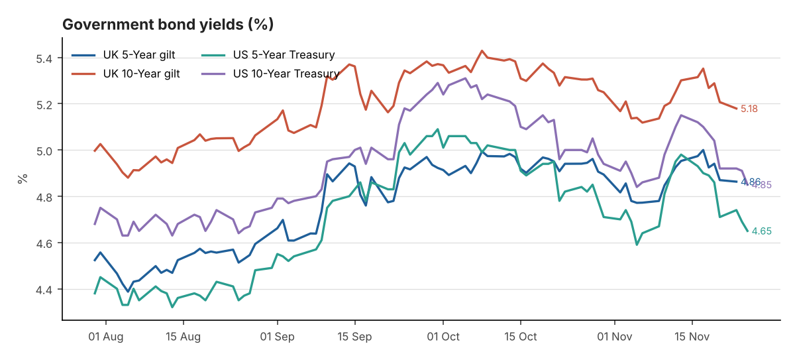
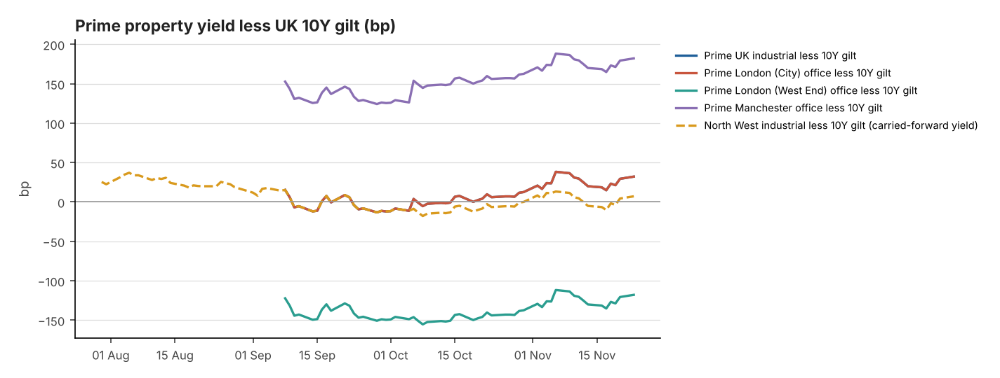

# DAILY FINANCIAL & PROPERTY INVESTMENT BRIEFING

**Date:** 27 November 2026 
**Reporting time:** 06:30 UK time

<small>Generated 2026-11-27 06:31 UTC · run `20261127T063136Z` · commentary: analyst note. Each figure shows its own observation date. Definitions, data-quality notes and full sources are in the appendix.</small>

> **Alerts**
> - New listings: 2 new North West industrial listings (34,370 sq ft); largest Units 10 & 11, Huyton, Merseyside, 34,000 sq ft.
> - Corporate action — SEGRO: Recommended share offer from Prologis (0.0920 new Prologis shares per SEGRO share, partial cash alternative at 1,031.7p; completion expected H1 2027). Shares trade on deal terms.

## 1. Executive Summary

1. **Grey Belt test at M61 J4.** Bolton officers recommend approving Peel Land's **247,000–276,000 sq ft** industrial scheme on 22 acres next to Logistics North. They accept the Green Belt site counts as Grey Belt, and the committee decides next week ([Place North West](https://www.placenorthwest.co.uk/bolton-lines-up-275000-sq-ft-peel-industrial-for-approval/)).
2. **Richborough St Helens site has no planning status yet.** The 649,000 sq ft M62 J7 site is unallocated Green Belt with no consent, so it is long-term pipeline, not near-term supply.
3. **Big Liverpool office letting.** Weightmans signed 50,000 sq ft for 15 years at Walker House, Exchange Flags, leaving Bruntwood's Plaza. It is Liverpool's second-largest office deal since 2020.
4. **No new rates data.** The Bank of England database refused access again, so the latest official gilt yields are from 23 November: 10Y 5.18% and 5Y 4.86%. US markets were closed on 26 November for Thanksgiving.
5. **Listings.** Two new North West listings totalling 34,370 sq ft; the largest is **Units 10 & 11, Neon Knowsley Lane, Huyton (34,000 sq ft, design and build)**. Crewe 145 (143,000 sq ft) has been removed; this is not confirmed as a letting.

## 2. Government Bond Yields — UK and US

| Market | Latest Yield | Daily | 7-Day | 30-Day | Observed | Source |
|---|---|---|---|---|---|---|
| UK 5-Year gilt | 4.86% ⚠ stale | -0.7bp | -11bp | -7.7bp | 23 Nov 2026 | [Bank of England Database (IADB)](https://www.bankofengland.co.uk/boeapps/database/fromshowcolumns.asp?SeriesCodes=IUDSNPY&UsingCodes=Y) |
| UK 10-Year gilt | 5.18% ⚠ stale | -2.8bp | -13.6bp | -13.6bp | 23 Nov 2026 | [Bank of England Database (IADB)](https://www.bankofengland.co.uk/boeapps/database/fromshowcolumns.asp?SeriesCodes=IUDMNPY&UsingCodes=Y) |
| US 5-Year Treasury | 4.65% | -4bp | -24bp | -19bp | 25 Nov 2026 | [US Treasury - Daily Treasury Par Yield Curve Rates](https://home.treasury.gov/resource-center/data-chart-center/interest-rates/TextView?type=daily_treasury_yield_curve&field_tdr_date_value=2026) |
| US 10-Year Treasury | 4.85% | -6bp | -22bp | -15bp | 25 Nov 2026 | [US Treasury - Daily Treasury Par Yield Curve Rates](https://home.treasury.gov/resource-center/data-chart-center/interest-rates/TextView?type=daily_treasury_yield_curve&field_tdr_date_value=2026) |
| UK 2-Year gilt | 4.89% ⚠ stale | +1bp | -15bp† | Not verified | 23 Nov 2026 | [Trading Economics (table)](https://tradingeconomics.com/united-kingdom/government-bond-yield) *(secondary)* |
| UK 30-Year gilt | 5.69% ⚠ stale | Not verified | -10bp | Not verified | 23 Nov 2026 | [Trading Economics](https://tradingeconomics.com/united-kingdom/30-year-bond-yield) *(secondary)* |
| US 2-Year Treasury | 4.61% | -2bp | -19bp | -7bp | 25 Nov 2026 | [US Treasury - Daily Treasury Par Yield Curve Rates](https://home.treasury.gov/resource-center/data-chart-center/interest-rates/TextView?type=daily_treasury_yield_curve&field_tdr_date_value=2026) |
| US 30-Year Treasury | 5.24% | -6bp | -17bp | -7bp | 25 Nov 2026 | [US Treasury - Daily Treasury Par Yield Curve Rates](https://home.treasury.gov/resource-center/data-chart-center/interest-rates/TextView?type=daily_treasury_yield_curve&field_tdr_date_value=2026) |

**10Y less 5Y:** UK +31.6bp (23 Nov 2026) · US +20bp (25 Nov 2026) 
<small>Changes in basis points. † = comparison crosses sources or instruments (indicative).</small>

## 3. Interest Rates — Bank Rate, SONIA and Fed

| Indicator | Latest | Previous | Date | Change | Source |
|---|---|---|---|---|---|
| BoE Bank Rate | 4.00% | 3.75% | effective 05 Nov 2026 | +25bp | [Bank of England Database (IADB)](https://www.bankofengland.co.uk/boeapps/database/fromshowcolumns.asp?SeriesCodes=IUDBEDR&UsingCodes=Y) |
| SONIA (overnight fixing) | 3.9861% | 3.9847% | 24 Nov 2026 | +0.1bp | [FRED IUDSOIA](https://fred.stlouisfed.org/series/IUDSOIA) |
| 5Y SONIA swap (finance-cost reference) | 4.58% ⚠ stale | 4.74% | 04 Nov 2026 | -16bp | [Knight Frank Prime Yield Guide (Macrobond/ICAP)](https://www.knightfrank.co.uk/site-assets/research/report-pdfs/yield-guide/prime-yield-guide-nov-2026.pdf) *(secondary)* |
| Fed funds target range | 3.75–4.00% | 3.50–3.75% | effective 17 Sep 2026 | +25bp | [FRED DFEDTARU](https://fred.stlouisfed.org/series/DFEDTARU) |

**Next MPC decision:** 17 Dec 2026

**Confirmed:** Bank Rate 4.00%; SONIA 3.99% (24 Nov); next MPC decision 17 December.

**Not verified:** gilt moves since 23 November, as no official or cited quote is available. OIS pricing is also not verified; the last press-reported December hike probability was about 80% (Reuters, 18 Nov).

**Interpretation:** no new information today. The rally to 23 November remains the latest confirmed position.

## 4. Inflation — UK and US

| Indicator | Latest | Previous | Period | Trend | Source |
|---|---|---|---|---|---|
| UK CPI (12m) | 3.6% | 3.5% | Oct 2026 (pub. 18 Nov) | Accelerating | [ONS MM23](https://www.ons.gov.uk/economy/inflationandpriceindices/timeseries/d7g7/mm23) |
| UK CPIH (12m) | 3.7% | 3.6% | Oct 2026 (pub. 18 Nov) | Accelerating | [ONS MM23](https://www.ons.gov.uk/economy/inflationandpriceindices/timeseries/l55o/mm23) |
| UK core CPI (12m, ex energy, food, alcohol & tobacco) | 2.8% | 2.8% | Oct 2026 (pub. 18 Nov) | Accelerating | [ONS MM23](https://www.ons.gov.uk/economy/inflationandpriceindices/timeseries/dko8/mm23) |
| US CPI-U (12m, NSA) | 3.7% | 3.4% | Sep 2026 | Accelerating | [BLS CPI via FRED CPIAUCNS](https://fred.stlouisfed.org/series/CPIAUCNS) |
| US core CPI-U (12m, NSA) | 2.6% | 2.4% | Sep 2026 | Broadly stable | [BLS CPI via FRED CPILFENS](https://fred.stlouisfed.org/series/CPILFENS) |

**Next ONS inflation release:** see Section 14

## 5. Prime UK Industrial and Office Investment Yields

| Sector | Latest | Basis | Previous | Move | Evidence | Source |
|---|---|---|---|---|---|---|
| UK Industrial & Logistics | 5.50% | NIY | 5.25–5.50% | +12.5bp | Nov 2026 | [Knight Frank Prime Yield Guide](https://www.knightfrank.co.uk/site-assets/research/report-pdfs/yield-guide/prime-yield-guide-nov-2026.pdf) |
| Prime Distribution Warehouses ‡ | 5.50–5.75% | Not stated | 5.50% | +12.5bp | Nov 2026 | [Knight Frank Prime Yield Guide](https://www.knightfrank.co.uk/site-assets/research/report-pdfs/yield-guide/prime-yield-guide-nov-2026.pdf) |
| South East Industrial ‡ | 5.25–5.50% | Not stated | 5.25% | +12.5bp | Nov 2026 | [Knight Frank Prime Yield Guide](https://www.knightfrank.co.uk/site-assets/research/report-pdfs/yield-guide/prime-yield-guide-nov-2026.pdf) |
| Greater London Industrial | 5.25% | Not stated | 5.00–5.25% | +12.5bp | Nov 2026 | [Knight Frank Prime Yield Guide](https://www.knightfrank.co.uk/site-assets/research/report-pdfs/yield-guide/prime-yield-guide-nov-2026.pdf) |
| Prime Multi-let Industrial (Rest of UK) ‡ | 5.25–5.50% | Not stated | 5.25% | +12.5bp | Nov 2026 | [Knight Frank Prime Yield Guide](https://www.knightfrank.co.uk/site-assets/research/report-pdfs/yield-guide/prime-yield-guide-nov-2026.pdf) |
| North West Industrial ‡ | 5.25% | NIY | — | — | Q4 2025 ⚠ carried forward (331d) | [Knight Frank LOGIC: North West 2025 Review](https://www.knightfrank.co.uk/site-assets/research/report-pdfs/logic/2025-review-nw-industrial.pdf) |
| UK Logistics (average of 71 submarkets) ‡ | 5.74% | NIY | 5.59% | +15bp | Q3 2026 ⚠ carried forward (58d) | [Cushman & Wakefield UK Industrial MarketBeat](https://www.cushmanwakefield.com/en/united-kingdom/insights/uk-marketbeat/industrial-marketbeat) |
| London West End Offices | 4.00% | Not stated | 3.75–4.00% | +12.5bp | Nov 2026 | [Knight Frank Prime Yield Guide](https://www.knightfrank.co.uk/site-assets/research/report-pdfs/yield-guide/prime-yield-guide-nov-2026.pdf) |
| London City Offices | 5.50% | Not stated | 5.25–5.50% | +12.5bp | Nov 2026 | [Knight Frank Prime Yield Guide](https://www.knightfrank.co.uk/site-assets/research/report-pdfs/yield-guide/prime-yield-guide-nov-2026.pdf) |
| Manchester Offices ‡ | 7.00% | Not stated | 6.75–7.00% | +12.5bp | Nov 2026 | [Knight Frank Prime Yield Guide](https://www.knightfrank.co.uk/site-assets/research/report-pdfs/yield-guide/prime-yield-guide-nov-2026.pdf) |
| Regional UK Offices ‡ | 7.00% | Not stated | 6.75–7.00% | +12.5bp | Nov 2026 | [Knight Frank Prime Yield Guide](https://www.knightfrank.co.uk/site-assets/research/report-pdfs/yield-guide/prime-yield-guide-nov-2026.pdf) |

<small>Published prime yields, carried forward until new evidence appears — not daily valuations. ‡ = substitution; see appendix.</small>

## 6. Property Yield Spreads Versus UK Gilts

| Spread | Property yield | UK 10Y gilt | Latest spread | At evidence date | Previous comparable | Change (property / gilt) | Driver |
|---|---|---|---|---|---|---|---|
| Prime UK industrial less 10Y gilt | 5.50% (NIY, Nov 2026) | 5.18% (23 Nov) | +32.1bp | +38.2bp | +3.8bp (Oct 2026) | +28.3bp (+12.5bp / +15.8bp) | Both (reinforcing) |
| Prime London (City) office less 10Y gilt | 5.50% (Not stated, Nov 2026) | 5.18% (23 Nov) | +32.1bp | +38.2bp | +3.8bp (Oct 2026) | +28.3bp (+12.5bp / +15.8bp) | Both (reinforcing) |
| Prime London (West End) office less 10Y gilt | 4.00% (Not stated, Nov 2026) | 5.18% (23 Nov) | -117.9bp | -111.8bp | -146.2bp (Oct 2026) | +28.3bp (+12.5bp / +15.8bp) | Both (reinforcing) |
| Prime Manchester office less 10Y gilt | 7.00% (Not stated, Nov 2026) | 5.18% (23 Nov) | +182.1bp | +188.2bp | +153.8bp (Oct 2026) | +28.3bp (+12.5bp / +15.8bp) | Both (reinforcing) |
| North West industrial less 10Y gilt | 5.25% (NIY, Q4 2025) | 5.18% (23 Nov) | +7.1bp | +78.4bp | Not verified | Not verified | Not verified |

<small>A simple yield gap (property yield midpoint less 10Y gilt) — not a full measure of risk or relative value.</small>

**Market commentary** <small>(confirmed data points are listed in the appendix)</small>

There is no new market data today. Bank of England yields stop at 23 November, when the 10-year par yield was 5.18%, and US markets were shut for Thanksgiving, so Treasury and US REIT prices are unchanged from 25 November. On those figures the prime industrial cushion over gilts is about 32bp, and SEGRO's Prologis share offer is worth about 892p.

The news flow is mostly about planning and supply. Bolton officers accepting Grey Belt status for Peel's M61 scheme is significant. If members agree next week, it is the clearest North West example yet of the new policy releasing Green Belt for logistics. Richborough's St Helens site will probably rely on the same argument.

Investment markets show steady institutional appetite outside industrial. Aviva Investors bought Edinburgh's fully let 280,000 sq ft Straiton Retail Park, Principal bought an Oxford build-to-rent scheme for £27.3m, and TPT combined £215m of property into a new fund. Safestore's falling occupancy (78.1%) points to softer demand for self-storage, one of the alternative uses for urban industrial units.

Interpretation: planning policy is now loosening supply faster than demand is growing. Over 2027–28 that could cap rental growth for big boxes in the North West, while well-located mid-box and urban units stay tight.

## 7. Listed Industrial & Logistics Property Share Prices

| Company | Price | Daily | 5-Day | 1-Month | YTD | Mkt cap | Div. yield | Close | Source |
|---|---|---|---|---|---|---|---|---|---|
| SEGRO (SGRO.L) | 922.6p | — | — | — | — | Not verified | 3.4% | 09 Nov ⚠ stale | [StockInvest.us (single dated source)](https://stockinvest.us/stock-price/SGRO.L) *(secondary)* |
| Tritax Big Box REIT (BBOX.L) | 145.4p | — | — | — | — | Not verified | 5.5% | 27 Oct ⚠ stale | [Kalkine Media (dated 27 Oct 2026; single source)](https://kalkinemedia.com/uk/stocks/retail/what-tritax-big-box-reit-lsebbox-says-about-the-current-retail-stocks-story) *(secondary)* |
| LondonMetric Property (LMP.L) | 188.2p | +0.2% | — | — | — | Not verified | 6.7% | 09 Nov ⚠ stale | [StockInvest.us; corroborated by AJ Bell last trade 188.2p](https://stockinvest.us/stock-price/LMP.L) *(secondary)* |
| British Land (BLND.L) | Not verified | — | — | — | — | Not verified | — | — | — |
| Landsec (LAND.L) | 659.0p | — | — | — | — | Not verified | — | 27 Oct ⚠ stale | [Kalkine Media (dated 27 Oct 2026; single source)](https://kalkinemedia.com/uk/stocks/industrial/land-securities-lseland-leads-a-fresh-market-look-at-industrial-stocks) *(secondary)* |
| Derwent London (DLN.L) | Not verified | — | — | — | — | Not verified | — | — | — |
| Great Portland Estates (GPE.L) | Not verified | — | — | — | — | Not verified | — | — | — |
| Prologis (PLD) | $127.03 | -0.2% | +1.4% | +0.6% | -0.5% | Not verified | — | 25 Nov | [Nasdaq (official close)](https://www.nasdaq.com/market-activity/stocks/pld/historical) |

*International logistics comparators*

| Company | Price | Daily | 5-Day | 1-Month | YTD | Mkt cap | Div. yield | Close | Source |
|---|---|---|---|---|---|---|---|---|---|
| EastGroup Properties (EGP) | $200.94 | +0.2% | +2.4% | +0.5% | +12.8% | Not verified | — | 25 Nov | [Nasdaq (official close)](https://www.nasdaq.com/market-activity/stocks/egp/historical) |
| First Industrial Realty Trust (FR) | $55.66 | +0.9% | +1.8% | +0.8% | -2.8% | Not verified | — | 25 Nov | [Nasdaq (official close)](https://www.nasdaq.com/market-activity/stocks/fr/historical) |
| Rexford Industrial Realty (REXR) | $36.76 | -0.2% | +1.7% | -3.3% | -5.1% | Not verified | — | 25 Nov | [Nasdaq (official close)](https://www.nasdaq.com/market-activity/stocks/rexr/historical) |
| WDP (Warehouses De Pauw) (WDP.BR) | Not verified | — | — | — | — | Not verified | — | — | — |
| CTP (CTPNV.AS) | Not verified | — | — | — | — | Not verified | — | — | — |

<small>Latest completed trading session before the 06:30 UK briefing; end-of-day data, not real-time. London prices are in pence (GBX); US in USD; Euronext in EUR. Changes are share-price returns only, excluding dividends (not total shareholder return). ⚑ = daily move of 3% or more. Market caps from Nasdaq are as at retrieval. Dividend yield = latest annualised dividend from company reports ÷ price, where on file. "Not verified" = no licensed price feed returned data and no cited close is on file.</small>

**SEGRO — Prologis offer look-through:** 0.0920 × Prologis close $127.03 (25 Nov) ÷ $1.3104/£ (20 Nov, FRED) = **891.8p** per SEGRO share in Prologis stock, vs SEGRO close 922.6p (-3.3% offer spread). Partial cash alternative: 1031.7p (capped). <small>The FX rate lags by several days, so this is indicative only.</small>

**Corporate actions on the watchlist**

- **SEGRO** — Listed - in offer period. Recommended share offer from Prologis (0.0920 new Prologis shares per SEGRO share, partial cash alternative at 1,031.7p; completion expected H1 2027). Shares trade on deal terms. ([source](https://www.slaughterandmay.com/recent-work/advising-segro-on-the-recommended-share-offer-by-prologis/))
- **Prologis** — Listed. Acquirer of SEGRO (recommended offer). ([source](https://www.slaughterandmay.com/recent-work/advising-segro-on-the-recommended-share-offer-by-prologis/))
- **WDP (Warehouses De Pauw)** — Listed. Also admitted on Euronext Amsterdam; Euronext information document dated 26 Oct 2026. ([source](https://live.euronext.com/sites/default/files/2026-10/WDP%20Information%20Document%202026%2010%2026.pdf))

## 8. REIT Valuation and Performance Commentary

| Metric | SEGRO | Tritax Big Box REIT | LondonMetric Property | 
|---|---|---|---|
| EPRA NTA per share | 902p | 185.88p | 198.5p | 
| Loan-to-value | 31% | 32.9% | 36.6% | 
| Average cost of debt | 2.8% | 3.6% | 3.9% | 
| WAULT | — | 9.9 yrs | 16.4yrs | 
| Occupancy | 94.5% | 93.5% | 97.4% | 
| Like-for-like rental growth | 5.3% | 5.1% | 5.8% | 
| ERV growth | 1.8% | 1.9% | 2.3% | 
| Development pipeline | £90m potential rent | 507MW secured power | No direct development; c.£350m acquisition pipeline | 
| Dividend (annualised) | 31.1p | 8.0p | 12.6p | 
| Report basis | [H1 2026 (30 Jun)](https://www.segro.com/media/xlibxjqh/press-release-full-version-final.pdf) | [H1 2026 (30 Jun)](https://www.investegate.co.uk/announcement/rns/tritax-big-box-reit--bbox/half-year-report/9707045) | [H1 FY27 (30 Sep)](https://www.investegate.co.uk/announcement/rns/londonmetric-property--lmp/half-year-financial-report/9889964) | 
| Premium / (discount) to EPRA NTA | +2.3% <small>(price 09 Nov)</small> | -21.8% <small>(price 27 Oct)</small> | -5.2% <small>(price 09 Nov)</small> | 

<small>Metrics are from each company's latest report (row "Report basis"; some metrics come from later trading updates — full detail in `data/reit_fundamentals.csv`). Share-price dates are shown separately.</small>

Company announcements (last 14 days, routine filings excluded)

| Date | Company | Announcement | Type |
|---|---|---|---|
| 2026-11-24 | BLND | [Convertible Bond Pricing](https://www.investegate.co.uk/announcement/rns/british-land-company--blnd/convertible-bond-pricing/9891952) | Capital / debt |
| 2026-11-24 | LMP | [Half-year Financial Report](https://www.investegate.co.uk/announcement/rns/londonmetric-property--lmp/half-year-financial-report/9889964) | Results |
| 2026-11-24 | BLND | [Issue of Debt](https://www.investegate.co.uk/announcement/rns/british-land-company--blnd/issue-of-debt/9889892) | Capital / debt |
| 2026-11-19 | GPE | [Another strong half-year performance](https://www.investegate.co.uk/announcement/rns/great-portland-estates--gpe/another-strong-half-year-performance/9882939) | Results |
| 2026-11-18 | DLN | [Admission to Trading](https://www.investegate.co.uk/announcement/rns/derwent-london--dln/admission-to-trading/9882705) | M&A / corporate action |
| 2026-11-18 | BLND | [Half-year Financial Report](https://www.investegate.co.uk/announcement/rns/british-land-company--blnd/half-year-financial-report/9880519) | Results |
| 2026-11-16 | GPE | [GPE sells 2 Aldermanbury Square to Rothesay](https://www.investegate.co.uk/announcement/rns/great-portland-estates--gpe/gpe-sells-2-aldermanbury-square-to-rothesay-/9875715) | Other |
| 2026-11-13 | LAND | [Half-year Financial Report](https://www.investegate.co.uk/announcement/rns/land-securities-group--land/half-year-financial-report/9873573) | Results |

**Verified:**
- No new SEGRO, Tritax, LondonMetric or British Land announcements.
- US REIT prices are unchanged (market holiday); Prologis $127.03 (25 Nov).
- Safestore: occupancy 78.1%, Q4 revenue +2.9%.
- No verified UK closes since 9 November.

**Interpretation:** no meaningful new REIT information today.

## 9. Top UK Industrial & Logistics Property News

No significant new UK industrial and logistics stories were found for this period.

## 10. North West Industrial & Logistics News

**1. Bolton officers back Peel's 275,000 sq ft Grey Belt industrial scheme at M61 J4**

`NORTH WEST INDUSTRIAL` · **▲ 100,000+ sq ft** · **new** · <small>[Place North West](https://www.placenorthwest.co.uk/bolton-lines-up-275000-sq-ft-peel-industrial-for-approval/), published 2026-11-26</small>

Bolton Council officers have recommended outline approval for Peel Land's 247,000–276,000 sq ft of industrial space, in up to three units, on 22 acres near M61 Junction 4, north of Salford Road and the 4m sq ft Logistics North. Officers agree the Green Belt site counts as Grey Belt. The planning committee decides next week.

**Why this matters:** An officer recommendation on Grey Belt grounds is a direct test of the new policy for North West logistics land. If members approve it, expect more Green Belt employment sites on the M61, M62 and M6 to come forward this way, adding to an already large big-box pipeline.

Key figures and relevance

- **Key figures:** 22 acres; 247,000–276,000 sq ft; up to 3 units; M61 J4; committee next week
- **Relevance:** Grey Belt policy unlocking Green Belt employment land in Greater Manchester.

**2. Richborough St Helens site is unallocated Green Belt**

`NORTH WEST INDUSTRIAL` · **▲ 100,000+ sq ft** · *follow-up* · <small>[Place North West](https://www.placenorthwest.co.uk/richborough-eyes-650000-sq-ft-st-helens-industrial/), published 2026-11-26</small>

Follow-up: Place North West reports that Richborough's 56-acre site off Jubits Lane and Warrington Road at M62 J7 is Green Belt, has no planning permission and is not allocated in St Helens' local plan. Richborough recently won consent for 700,000 sq ft in Tamworth. Spitfire advised Richborough and Selby Rural the landowner.

**Why this matters:** Today's Bolton recommendation shows the route Richborough is likely to take. Until it is consented, treat the 649,000 sq ft as speculative pipeline, not near-term supply.

Key figures and relevance

- **Key figures:** 56 acres; up to 649,000 sq ft; Green Belt, unallocated; no consent
- **Relevance:** Clarifies that delivery of the site depends on a Grey Belt or local plan route.

**3. Weightmans signs 50,000 sq ft at Walker House, Exchange Flags, Liverpool**

`OFFICES` · 20,000+ sq ft · **new** · <small>[Place North West](https://www.placenorthwest.co.uk/weightmans-signs-for-50000-sq-ft-at-exchange-flags/), published 2026-11-26</small>

Law firm Weightmans has signed a 15-year lease, with a break at year 10, on 50,000 sq ft over the ground and first floors of AP UK's (Ashtrom) Walker House, Exchange Flags. It is moving from Bruntwood's Plaza. Place North West calls it Liverpool's second-largest office deal since 2020. Rent not disclosed.

**Why this matters:** It is evidence of 'flight to quality' in a regional office market, with a tenant leaving older space for refurbished Grade A. Liverpool's Plaza will need repositioning, the kind of secondary office stock that may be converted to other uses.

Key figures and relevance

- **Key figures:** 50,000 sq ft; 15 yrs (break yr 10); landlord AP UK (Ashtrom)
- **Relevance:** Large Liverpool office letting, with professional services moving to better space.

**6. Aldi consults on £7m Hazel Grove store replacing vacant Carpetright**

`PLANNING / DEVELOPMENT` · **new** · <small>[Place North West](https://www.placenorthwest.co.uk/aldi-moves-forward-with-hazel-grove-plans/), published 2026-11-26</small>

Aldi has started public consultation on a £7m, 13,000 sq ft supermarket replacing the former Carpetright store off Macclesfield Road, Hazel Grove, Stockport, vacant since 2024. A planning application will follow in the coming months.

Key figures and relevance

- **Key figures:** 13,000 sq ft; £7m; vacant since 2024
- **Relevance:** Discount grocers recycling vacant retail warehouses in Greater Manchester.

**All Place North West headlines since the last briefing** <small>(Thu 26 Nov 06:00 onwards; stories summarised above are not repeated; industrial items first)</small>

| Published | Headline | |
|---|---|---|
| Thu 13:44 | [Sefton prepares to turn the page on Sandway](https://www.placenorthwest.co.uk/sefton-prepares-to-turn-the-page-on-sandway/) |  |
| Thu 10:55 | [Civic buys engineer behind Manchester’s timber Ivy](https://www.placenorthwest.co.uk/civic-buys-engineer-behind-manchesters-timber-ivy/) |  |
| Thu 10:40 | [Tate Liverpool confirms autumn 2027 reopening](https://www.placenorthwest.co.uk/tate-liverpool-confirms-autumn-2027-reopening/) |  |
| Thu 10:04 | [Baker leaves Cushman & Wakefield after 30 years](https://www.placenorthwest.co.uk/change-at-the-top-for-cushman-wakefield/) |  |
| Thu 09:41 | [Manchester hotel to expand with basement conversion](https://www.placenorthwest.co.uk/manchester-hotel-to-expand-with-basement-conversion/) |  |
| Thu 09:18 | [Evans returns to Wirral](https://www.placenorthwest.co.uk/evans-returns-to-wirral/) |  |

**North West outlook**

Two big-box stories dominate. Peel's 247,000–276,000 sq ft M61 J4 scheme beside Logistics North goes to committee next week with officer support on Grey Belt grounds. Richborough's 649,000 sq ft St Helens site is confirmed as unallocated Green Belt. Together with Ashton Moss and Heywood, Greater Manchester and Merseyside big-box proposals now exceed 2m sq ft, most of it needing pre-lets. Today's sweep adds 34,000 sq ft of design-and-build at Neon, Huyton, the second Neon phase marketed this week. Crewe 145 (143,000 sq ft) has been removed, which could be a letting and should be confirmed with the agents. Availability is 41.7m sq ft.

## 11. New North West Industrial Listings

<small>Agents' listings sweep of 2026-11-27 05:08 UTC (source: tracker branch `claude/magical-ride-4nijqh`, `output/daily/Latest New Listings.md`).</small>

Compared with the sweep of 2026-11-26 05:08 UTC.

- **New to market:** 2 properties, 34,370 sq ft (existing 39,104 / pipeline 34,000)
- **Returned to market:** 5
- **Removed (let, sold or withdrawn):** 6 properties, 160,916 sq ft
- **Advertised available now:** 921 properties, 41,666,311 sq ft

| Property | Location | sq ft | Status | Agents |
|---|---|---:|---|---|
| [Units 10 & 11, Neon Knowsley Lane, Knowsley, Merseyside](https://www.b8re.com/properties/units-10-11-neon-knowsley-lane-knowsley-merseyside/) | Huyton, Merseyside | 34,000 | Proposed / Design and Build | B8 Real Estate |
| [New Russia Hall Unit 16](https://legatowen.co.uk/property/new-russia-hall-unit-16-bolesworth-gatesheath-chester-road-tattenhall-chester-cheshire-ch3-9ah/) | Cheshire West and Chester, Cheshire | 370 | Availability Unconfirmed | Legat Owen |

**Returned to market:** Unit 1 Hampton Heath Industrial Estate (495 sq ft, Legat Owen); Park Court, Sherdley Business Park, St Helens, Merseyside (7,500 sq ft, B8 Real Estate); Unit 15, Beeston Court, Runcorn, Cheshire (2,725 sq ft, B8 Real Estate); Manchester Road, Ashton-Under-Lyne, Greater Manchester, OL7 0DA (10,746 sq ft, CPP (Commercial Property Partners)); Rockwell House (28,509 sq ft, Legat Owen)
**Removed:** Crewe 145 Indurent (143,000 sq ft, Legat Owen); B8C, Heywood Distribution Park, Heywood, Greater Manchester (9,766 sq ft, B8 Real Estate); Unit 9 Valley Court (4,414 sq ft, Legat Owen); Unit 1, Sandon Industrial Estate, Liverpool, Merseyside (2,725 sq ft, B8 Real Estate); Unit 12 (641 sq ft, Taylor Weaver); Unit 16 New Russia Hall (370 sq ft, Legat Owen)
**New joint agents:** Unit 6, Manchester Trade Park, Oldham Road (+BC Real Estate); Unit 2, Merlin Park, Barton Dock Road (+BC Real Estate); Units 6-8, Brookfield Business Park, Liverpool, Merseyside (+B8 Real Estate)

Full schedule: North West Industrial & Logistics Availability.xlsx (tracker branch claude/magical-ride-4nijqh).

## 12. UK Office and Property Investment News

**4. Aviva Investors buys Straiton Retail Park, Edinburgh, from Hines**

`PROPERTY INVESTMENT` · **▲ 100,000+ sq ft** · **new** · <small>[Property Week](https://www.propertyweek.com/news/aviva-investors-snap-up-edinburghs-straiton-retail-park), published 2026-11-26</small>

Aviva Investors has bought the fully let Straiton Retail Park in Edinburgh from Hines for an undisclosed sum. The 22-acre park has more than 280,000 sq ft across 28 units, let to tenants including Next, M&S, TK Maxx, Lidl and Boots.

Key figures and relevance

- **Key figures:** 22 acres; 280,000+ sq ft; 28 units; price undisclosed
- **Relevance:** Institutional buyers are returning to retail parks.

**5. TPT launches £215m UK property fund**

`FINANCE / CAPITAL MARKETS` · **new** · <small>[Property Week](https://www.propertyweek.com/news/tpt-investment-management-launches-new-215m-property-fund), published 2026-11-26</small>

TPT Investment Management has launched a reserved investor fund with £215m of assets, combining its existing UK property investments into one vehicle open to a wider range of clients, including commercial sectors.

Key figures and relevance

- **Key figures:** £215m RIF
- **Relevance:** Pension-scheme capital is being restructured to invest in UK property.

**7. Safestore Q4 revenue up 2.9% but occupancy falls to 78.1%**

`PROPERTY INVESTMENT` · **new** · <small>[Property Week](https://www.propertyweek.com/news/newly-opened-safestore-sites-drive-fourth-quarter-revenue), published 2026-11-26</small>

Safestore's revenue rose 2.9% to £63.5m in the three months to October, helped by new stores, despite softer trading in the UK and Paris. Occupancy fell to 78.1% from 79.9%. UK like-for-like revenue rose 0.5% and occupied space was 1.9% below last year.

Key figures and relevance

- **Key figures:** Revenue £63.5m (+2.9%); occupancy 78.1% (79.9%); UK LfL revenue +0.5%
- **Relevance:** Softer self-storage demand, an alternative use for urban industrial units.

**8. Principal buys Oxford North BTR scheme for £27.3m**

`PROPERTY INVESTMENT` · **new** · <small>[Property Week](https://www.propertyweek.com/news/principal-asset-management-buys-oxford-btr-scheme-for-27-3m), published 2026-11-26</small>

Principal Asset Management has agreed to buy The Hill Group's 67-home build-to-rent scheme in Canalside Quarter, part of the £700m Oxford North masterplan, for £27.3m.

Key figures and relevance

- **Key figures:** £27.3m; 67 homes; £700m masterplan
- **Relevance:** Institutional appetite for build-to-rent.

## 13. What This Means for the North West Industrial Market

1. **Pricing and yields.** *Verified:* last official 10Y gilt 5.18% (23 Nov); cushion about +32bp. *Interpretation:* nothing new. Keep prime guidance at about 5.50% NIY, pending fresh gilt data.
2. **Rents and demand.** *Verified:* Weightmans' 15-year office lease in Liverpool; possible Crewe 145 letting (unconfirmed). *Interpretation:* occupiers are committing to quality space. If the Crewe removal is a letting, it supports big-box rent assumptions on the M6.
3. **Viability and supply.** *Verified:* officers support Grey Belt for Peel's M61 scheme; St Helens 649,000 sq ft is unallocated Green Belt. *Interpretation:* Grey Belt is becoming a workable route for logistics consents. Landowners near motorway junctions should commission Grey Belt assessments, and appraisals should allow for more competing supply from 2028.
4. **Debt and funding.** *Verified:* no new rates data. *Interpretation:* no change from yesterday's view.
5. **Appetite.** *Verified:* Aviva bought a retail park; TPT launched a £215m fund. *Interpretation:* institutions are deploying into income-producing regional assets. Well-let North West multi-let industrial estates should find similar buyers.

## 14. Upcoming Economic and Property Market Events

| Date | Event |
|---|---|
| Fri 27 Nov | [US markets early close (13:00 ET)](https://www.nyse.com/markets/hours-calendars) |

---

## Appendix — Data quality, definitions and sources

Expand: data quality, definitions and full sources

**Confirmed data points used in the commentary**

- UK 10Y gilt 5.18% on 23 Nov 2026: fell 2.8bp on the day, fell 13.6bp over 7 days, fell 13.6bp over 30 days.
- US 10Y Treasury 4.85% on 25 Nov 2026: fell 6bp on the day, fell 22bp over 7 days, fell 15bp over 30 days.
- Bank Rate 4.00% (effective 05 Nov 2026, changed +25bp from 3.75%).
- UK CPI 3.6% in October 2026 (previous 3.5%); trend: Accelerating.
- US CPI 3.7% in September 2026 (previous 3.4%); trend: Accelerating.
- Latest published prime yield movements: UK Industrial & Logistics +12.5bp to 5.50% (Knight Frank Prime Yield Guide, Nov 2026); Prime Distribution Warehouses +12.5bp to 5.50–5.75% (Knight Frank Prime Yield Guide, Nov 2026); South East Industrial +12.5bp to 5.25–5.50% (Knight Frank Prime Yield Guide, Nov 2026); Greater London Industrial +12.5bp to 5.25% (Knight Frank Prime Yield Guide, Nov 2026); Prime Multi-let Industrial (Rest of UK) +12.5bp to 5.25–5.50% (Knight Frank Prime Yield Guide, Nov 2026); UK Logistics (average of 71 submarkets) +15bp to 5.74% (Cushman & Wakefield UK Industrial MarketBeat, Q3 2026); London West End Offices +12.5bp to 4.00% (Knight Frank Prime Yield Guide, Nov 2026); London City Offices +12.5bp to 5.50% (Knight Frank Prime Yield Guide, Nov 2026); Manchester Offices +12.5bp to 7.00% (Knight Frank Prime Yield Guide, Nov 2026); Regional UK Offices +12.5bp to 7.00% (Knight Frank Prime Yield Guide, Nov 2026).

**Retrieval failures and data gaps**

- All automated sources responded.
- UK 2-Year gilt: latest observation (23 Nov 2026) is stale.
- UK 5-Year gilt: latest observation (23 Nov 2026) is stale.
- UK 10-Year gilt: latest observation (23 Nov 2026) is stale.
- UK 30-Year gilt: latest observation (23 Nov 2026) is stale.
- 5Y SONIA swap rate: latest observation (04 Nov 2026) is stale.
- USD per GBP: latest observation (20 Nov 2026) is stale.
- US CPI-U (12m, NSA): latest observation (01 Sep 2026) is stale.
- US core CPI-U (12m, NSA): latest observation (01 Sep 2026) is stale.
- Discrepancy — UK 10-Year gilt, 2026-11-06: 5.12% (Bank of England Database (IADB)) vs 5.16% ([Trading Economics](https://tradingeconomics.com/united-kingdom/government-bond-yield)), +4.2bp; often a different instrument.
- Discrepancy — UK 10-Year gilt, 2026-11-13: 5.30% (Bank of England Database (IADB)) vs 5.34% ([Trading Economics](https://tradingeconomics.com/united-kingdom/government-bond-yield)), +3.9bp; often a different instrument.
- Discrepancy — UK 10-Year gilt, 2026-11-16: 5.32% (Bank of England Database (IADB)) vs 5.37% ([Trading Economics](https://tradingeconomics.com/united-kingdom/government-bond-yield)), +5.5bp; often a different instrument.
- Discrepancy — UK 10-Year gilt, 2026-11-20: 5.21% (Bank of England Database (IADB)) vs 5.24% ([Trading Economics](https://tradingeconomics.com/united-kingdom/government-bond-yield)), +3.3bp; often a different instrument.

**Property yield substitutions (‡)**

- **Prime Distribution Warehouses:** 15-year lease with open-market rent reviews (KF does not state the yield basis for this row)
- **South East Industrial:** KF South East multi-let estates
- **Prime Multi-let Industrial (Rest of UK):** KF 'Good Modern Rest of UK Estates' used as the prime multi-let proxy
- **North West Industrial:** Manchester prime (units >50,000 sq ft) used for the North West. No 2026 North West prime yield from KF, Savills, CBRE or C&W was found on 9 Nov 2026, so this Q4 2025 figure is carried forward.
- **UK Logistics (average of 71 submarkets):** An average across 71 submarkets, a wider definition than KF's single prime-distribution benchmark. This is why it reads higher.
- **Manchester Offices:** KF 'Major Regional Cities' (10-year lease) is a composite, not Manchester-specific.
- **Regional UK Offices:** KF 'Major Regional Cities' (10-year lease) is a composite, not Manchester-specific.

**Definitions**

- UK gilts from the Bank of England database are fitted nominal par yields; market quotes (e.g. Trading Economics) are benchmark-gilt yields and are labelled secondary. US yields are Treasury constant-maturity par yields.
- Net initial yield (NIY) = net income ÷ gross price including purchaser's costs. Equivalent yield = IRR assuming rent reverts to market at review/expiry. The two are not interchangeable.
- SONIA is the overnight fixing — not term SONIA or SONIA swaps.
- Inflation trend compares the last three monthly readings (±0.15pp threshold). US annual rates are calculated from the BLS NSA index via FRED.
- Share-price changes exclude dividends. 5-day = five trading sessions; 1-month = last close on or before 30 days earlier; YTD = versus the last close of the previous year.
- Correlation between gilts, property yields and listed property prices does not establish causation.

**Analyst sources**

- Bank of England IADB (to 23 Nov), US Treasury and Nasdaq data (tables); NYSE holiday calendar.
- Place North West: [Peel Bolton](https://www.placenorthwest.co.uk/bolton-lines-up-275000-sq-ft-peel-industrial-for-approval/), [Richborough St Helens](https://www.placenorthwest.co.uk/richborough-eyes-650000-sq-ft-st-helens-industrial/), [Weightmans](https://www.placenorthwest.co.uk/weightmans-signs-for-50000-sq-ft-at-exchange-flags/), [Aldi Hazel Grove](https://www.placenorthwest.co.uk/aldi-moves-forward-with-hazel-grove-plans/).
- Property Week: [Straiton Retail Park](https://www.propertyweek.com/news/aviva-investors-snap-up-edinburghs-straiton-retail-park), [TPT fund](https://www.propertyweek.com/news/tpt-investment-management-launches-new-215m-property-fund), [Safestore](https://www.propertyweek.com/news/newly-opened-safestore-sites-drive-fourth-quarter-revenue), [Principal BTR](https://www.propertyweek.com/news/principal-asset-management-buys-oxford-btr-scheme-for-27-3m).
- Listings sweep: branch `claude/magical-ride-4nijqh`, sweep of 27 Nov 2026 05:08 UTC.

<small>Prepared from public sources for professional information; not investment advice. History: `data/observations.csv`, `data/share_prices.csv`, `data/news_log.csv`, `data/announcements.csv`; audit trail: `data/audit_log.csv`.</small>
