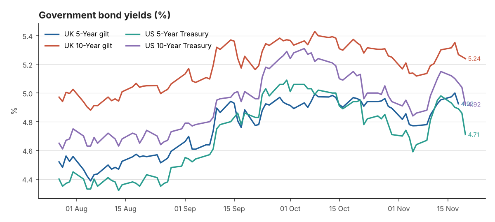
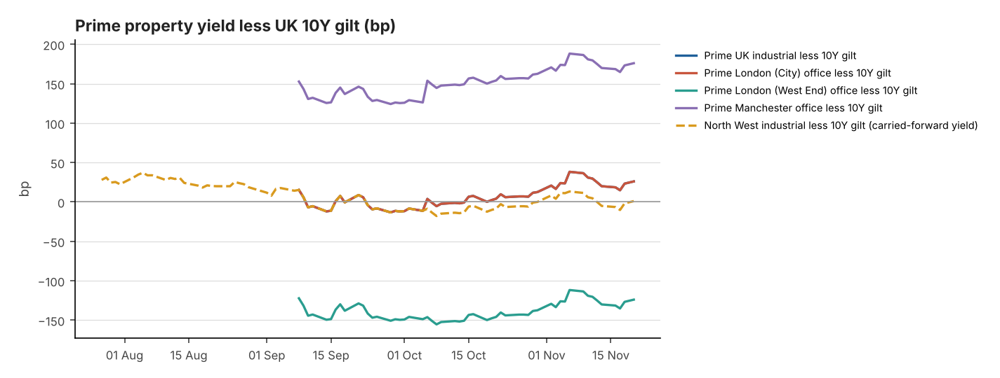

# DAILY FINANCIAL & PROPERTY INVESTMENT BRIEFING

**Date:** 23 November 2026 
**Reporting time:** 06:30 UK time

<small>Generated 2026-11-23 06:29 UTC · run `20261123T062925Z` · commentary: analyst note. Each figure shows its own observation date. Definitions, data-quality notes and full sources are in the appendix.</small>

> **Alerts**
> - New listings: 3 new North West industrial listings (32,459 sq ft); largest Units 7 & 9, Huyton, Merseyside, 24,500 sq ft.
> - Corporate action — SEGRO: Recommended share offer from Prologis (0.0920 new Prologis shares per SEGRO share, partial cash alternative at 1,031.7p; completion expected H1 2027). Shares trade on deal terms.

## 1. Executive Summary

1. **Yields fell through the end of last week.** The BoE 10Y par yield dropped 8bp to 5.27% on 18 November after the in-line CPI, and Trading Economics quoted the 10Y at **5.24%** (−8bp) and the 2Y at **4.88%** on 20 November (market quotes). US Treasuries also rallied: the 10Y was 4.92% (−12bp) and the 2Y 4.63% (−13bp) on 20 November, with coverage citing lower oil and a weaker risk mood.
2. **Yield cushion rebuilt to about +26bp.** Prime distribution (5.50%+ NIY, carried forward) against the 10Y at about 5.24%, up from roughly +13bp a week ago.
3. **Third Grey Belt appeal win this month.** Breck won consent on appeal for 51 homes on Green Belt in Parr, St Helens, after the M42 logistics and Lancaster decisions ([Place North West](https://www.placenorthwest.co.uk/breck-wins-grey-belt-argument-in-st-helens-appeal/)).
4. **New listings.** Three new North West listings totalling 32,459 sq ft; the largest is **Units 7 & 9 Neon, Knowsley Lane, Huyton (24,500 sq ft, design and build)**. The sweep again recorded about 75 large Savills "removals" (5.5m sq ft), the same source glitch seen on 18 November.
5. **Listed logistics still weak; LondonMetric reports tomorrow.** Prologis fell 0.7% to $122.50 (−4.8% over 5 days), putting the SEGRO share offer at about 853p. LondonMetric's half-year results are due on 24 November.

## 2. Government Bond Yields — UK and US

| Market | Latest Yield | Daily | 7-Day | 30-Day | Observed | Source |
|---|---|---|---|---|---|---|
| UK 5-Year gilt | 4.92% | -7.6bp | +3.9bp | -4.3bp | 18 Nov 2026 | [Bank of England Database (IADB)](https://www.bankofengland.co.uk/boeapps/database/fromshowcolumns.asp?SeriesCodes=IUDSNPY&UsingCodes=Y) |
| UK 10-Year gilt | 5.24% | -2.8bp† | -6.1bp† | -9.4bp† | 20 Nov 2026 | [Trading Economics](https://tradingeconomics.com/united-kingdom/government-bond-yield) *(secondary)* |
| US 5-Year Treasury | 4.71% | -15bp | -27bp | -24bp | 20 Nov 2026 | [US Treasury - Daily Treasury Par Yield Curve Rates](https://home.treasury.gov/resource-center/data-chart-center/interest-rates/TextView?type=daily_treasury_yield_curve&field_tdr_date_value=2026) |
| US 10-Year Treasury | 4.92% | -12bp | -23bp | -21bp | 20 Nov 2026 | [US Treasury - Daily Treasury Par Yield Curve Rates](https://home.treasury.gov/resource-center/data-chart-center/interest-rates/TextView?type=daily_treasury_yield_curve&field_tdr_date_value=2026) |
| UK 2-Year gilt | 4.88% | -16bp† | -12.5bp† | Not verified | 20 Nov 2026 | [Trading Economics (table)](https://tradingeconomics.com/united-kingdom/government-bond-yield) *(secondary)* |
| UK 30-Year gilt | 5.79% ⚠ stale | -3bp | Not verified | Not verified | 16 Nov 2026 | [Trading Economics](https://tradingeconomics.com/united-kingdom/30-year-bond-yield) *(secondary)* |
| US 2-Year Treasury | 4.63% | -13bp | -25bp | -18bp | 20 Nov 2026 | [US Treasury - Daily Treasury Par Yield Curve Rates](https://home.treasury.gov/resource-center/data-chart-center/interest-rates/TextView?type=daily_treasury_yield_curve&field_tdr_date_value=2026) |
| US 30-Year Treasury | 5.31% | -9bp | -16bp | -11bp | 20 Nov 2026 | [US Treasury - Daily Treasury Par Yield Curve Rates](https://home.treasury.gov/resource-center/data-chart-center/interest-rates/TextView?type=daily_treasury_yield_curve&field_tdr_date_value=2026) |

**10Y less 5Y:** UK Not verified · US +21bp (20 Nov 2026) 
<small>Changes in basis points. † = comparison crosses sources or instruments (indicative).</small>

## 3. Interest Rates — Bank Rate, SONIA and Fed

| Indicator | Latest | Previous | Date | Change | Source |
|---|---|---|---|---|---|
| BoE Bank Rate | 4.00% | 3.75% | effective 05 Nov 2026 | +25bp | [Bank of England Database (IADB)](https://www.bankofengland.co.uk/boeapps/database/fromshowcolumns.asp?SeriesCodes=IUDBEDR&UsingCodes=Y) |
| SONIA (overnight fixing) | 3.9840% | 3.9840% | 18 Nov 2026 | 0bp | [FRED IUDSOIA](https://fred.stlouisfed.org/series/IUDSOIA) |
| 5Y SONIA swap (finance-cost reference) | 4.58% ⚠ stale | 4.74% | 04 Nov 2026 | -16bp | [Knight Frank Prime Yield Guide (Macrobond/ICAP)](https://www.knightfrank.co.uk/site-assets/research/report-pdfs/yield-guide/prime-yield-guide-nov-2026.pdf) *(secondary)* |
| Fed funds target range | 3.75–4.00% | 3.50–3.75% | effective 17 Sep 2026 | +25bp | [FRED DFEDTARU](https://fred.stlouisfed.org/series/DFEDTARU) |

**Next MPC decision:** 17 Dec 2026

**Confirmed:** Bank Rate 4.00%; next MPC decision 17 December. On market quotes the 2Y gilt is about 4.88% (20 Nov), down roughly 16bp from the 5.04% quoted on 16 November.

**Not verified:** OIS pricing. The fall in 2Y yields is consistent with markets trimming December hike odds after CPI, which Reuters put at about 80% on 18 November.

**Interpretation:** the rally takes some pressure off swaps. A 5Y swap probably in the mid-4s (not verified) eases all-in debt costs slightly, but they remain above prime industrial yields.

## 4. Inflation — UK and US

| Indicator | Latest | Previous | Period | Trend | Source |
|---|---|---|---|---|---|
| UK CPI (12m) | 3.6% | 3.5% | Oct 2026 (pub. 18 Nov) | Accelerating | [ONS MM23](https://www.ons.gov.uk/economy/inflationandpriceindices/timeseries/d7g7/mm23) |
| UK CPIH (12m) | 3.7% | 3.6% | Oct 2026 (pub. 18 Nov) | Accelerating | [ONS MM23](https://www.ons.gov.uk/economy/inflationandpriceindices/timeseries/l55o/mm23) |
| UK core CPI (12m, ex energy, food, alcohol & tobacco) | 2.8% | 2.8% | Oct 2026 (pub. 18 Nov) | Accelerating | [ONS MM23](https://www.ons.gov.uk/economy/inflationandpriceindices/timeseries/dko8/mm23) |
| US CPI-U (12m, NSA) | 3.7% | 3.4% | Sep 2026 | Accelerating | [BLS CPI via FRED CPIAUCNS](https://fred.stlouisfed.org/series/CPIAUCNS) |
| US core CPI-U (12m, NSA) | 2.6% | 2.4% | Sep 2026 | Broadly stable | [BLS CPI via FRED CPILFENS](https://fred.stlouisfed.org/series/CPILFENS) |

**Next ONS inflation release:** see Section 14

## 5. Prime UK Industrial and Office Investment Yields

| Sector | Latest | Basis | Previous | Move | Evidence | Source |
|---|---|---|---|---|---|---|
| UK Industrial & Logistics | 5.50% | NIY | 5.25–5.50% | +12.5bp | Nov 2026 | [Knight Frank Prime Yield Guide](https://www.knightfrank.co.uk/site-assets/research/report-pdfs/yield-guide/prime-yield-guide-nov-2026.pdf) |
| Prime Distribution Warehouses ‡ | 5.50–5.75% | Not stated | 5.50% | +12.5bp | Nov 2026 | [Knight Frank Prime Yield Guide](https://www.knightfrank.co.uk/site-assets/research/report-pdfs/yield-guide/prime-yield-guide-nov-2026.pdf) |
| South East Industrial ‡ | 5.25–5.50% | Not stated | 5.25% | +12.5bp | Nov 2026 | [Knight Frank Prime Yield Guide](https://www.knightfrank.co.uk/site-assets/research/report-pdfs/yield-guide/prime-yield-guide-nov-2026.pdf) |
| Greater London Industrial | 5.25% | Not stated | 5.00–5.25% | +12.5bp | Nov 2026 | [Knight Frank Prime Yield Guide](https://www.knightfrank.co.uk/site-assets/research/report-pdfs/yield-guide/prime-yield-guide-nov-2026.pdf) |
| Prime Multi-let Industrial (Rest of UK) ‡ | 5.25–5.50% | Not stated | 5.25% | +12.5bp | Nov 2026 | [Knight Frank Prime Yield Guide](https://www.knightfrank.co.uk/site-assets/research/report-pdfs/yield-guide/prime-yield-guide-nov-2026.pdf) |
| North West Industrial ‡ | 5.25% | NIY | — | — | Q4 2025 ⚠ carried forward (327d) | [Knight Frank LOGIC: North West 2025 Review](https://www.knightfrank.co.uk/site-assets/research/report-pdfs/logic/2025-review-nw-industrial.pdf) |
| UK Logistics (average of 71 submarkets) ‡ | 5.74% | NIY | 5.59% | +15bp | Q3 2026 ⚠ carried forward (54d) | [Cushman & Wakefield UK Industrial MarketBeat](https://www.cushmanwakefield.com/en/united-kingdom/insights/uk-marketbeat/industrial-marketbeat) |
| London West End Offices | 4.00% | Not stated | 3.75–4.00% | +12.5bp | Nov 2026 | [Knight Frank Prime Yield Guide](https://www.knightfrank.co.uk/site-assets/research/report-pdfs/yield-guide/prime-yield-guide-nov-2026.pdf) |
| London City Offices | 5.50% | Not stated | 5.25–5.50% | +12.5bp | Nov 2026 | [Knight Frank Prime Yield Guide](https://www.knightfrank.co.uk/site-assets/research/report-pdfs/yield-guide/prime-yield-guide-nov-2026.pdf) |
| Manchester Offices ‡ | 7.00% | Not stated | 6.75–7.00% | +12.5bp | Nov 2026 | [Knight Frank Prime Yield Guide](https://www.knightfrank.co.uk/site-assets/research/report-pdfs/yield-guide/prime-yield-guide-nov-2026.pdf) |
| Regional UK Offices ‡ | 7.00% | Not stated | 6.75–7.00% | +12.5bp | Nov 2026 | [Knight Frank Prime Yield Guide](https://www.knightfrank.co.uk/site-assets/research/report-pdfs/yield-guide/prime-yield-guide-nov-2026.pdf) |

<small>Published prime yields, carried forward until new evidence appears — not daily valuations. ‡ = substitution; see appendix.</small>

## 6. Property Yield Spreads Versus UK Gilts

| Spread | Property yield | UK 10Y gilt | Latest spread | At evidence date | Previous comparable | Change (property / gilt) | Driver |
|---|---|---|---|---|---|---|---|
| Prime UK industrial less 10Y gilt | 5.50% (NIY, Nov 2026) | 5.24% (20 Nov) | +26bp | +38.2bp | +3.8bp (Oct 2026) | +22.2bp (+12.5bp / +9.7bp) | Both (reinforcing) |
| Prime London (City) office less 10Y gilt | 5.50% (Not stated, Nov 2026) | 5.24% (20 Nov) | +26bp | +38.2bp | +3.8bp (Oct 2026) | +22.2bp (+12.5bp / +9.7bp) | Both (reinforcing) |
| Prime London (West End) office less 10Y gilt | 4.00% (Not stated, Nov 2026) | 5.24% (20 Nov) | -124bp | -111.8bp | -146.2bp (Oct 2026) | +22.2bp (+12.5bp / +9.7bp) | Both (reinforcing) |
| Prime Manchester office less 10Y gilt | 7.00% (Not stated, Nov 2026) | 5.24% (20 Nov) | +176bp | +188.2bp | +153.8bp (Oct 2026) | +22.2bp (+12.5bp / +9.7bp) | Both (reinforcing) |
| North West industrial less 10Y gilt | 5.25% (NIY, Q4 2025) | 5.24% (20 Nov) | +1bp | +78.4bp | Not verified | Not verified | Not verified |

<small>A simple yield gap (property yield midpoint less 10Y gilt) — not a full measure of risk or relative value.</small>

**Market commentary** <small>(confirmed data points are listed in the appendix)</small>

Bond markets turned last week. After the 2-year gilt topped 5% and the 10-year reached about 5.37% on 16 November, in-line inflation, lower oil prices and a softer global risk mood brought yields back down. On market quotes the 10-year was 5.24% and the 2-year 4.88% on 20 November. Official Bank of England data shows the 10-year at 5.27% on 18 November. US Treasuries rallied harder, with the 2-year down 25bp in a week. The comparisons cross sources, so treat the exact magnitudes as indicative.

For property, the immediate pressure eases. The prime industrial yield gap over gilts has rebuilt to about 26bp, and the risk of a sharp outward move in early-December agent yield updates looks lower than a week ago. A 25bp move for prime distribution is still plausible given where gilts stand against October levels.

Listed logistics has not shared the relief: US logistics REITs fell again, with First Industrial −10.7% over a month and Prologis −4.0% year to date. That reflects sector-specific concerns as well as rates; the drivers are not analysed here.

Development economics remain tight. Borough Yard's enabling costs have risen by £21m, which shows how abnormal costs on brownfield land erode viability. Planning, by contrast, keeps loosening: a third Grey Belt appeal win this month suggests inspectors are applying the test in developers' favour.

Interpretation: a calmer rates backdrop into December supports transaction activity for well-let industrial, but price discovery will stay slow until the 17 December MPC decision.

## 7. Listed Industrial & Logistics Property Share Prices

| Company | Price | Daily | 5-Day | 1-Month | YTD | Mkt cap | Div. yield | Close | Source |
|---|---|---|---|---|---|---|---|---|---|
| SEGRO (SGRO.L) | 922.6p | — | — | — | — | Not verified | 3.4% | 09 Nov ⚠ stale | [StockInvest.us (single dated source)](https://stockinvest.us/stock-price/SGRO.L) *(secondary)* |
| Tritax Big Box REIT (BBOX.L) | 145.4p | — | — | — | — | Not verified | 5.5% | 27 Oct ⚠ stale | [Kalkine Media (dated 27 Oct 2026; single source)](https://kalkinemedia.com/uk/stocks/retail/what-tritax-big-box-reit-lsebbox-says-about-the-current-retail-stocks-story) *(secondary)* |
| LondonMetric Property (LMP.L) | 188.2p | +0.2% | — | — | — | Not verified | 6.7% | 09 Nov ⚠ stale | [StockInvest.us; corroborated by AJ Bell last trade 188.2p](https://stockinvest.us/stock-price/LMP.L) *(secondary)* |
| British Land (BLND.L) | Not verified | — | — | — | — | Not verified | — | — | — |
| Landsec (LAND.L) | 659.0p | — | — | — | — | Not verified | — | 27 Oct ⚠ stale | [Kalkine Media (dated 27 Oct 2026; single source)](https://kalkinemedia.com/uk/stocks/industrial/land-securities-lseland-leads-a-fresh-market-look-at-industrial-stocks) *(secondary)* |
| Derwent London (DLN.L) | Not verified | — | — | — | — | Not verified | — | — | — |
| Great Portland Estates (GPE.L) | Not verified | — | — | — | — | Not verified | — | — | — |
| Prologis (PLD) | $122.50 | -0.7% | -4.8% | -4.0% | -4.0% | Not verified | — | 20 Nov | [Nasdaq (official close)](https://www.nasdaq.com/market-activity/stocks/pld/historical) |

*International logistics comparators*

| Company | Price | Daily | 5-Day | 1-Month | YTD | Mkt cap | Div. yield | Close | Source |
|---|---|---|---|---|---|---|---|---|---|
| EastGroup Properties (EGP) | $191.70 | -0.6% | -3.0% | -5.7% | +7.6% | Not verified | — | 20 Nov | [Nasdaq (official close)](https://www.nasdaq.com/market-activity/stocks/egp/historical) |
| First Industrial Realty Trust (FR) | $53.05 | -1.5% | -3.9% | -10.7% | -7.4% | Not verified | — | 20 Nov | [Nasdaq (official close)](https://www.nasdaq.com/market-activity/stocks/fr/historical) |
| Rexford Industrial Realty (REXR) | $35.63 | +0.3% | -5.1% | -3.2% | -8.0% | Not verified | — | 20 Nov | [Nasdaq (official close)](https://www.nasdaq.com/market-activity/stocks/rexr/historical) |
| WDP (Warehouses De Pauw) (WDP.BR) | Not verified | — | — | — | — | Not verified | — | — | — |
| CTP (CTPNV.AS) | Not verified | — | — | — | — | Not verified | — | — | — |

<small>Latest completed trading session before the 06:30 UK briefing; end-of-day data, not real-time. London prices are in pence (GBX); US in USD; Euronext in EUR. Changes are share-price returns only, excluding dividends (not total shareholder return). ⚑ = daily move of 3% or more. Market caps from Nasdaq are as at retrieval. Dividend yield = latest annualised dividend from company reports ÷ price, where on file. "Not verified" = no licensed price feed returned data and no cited close is on file.</small>

**SEGRO — Prologis offer look-through:** 0.0920 × Prologis close $122.50 (20 Nov) ÷ $1.3212/£ (13 Nov, FRED) = **853.0p** per SEGRO share in Prologis stock, vs SEGRO close 922.6p (-7.5% offer spread). Partial cash alternative: 1031.7p (capped). <small>The FX rate lags by several days, so this is indicative only.</small>

**Corporate actions on the watchlist**

- **SEGRO** — Listed - in offer period. Recommended share offer from Prologis (0.0920 new Prologis shares per SEGRO share, partial cash alternative at 1,031.7p; completion expected H1 2027). Shares trade on deal terms. ([source](https://www.slaughterandmay.com/recent-work/advising-segro-on-the-recommended-share-offer-by-prologis/))
- **Prologis** — Listed. Acquirer of SEGRO (recommended offer). ([source](https://www.slaughterandmay.com/recent-work/advising-segro-on-the-recommended-share-offer-by-prologis/))
- **WDP (Warehouses De Pauw)** — Listed. Also admitted on Euronext Amsterdam; Euronext information document dated 26 Oct 2026. ([source](https://live.euronext.com/sites/default/files/2026-10/WDP%20Information%20Document%202026%2010%2026.pdf))

## 8. REIT Valuation and Performance Commentary

| Metric | SEGRO | Tritax Big Box REIT | LondonMetric Property | 
|---|---|---|---|
| EPRA NTA per share | 902p | 185.88p | 200.6p | 
| Loan-to-value | 31% | 32.9% | 36.7% | 
| Average cost of debt | 2.8% | 3.6% | 4.0% | 
| WAULT | — | 9.9 yrs | 16+ yrs | 
| Occupancy | 94.5% | 93.5% | 97.4% | 
| Like-for-like rental growth | 5.3% | 5.1% | 5.8% | 
| ERV growth | 1.8% | 1.9% | 3.3% | 
| Development pipeline | £90m potential rent | 507MW secured power | No direct development | 
| Dividend (annualised) | 31.1p | 8.0p | 12.6p | 
| Report basis | [H1 2026 (30 Jun)](https://www.segro.com/media/xlibxjqh/press-release-full-version-final.pdf) | [H1 2026 (30 Jun)](https://www.investegate.co.uk/announcement/rns/tritax-big-box-reit--bbox/half-year-report/9707045) | [FY 2026 (31 Mar)](https://www.investegate.co.uk/announcement/rns/londonmetric-property--lmp/full-year-results-for-the-year-ended-31-march-2026/9578979) | 
| Premium / (discount) to EPRA NTA | +2.3% <small>(price 09 Nov)</small> | -21.8% <small>(price 27 Oct)</small> | -6.2% <small>(price 09 Nov)</small> | 

<small>Metrics are from each company's latest report (row "Report basis"; some metrics come from later trading updates — full detail in `data/reit_fundamentals.csv`). Share-price dates are shown separately.</small>

Company announcements (last 14 days, routine filings excluded)

| Date | Company | Announcement | Type |
|---|---|---|---|
| 2026-11-19 | GPE | [Another strong half-year performance](https://www.investegate.co.uk/announcement/rns/great-portland-estates--gpe/another-strong-half-year-performance/9882939) | Results |
| 2026-11-18 | DLN | [Admission to Trading](https://www.investegate.co.uk/announcement/rns/derwent-london--dln/admission-to-trading/9882705) | M&A / corporate action |
| 2026-11-18 | BLND | [Half-year Financial Report](https://www.investegate.co.uk/announcement/rns/british-land-company--blnd/half-year-financial-report/9880519) | Results |
| 2026-11-16 | GPE | [GPE sells 2 Aldermanbury Square to Rothesay](https://www.investegate.co.uk/announcement/rns/great-portland-estates--gpe/gpe-sells-2-aldermanbury-square-to-rothesay-/9875715) | Other |
| 2026-11-13 | LAND | [Half-year Financial Report](https://www.investegate.co.uk/announcement/rns/land-securities-group--land/half-year-financial-report/9873573) | Results |

**Verified:**
- No new SEGRO, Tritax or LondonMetric announcements since Friday.
- LondonMetric half-year results are due on 24 November.
- Home REIT faces a £135.4m investor claim.
- Prologis $122.50; First Industrial −1.5% on the day and −10.7% over a month.
- No verified UK closes since 9 November.

**Interpretation:**
- Tomorrow's LondonMetric results will give the first post-Picton NTA and a read on long-income valuations after the gilt move. Watch for NTA, LTV and its cost of debt (4.0% at March).
- US logistics REIT weakness alongside falling Treasury yields suggests sector-specific factors beyond rates; correlation is not causation.

## 9. Top UK Industrial & Logistics Property News

**3. Plans to triple size of Cambridge Science Park approved**

`PLANNING / DEVELOPMENT` · **▲ 100,000+ sq ft** · **new** · <small>[Property Week](https://www.propertyweek.com/news/plans-to-triple-size-of-cambridge-science-park-approved), published 2026-11-20</small>

Trinity College Cambridge and GummerLeathes have consent to expand Cambridge Science Park from 2.8m sq ft to about 8.3m sq ft over 25–30 years, replacing low-density buildings under an Allies and Morrison masterplan. They expect the park's annual economic output to treble from £1bn to over £3bn.

**Why this matters:** Planning backing for a 5.5m sq ft long-term expansion shows government growth priorities are delivering consents for strategic employment schemes. Greater Manchester's growth locations (Atom Valley, ID Manchester) compete for the same occupiers and capital.

Key figures and relevance

- **Key figures:** 2.8m to c.8.3m sq ft; 25–30 year phasing; output £1bn to £3bn+
- **Relevance:** Long-term science and technology space pipeline in the Oxford–Cambridge corridor.

## 10. North West Industrial & Logistics News

**1. Breck wins Grey Belt argument in St Helens appeal**

`PLANNING / DEVELOPMENT` · **new** · <small>[Place North West](https://www.placenorthwest.co.uk/breck-wins-grey-belt-argument-in-st-helens-appeal/), published 2026-11-20</small>

Breck Homes, with landowner Northern Trust, has won consent on appeal for 51 affordable homes on a four-acre Green Belt site off Fleet Street, Parr, St Helens. St Helens Council had refused the March 2025 application for six reasons, rejecting the developer's argument that the site met the Grey Belt criteria.

**Why this matters:** It is the third Grey Belt appeal success this month and the second in the North West. Inspectors are consistently accepting developers' Grey Belt cases, which strengthens the hand of promoters of Green Belt-edge employment land around St Helens, Warrington and the M6/M62. Land values and option terms should reflect that.

Key figures and relevance

- **Key figures:** 51 homes; 4 acres; council refusal overturned; Grey Belt argument accepted
- **Relevance:** Third North West-relevant Grey Belt appeal win this month (after M42 logistics and Lancaster).

**2. Price tag for Wirral's 1,600-home Borough Yard rises by £21m**

`PLANNING / DEVELOPMENT` · **▲ 100,000+ sq ft** · **new** · <small>[Place North West](https://www.placenorthwest.co.uk/price-tag-for-wirrals-1600-home-borough-yard-rises-by-21m/), published 2026-11-20</small>

Wirral Council is to award John Sisk & Son a £36.5m contract for the next enabling works at Borough Yard, a 65-acre former railway and gasworks site in Birkenhead planned for 1,600 homes and 650,000 sq ft of commercial space. Site investigations and design work have added about £21m to the cost. The scheme has £52.1m of public funding.

**Why this matters:** A £21m cost rise on enabling works alone shows how remediation and abnormals are hitting brownfield appraisals. The same risks apply to former industrial and port-side sites in Merseyside that developers are looking at for logistics.

Key figures and relevance

- **Key figures:** Cost up c.£21m; Sisk enabling contract £36.5m; 65 acres; 1,600 homes; 650,000 sq ft commercial; £52.1m LCRCA/Homes England funding
- **Relevance:** Brownfield remediation costs rising; viability pressure on Merseyside regeneration.

**All Place North West headlines since the last briefing** <small>(Fri 20 Nov 06:00 onwards; stories summarised above are not repeated; industrial items first)</small>

| Published | Headline | |
|---|---|---|
| Fri 12:57 | [Select’s latest Manchester tower in for planning](https://www.placenorthwest.co.uk/selects-latest-manchester-tower-in-for-planning/) |  |
| Fri 11:55 | [THING OF THE WEEK](https://www.placenorthwest.co.uk/thing-of-the-week-474/) |  |
| Fri 11:55 | [Commonhold and Leasehold Reform Bill: good, bad, unnecessary?](https://www.placenorthwest.co.uk/commonhold-and-leasehold-reform-bill-good-bad-unnecessary/) |  |
| Fri 09:38 | [Progress for 43-storey Cheetham Hill tower](https://www.placenorthwest.co.uk/progress-for-43-storey-cheetham-hill-tower/) |  |
| Fri 08:03 | [Bellway secures consent for 66 homes in Alderley Edge](https://www.placenorthwest.co.uk/bellway-secures-consent-for-66-homes-in-alderley-edge/) |  |

**North West outlook**

North West industrial news since Friday is light: no lettings or investment deals were reported. Today's sweep added three listings (32,459 sq ft), led by the proposed 24,500 sq ft design-and-build Units 7 & 9 at Neon, Knowsley Lane, Huyton, plus small units in Runcorn and Crewe. The sweep again shows about 75 Savills listings (5.5m sq ft) as "removed". Last week the same listings returned the following day, so headline availability of 39.8m sq ft is understated and should not be read as take-up. Planning momentum continues, with Breck's Grey Belt appeal win in St Helens, while Borough Yard's £21m cost rise shows the brownfield viability risk on Merseyside.

## 11. New North West Industrial Listings

<small>Agents' listings sweep of 2026-11-23 05:08 UTC (source: tracker branch `claude/magical-ride-4nijqh`, `output/daily/Latest New Listings.md`).</small>

Compared with the sweep of 2026-11-20 05:08 UTC.

- **New to market:** 3 properties, 32,459 sq ft (existing 7,959 / pipeline 24,500)
- **Returned to market:** 0
- **Removed (let, sold or withdrawn):** 75 properties, 5,478,254 sq ft
- **Advertised available now:** 859 properties, 39,823,042 sq ft

| Property | Location | sq ft | Status | Agents |
|---|---|---:|---|---|
| [Units 7 & 9, Neon Knowsley Lane, Knowsley, Merseyside](https://www.b8re.com/properties/units-7-9-neon-knowsley-lane-knowsley-merseyside/) | Huyton, Merseyside | 24,500 | Proposed / Design and Build | B8 Real Estate |
| [Unit 1, Taylors Row](https://legatowen.co.uk/property/unit-1-taylors-row-runcorn-cheshire-wa7-5qp/) | Runcorn, Cheshire | 6,539 | Availability Unconfirmed | Legat Owen |
| [Unit 5, Macon Way](https://legatowen.co.uk/property/unit-5-macon-business-park-macon-way-crewe-cheshire-cw1-6dg/) | Crewe, Cheshire | 1,420 | Availability Unconfirmed | Legat Owen |

**Removed:** X-Dock 549 (549,400 sq ft, Savills); Burnley 543 (543,269 sq ft, Savills); Atlantic Park, Liverpool, L30 4AB (388,000 sq ft, Savills); Atlantic Park, Liverpool, L30 4AB (351,389 sq ft, Savills); Voltage Park (284,000 sq ft, Savills); Bolton 280 (280,619 sq ft, Savills); Widnes 258 (257,500 sq ft, Savills); WG225 Winsford Gateway (225,067 sq ft, Legat Owen); Units 1 & 2  Royce Trading Estate, Ashburton Road West, Trafford Park, Manchester, M17 1RY (215,708 sq ft, Savills); Symmetry Park (190,000 sq ft, Savills) … and 65 more

Full schedule: North West Industrial & Logistics Availability.xlsx (tracker branch claude/magical-ride-4nijqh).

## 12. UK Office and Property Investment News

**4. Home REIT hit with £135.4m legal claim from investors**

`FINANCE / CAPITAL MARKETS` · **new** · <small>[Property Week](https://www.propertyweek.com/finance/home-reit-hit-with-135-4m-legal-claim-from-investors), published 2026-11-20</small>

Home REIT has received a £135.4m High Court claim from more than 800 current and former shareholders alleging misleading statements about its business model, rental income and portfolio. The REIT, which is in managed wind-down, warned the claim could affect its planned liquidation.

Key figures and relevance

- **Key figures:** £135.4m claim; 800+ claimants; proceedings issued 2 October
- **Relevance:** Governance and disclosure risk in listed property vehicles.

## 13. What This Means for the North West Industrial Market

1. **Pricing and yields.** *Verified:* 10Y gilt about 5.24% (20 Nov); cushion about +26bp. *Interpretation:* the risk of a sharp December repricing has eased. Hold pricing guidance for prime North West stock at about 5.50% NIY and avoid pre-emptive discounts.
2. **Rents and demand.** *Verified:* no new North West lettings this period; small new supply (32,459 sq ft). *Interpretation:* limited new supply keeps the market tight for occupiers. Keep quoting rents firm and treat the reported "removals" as a data issue, not demand.
3. **Viability and supply.** *Verified:* Borough Yard costs +£21m; third Grey Belt appeal win. *Interpretation:* add contingency for abnormals on brownfield appraisals. Grey Belt sites may offer cleaner, cheaper-to-develop alternatives for logistics around St Helens and the M6.
4. **Debt and funding.** *Verified:* 2Y gilt about 4.88%, down about 16bp from 16 November. *Interpretation:* lock financing for deals completing before year-end while short rates have eased. The window may close if the MPC is hawkish.
5. **Appetite.** *Verified:* listed logistics REITs remain under pressure; LondonMetric reports tomorrow. *Interpretation:* listed buyers are unlikely to be aggressive bidders near term. Private and institutional direct buyers will set North West pricing into year-end.

## 14. Upcoming Economic and Property Market Events

| Date | Event |
|---|---|
| Tue 24 Nov | [LondonMetric half-year results](https://www.investegate.co.uk/company/LMP) |

---

## Appendix — Data quality, definitions and sources

Expand: data quality, definitions and full sources

**Confirmed data points used in the commentary**

- UK 10Y gilt 5.24% on 20 Nov 2026: fell 2.8bp on the day, fell 6.1bp over 7 days, fell 9.4bp over 30 days (mixed sources - see Table A notes).
- US 10Y Treasury 4.92% on 20 Nov 2026: fell 12bp on the day, fell 23bp over 7 days, fell 21bp over 30 days.
- Bank Rate 4.00% (effective 05 Nov 2026, changed +25bp from 3.75%).
- UK CPI 3.6% in October 2026 (previous 3.5%); trend: Accelerating.
- US CPI 3.7% in September 2026 (previous 3.4%); trend: Accelerating.
- Latest published prime yield movements: UK Industrial & Logistics +12.5bp to 5.50% (Knight Frank Prime Yield Guide, Nov 2026); Prime Distribution Warehouses +12.5bp to 5.50–5.75% (Knight Frank Prime Yield Guide, Nov 2026); South East Industrial +12.5bp to 5.25–5.50% (Knight Frank Prime Yield Guide, Nov 2026); Greater London Industrial +12.5bp to 5.25% (Knight Frank Prime Yield Guide, Nov 2026); Prime Multi-let Industrial (Rest of UK) +12.5bp to 5.25–5.50% (Knight Frank Prime Yield Guide, Nov 2026); UK Logistics (average of 71 submarkets) +15bp to 5.74% (Cushman & Wakefield UK Industrial MarketBeat, Q3 2026); London West End Offices +12.5bp to 4.00% (Knight Frank Prime Yield Guide, Nov 2026); London City Offices +12.5bp to 5.50% (Knight Frank Prime Yield Guide, Nov 2026); Manchester Offices +12.5bp to 7.00% (Knight Frank Prime Yield Guide, Nov 2026); Regional UK Offices +12.5bp to 7.00% (Knight Frank Prime Yield Guide, Nov 2026).

**Retrieval failures and data gaps**

- All automated sources responded.
- UK 30-Year gilt: latest observation (16 Nov 2026) is stale.
- 5Y SONIA swap rate: latest observation (04 Nov 2026) is stale.
- USD per GBP: latest observation (13 Nov 2026) is stale.
- US CPI-U (12m, NSA): latest observation (01 Sep 2026) is stale.
- US core CPI-U (12m, NSA): latest observation (01 Sep 2026) is stale.
- Discrepancy — UK 10-Year gilt, 2026-11-06: 5.12% (Bank of England Database (IADB)) vs 5.16% ([Trading Economics](https://tradingeconomics.com/united-kingdom/government-bond-yield)), +4.2bp; often a different instrument.
- Discrepancy — UK 10-Year gilt, 2026-11-13: 5.30% (Bank of England Database (IADB)) vs 5.34% ([Trading Economics](https://tradingeconomics.com/united-kingdom/government-bond-yield)), +3.9bp; often a different instrument.
- Discrepancy — UK 10-Year gilt, 2026-11-16: 5.32% (Bank of England Database (IADB)) vs 5.37% ([Trading Economics](https://tradingeconomics.com/united-kingdom/government-bond-yield)), +5.5bp; often a different instrument.

**Property yield substitutions (‡)**

- **Prime Distribution Warehouses:** 15-year lease with open-market rent reviews (KF does not state the yield basis for this row)
- **South East Industrial:** KF South East multi-let estates
- **Prime Multi-let Industrial (Rest of UK):** KF 'Good Modern Rest of UK Estates' used as the prime multi-let proxy
- **North West Industrial:** Manchester prime (units >50,000 sq ft) used for the North West. No 2026 North West prime yield from KF, Savills, CBRE or C&W was found on 9 Nov 2026, so this Q4 2025 figure is carried forward.
- **UK Logistics (average of 71 submarkets):** An average across 71 submarkets, a wider definition than KF's single prime-distribution benchmark. This is why it reads higher.
- **Manchester Offices:** KF 'Major Regional Cities' (10-year lease) is a composite, not Manchester-specific.
- **Regional UK Offices:** KF 'Major Regional Cities' (10-year lease) is a composite, not Manchester-specific.

**Definitions**

- UK gilts from the Bank of England database are fitted nominal par yields; market quotes (e.g. Trading Economics) are benchmark-gilt yields and are labelled secondary. US yields are Treasury constant-maturity par yields.
- Net initial yield (NIY) = net income ÷ gross price including purchaser's costs. Equivalent yield = IRR assuming rent reverts to market at review/expiry. The two are not interchangeable.
- SONIA is the overnight fixing — not term SONIA or SONIA swaps.
- Inflation trend compares the last three monthly readings (±0.15pp threshold). US annual rates are calculated from the BLS NSA index via FRED.
- Share-price changes exclude dividends. 5-day = five trading sessions; 1-month = last close on or before 30 days earlier; YTD = versus the last close of the previous year.
- Correlation between gilts, property yields and listed property prices does not establish causation.

**Analyst sources**

- Trading Economics, [UK 10Y gilt](https://tradingeconomics.com/united-kingdom/government-bond-yield) (20 Nov quotes); Bank of England IADB and US Treasury data (tables).
- Morningstar/Dow Jones, [10-Year Treasury yield falls](https://www.morningstar.com/news/dow-jones/202611198503/10-year-treasury-yield-falls-to-5051-data-talk), and Newsquawk Treasury wraps for drivers.
- Place North West: [Breck Grey Belt](https://www.placenorthwest.co.uk/breck-wins-grey-belt-argument-in-st-helens-appeal/), [Borough Yard](https://www.placenorthwest.co.uk/price-tag-for-wirrals-1600-home-borough-yard-rises-by-21m/).
- Property Week: [Cambridge Science Park](https://www.propertyweek.com/news/plans-to-triple-size-of-cambridge-science-park-approved), [Home REIT](https://www.propertyweek.com/finance/home-reit-hit-with-135-4m-legal-claim-from-investors).
- Listings sweep: branch `claude/magical-ride-4nijqh`, sweep of 23 Nov 2026 05:08 UTC.

<small>Prepared from public sources for professional information; not investment advice. History: `data/observations.csv`, `data/share_prices.csv`, `data/news_log.csv`, `data/announcements.csv`; audit trail: `data/audit_log.csv`.</small>
