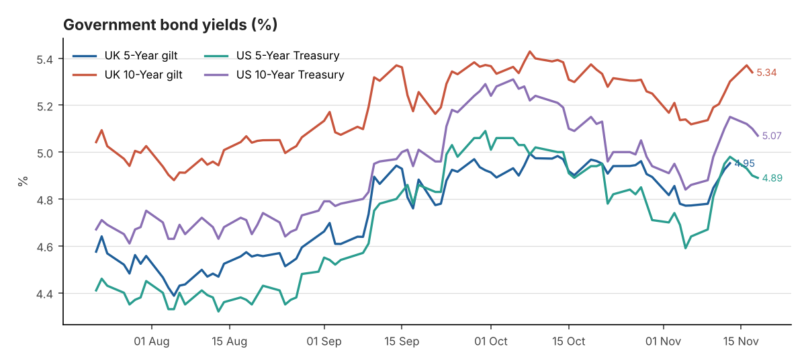
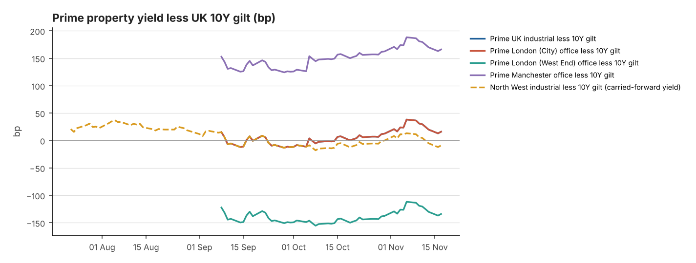

# DAILY FINANCIAL & PROPERTY INVESTMENT BRIEFING

**Date:** 19 November 2026 
**Reporting time:** 06:30 UK time

<small>Generated 2026-11-19 06:32 UTC · run `20261119T063208Z` · commentary: analyst note. Each figure shows its own observation date. Definitions, data-quality notes and full sources are in the appendix.</small>

> **Alerts**
> - New listings: 3 new North West industrial listings (87,622 sq ft); largest Pin Mill House, Worsley / Walkden, Greater Manchester, 67,811 sq ft.
> - Corporate action — SEGRO: Recommended share offer from Prologis (0.0920 new Prologis shares per SEGRO share, partial cash alternative at 1,031.7p; completion expected H1 2027). Shares trade on deal terms.

## 1. Executive Summary

1. **UK inflation in line; gilts eased.** October CPI rose to 3.6% (3.5% in September), matching consensus and just below the BoE's 3.7% forecast. Core held at 2.8% and services were 3.7% (below the 3.8% forecast). Gilt yields fell to a six-day low ([MarketScreener headline](https://www.marketscreener.com/news/uk-gilt-yields-fall-to-six-day-low-after-cpi-data-ce785edcd08cf224); level not verified). Reuters, via [Trading & Investment News](https://www.tradingandinvestmentnews.co.uk/uk-core-inflation-sterling/), reports markets trimmed December hike odds to about 80%.
2. **Rental growth is beating yield drift at British Land.** Half-year ERV growth of 3.0% offset a 3bp outward move in the net equivalent yield to 6.1%. EPRA NTA rose 2% to 599p and like-for-like net rents grew 12%.
3. **New listings sweep.** Three new North West listings totalling 87,622 sq ft; the largest is **Pin Mill House, Worsley (67,811 sq ft)**. The sweep shows 75 listings returned to market, almost all Savills, which confirms yesterday's large Savills removals were a data glitch, not lettings.
4. **North West pricing and supply evidence.** Penrith M&S is for sale at £5m+ (7.5% NIY, about 25% below its 2018 price). No2 St Michael's in Manchester has topped out with 75,000 sq ft of offices due in 2027.
5. **Listed property mixed.** Workspace's loss widened to £121.2m as values fell 6.6%. Prologis was steady at $125.22, putting the SEGRO share offer at about 872p. Official BoE gilt data was unavailable again today.

## 2. Government Bond Yields — UK and US

| Market | Latest Yield | Daily | 7-Day | 30-Day | Observed | Source |
|---|---|---|---|---|---|---|
| UK 5-Year gilt | 4.95% ⚠ stale | +2.7bp | +18bp | -1.7bp | 13 Nov 2026 | [Bank of England Database (IADB)](https://www.bankofengland.co.uk/boeapps/database/fromshowcolumns.asp?SeriesCodes=IUDSNPY&UsingCodes=Y) |
| UK 10-Year gilt | 5.34% | -3bp† | +14.9bp† | +4.1bp† | 17 Nov 2026 | [Trading Economics (table dated Nov/17)](https://tradingeconomics.com/united-kingdom/government-bond-yield) *(secondary)* |
| US 5-Year Treasury | 4.89% | -1bp | +8bp | -5bp | 18 Nov 2026 | [US Treasury - Daily Treasury Par Yield Curve Rates](https://home.treasury.gov/resource-center/data-chart-center/interest-rates/TextView?type=daily_treasury_yield_curve&field_tdr_date_value=2026) |
| US 10-Year Treasury | 5.07% | -3bp | +9bp | -8bp | 18 Nov 2026 | [US Treasury - Daily Treasury Par Yield Curve Rates](https://home.treasury.gov/resource-center/data-chart-center/interest-rates/TextView?type=daily_treasury_yield_curve&field_tdr_date_value=2026) |
| UK 2-Year gilt | 5.04% | +3.5bp† | +28bp† | Not verified | 16 Nov 2026 | [Trading Economics; Reuters-sourced report says back above 5%](https://www.tradingandinvestmentnews.co.uk/gilt-yields-spike-rate-bets/) *(secondary)* |
| UK 30-Year gilt | 5.79% | -3bp | Not verified | Not verified | 16 Nov 2026 | [Trading Economics](https://tradingeconomics.com/united-kingdom/30-year-bond-yield) *(secondary)* |
| US 2-Year Treasury | 4.80% | 0bp | +7bp | +3bp | 18 Nov 2026 | [US Treasury - Daily Treasury Par Yield Curve Rates](https://home.treasury.gov/resource-center/data-chart-center/interest-rates/TextView?type=daily_treasury_yield_curve&field_tdr_date_value=2026) |
| US 30-Year Treasury | 5.41% | -5bp | +6bp | -7bp | 18 Nov 2026 | [US Treasury - Daily Treasury Par Yield Curve Rates](https://home.treasury.gov/resource-center/data-chart-center/interest-rates/TextView?type=daily_treasury_yield_curve&field_tdr_date_value=2026) |

**10Y less 5Y:** UK Not verified · US +18bp (18 Nov 2026) 
<small>Changes in basis points. † = comparison crosses sources or instruments (indicative).</small>

## 3. Interest Rates — Bank Rate, SONIA and Fed

| Indicator | Latest | Previous | Date | Change | Source |
|---|---|---|---|---|---|
| BoE Bank Rate | 4.00% | 3.75% | effective 05 Nov 2026 | +25bp | [Bank of England Database (IADB)](https://www.bankofengland.co.uk/boeapps/database/fromshowcolumns.asp?SeriesCodes=IUDBEDR&UsingCodes=Y) |
| SONIA (overnight fixing) | 3.9833% | 3.9832% | 16 Nov 2026 | 0bp | [FRED IUDSOIA](https://fred.stlouisfed.org/series/IUDSOIA) |
| 5Y SONIA swap (finance-cost reference) | 4.58% ⚠ stale | 4.74% | 04 Nov 2026 | -16bp | [Knight Frank Prime Yield Guide (Macrobond/ICAP)](https://www.knightfrank.co.uk/site-assets/research/report-pdfs/yield-guide/prime-yield-guide-nov-2026.pdf) *(secondary)* |
| Fed funds target range | 3.75–4.00% | 3.50–3.75% | effective 17 Sep 2026 | +25bp | [FRED DFEDTARU](https://fred.stlouisfed.org/series/DFEDTARU) |

**Next MPC decision:** 17 Dec 2026

**Confirmed:**
- Bank Rate 4.00%.
- October CPI 3.6% (core 2.8%, services 3.7%), in line or slightly soft.
- Next MPC decision 17 December.

**Press-reported, not verified against OIS:** about 80% probability of a December hike, trimmed after CPI (Reuters, via Trading & Investment News).

**Interpretation:** the data neither forces nor rules out a December hike. A softer services print gives the MPC room to pause, which would ease short-dated swaps and slightly improve property debt costs.

## 4. Inflation — UK and US

| Indicator | Latest | Previous | Period | Trend | Source |
|---|---|---|---|---|---|
| UK CPI (12m) | 3.6% | 3.5% | Oct 2026 (pub. 18 Nov) | Accelerating | [ONS MM23](https://www.ons.gov.uk/economy/inflationandpriceindices/timeseries/d7g7/mm23) |
| UK CPIH (12m) | 3.7% | 3.6% | Oct 2026 (pub. 18 Nov) | Accelerating | [ONS MM23](https://www.ons.gov.uk/economy/inflationandpriceindices/timeseries/l55o/mm23) |
| UK core CPI (12m, ex energy, food, alcohol & tobacco) | 2.8% | 2.8% | Oct 2026 (pub. 18 Nov) | Accelerating | [ONS MM23](https://www.ons.gov.uk/economy/inflationandpriceindices/timeseries/dko8/mm23) |
| US CPI-U (12m, NSA) | 3.7% | 3.4% | Sep 2026 | Accelerating | [BLS CPI via FRED CPIAUCNS](https://fred.stlouisfed.org/series/CPIAUCNS) |
| US core CPI-U (12m, NSA) | 2.6% | 2.4% | Sep 2026 | Broadly stable | [BLS CPI via FRED CPILFENS](https://fred.stlouisfed.org/series/CPILFENS) |

**Next ONS inflation release:** see Section 14

## 5. Prime UK Industrial and Office Investment Yields

| Sector | Latest | Basis | Previous | Move | Evidence | Source |
|---|---|---|---|---|---|---|
| UK Industrial & Logistics | 5.50% | NIY | 5.25–5.50% | +12.5bp | Nov 2026 | [Knight Frank Prime Yield Guide](https://www.knightfrank.co.uk/site-assets/research/report-pdfs/yield-guide/prime-yield-guide-nov-2026.pdf) |
| Prime Distribution Warehouses ‡ | 5.50–5.75% | Not stated | 5.50% | +12.5bp | Nov 2026 | [Knight Frank Prime Yield Guide](https://www.knightfrank.co.uk/site-assets/research/report-pdfs/yield-guide/prime-yield-guide-nov-2026.pdf) |
| South East Industrial ‡ | 5.25–5.50% | Not stated | 5.25% | +12.5bp | Nov 2026 | [Knight Frank Prime Yield Guide](https://www.knightfrank.co.uk/site-assets/research/report-pdfs/yield-guide/prime-yield-guide-nov-2026.pdf) |
| Greater London Industrial | 5.25% | Not stated | 5.00–5.25% | +12.5bp | Nov 2026 | [Knight Frank Prime Yield Guide](https://www.knightfrank.co.uk/site-assets/research/report-pdfs/yield-guide/prime-yield-guide-nov-2026.pdf) |
| Prime Multi-let Industrial (Rest of UK) ‡ | 5.25–5.50% | Not stated | 5.25% | +12.5bp | Nov 2026 | [Knight Frank Prime Yield Guide](https://www.knightfrank.co.uk/site-assets/research/report-pdfs/yield-guide/prime-yield-guide-nov-2026.pdf) |
| North West Industrial ‡ | 5.25% | NIY | — | — | Q4 2025 ⚠ carried forward (323d) | [Knight Frank LOGIC: North West 2025 Review](https://www.knightfrank.co.uk/site-assets/research/report-pdfs/logic/2025-review-nw-industrial.pdf) |
| UK Logistics (average of 71 submarkets) ‡ | 5.74% | NIY | 5.59% | +15bp | Q3 2026 ⚠ carried forward (50d) | [Cushman & Wakefield UK Industrial MarketBeat](https://www.cushmanwakefield.com/en/united-kingdom/insights/uk-marketbeat/industrial-marketbeat) |
| London West End Offices | 4.00% | Not stated | 3.75–4.00% | +12.5bp | Nov 2026 | [Knight Frank Prime Yield Guide](https://www.knightfrank.co.uk/site-assets/research/report-pdfs/yield-guide/prime-yield-guide-nov-2026.pdf) |
| London City Offices | 5.50% | Not stated | 5.25–5.50% | +12.5bp | Nov 2026 | [Knight Frank Prime Yield Guide](https://www.knightfrank.co.uk/site-assets/research/report-pdfs/yield-guide/prime-yield-guide-nov-2026.pdf) |
| Manchester Offices ‡ | 7.00% | Not stated | 6.75–7.00% | +12.5bp | Nov 2026 | [Knight Frank Prime Yield Guide](https://www.knightfrank.co.uk/site-assets/research/report-pdfs/yield-guide/prime-yield-guide-nov-2026.pdf) |
| Regional UK Offices ‡ | 7.00% | Not stated | 6.75–7.00% | +12.5bp | Nov 2026 | [Knight Frank Prime Yield Guide](https://www.knightfrank.co.uk/site-assets/research/report-pdfs/yield-guide/prime-yield-guide-nov-2026.pdf) |

<small>Published prime yields, carried forward until new evidence appears — not daily valuations. ‡ = substitution; see appendix.</small>

## 6. Property Yield Spreads Versus UK Gilts

| Spread | Property yield | UK 10Y gilt | Latest spread | At evidence date | Previous comparable | Change (property / gilt) | Driver |
|---|---|---|---|---|---|---|---|
| Prime UK industrial less 10Y gilt | 5.50% (NIY, Nov 2026) | 5.34% (17 Nov) | +16bp | +38.2bp | +3.8bp (Oct 2026) | +12.2bp (+12.5bp / -0.3bp) | Property-yield-driven |
| Prime London (City) office less 10Y gilt | 5.50% (Not stated, Nov 2026) | 5.34% (17 Nov) | +16bp | +38.2bp | +3.8bp (Oct 2026) | +12.2bp (+12.5bp / -0.3bp) | Property-yield-driven |
| Prime London (West End) office less 10Y gilt | 4.00% (Not stated, Nov 2026) | 5.34% (17 Nov) | -134bp | -111.8bp | -146.2bp (Oct 2026) | +12.2bp (+12.5bp / -0.3bp) | Property-yield-driven |
| Prime Manchester office less 10Y gilt | 7.00% (Not stated, Nov 2026) | 5.34% (17 Nov) | +166bp | +188.2bp | +153.8bp (Oct 2026) | +12.2bp (+12.5bp / -0.3bp) | Property-yield-driven |
| North West industrial less 10Y gilt | 5.25% (NIY, Q4 2025) | 5.34% (17 Nov) | -9bp | +78.4bp | Not verified | Not verified | Not verified |

<small>A simple yield gap (property yield midpoint less 10Y gilt) — not a full measure of risk or relative value.</small>

**Market commentary** <small>(confirmed data points are listed in the appendix)</small>

The inflation print removed some of last week's pressure. Headline CPI rose to 3.6%, as forecast, driven by motor fuel. Services inflation of 3.7% was a touch below expectations and core held at 2.8%. Gilt yields fell to a six-day low on the day; the exact level is not verified, and the last cited 10-year figure is 5.34% on 17 November. Reuters reports December hike odds slipping to around 80%, and sterling fell to a one-month low, consistent with slightly lower rate expectations.

For property, the key evidence came from British Land's half-year results. Its valuation rose 1.5% even though the net equivalent yield moved out 3bp, because ERV growth of 3% did the work. Campuses led at +3.9%, and retail parks and London urban logistics grew 2.0%. Workspace showed the other side of the market: London flexible-office values fell 6.6% and its dividend decision was deferred.

Regional long-income retail is clearing at 7%+ yields, as Penrith M&S at 7.5% shows. Praxis paid £27.2m for Cardiff's Morgan Quarter, value-add capital at work.

Interpretation: income growth is protecting values where rents are rising (industrial, retail parks, prime campuses), while weaker office segments continue to reprice. Gilts easing back towards 5.3% would modestly reduce the outward pressure on prime yields ahead of the December valuations.

## 7. Listed Industrial & Logistics Property Share Prices

| Company | Price | Daily | 5-Day | 1-Month | YTD | Mkt cap | Div. yield | Close | Source |
|---|---|---|---|---|---|---|---|---|---|
| SEGRO (SGRO.L) | 922.6p | — | — | — | — | Not verified | 3.4% | 09 Nov ⚠ stale | [StockInvest.us (single dated source)](https://stockinvest.us/stock-price/SGRO.L) *(secondary)* |
| Tritax Big Box REIT (BBOX.L) | 145.4p | — | — | — | — | Not verified | 5.5% | 27 Oct ⚠ stale | [Kalkine Media (dated 27 Oct 2026; single source)](https://kalkinemedia.com/uk/stocks/retail/what-tritax-big-box-reit-lsebbox-says-about-the-current-retail-stocks-story) *(secondary)* |
| LondonMetric Property (LMP.L) | 188.2p | +0.2% | — | — | — | Not verified | 6.7% | 09 Nov ⚠ stale | [StockInvest.us; corroborated by AJ Bell last trade 188.2p](https://stockinvest.us/stock-price/LMP.L) *(secondary)* |
| British Land (BLND.L) | Not verified | — | — | — | — | Not verified | — | — | — |
| Landsec (LAND.L) | 659.0p | — | — | — | — | Not verified | — | 27 Oct ⚠ stale | [Kalkine Media (dated 27 Oct 2026; single source)](https://kalkinemedia.com/uk/stocks/industrial/land-securities-lseland-leads-a-fresh-market-look-at-industrial-stocks) *(secondary)* |
| Derwent London (DLN.L) | Not verified | — | — | — | — | Not verified | — | — | — |
| Great Portland Estates (GPE.L) | Not verified | — | — | — | — | Not verified | — | — | — |
| Prologis (PLD) | $125.22 | -0.3% | -3.7% | +0.9% | -1.9% | Not verified | — | 18 Nov | [Nasdaq (official close)](https://www.nasdaq.com/market-activity/stocks/pld/historical) |

*International logistics comparators*

| Company | Price | Daily | 5-Day | 1-Month | YTD | Mkt cap | Div. yield | Close | Source |
|---|---|---|---|---|---|---|---|---|---|
| EastGroup Properties (EGP) | $196.16 | +1.2% | -0.9% | -0.3% | +10.1% | Not verified | — | 18 Nov | [Nasdaq (official close)](https://www.nasdaq.com/market-activity/stocks/egp/historical) |
| First Industrial Realty Trust (FR) | $54.66 | +0.4% | -1.1% | -6.1% | -4.6% | Not verified | — | 18 Nov | [Nasdaq (official close)](https://www.nasdaq.com/market-activity/stocks/fr/historical) |
| Rexford Industrial Realty (REXR) | $36.14 | -0.1% | -4.5% | -0.6% | -6.7% | Not verified | — | 18 Nov | [Nasdaq (official close)](https://www.nasdaq.com/market-activity/stocks/rexr/historical) |
| WDP (Warehouses De Pauw) (WDP.BR) | Not verified | — | — | — | — | Not verified | — | — | — |
| CTP (CTPNV.AS) | Not verified | — | — | — | — | Not verified | — | — | — |

<small>Latest completed trading session before the 06:30 UK briefing; end-of-day data, not real-time. London prices are in pence (GBX); US in USD; Euronext in EUR. Changes are share-price returns only, excluding dividends (not total shareholder return). ⚑ = daily move of 3% or more. Market caps from Nasdaq are as at retrieval. Dividend yield = latest annualised dividend from company reports ÷ price, where on file. "Not verified" = no licensed price feed returned data and no cited close is on file.</small>

**SEGRO — Prologis offer look-through:** 0.0920 × Prologis close $125.22 (18 Nov) ÷ $1.3212/£ (13 Nov, FRED) = **872.0p** per SEGRO share in Prologis stock, vs SEGRO close 922.6p (-5.5% offer spread). Partial cash alternative: 1031.7p (capped). <small>The FX rate lags by several days, so this is indicative only.</small>

**Corporate actions on the watchlist**

- **SEGRO** — Listed - in offer period. Recommended share offer from Prologis (0.0920 new Prologis shares per SEGRO share, partial cash alternative at 1,031.7p; completion expected H1 2027). Shares trade on deal terms. ([source](https://www.slaughterandmay.com/recent-work/advising-segro-on-the-recommended-share-offer-by-prologis/))
- **Prologis** — Listed. Acquirer of SEGRO (recommended offer). ([source](https://www.slaughterandmay.com/recent-work/advising-segro-on-the-recommended-share-offer-by-prologis/))
- **WDP (Warehouses De Pauw)** — Listed. Also admitted on Euronext Amsterdam; Euronext information document dated 26 Oct 2026. ([source](https://live.euronext.com/sites/default/files/2026-10/WDP%20Information%20Document%202026%2010%2026.pdf))

## 8. REIT Valuation and Performance Commentary

| Metric | SEGRO | Tritax Big Box REIT | LondonMetric Property | 
|---|---|---|---|
| EPRA NTA per share | 902p | 185.88p | 200.6p | 
| Loan-to-value | 31% | 32.9% | 36.7% | 
| Average cost of debt | 2.8% | 3.6% | 4.0% | 
| WAULT | — | 9.9 yrs | 16+ yrs | 
| Occupancy | 94.5% | 93.5% | 97.4% | 
| Like-for-like rental growth | 5.3% | 5.1% | 5.8% | 
| ERV growth | 1.8% | 1.9% | 3.3% | 
| Development pipeline | £90m potential rent | 507MW secured power | No direct development | 
| Dividend (annualised) | 31.1p | 8.0p | 12.6p | 
| Report basis | [H1 2026 (30 Jun)](https://www.segro.com/media/xlibxjqh/press-release-full-version-final.pdf) | [H1 2026 (30 Jun)](https://www.investegate.co.uk/announcement/rns/tritax-big-box-reit--bbox/half-year-report/9707045) | [FY 2026 (31 Mar)](https://www.investegate.co.uk/announcement/rns/londonmetric-property--lmp/full-year-results-for-the-year-ended-31-march-2026/9578979) | 
| Premium / (discount) to EPRA NTA | +2.3% <small>(price 09 Nov)</small> | -21.8% <small>(price 27 Oct)</small> | -6.2% <small>(price 09 Nov)</small> | 

<small>Metrics are from each company's latest report (row "Report basis"; some metrics come from later trading updates — full detail in `data/reit_fundamentals.csv`). Share-price dates are shown separately.</small>

Company announcements (last 14 days, routine filings excluded)

| Date | Company | Announcement | Type |
|---|---|---|---|
| 2026-11-18 | DLN | [Admission to Trading](https://www.investegate.co.uk/announcement/rns/derwent-london--dln/admission-to-trading/9882705) | M&A / corporate action |
| 2026-11-18 | BLND | [Half-year Financial Report](https://www.investegate.co.uk/announcement/rns/british-land-company--blnd/half-year-financial-report/9880519) | Results |
| 2026-11-16 | GPE | [GPE sells 2 Aldermanbury Square to Rothesay](https://www.investegate.co.uk/announcement/rns/great-portland-estates--gpe/gpe-sells-2-aldermanbury-square-to-rothesay-/9875715) | Other |
| 2026-11-13 | LAND | [Half-year Financial Report](https://www.investegate.co.uk/announcement/rns/land-securities-group--land/half-year-financial-report/9873573) | Results |
| 2026-11-05 | DLN | [Third Quarter Business Update](https://www.investegate.co.uk/announcement/rns/derwent-london--dln/third-quarter-business-update-/9859178) | Trading update |

**Verified:**
- British Land: NTA 599p, LTV 39.6%, ERV +3.0%, NEY 6.1% (+3bp).
- Workspace: values −6.6%, loss £121.2m.
- No new SEGRO, Tritax or LondonMetric announcements; LondonMetric reports on 24 November.
- Prologis $125.22 (−0.3%); EastGroup +1.2%.
- No verified UK closes since 9 November.

**Interpretation:**
- British Land shows that rental growth can outrun moderate yield expansion. Tritax and LondonMetric, with indexed or reversionary leases, are positioned similarly, but this is inference, not reported data.
- Share-price moves alongside gilts are correlation, not established cause.

## 9. Top UK Industrial & Logistics Property News

No significant new UK industrial and logistics stories were found for this period.

## 10. North West Industrial & Logistics News

**2. Penrith M&S on sale for £5m**

`PROPERTY INVESTMENT` · **new** · <small>[Place North West](https://www.placenorthwest.co.uk/penrith-ms-on-sale-for-5m/), published 2026-11-18</small>

Carrick Real Estate is seeking offers above £5m for the M&S store in Penrith, let on a 20-year lease from 2015 at about £400,000 a year, reflecting a 7.5% net initial yield at the asking price. The BAE Systems Pension Scheme bought it from LondonMetric for £6.7m in 2018.

**Why this matters:** A 7.5% yield for a long M&S lease in Cumbria, about 25% below its 2018 price, shows how far regional long-income pricing has adjusted. It is a useful benchmark for North West investors comparing retail warehouse and industrial yields.

Key figures and relevance

- **Key figures:** £5m+ asking; c.£400,000 rent; NIY 7.5%; bought for £6.7m in 2018
- **Relevance:** North West regional retail pricing evidence: about 25% below 2018 value.

**3. Domis tops out 43-storey No2 St Michael's**

`OFFICES` · 20,000+ sq ft · **new** · <small>[Place North West](https://www.placenorthwest.co.uk/domis-tops-out-43-storey-no2-st-michaels/), published 2026-11-18</small>

Domis Construction has topped out the 43-storey No2 St Michael's in central Manchester, the tower element of the £400m Salboy and Relentless Developments scheme, due to complete next year. It includes 75,000 sq ft of offices, building on the fully let 185,000 sq ft No1 St Michael's, plus a 162-room W Hotel and 217 W-branded residences.

**Why this matters:** It adds 75,000 sq ft of Grade A Manchester office space next year, alongside a fully let first phase. That points to continued occupier demand for the best city-centre space even as Landsec and others freeze speculative development.

Key figures and relevance

- **Key figures:** 43 storeys; £400m scheme; 75,000 sq ft workspace; No1 St Michael's 185,000 sq ft fully let; completion 2027
- **Relevance:** New Grade A office supply in Manchester city centre in 2027.

**4. Lancashire signs off £643m transport proposals**

`PLANNING / DEVELOPMENT` · **new** · <small>[Place North West](https://www.placenorthwest.co.uk/lancashire-signs-off-643m-transport-proposals/), published 2026-11-18</small>

Lancashire Combined County Authority has unanimously approved its Local Transport Plan implementation plan for 2026–2030, worth £643m, with rail station improvements and rural connectivity prominent. Officers will now deliver the four-year programme, informed by public consultation on the publication version.

Key figures and relevance

- **Key figures:** £643m programme; 2026–2030; unanimous approval
- **Relevance:** Infrastructure spend supporting Lancashire employment locations over four years.

**All Place North West headlines since the last briefing** <small>(Wed 18 Nov 06:00 onwards; stories summarised above are not repeated; industrial items first)</small>

| Published | Headline | |
|---|---|---|
| Wed 16:47 | [Ascot gets ball rolling on plans for 34-storey tower on Liverpool waterfront](https://www.placenorthwest.co.uk/ascot-gets-ball-rolling-on-plans-for-34-storey-tower-on-liverpool-waterfront/) |  |
| Wed 11:57 | [Cheshire East approves David Lloyd’s Nantwich health club](https://www.placenorthwest.co.uk/cheshire-east-approves-david-lloyds-nantwich-health-club/) |  |
| Wed 11:37 | [Trafford looks to expand housing portfolio, regenerate Empress Conservation Area](https://www.placenorthwest.co.uk/trafford-looks-to-expand-housing-portfolio-regenerate-empress-conservation-area/) |  |
| Wed 10:34 | [ECF finds its next chair in David Prout](https://www.placenorthwest.co.uk/ecf-finds-its-new-chair-in-david-prout/) |  |
| Wed 07:50 | [Taylor Wimpey cracks on with 310 Halton homes after appeal win](https://www.placenorthwest.co.uk/taylor-wimpey-cracks-on-with-310-halton-homes-after-appeal-win/) |  |
| Wed 07:09 | [Growing Shropshire brewer buys second Chester pub](https://www.placenorthwest.co.uk/growing-shropshire-brewer-buys-second-chester-pub/) |  |

**North West outlook**

Today's sweep added three new North West listings (87,622 sq ft), led by the 67,811 sq ft Pin Mill House in Worsley, plus 19,811 sq ft at Brereton Green, Sandbach. The return of 75 Savills listings confirms that yesterday's 5.7m sq ft "removal" was a source glitch, so headline availability is back to 43.2m sq ft. Today's removals include Lancashire Central (670,000 sq ft) and MP350, Wigan (395,653 sq ft). These could be lettings or withdrawals and need confirming before they are treated as take-up. No2 St Michael's adds Manchester offices in 2027. Penrith's 7.5% M&S pricing gives a regional long-income comparator.

## 11. New North West Industrial Listings

<small>Agents' listings sweep of 2026-11-19 05:08 UTC (source: tracker branch `claude/magical-ride-4nijqh`, `output/daily/Latest New Listings.md`).</small>

Compared with the sweep of 2026-11-18 05:08 UTC.

- **New to market:** 3 properties, 87,622 sq ft (existing 4,584,425 / pipeline 501,645)
- **Returned to market:** 75
- **Removed (let, sold or withdrawn):** 4 properties, 1,075,347 sq ft
- **Advertised available now:** 921 properties, 43,167,543 sq ft

| Property | Location | sq ft | Status | Agents |
|---|---|---:|---|---|
| [Pin Mill House, Priestley Road, Manchester, Greater Man](https://www.b8re.com/properties/pin-mill-house-priestley-road-manchester-greater-manchester/) | Worsley / Walkden, Greater Manchester | 67,811 | Availability Unconfirmed | B8 Real Estate |
| [Holmes Chapel Road, Brereton Green, Sandbach, CW11 1SD](https://www.willsill.co.uk/property/holmes-chapel-road-brereton-green-sandbach-cw11-1sd/) | Sandbach, Cheshire | 19,811 | Availability Unconfirmed | Williams Sillitoe |
| [Queens Rd, Manchester, M40 8RR](https://search.savills.com/property-detail/gb0458l437028) | North Manchester, Greater Manchester | size n/d | Availability Unconfirmed | Savills |

**Returned to market:** The Croft - Unit 3D Phase 2 (3,959 sq ft, Legat Owen); The Croft - Unit 4A Phase 2 (5,772 sq ft, Legat Owen); Unit 12B (3,732 sq ft, Savills); Unit A18 (27,425 sq ft, Savills); Delta Point Leestone Road, Sharston Industrial Estate, Sharston, M22 4SA (15,082 sq ft, Williams Sillitoe); Crumpsall Lane (62,867 sq ft, Savills); Unit D2 (9,234 sq ft, Savills); Unit D3 (8,794 sq ft, Savills); Unit D5 (9,472 sq ft, Savills); Unit 3 (8,542 sq ft, Savills); Unit 17-18 Wingates Industrial Estate, Barrs Fold Road, Bolton, BL5 3XP (20,235 sq ft, Savills); D1 Nasmyth Business Centre, Eccles, M30 OSN (9,277 sq ft, Savills); Bower Street (size n/d sq ft, Savills); Unit 7 Port Road, Port Road Business Park, Carlisle, CA2 7AF (9,743 sq ft, Savills); Air 66 & Air 84 (152,286 sq ft, Savills); Trafford 150, Longbridge Road, Manchester, M17 1SN (148,240 sq ft, Savills); Unit A1 / A6 - A9 (9,609 sq ft, Savills); Sambro International (184,422 sq ft, Savills); Foundry Point (49,606 sq ft, Savills); Unit 1 (20,653 sq ft, Savills); Unit 9 & 19 (10,534 sq ft, Savills); Symmetry Park (size n/d sq ft, Savills); Neon (74,000 sq ft, Savills); Units 1 & 2  Royce Trading Estate, Ashburton Road West, Trafford Park, Manchester, M17 1RY (215,708 sq ft, Savills); Atlantic Park, Liverpool, L30 4AB (388,000 sq ft, Savills); Unit 2, Prince Mead Place, Kings Park, Manchester, M17 1PN (23,992 sq ft, Savills); Mill Lane Industrial Estate, Stanney Mill Road, Chester, CH2 4HX (37,300 sq ft, Savills); Unit 235 - Europa Trade Park (3,955 sq ft, Savills); Units 4 & 5 Clayton Road Industrial Estate (23,005 sq ft, Savills); Unit 7 (5,942 sq ft, Savills); Unit 8, Gemini Trade Park, Warrington, WA5 7YF (6,526 sq ft, Savills); Unit 6 (8,072 sq ft, Savills); Velocity (Unit A) (31,500 sq ft, Savills); Jensen Court (26,456 sq ft, Savills); Knowsley 120, Acornfield Road, Knowsley Industrial Park, Liverpool, L33 7UF (119,941 sq ft, Savills); Atlantic Park, Liverpool, L30 4AB (351,389 sq ft, Savills); Kings Park, Trafford Park, Manchester, M17 1QA (63,060 sq ft, Savills); Unit 6 Millbrook Industrial Estate (5,995 sq ft, Savills); 4B Eagle Park Drive, Warrington, WA2 8JA (6,370 sq ft, Savills); Widnes 258 (257,500 sq ft, Savills); Unit 336 (85,757 sq ft, Savills); B2 (5,480 sq ft, Savills); Unit E7A (77,000 sq ft, Savills); Unit E8 (11,915 sq ft, Savills); Trade City Sharston (62,662 sq ft, Savills); Unit C3 (4,390 sq ft, Savills); Unit C5 (4,390 sq ft, Savills); Unit C10 (4,390 sq ft, Savills); Unit C7 (4,390 sq ft, Savills); Unit C12 (4,390 sq ft, Savills); Unit C13 (4,390 sq ft, Savills); Unit 62 (52,065 sq ft, Savills); Unit 39 (4,938 sq ft, Savills); Unit 1, 2 & 3 Millbrook Industrial Estate (26,221 sq ft, Savills); Stainburn Road, Openshaw, M11 2QA (101,316 sq ft, Savills); B10-12 (25,107 sq ft, Savills); Trafford Gate (58,211 sq ft, Savills); Unit 12-15 Stakehill Industrial Estate, Middleton, M24 2FL (23,480 sq ft, Savills); 14 Calver Road, Winwick Quay, Warrington, WA2 8UD (44,246 sq ft, Savills); Burnley 543 (543,269 sq ft, Savills); Unit A12 Barton Business Park, Manchester, M30 0QR (1,192 sq ft, Savills); Unit A6 Barton Business Park, Manchester, M30 0QR (2,854 sq ft, Savills); Unit A7-A9 Barton Business Park, Manchester, M30 0QR (5,568 sq ft, Savills); Unit 4 Melford Court, Warrington, WA1 4RZ (7,794 sq ft, Savills); Unit 224 - Europa Trade Park, Warrington, WA5 7TN (3,144 sq ft, Savills); Unit 5B (32,613 sq ft, Savills); Avro Business Park (170,048 sq ft, Savills); Voltage Park (284,000 sq ft, Savills); Symmetry Park (149,000 sq ft, Savills); Symmetry Park (190,000 sq ft, Savills); X-Dock 549 (549,400 sq ft, Savills); Albert Road, Bollington, Macclesfield, SK10 5HS (28,732 sq ft, Savills); Knowsley Park (size n/d sq ft, Savills); Unit 4, 10, 11 and 15, Shepley Industrial Estate North, Manchester, M34 5DR (19,816 sq ft, Savills); Bell Lane, Bury, BL9 6DL (10,534 sq ft, Savills)
**Removed:** Lancashire Central, Lostock Lane, Preston, Lancashire (670,000 sq ft, B8 Real Estate); MP350, Challenge Way, Wigan, Greater Manchester (395,653 sq ft, B8 Real Estate); The Croft, Phase 2, Welton Road, Bromborough, Merseyside (5,772 sq ft, B8 Real Estate); The Croft - Unit 3B Phase 2 (3,922 sq ft, Legat Owen)
**New joint agents:** Haydock 23, Haydock, Merseyside (+Savills); Unit G Roundthorn Industrial Estate, Ennis Close, Manchester, M23 9LE (+Savills); Titan (+Savills); C Block (+Savills); Unit D1, Ennis Close, Manchester, M23 9LE (+Savills); Unit C2 Penrhyn Court (+Savills); Park Parade Industrial Estate, Ashton-Under-Lyne, OL6 7PP (+Savills); Urban X (+Savills); Viking Park (+Savills); Unit 4A Aston Way (+Savills); Brookside Business Park (+Savills); Melford Court (+B8 Real Estate, Savills); Logistics City Sharston (+Savills); Kingsland Grange Industrial Estate (+Savills); Altitude (+Savills); Apex (+Savills); Beacon Point (+Savills); Units 5B, 5D, 5F (+Savills); Central 600, Lancashire Central, Preston, PR5 6BZ (+Savills); Unit 2, Connect Park, St. Helens, WA11 9TH (+Savills); Unit 15, Gawsworth Court (+Savills); Millfield Park (+Savills); Satellite Park, Chadderton, Manchester, M24 1RU (+Savills); Unit 1 Atlantic Park (+Savills); Northbank Industrial Estate (+Savills); Unit 1 Walker Park (+Savills); Boston Court, Salford, M50 2GN (+Savills); Unit 17, Gemini Business Park, Europa Boulevard, Warrington, WA5 7TP (+Savills); Unit 2 Atlantic Park (+Savills); Unit 245 - Europa Trade Park, Warrington, WA5 7TN (+Savills); Unit 3 Atlantic Park (+Savills); Unit 4 Atlantic Park (+Savills); Unit 74 Venture Point West (+Savills); Unit 76 Venture Point West (+Savills); Unit 8, Walker Industrial Estate, Blackburn, BB1 2QE (+Savills); Unit 80 Venture Point West (+Savills); Unit 90 - 92 Venture Point West (+Savills); Unit E7B (+Savills); Trafford Wharf Industrial Estate (+Savills); Unit B Barton Business Park, Cawdor Street, Manchester, M30 0QR (+Savills); Venture Court (+Savills); Crewe 335 (+Savills); Unit 10 Dalton Way (+Savills); Unit 9, Gawsworth Court (+Savills)
**Sources not fully checked:** Indurent (landlord) – Partial

Full schedule: North West Industrial & Logistics Availability.xlsx (tracker branch claude/magical-ride-4nijqh).

## 12. UK Office and Property Investment News

**1. British Land confirms organisational restructure and potential job cuts as earnings rise**

`PROPERTY INVESTMENT` · **new** · <small>[Property Week](https://www.propertyweek.com/news/british-land-confirms-organisational-restructure-as-earnings-rise), published 2026-11-18</small>

British Land reported half-year underlying profit up 7% to £166m, with 12% like-for-like net rental growth, EPRA NTA up 2% to 599p and ERV growth of 3.0%. Its portfolio rose 1.5% to £10.5bn and the net equivalent yield moved out 3bp to 6.1%. It is restructuring to save £5–7m a year, with up to 50 job cuts reported.

**Why this matters:** British Land's valuations rose despite gilts above 5%, because 3% ERV growth outweighed a 3bp outward yield shift. That is the mechanism North West industrial owners need: rental growth carrying values while yields drift. It supports income-led valuations at the December quarter-end.

Key figures and relevance

- **Key figures:** Underlying profit £166m (+7%); NTA 599p (+2%); LTV 39.6%; ERV +3.0%; NEY 6.1% (+3bp); like-for-like net rents +12%
- **Relevance:** Listed evidence that rental growth is offsetting yield pressure in campuses, retail parks and London urban logistics.

**5. Workspace Group's losses widen to £121.2m as strategic turnaround progresses**

`OFFICES` · **new** · <small>[Property Week](https://www.propertyweek.com/news/677051), published 2026-11-18</small>

Workspace Group reported a £121.2m pre-tax loss for the half-year, 70% wider than a year earlier, driven by a 6.6% fall in portfolio value from £2.13bn to £1.96bn. It deferred its interim dividend decision but reported 'good early signs' from its turnaround strategy for its London flexible-office business.

Key figures and relevance

- **Key figures:** Loss £121.2m (+70.4%); portfolio £1.96bn (-6.6%); interim dividend deferred
- **Relevance:** London flexible/SME office values still falling.

**6. Praxis snaps up Cardiff's Morgan Quarter in £27.2m deal**

`PROPERTY INVESTMENT` · **▲ 100,000+ sq ft** · **new** · <small>[Property Week](https://www.propertyweek.com/news/praxis-snaps-up-cardiffs-morgan-quarter-in-27-2m-deal), published 2026-11-18</small>

Praxis has bought Morgan Quarter in Cardiff, a 158,000 sq ft freehold including the grade II-listed Royal and Morgan Arcades and the Creative Quarter office hub, for £27.2m. It plans £5m of capital investment to upgrade flexible workspace for local SMEs.

Key figures and relevance

- **Key figures:** £27.2m; 158,000 sq ft; £5m capex planned
- **Relevance:** Value-add capital buying regional mixed-use stock.

## 13. What This Means for the North West Industrial Market

1. **Pricing and yields.** *Verified:* CPI in line; gilts eased; BLND NEY +3bp. *Interpretation:* outward yield pressure has paused for now. Value prime North West stock at 5.50–5.75% and lean on rental growth in reversionary assets.
2. **Rents and demand.** *Verified:* British Land ERV +3%; Custodian industrial ERV +1.3% last quarter. *Interpretation:* annual ERV growth of 3–4% remains a reasonable North West industrial assumption for good stock. Use it in rent-review negotiations and in marketing reversionary lots.
3. **Viability and supply.** *Verified:* new listings of 87,622 sq ft; large removals at Lancashire Central and MP350 Wigan (unconfirmed). *Interpretation:* if those large removals prove to be lettings, big-box availability on the M6/M61 corridor is tightening, which supports pre-let marketing of new schemes. Confirm with the agents before relying on it.
4. **Debt and funding.** *Verified:* December hike odds about 80% (press). *Interpretation:* a pause would trim swap rates. Buyers may wait for the MPC, so sellers should expect slower exchanges into December.
5. **Appetite.** *Verified:* Praxis buying value-add; Penrith M&S at 7.5%; strong BLND leasing. *Interpretation:* private and value-add buyers are active at 7%+ yields. For secondary North West industrial, target this pool with clear asset-management angles.

## 14. Upcoming Economic and Property Market Events

| Date | Event |
|---|---|
| Tue 24 Nov | [LondonMetric half-year results](https://www.investegate.co.uk/company/LMP) |

---

## Appendix — Data quality, definitions and sources

Expand: data quality, definitions and full sources

**Confirmed data points used in the commentary**

- UK 10Y gilt 5.34% on 17 Nov 2026: fell 3bp on the day, rose 14.9bp over 7 days, rose 4.1bp over 30 days (mixed sources - see Table A notes).
- US 10Y Treasury 5.07% on 18 Nov 2026: fell 3bp on the day, rose 9bp over 7 days, fell 8bp over 30 days.
- Bank Rate 4.00% (effective 05 Nov 2026, changed +25bp from 3.75%).
- UK CPI 3.6% in October 2026 (previous 3.5%); trend: Accelerating.
- US CPI 3.7% in September 2026 (previous 3.4%); trend: Accelerating.
- Latest published prime yield movements: UK Industrial & Logistics +12.5bp to 5.50% (Knight Frank Prime Yield Guide, Nov 2026); Prime Distribution Warehouses +12.5bp to 5.50–5.75% (Knight Frank Prime Yield Guide, Nov 2026); South East Industrial +12.5bp to 5.25–5.50% (Knight Frank Prime Yield Guide, Nov 2026); Greater London Industrial +12.5bp to 5.25% (Knight Frank Prime Yield Guide, Nov 2026); Prime Multi-let Industrial (Rest of UK) +12.5bp to 5.25–5.50% (Knight Frank Prime Yield Guide, Nov 2026); UK Logistics (average of 71 submarkets) +15bp to 5.74% (Cushman & Wakefield UK Industrial MarketBeat, Q3 2026); London West End Offices +12.5bp to 4.00% (Knight Frank Prime Yield Guide, Nov 2026); London City Offices +12.5bp to 5.50% (Knight Frank Prime Yield Guide, Nov 2026); Manchester Offices +12.5bp to 7.00% (Knight Frank Prime Yield Guide, Nov 2026); Regional UK Offices +12.5bp to 7.00% (Knight Frank Prime Yield Guide, Nov 2026).

**Retrieval failures and data gaps**

- All automated sources responded.
- UK 5-Year gilt: latest observation (13 Nov 2026) is stale.
- 5Y SONIA swap rate: latest observation (04 Nov 2026) is stale.
- USD per GBP: latest observation (13 Nov 2026) is stale.
- US CPI-U (12m, NSA): latest observation (01 Sep 2026) is stale.
- US core CPI-U (12m, NSA): latest observation (01 Sep 2026) is stale.
- Discrepancy — UK 10-Year gilt, 2026-10-06: 5.34% (Bank of England Database (IADB)) vs 5.42% ([Knight Frank Prime Yield Guide (Macrobond/ICAP)](https://www.knightfrank.co.uk/site-assets/research/report-pdfs/yield-guide/10.-kf-final-october-2026-prime-yield-guide.pdf)), +8.3bp; often a different instrument.
- Discrepancy — UK 10-Year gilt, 2026-11-06: 5.12% (Bank of England Database (IADB)) vs 5.16% ([Trading Economics](https://tradingeconomics.com/united-kingdom/government-bond-yield)), +4.2bp; often a different instrument.
- Discrepancy — UK 10-Year gilt, 2026-11-13: 5.30% (Bank of England Database (IADB)) vs 5.34% ([Trading Economics](https://tradingeconomics.com/united-kingdom/government-bond-yield)), +3.9bp; often a different instrument.

**Property yield substitutions (‡)**

- **Prime Distribution Warehouses:** 15-year lease with open-market rent reviews (KF does not state the yield basis for this row)
- **South East Industrial:** KF South East multi-let estates
- **Prime Multi-let Industrial (Rest of UK):** KF 'Good Modern Rest of UK Estates' used as the prime multi-let proxy
- **North West Industrial:** Manchester prime (units >50,000 sq ft) used for the North West. No 2026 North West prime yield from KF, Savills, CBRE or C&W was found on 9 Nov 2026, so this Q4 2025 figure is carried forward.
- **UK Logistics (average of 71 submarkets):** An average across 71 submarkets, a wider definition than KF's single prime-distribution benchmark. This is why it reads higher.
- **Manchester Offices:** KF 'Major Regional Cities' (10-year lease) is a composite, not Manchester-specific.
- **Regional UK Offices:** KF 'Major Regional Cities' (10-year lease) is a composite, not Manchester-specific.

**Definitions**

- UK gilts from the Bank of England database are fitted nominal par yields; market quotes (e.g. Trading Economics) are benchmark-gilt yields and are labelled secondary. US yields are Treasury constant-maturity par yields.
- Net initial yield (NIY) = net income ÷ gross price including purchaser's costs. Equivalent yield = IRR assuming rent reverts to market at review/expiry. The two are not interchangeable.
- SONIA is the overnight fixing — not term SONIA or SONIA swaps.
- Inflation trend compares the last three monthly readings (±0.15pp threshold). US annual rates are calculated from the BLS NSA index via FRED.
- Share-price changes exclude dividends. 5-day = five trading sessions; 1-month = last close on or before 30 days earlier; YTD = versus the last close of the previous year.
- Correlation between gilts, property yields and listed property prices does not establish causation.

**Analyst sources**

- CPI coverage: [Trading & Investment News](https://www.tradingandinvestmentnews.co.uk/uk-core-inflation-sterling/) (Reuters), [MoneyWeek live](https://moneyweek.com/economy/news/live/inflation-cpi-october-2026-report); ONS data in the inflation table.
- [MarketScreener](https://www.marketscreener.com/news/uk-gilt-yields-fall-to-six-day-low-after-cpi-data-ce785edcd08cf224): gilt yields at a six-day low (headline only; site blocks automated access).
- British Land, [Half-year Financial Report](https://www.investegate.co.uk/announcement/rns/british-land-company--blnd/half-year-financial-report/9880519); Property Week: [British Land](https://www.propertyweek.com/news/british-land-confirms-organisational-restructure-as-earnings-rise), [Workspace](https://www.propertyweek.com/news/677051), [Praxis](https://www.propertyweek.com/news/praxis-snaps-up-cardiffs-morgan-quarter-in-27-2m-deal).
- Place North West: [Penrith M&S](https://www.placenorthwest.co.uk/penrith-ms-on-sale-for-5m/), [No2 St Michael's](https://www.placenorthwest.co.uk/domis-tops-out-43-storey-no2-st-michaels/), [Lancashire transport](https://www.placenorthwest.co.uk/lancashire-signs-off-643m-transport-proposals/).
- Listings sweep: branch `claude/magical-ride-4nijqh`, sweep of 19 Nov 2026 05:08 UTC.

<small>Prepared from public sources for professional information; not investment advice. History: `data/observations.csv`, `data/share_prices.csv`, `data/news_log.csv`, `data/announcements.csv`; audit trail: `data/audit_log.csv`.</small>
