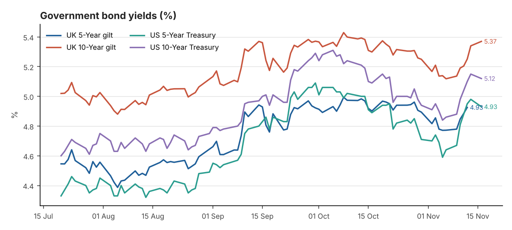
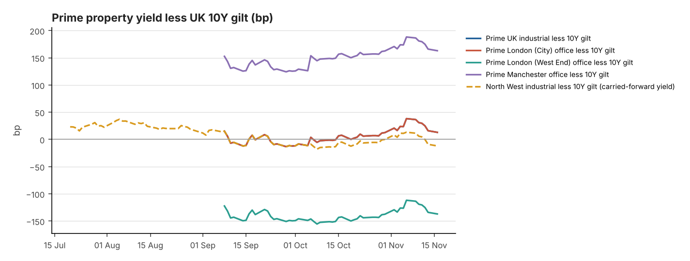

# DAILY FINANCIAL & PROPERTY INVESTMENT BRIEFING

**Date:** 17 November 2026 
**Reporting time:** 06:30 UK time

<small>Generated 2026-11-17 06:30 UTC · run `20261117T063042Z` · commentary: analyst note. Each figure shows its own observation date. Definitions, data-quality notes and full sources are in the appendix.</small>

> **Alerts**
> - New listings: Today's listings sweep did not complete.
> - Corporate action — SEGRO: Recommended share offer from Prologis (0.0920 new Prologis shares per SEGRO share, partial cash alternative at 1,031.7p; completion expected H1 2027). Shares trade on deal terms.

## 1. Executive Summary

1. **Gilt sell-off extended.** On 16 November the 2Y gilt was back above 5% (5.04%, the highest since October 2023) and the 10Y was quoted at 5.37% (+3bp). Sixty-nine of 70 conventional gilts rose in yield ([Trading & Investment News](https://www.tradingandinvestmentnews.co.uk/gilt-yields-spike-rate-bets/), Trading Economics; market quotes). UK labour data is out at 07:00 today and CPI tomorrow.
2. **Prime long-income still clears near gilts.** GPE sold Clifford Chance's 324,700 sq ft City headquarters (let to 2046) to Rothesay for £422.3m at a **5.25% NIY**, about 3% above book ([GPE RNS](https://www.investegate.co.uk/announcement/rns/great-portland-estates--gpe/gpe-sells-2-aldermanbury-square-to-rothesay-/9875715)).
3. **Yield cushion down to about +13bp.** Prime distribution (5.50%+, carried forward) against the 10Y at 5.37%.
4. **North West industrial investment test.** Hollins Murray Group is marketing three Greater Manchester units (106,400 sq ft, including a DPD-let Bredbury shed) at £12.6m via King Street Real Estate.
5. **Listed property and listings.** Prologis fell 0.8% to $127.60, and the SEGRO share offer is worth about 889p on updated FX. No new results from the primary REITs. Today's listings sweep did not complete; the latest is from 15 November.

## 2. Government Bond Yields — UK and US

| Market | Latest Yield | Daily | 7-Day | 30-Day | Observed | Source |
|---|---|---|---|---|---|---|
| UK 5-Year gilt | 4.93% | +4bp | +15.4bp | -5.8bp | 12 Nov 2026 | [Bank of England Database (IADB)](https://www.bankofengland.co.uk/boeapps/database/fromshowcolumns.asp?SeriesCodes=IUDSNPY&UsingCodes=Y) |
| UK 10-Year gilt | 5.37% | +3bp | +23.4bp† | +7.1bp† | 16 Nov 2026 | [Trading Economics](https://tradingeconomics.com/united-kingdom/government-bond-yield) *(secondary)* |
| US 5-Year Treasury | 4.93% | -5bp | +26bp | +4bp | 16 Nov 2026 | [US Treasury - Daily Treasury Par Yield Curve Rates](https://home.treasury.gov/resource-center/data-chart-center/interest-rates/TextView?type=daily_treasury_yield_curve&field_tdr_date_value=2026) |
| US 10-Year Treasury | 5.12% | -3bp | +24bp | +3bp | 16 Nov 2026 | [US Treasury - Daily Treasury Par Yield Curve Rates](https://home.treasury.gov/resource-center/data-chart-center/interest-rates/TextView?type=daily_treasury_yield_curve&field_tdr_date_value=2026) |
| UK 2-Year gilt | 5.04% | +3.5bp† | +28bp† | Not verified | 16 Nov 2026 | [Trading Economics; Reuters-sourced report says back above 5%](https://www.tradingandinvestmentnews.co.uk/gilt-yields-spike-rate-bets/) *(secondary)* |
| UK 30-Year gilt | 5.79% | -3bp | Not verified | Not verified | 16 Nov 2026 | [Trading Economics](https://tradingeconomics.com/united-kingdom/30-year-bond-yield) *(secondary)* |
| US 2-Year Treasury | 4.83% | -5bp | +27bp | +9bp | 16 Nov 2026 | [US Treasury - Daily Treasury Par Yield Curve Rates](https://home.treasury.gov/resource-center/data-chart-center/interest-rates/TextView?type=daily_treasury_yield_curve&field_tdr_date_value=2026) |
| US 30-Year Treasury | 5.46% | -1bp | +20bp | +3bp | 16 Nov 2026 | [US Treasury - Daily Treasury Par Yield Curve Rates](https://home.treasury.gov/resource-center/data-chart-center/interest-rates/TextView?type=daily_treasury_yield_curve&field_tdr_date_value=2026) |

**10Y less 5Y:** UK Not verified · US +19bp (16 Nov 2026) 
<small>Changes in basis points. † = comparison crosses sources or instruments (indicative).</small>

## 3. Interest Rates — Bank Rate, SONIA and Fed

| Indicator | Latest | Previous | Date | Change | Source |
|---|---|---|---|---|---|
| BoE Bank Rate | 4.00% | 3.75% | effective 05 Nov 2026 | +25bp | [Bank of England Database (IADB)](https://www.bankofengland.co.uk/boeapps/database/fromshowcolumns.asp?SeriesCodes=IUDBEDR&UsingCodes=Y) |
| SONIA (overnight fixing) | 3.9846% | 3.9845% | 12 Nov 2026 | 0bp | [FRED IUDSOIA](https://fred.stlouisfed.org/series/IUDSOIA) |
| 5Y SONIA swap (finance-cost reference) | 4.58% ⚠ stale | 4.74% | 04 Nov 2026 | -16bp | [Knight Frank Prime Yield Guide (Macrobond/ICAP)](https://www.knightfrank.co.uk/site-assets/research/report-pdfs/yield-guide/prime-yield-guide-nov-2026.pdf) *(secondary)* |
| Fed funds target range | 3.75–4.00% | 3.50–3.75% | effective 17 Sep 2026 | +25bp | [FRED DFEDTARU](https://fred.stlouisfed.org/series/DFEDTARU) |

**Next MPC decision:** 17 Dec 2026

**Confirmed:**
- Bank Rate 4.00%; SONIA 3.98% (12 Nov).
- The 2Y gilt is about 5.0%, roughly 100bp above Bank Rate.
- Next MPC decision 17 December; today's labour market data and tomorrow's October CPI are the key inputs.

**Not verified:** OIS-implied path. Coverage attributes the moves to bets on continued BoE hikes.

**Interpretation:** a hot CPI print tomorrow would cement a December rise; a soft one could trigger a sharp relief rally at the short end. Fixed-rate property debt is being repriced higher this week either way.

## 4. Inflation — UK and US

| Indicator | Latest | Previous | Period | Trend | Source |
|---|---|---|---|---|---|
| UK CPI (12m) | 3.5% | 3.1% | Sep 2026 (pub. 21 Oct) | Accelerating | [ONS MM23](https://www.ons.gov.uk/economy/inflationandpriceindices/timeseries/d7g7/mm23) |
| UK CPIH (12m) | 3.6% | 3.3% | Sep 2026 (pub. 21 Oct) | Accelerating | [ONS MM23](https://www.ons.gov.uk/economy/inflationandpriceindices/timeseries/l55o/mm23) |
| UK core CPI (12m, ex energy, food, alcohol & tobacco) | 2.8% | 2.6% | Sep 2026 (pub. 21 Oct) | Accelerating | [ONS MM23](https://www.ons.gov.uk/economy/inflationandpriceindices/timeseries/dko8/mm23) |
| US CPI-U (12m, NSA) | 3.7% | 3.4% | Sep 2026 | Accelerating | [BLS CPI via FRED CPIAUCNS](https://fred.stlouisfed.org/series/CPIAUCNS) |
| US core CPI-U (12m, NSA) | 2.6% | 2.4% | Sep 2026 | Broadly stable | [BLS CPI via FRED CPILFENS](https://fred.stlouisfed.org/series/CPILFENS) |

**Next ONS inflation release:** see Section 14

## 5. Prime UK Industrial and Office Investment Yields

| Sector | Latest | Basis | Previous | Move | Evidence | Source |
|---|---|---|---|---|---|---|
| UK Industrial & Logistics | 5.50% | NIY | 5.25–5.50% | +12.5bp | Nov 2026 | [Knight Frank Prime Yield Guide](https://www.knightfrank.co.uk/site-assets/research/report-pdfs/yield-guide/prime-yield-guide-nov-2026.pdf) |
| Prime Distribution Warehouses ‡ | 5.50–5.75% | Not stated | 5.50% | +12.5bp | Nov 2026 | [Knight Frank Prime Yield Guide](https://www.knightfrank.co.uk/site-assets/research/report-pdfs/yield-guide/prime-yield-guide-nov-2026.pdf) |
| South East Industrial ‡ | 5.25–5.50% | Not stated | 5.25% | +12.5bp | Nov 2026 | [Knight Frank Prime Yield Guide](https://www.knightfrank.co.uk/site-assets/research/report-pdfs/yield-guide/prime-yield-guide-nov-2026.pdf) |
| Greater London Industrial | 5.25% | Not stated | 5.00–5.25% | +12.5bp | Nov 2026 | [Knight Frank Prime Yield Guide](https://www.knightfrank.co.uk/site-assets/research/report-pdfs/yield-guide/prime-yield-guide-nov-2026.pdf) |
| Prime Multi-let Industrial (Rest of UK) ‡ | 5.25–5.50% | Not stated | 5.25% | +12.5bp | Nov 2026 | [Knight Frank Prime Yield Guide](https://www.knightfrank.co.uk/site-assets/research/report-pdfs/yield-guide/prime-yield-guide-nov-2026.pdf) |
| North West Industrial ‡ | 5.25% | NIY | — | — | Q4 2025 ⚠ carried forward (321d) | [Knight Frank LOGIC: North West 2025 Review](https://www.knightfrank.co.uk/site-assets/research/report-pdfs/logic/2025-review-nw-industrial.pdf) |
| UK Logistics (average of 71 submarkets) ‡ | 5.74% | NIY | 5.59% | +15bp | Q3 2026 ⚠ carried forward (48d) | [Cushman & Wakefield UK Industrial MarketBeat](https://www.cushmanwakefield.com/en/united-kingdom/insights/uk-marketbeat/industrial-marketbeat) |
| London West End Offices | 4.00% | Not stated | 3.75–4.00% | +12.5bp | Nov 2026 | [Knight Frank Prime Yield Guide](https://www.knightfrank.co.uk/site-assets/research/report-pdfs/yield-guide/prime-yield-guide-nov-2026.pdf) |
| London City Offices | 5.50% | Not stated | 5.25–5.50% | +12.5bp | Nov 2026 | [Knight Frank Prime Yield Guide](https://www.knightfrank.co.uk/site-assets/research/report-pdfs/yield-guide/prime-yield-guide-nov-2026.pdf) |
| Manchester Offices ‡ | 7.00% | Not stated | 6.75–7.00% | +12.5bp | Nov 2026 | [Knight Frank Prime Yield Guide](https://www.knightfrank.co.uk/site-assets/research/report-pdfs/yield-guide/prime-yield-guide-nov-2026.pdf) |
| Regional UK Offices ‡ | 7.00% | Not stated | 6.75–7.00% | +12.5bp | Nov 2026 | [Knight Frank Prime Yield Guide](https://www.knightfrank.co.uk/site-assets/research/report-pdfs/yield-guide/prime-yield-guide-nov-2026.pdf) |

<small>Published prime yields, carried forward until new evidence appears — not daily valuations. ‡ = substitution; see appendix.</small>

## 6. Property Yield Spreads Versus UK Gilts

| Spread | Property yield | UK 10Y gilt | Latest spread | At evidence date | Previous comparable | Change (property / gilt) | Driver |
|---|---|---|---|---|---|---|---|
| Prime UK industrial less 10Y gilt | 5.50% (NIY, Nov 2026) | 5.37% (16 Nov) | +13bp | +38.2bp | +3.8bp (Oct 2026) | +9.2bp (+12.5bp / -3.3bp) | Both (offsetting) |
| Prime London (City) office less 10Y gilt | 5.50% (Not stated, Nov 2026) | 5.37% (16 Nov) | +13bp | +38.2bp | +3.8bp (Oct 2026) | +9.2bp (+12.5bp / -3.3bp) | Both (offsetting) |
| Prime London (West End) office less 10Y gilt | 4.00% (Not stated, Nov 2026) | 5.37% (16 Nov) | -137bp | -111.8bp | -146.2bp (Oct 2026) | +9.2bp (+12.5bp / -3.3bp) | Both (offsetting) |
| Prime Manchester office less 10Y gilt | 7.00% (Not stated, Nov 2026) | 5.37% (16 Nov) | +163bp | +188.2bp | +153.8bp (Oct 2026) | +9.2bp (+12.5bp / -3.3bp) | Both (offsetting) |
| North West industrial less 10Y gilt | 5.25% (NIY, Q4 2025) | 5.37% (16 Nov) | -12bp | +78.4bp | Not verified | Not verified | Not verified |

<small>A simple yield gap (property yield midpoint less 10Y gilt) — not a full measure of risk or relative value.</small>

**Market commentary** <small>(confirmed data points are listed in the appendix)</small>

The gilt market extended Friday's sell-off on Monday. The 2-year moved back above 5% and the 10-year reached about 5.37% on market quotes. Official Bank of England data, which lags, shows the 10-year at 5.25% on 12 November. Either way, gilts are now above prime industrial yields once the yield range is taken into account, and the simple yield gap for prime distribution is about 13bp.

Yesterday's most useful property evidence came from London. GPE sold 2 Aldermanbury Square, a 20-year Clifford Chance letting, to Rothesay at a 5.25% NIY, slightly above book value. Long-dated liability-matching buyers such as annuity insurers price against long gilts and inflation-linked liabilities, not short-term rates, and still value secure 20-year income. The lesson for industrial is that very long, strong-covenant leases can hold value near gilt yields, while shorter or reversionary income is priced off debt costs and will soften.

Elsewhere, Allsop's auction cleared 84% of lots, with a £4.1m retail parade at 10.7%. That shows private buyers remain active for high yields. Sirius's results showed income up 18% but values down. Kadans and CWG needed the National Wealth Fund to complete a £368m development facility, a sign that development finance is increasingly blended with public money.

Interpretation: the market is splitting by income quality. Expect long-let, strong-covenant assets to hold pricing, while shorter-income and speculative assets reprice towards debt costs.

## 7. Listed Industrial & Logistics Property Share Prices

| Company | Price | Daily | 5-Day | 1-Month | YTD | Mkt cap | Div. yield | Close | Source |
|---|---|---|---|---|---|---|---|---|---|
| SEGRO (SGRO.L) | 922.6p | — | — | — | — | Not verified | 3.4% | 09 Nov ⚠ stale | [StockInvest.us (single dated source)](https://stockinvest.us/stock-price/SGRO.L) *(secondary)* |
| Tritax Big Box REIT (BBOX.L) | 145.4p | — | — | — | — | Not verified | 5.5% | 27 Oct ⚠ stale | [Kalkine Media (dated 27 Oct 2026; single source)](https://kalkinemedia.com/uk/stocks/retail/what-tritax-big-box-reit-lsebbox-says-about-the-current-retail-stocks-story) *(secondary)* |
| LondonMetric Property (LMP.L) | 188.2p | +0.2% | — | — | — | Not verified | 6.7% | 09 Nov ⚠ stale | [StockInvest.us; corroborated by AJ Bell last trade 188.2p](https://stockinvest.us/stock-price/LMP.L) *(secondary)* |
| British Land (BLND.L) | Not verified | — | — | — | — | Not verified | — | — | — |
| Landsec (LAND.L) | 659.0p | — | — | — | — | Not verified | — | 27 Oct ⚠ stale | [Kalkine Media (dated 27 Oct 2026; single source)](https://kalkinemedia.com/uk/stocks/industrial/land-securities-lseland-leads-a-fresh-market-look-at-industrial-stocks) *(secondary)* |
| Derwent London (DLN.L) | Not verified | — | — | — | — | Not verified | — | — | — |
| Great Portland Estates (GPE.L) | Not verified | — | — | — | — | Not verified | — | — | — |
| Prologis (PLD) | $127.60 | -0.8% | -2.3% | +1.5% | -0.1% | Not verified | — | 16 Nov | [Nasdaq (official close)](https://www.nasdaq.com/market-activity/stocks/pld/historical) |

*International logistics comparators*

| Company | Price | Daily | 5-Day | 1-Month | YTD | Mkt cap | Div. yield | Close | Source |
|---|---|---|---|---|---|---|---|---|---|
| EastGroup Properties (EGP) | $196.28 | -0.7% | -1.5% | -0.1% | +10.2% | Not verified | — | 16 Nov | [Nasdaq (official close)](https://www.nasdaq.com/market-activity/stocks/egp/historical) |
| First Industrial Realty Trust (FR) | $54.94 | -0.4% | +0.0% | -6.5% | -4.1% | Not verified | — | 16 Nov | [Nasdaq (official close)](https://www.nasdaq.com/market-activity/stocks/fr/historical) |
| Rexford Industrial Realty (REXR) | $37.43 | -0.3% | -3.3% | +1.6% | -3.3% | Not verified | — | 16 Nov | [Nasdaq (official close)](https://www.nasdaq.com/market-activity/stocks/rexr/historical) |
| WDP (Warehouses De Pauw) (WDP.BR) | Not verified | — | — | — | — | Not verified | — | — | — |
| CTP (CTPNV.AS) | Not verified | — | — | — | — | Not verified | — | — | — |

<small>Latest completed trading session before the 06:30 UK briefing; end-of-day data, not real-time. London prices are in pence (GBX); US in USD; Euronext in EUR. Changes are share-price returns only, excluding dividends (not total shareholder return). ⚑ = daily move of 3% or more. Market caps from Nasdaq are as at retrieval. Dividend yield = latest annualised dividend from company reports ÷ price, where on file. "Not verified" = no licensed price feed returned data and no cited close is on file.</small>

**SEGRO — Prologis offer look-through:** 0.0920 × Prologis close $127.60 (16 Nov) ÷ $1.3212/£ (13 Nov, FRED) = **888.5p** per SEGRO share in Prologis stock, vs SEGRO close 922.6p (-3.7% offer spread). Partial cash alternative: 1031.7p (capped). <small>The FX rate lags by several days, so this is indicative only.</small>

**Corporate actions on the watchlist**

- **SEGRO** — Listed - in offer period. Recommended share offer from Prologis (0.0920 new Prologis shares per SEGRO share, partial cash alternative at 1,031.7p; completion expected H1 2027). Shares trade on deal terms. ([source](https://www.slaughterandmay.com/recent-work/advising-segro-on-the-recommended-share-offer-by-prologis/))
- **Prologis** — Listed. Acquirer of SEGRO (recommended offer). ([source](https://www.slaughterandmay.com/recent-work/advising-segro-on-the-recommended-share-offer-by-prologis/))
- **WDP (Warehouses De Pauw)** — Listed. Also admitted on Euronext Amsterdam; Euronext information document dated 26 Oct 2026. ([source](https://live.euronext.com/sites/default/files/2026-10/WDP%20Information%20Document%202026%2010%2026.pdf))

## 8. REIT Valuation and Performance Commentary

| Metric | SEGRO | Tritax Big Box REIT | LondonMetric Property | 
|---|---|---|---|
| EPRA NTA per share | 902p | 185.88p | 200.6p | 
| Loan-to-value | 31% | 32.9% | 36.7% | 
| Average cost of debt | 2.8% | 3.6% | 4.0% | 
| WAULT | — | 9.9 yrs | 16+ yrs | 
| Occupancy | 94.5% | 93.5% | 97.4% | 
| Like-for-like rental growth | 5.3% | 5.1% | 5.8% | 
| ERV growth | 1.8% | 1.9% | 3.3% | 
| Development pipeline | £90m potential rent | 507MW secured power | No direct development | 
| Dividend (annualised) | 31.1p | 8.0p | 12.6p | 
| Report basis | [H1 2026 (30 Jun)](https://www.segro.com/media/xlibxjqh/press-release-full-version-final.pdf) | [H1 2026 (30 Jun)](https://www.investegate.co.uk/announcement/rns/tritax-big-box-reit--bbox/half-year-report/9707045) | [FY 2026 (31 Mar)](https://www.investegate.co.uk/announcement/rns/londonmetric-property--lmp/full-year-results-for-the-year-ended-31-march-2026/9578979) | 
| Premium / (discount) to EPRA NTA | +2.3% <small>(price 09 Nov)</small> | -21.8% <small>(price 27 Oct)</small> | -6.2% <small>(price 09 Nov)</small> | 

<small>Metrics are from each company's latest report (row "Report basis"; some metrics come from later trading updates — full detail in `data/reit_fundamentals.csv`). Share-price dates are shown separately.</small>

Company announcements (last 14 days, routine filings excluded)

| Date | Company | Announcement | Type |
|---|---|---|---|
| 2026-11-16 | GPE | [GPE sells 2 Aldermanbury Square to Rothesay](https://www.investegate.co.uk/announcement/rns/great-portland-estates--gpe/gpe-sells-2-aldermanbury-square-to-rothesay-/9875715) | Other |
| 2026-11-13 | LAND | [Half-year Financial Report](https://www.investegate.co.uk/announcement/rns/land-securities-group--land/half-year-financial-report/9873573) | Results |
| 2026-11-05 | DLN | [Third Quarter Business Update](https://www.investegate.co.uk/announcement/rns/derwent-london--dln/third-quarter-business-update-/9859178) | Trading update |
| 2026-11-04 | LMP | [NON-EXECUTIVE DIRECTOR CHANGES](https://www.investegate.co.uk/announcement/rns/londonmetric-property--lmp/non-executive-director-changes/9856840) | Board |

**Verified:**
- No new SEGRO, Tritax or LondonMetric announcements; LondonMetric reports on 24 November.
- GPE sold 2 Aldermanbury Square at a 5.25% NIY, c.3% above March book.
- Sirius: revenue +17.9%, €24m valuation deficit.
- Prologis $127.60 (−0.8%); US comparators −0.3% to −0.7%.
- No verified UK closes since 9 November.

**Interpretation:**
- GPE achieving at least book value on a trophy asset is supportive evidence for valuers of long-let prime assets. Tritax's long-WAULT big-box portfolio is the closest UK listed industrial analogue, but this is not evidence about its pricing.
- Listed property and gilts moving together is correlation, not established cause.

**Next:** LondonMetric half-year results on 24 November.

## 9. Top UK Industrial & Logistics Property News

**8. Sirius reports 17.9% revenue rise as it eyes future UK acquisitions**

`UK INDUSTRIAL` · **new** · <small>[Property Week](https://www.propertyweek.com/news/sirius-sees-17-9-revenue-rise-as-revaluation-hits-profits), published 2026-11-16</small>

Sirius Real Estate, which owns business and industrial parks in Germany and the UK, reported a 17.9% rise in half-year revenue to €191.4m. Pre-tax profit before revaluations rose 39.3% to €60m, but a €24m valuation deficit cut reported pre-tax profit to €36m. The group is targeting further UK acquisitions.

Key figures and relevance

- **Key figures:** Revenue €191.4m (+17.9%); underlying PBT €60m (+39.3%); valuation deficit €24m; reported PBT €36m
- **Relevance:** Listed multi-let industrial owner: income growing while values ease.

## 10. North West Industrial & Logistics News

**2. HMG seeks £12.6m for GM industrial trio**

`NORTH WEST INDUSTRIAL` · **▲ 100,000+ sq ft** · **new** · <small>[Place North West](https://www.placenorthwest.co.uk/hmg-seeks-12-6m-for-gm-industrial-trio/), published 2026-11-16</small>

Hollins Murray Group has appointed King Street Real Estate to sell three Greater Manchester industrial units at a £12.6m guide. They are Caxton Close, Wigan (46,300 sq ft, let to Velocity Leisure as a padel venue), Carrs House, Bredbury (35,600 sq ft, recently let to DPD for five years) and a refurbished, vacant 24,500 sq ft unit at Stakehill.

**Why this matters:** It is a live test of North West small-lot industrial pricing after the gilt sell-off. The price achieved against the £12.6m guide will show whether private and fund buyers such as Rankeilour are absorbing higher rates. Short leases and a vacant unit make it a value-add rather than core lot.

Key figures and relevance

- **Key figures:** £12.6m guide; 3 units totalling 106,400 sq ft; DPD five-year lease at Bredbury; Stakehill vacant
- **Relevance:** New North West multi-asset industrial investment on the market; a test of small-lot pricing.

**4. GMCA seeks consultant to kick off spatial development strategy**

`PLANNING / DEVELOPMENT` · **new** · <small>[Place North West](https://www.placenorthwest.co.uk/gmca-seeks-consultant-to-kick-off-spatial-development-strategy/), published 2026-11-16</small>

Greater Manchester Combined Authority is seeking a consultant (£150,000 commission) for an integrated impact assessment to underpin its statutory spatial development strategy. Required under the Planning and Infrastructure Act, the SDS will identify strategic growth locations for the next 25 years and support the six growth locations in GM's £10bn pipeline, going beyond Places for Everyone.

Key figures and relevance

- **Key figures:** £150,000 commission; 25-year horizon; six growth locations; £10bn pipeline
- **Relevance:** Long-term framework for Greater Manchester employment-land allocations.

**5. Bury submits local plan to govt**

`PLANNING / DEVELOPMENT` · **new** · <small>[Place North West](https://www.placenorthwest.co.uk/bury-submits-local-plan-to-govt/), published 2026-11-16</small>

Bury Council has voted to submit its local plan, covering the period to 2043, to the Planning Inspectorate, putting it on course for adoption in November 2027. That would be Bury's first adopted local plan since 1997. The plan sets policies on affordable housing, transport, biodiversity net gain and flood risk.

Key figures and relevance

- **Key figures:** Plan period to 2043; adoption targeted Nov 2027; first local plan since 1997
- **Relevance:** Planning certainty improving in Greater Manchester boroughs.

**6. Rochdale's Seven Sisters to be knocked down as refurb estimates hit £269m**

`PLANNING / DEVELOPMENT` · **new** · <small>[Place North West](https://www.placenorthwest.co.uk/rochdales-seven-sisters-to-be-knocked-down-as-refurb-estimates-hit-269m/), published 2026-11-16</small>

Rochdale Boroughwide Housing will demolish the seven 1960s College Bank tower blocks (766 bedsits) after estimating retrofit costs of at least £269m, around £388,000 a flat. Around 600 new homes will replace them once residents are rehoused by next summer.

Key figures and relevance

- **Key figures:** Retrofit cost £269m+ (c.£388k per flat); 766 bedsits; c.600 replacement homes
- **Relevance:** Retrofit economics favouring demolition; cost inflation theme.

**All Place North West headlines since the last briefing** <small>(Mon 16 Nov 06:00 onwards; stories summarised above are not repeated; industrial items first)</small>

| Published | Headline | |
|---|---|---|
| Mon 13:00 | [Ollier Smurthwaite unveils latest Stockport resi](https://www.placenorthwest.co.uk/ollier-smurthwaite-unveils-latest-stockport-resi/) |  |
| Mon 10:51 | [Oldham approves £29m redevelopment of Saddleworth’s Waterside Mill](https://www.placenorthwest.co.uk/oldham-approves-29m-redevelopment-of-saddleworths-waterside-mill/) |  |
| Mon 10:32 | [Northern Trains opens £307m tender](https://www.placenorthwest.co.uk/northern-trains-opens-307m-tender/) |  |
| Mon 09:38 | [Bloor tables 900-home Cheshire proposal](https://www.placenorthwest.co.uk/bloor-tables-900-home-cheshire-proposal/) |  |

**North West outlook**

The main North West transaction signal is HMG's £12.6m Greater Manchester portfolio (Wigan, Bredbury, Stakehill; 106,400 sq ft). It combines a fresh DPD lease, a leisure-let unit and a vacant refurbished shed, so the price achieved will be a useful marker for small-lot, value-add pricing after the gilt sell-off. Planning frameworks are firming up. GMCA has begun its 25-year spatial development strategy, which will shape employment-land allocations beyond Places for Everyone, and Bury has submitted its first local plan since 1997. Rochdale's Seven Sisters decision (£269m retrofit cost) is a further reminder of cost pressure on refurbishment versus rebuild. Today's listings sweep did not complete, so new availability could not be assessed.

## 11. New North West Industrial Listings

**Today's listings sweep did not complete.** <small>Latest available sweep: 2026-11-15 09:34 UTC.</small>

## 12. UK Office and Property Investment News

**1. GPE sells Clifford Chance's London headquarters to Rothesay for £422.3m**

`PROPERTY INVESTMENT` · **▲ 100,000+ sq ft** · **new** · <small>[Great Portland Estates RNS via Investegate](https://www.investegate.co.uk/announcement/rns/great-portland-estates--gpe/gpe-sells-2-aldermanbury-square-to-rothesay-/9875715), published 2026-11-16</small>

GPE has sold 2 Aldermanbury Square, a 324,700 sq ft City headquarters office let to Clifford Chance until 2046, to annuity insurer Rothesay for a headline £422.3m. That reflects a 5.25% net initial yield, or £368.7m net of outstanding rent-frees, around 3% ahead of March 2026 book value. The building is on a 180-year geared ground lease.

**Why this matters:** A 5.25% yield on a 20-year City letting, struck as gilts hit 5.3%+, shows long-dated matching capital (insurers and annuity funds) will still pay near-gilt yields for secure income. It is the strongest evidence this month that the best long-income assets are not repricing as fast as bonds.

Key figures and relevance

- **Key figures:** £422.3m headline (£368.7m net); NIY 5.25%; 324,700 sq ft; let to 2046; c.3% above March book value
- **Relevance:** Prime long-let City office pricing at 5.25% NIY, achieved despite the gilt sell-off; matched-income buyer.

**3. Kadans and CWG secure £368m for flagship Canary Wharf life sciences scheme**

`FINANCE / CAPITAL MARKETS` · **▲ 100,000+ sq ft** · **new** · <small>[Property Week](https://www.propertyweek.com/news/kadans-and-cwg-secure-368m-for-flagship-canary-wharf-life-sciences-scheme), published 2026-11-16</small>

Canary Wharf Group and Kadans Science Partner have secured £368.5m of development debt for One North Quay, a 23-storey, c.570,000 sq ft life sciences and workspace building due for completion in early 2028. The government's National Wealth Fund provided £147m alongside Barclays and Emirates NBD.

**Why this matters:** It shows large development finance now depends on public co-lenders as bank appetite narrows. North West schemes with growth or innovation credentials, such as GMCA growth locations, may need similar blended funding to proceed.

Key figures and relevance

- **Key figures:** £368.5m debt; National Wealth Fund £147m; Barclays, Emirates NBD; 570,000 sq ft; completion early 2028
- **Relevance:** State-backed capital filling gaps in development finance for strategic schemes.

**7. Allsop raises £35.6m at penultimate commercial auction of the year**

`PROPERTY INVESTMENT` · **new** · <small>[Property Week](https://www.propertyweek.com/news/allsop-raises-35-6m-at-penultimate-commercial-auction-of-the-year), published 2026-11-16</small>

Allsop sold 41 lots for more than £35.6m at its penultimate commercial auction of 2026, an 84% success rate, with regional assets almost two-thirds of lots. The largest deal was a Southampton town-centre parade (tenants include Tesco Express, HMV and The Gym Group), sold before auction for £4.1m at a 10.7% NIY.

Key figures and relevance

- **Key figures:** £35.6m; 41 lots; 84% success rate; largest £4.1m at 10.7% NIY
- **Relevance:** Private-investor liquidity for high-yield secondary stock remains good.

## 13. What This Means for the North West Industrial Market

1. **Pricing and yields.** *Verified:* 10Y gilt about 5.37%; City long-let office at 5.25% NIY. *Interpretation:* split pricing advice by lease length. 15–20 year, strong-covenant North West logistics can still target institutional and insurance buyers near 5.50%, while 5-year leases and multi-let should be priced at 6.25–7%.
2. **Rents and demand.** *Verified:* DPD signed five years at Bredbury; no other new North West lettings. *Interpretation:* push for longer leases with indexation. Each extra year of term is now worth more in capital value than a small headline-rent gain.
3. **Viability and supply.** *Verified:* GMCA's SDS commissioned; Bury local plan submitted; Seven Sisters retrofit cost £269m. *Interpretation:* engage now in GMCA's SDS call-for-sites for employment land. For appraisals, retrofit costs are favouring demolition and new-build on obsolete sheds too.
4. **Debt and funding.** *Verified:* 2Y gilt 5.04%; Kadans and CWG needed the National Wealth Fund for development debt. *Interpretation:* buyers relying on bank debt will be outbid by cash and insurance capital. Structure sales with flexibility on completion timing to accommodate financing.
5. **Appetite.** *Verified:* Rothesay buying long income; Allsop 84% sold; HMG portfolio launched. *Interpretation:* market long-income North West assets to insurers and annuity funds. Take value-add lots to private buyers and auction, where liquidity remains good.

## 14. Upcoming Economic and Property Market Events

| Date | Event |
|---|---|
| Tue 17 Nov | [UK labour market overview - 07:00](https://www.ons.gov.uk/releasecalendar) |
| Wed 18 Nov | [UK consumer price inflation (October) - 07:00](https://www.ons.gov.uk/releasecalendar) |
| Tue 24 Nov | [LondonMetric half-year results](https://www.investegate.co.uk/company/LMP) |

---

## Appendix — Data quality, definitions and sources

Expand: data quality, definitions and full sources

**Confirmed data points used in the commentary**

- UK 10Y gilt 5.37% on 16 Nov 2026: rose 3bp on the day, rose 23.4bp over 7 days, rose 7.1bp over 30 days (mixed sources - see Table A notes).
- US 10Y Treasury 5.12% on 16 Nov 2026: fell 3bp on the day, rose 24bp over 7 days, rose 3bp over 30 days.
- Bank Rate 4.00% (effective 05 Nov 2026, changed +25bp from 3.75%).
- UK CPI 3.5% in September 2026 (previous 3.1%); trend: Accelerating.
- US CPI 3.7% in September 2026 (previous 3.4%); trend: Accelerating.
- Latest published prime yield movements: UK Industrial & Logistics +12.5bp to 5.50% (Knight Frank Prime Yield Guide, Nov 2026); Prime Distribution Warehouses +12.5bp to 5.50–5.75% (Knight Frank Prime Yield Guide, Nov 2026); South East Industrial +12.5bp to 5.25–5.50% (Knight Frank Prime Yield Guide, Nov 2026); Greater London Industrial +12.5bp to 5.25% (Knight Frank Prime Yield Guide, Nov 2026); Prime Multi-let Industrial (Rest of UK) +12.5bp to 5.25–5.50% (Knight Frank Prime Yield Guide, Nov 2026); UK Logistics (average of 71 submarkets) +15bp to 5.74% (Cushman & Wakefield UK Industrial MarketBeat, Q3 2026); London West End Offices +12.5bp to 4.00% (Knight Frank Prime Yield Guide, Nov 2026); London City Offices +12.5bp to 5.50% (Knight Frank Prime Yield Guide, Nov 2026); Manchester Offices +12.5bp to 7.00% (Knight Frank Prime Yield Guide, Nov 2026); Regional UK Offices +12.5bp to 7.00% (Knight Frank Prime Yield Guide, Nov 2026).

**Retrieval failures and data gaps**

- All automated sources responded.
- 5Y SONIA swap rate: latest observation (04 Nov 2026) is stale.
- UK CPI (12m): latest observation (01 Sep 2026) is stale.
- UK CPIH (12m): latest observation (01 Sep 2026) is stale.
- UK core CPI (12m, ex energy, food, alcohol & tobacco): latest observation (01 Sep 2026) is stale.
- US CPI-U (12m, NSA): latest observation (01 Sep 2026) is stale.
- US core CPI-U (12m, NSA): latest observation (01 Sep 2026) is stale.
- Discrepancy — UK 10-Year gilt, 2026-10-06: 5.34% (Bank of England Database (IADB)) vs 5.42% ([Knight Frank Prime Yield Guide (Macrobond/ICAP)](https://www.knightfrank.co.uk/site-assets/research/report-pdfs/yield-guide/10.-kf-final-october-2026-prime-yield-guide.pdf)), +8.3bp; often a different instrument.
- Discrepancy — UK 10-Year gilt, 2026-11-06: 5.12% (Bank of England Database (IADB)) vs 5.16% ([Trading Economics](https://tradingeconomics.com/united-kingdom/government-bond-yield)), +4.2bp; often a different instrument.

**Property yield substitutions (‡)**

- **Prime Distribution Warehouses:** 15-year lease with open-market rent reviews (KF does not state the yield basis for this row)
- **South East Industrial:** KF South East multi-let estates
- **Prime Multi-let Industrial (Rest of UK):** KF 'Good Modern Rest of UK Estates' used as the prime multi-let proxy
- **North West Industrial:** Manchester prime (units >50,000 sq ft) used for the North West. No 2026 North West prime yield from KF, Savills, CBRE or C&W was found on 9 Nov 2026, so this Q4 2025 figure is carried forward.
- **UK Logistics (average of 71 submarkets):** An average across 71 submarkets, a wider definition than KF's single prime-distribution benchmark. This is why it reads higher.
- **Manchester Offices:** KF 'Major Regional Cities' (10-year lease) is a composite, not Manchester-specific.
- **Regional UK Offices:** KF 'Major Regional Cities' (10-year lease) is a composite, not Manchester-specific.

**Definitions**

- UK gilts from the Bank of England database are fitted nominal par yields; market quotes (e.g. Trading Economics) are benchmark-gilt yields and are labelled secondary. US yields are Treasury constant-maturity par yields.
- Net initial yield (NIY) = net income ÷ gross price including purchaser's costs. Equivalent yield = IRR assuming rent reverts to market at review/expiry. The two are not interchangeable.
- SONIA is the overnight fixing — not term SONIA or SONIA swaps.
- Inflation trend compares the last three monthly readings (±0.15pp threshold). US annual rates are calculated from the BLS NSA index via FRED.
- Share-price changes exclude dividends. 5-day = five trading sessions; 1-month = last close on or before 30 days earlier; YTD = versus the last close of the previous year.
- Correlation between gilts, property yields and listed property prices does not establish causation.

**Analyst sources**

- [Trading & Investment News](https://www.tradingandinvestmentnews.co.uk/gilt-yields-spike-rate-bets/), Reuters-sourced gilt report; Trading Economics [UK 10Y](https://tradingeconomics.com/united-kingdom/government-bond-yield) and [30Y](https://tradingeconomics.com/united-kingdom/30-year-bond-yield) (16 Nov).
- GPE, [Sale of 2 Aldermanbury Square](https://www.investegate.co.uk/announcement/rns/great-portland-estates--gpe/gpe-sells-2-aldermanbury-square-to-rothesay-/9875715).
- Place North West: [HMG portfolio](https://www.placenorthwest.co.uk/hmg-seeks-12-6m-for-gm-industrial-trio/), [GMCA SDS](https://www.placenorthwest.co.uk/gmca-seeks-consultant-to-kick-off-spatial-development-strategy/), [Bury local plan](https://www.placenorthwest.co.uk/bury-submits-local-plan-to-govt/), [Seven Sisters](https://www.placenorthwest.co.uk/rochdales-seven-sisters-to-be-knocked-down-as-refurb-estimates-hit-269m/).
- Property Week: [Kadans/CWG](https://www.propertyweek.com/news/kadans-and-cwg-secure-368m-for-flagship-canary-wharf-life-sciences-scheme), [Allsop](https://www.propertyweek.com/news/allsop-raises-35-6m-at-penultimate-commercial-auction-of-the-year), [Sirius](https://www.propertyweek.com/news/sirius-sees-17-9-revenue-rise-as-revaluation-hits-profits).
- Listings sweep: branch `claude/magical-ride-4nijqh` (latest sweep 15 Nov 2026 09:34 UTC).

<small>Prepared from public sources for professional information; not investment advice. History: `data/observations.csv`, `data/share_prices.csv`, `data/news_log.csv`, `data/announcements.csv`; audit trail: `data/audit_log.csv`.</small>
