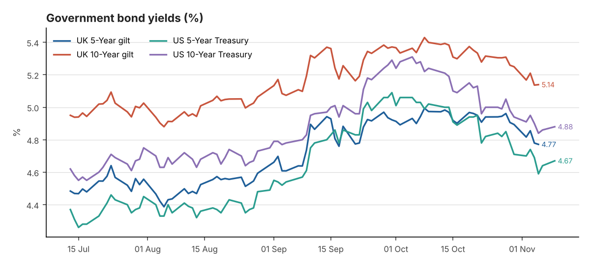
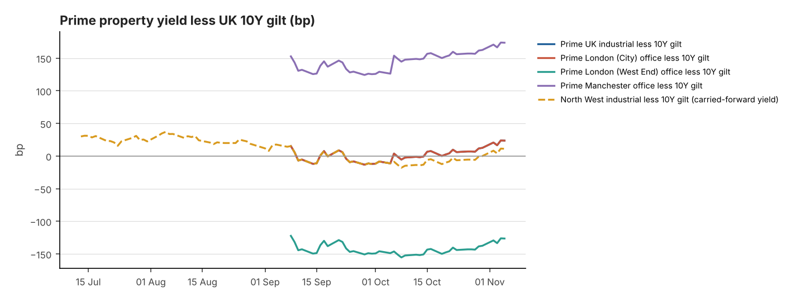

# DAILY FINANCIAL & PROPERTY INVESTMENT BRIEFING

**Date:** 10 November 2026
**Reporting time:** 08:00 UK time
<small>Generated 2026-11-10 07:48 UTC · run `20261110T074850Z` · commentary source: analyst note. Every figure shows its own observation date: markets close the previous business day, inflation is monthly, and property yields are published monthly or quarterly.</small>

## Executive Summary

1. **New property evidence: Knight Frank's November Prime Yield Guide** (prepared 6 November) moved yields out again. Prime distribution is **5.50%+ NIY**, up from 5.25–5.50%. South East and good-modern rest-of-UK multi-let estates are at 5.25–5.50% (+25bp). City prime is 5.50%+, West End prime core 4.00%+, and major regional offices 7.00%+. ([KF Nov 2026](https://www.knightfrank.co.uk/site-assets/research/report-pdfs/yield-guide/prime-yield-guide-nov-2026.pdf))
2. **Gilts are steady after the hike.** The BoE 10Y par yield was 5.14% on 5 November, 20bp lower over 30 days, and the 5Y was 4.77%. BoE curve data runs only to 5 November because of its usual publication lag. Knight Frank/ICAP shows the 10Y benchmark redemption yield at 5.15% on 4 November.
3. **Swap rates are easing.** The 5Y SONIA swap, the base for fixed-rate property debt, was 4.58% on 4 November, down 16bp from 4.74% on 6 October (Knight Frank/ICAP).
4. **US yields are edging back up ahead of today's CPI.** The US 10Y was 4.88% (+2bp) and the 2Y 4.56% (+5bp) on 9 November. October US CPI is out at 13:30 UK today, and UK Q3 GDP on Thursday.
5. **Spreads have widened from very thin levels.** Prime industrial now sits about **+36bp** over the 10Y gilt, against about +4bp on 6 October. Both lower gilts (+20bp of the widening) and higher property yields (+12.5bp) contributed. Major regional offices are about 186bp over gilts; West End offices are still about 114bp below.

## Table A — Government Bond Markets

| Market | Latest Yield | Daily Change | 7-Day Change | 30-Day Change | Observation Date | Source |
|---|---|---|---|---|---|---|
| UK 5-Year gilt | 4.77% | -0.8bp | -13.5bp | -12.8bp | 05 Nov 2026 | [Bank of England Database (IADB)](https://www.bankofengland.co.uk/boeapps/database/fromshowcolumns.asp?SeriesCodes=IUDSNPY&UsingCodes=Y) |
| UK 10-Year gilt | 5.14% | +0.3bp | -12bp | -19.8bp | 05 Nov 2026 | [Bank of England Database (IADB)](https://www.bankofengland.co.uk/boeapps/database/fromshowcolumns.asp?SeriesCodes=IUDMNPY&UsingCodes=Y) |
| US 5-Year Treasury | 4.67% | +3bp | -3bp | -35bp | 09 Nov 2026 | [US Treasury - Daily Treasury Par Yield Curve Rates](https://home.treasury.gov/resource-center/data-chart-center/interest-rates/TextView?type=daily_treasury_yield_curve&field_tdr_date_value=2026) |
| US 10-Year Treasury | 4.88% | +2bp | -3bp | -36bp | 09 Nov 2026 | [US Treasury - Daily Treasury Par Yield Curve Rates](https://home.treasury.gov/resource-center/data-chart-center/interest-rates/TextView?type=daily_treasury_yield_curve&field_tdr_date_value=2026) |

*Additional reference*

| Market | Latest Yield | Daily Change | 7-Day Change | 30-Day Change | Observation Date | Source |
|---|---|---|---|---|---|---|
| UK 2-Year gilt | 4.76% | Not verified | Not verified | Not verified | 05 Nov 2026 | [News report (rallies.ai) of BoE decision-day trading](https://rallies.ai/news/bank-of-england-delivers-first-rate-hike-in-three-years-gilt-yields-rise-6c4ea0b2eeeccedd) *(secondary)* |
| UK 30-Year gilt | Not verified | Not verified | Not verified | Not verified | — | — |
| US 2-Year Treasury | 4.56% | +5bp | -3bp | -24bp | 09 Nov 2026 | [US Treasury - Daily Treasury Par Yield Curve Rates](https://home.treasury.gov/resource-center/data-chart-center/interest-rates/TextView?type=daily_treasury_yield_curve&field_tdr_date_value=2026) |
| US 30-Year Treasury | 5.26% | 0bp | -2bp | -34bp | 09 Nov 2026 | [US Treasury - Daily Treasury Par Yield Curve Rates](https://home.treasury.gov/resource-center/data-chart-center/interest-rates/TextView?type=daily_treasury_yield_curve&field_tdr_date_value=2026) |

**Yield curve (10Y less 5Y):** UK +36.8bp (05 Nov 2026) · US +21bp (09 Nov 2026)

<small>Changes are in basis points (1 percentage point = 100bp). The 7-day and 30-day changes compare against the last observation on or before that many calendar days earlier. † = the comparison point comes from a different source or instrument than the latest figure, so treat it as indicative. UK gilt figures from the Bank of England's database are fitted par yields, not benchmark-gilt redemption yields. US figures are Treasury constant-maturity par yields.</small>

## Table B — Interest Rates and Inflation

| Indicator | Latest | Previous | Reporting Date | Trend | Source |
|---|---|---|---|---|---|
| BoE Bank Rate | 4.00% | 3.75% | effective 05 Nov 2026 | +25bp | [Bank of England Database (IADB)](https://www.bankofengland.co.uk/boeapps/database/fromshowcolumns.asp?SeriesCodes=IUDBEDR&UsingCodes=Y) |
| SONIA (overnight fixing) | 3.9824% | 3.7335% | 05 Nov 2026 | +24.9bp d/d | [FRED IUDSOIA](https://fred.stlouisfed.org/series/IUDSOIA) |
| 5Y SONIA swap (finance cost reference, not SONIA) | 4.58% | 4.74% | 04 Nov 2026 | Not verified 30d | [Knight Frank Prime Yield Guide (Macrobond/ICAP)](https://www.knightfrank.co.uk/site-assets/research/report-pdfs/yield-guide/prime-yield-guide-nov-2026.pdf) *(secondary)* |
| US Fed funds target range | 3.75–4.00% | 3.50–3.75% (to 16 Sep 2026) | effective 17 Sep 2026 | — | [FRED DFEDTARU](https://fred.stlouisfed.org/series/DFEDTARU) |
| UK CPI (12m) | 3.5% | 3.1% | September 2026 (published 21 Oct 2026) | Accelerating | [ONS MM23](https://www.ons.gov.uk/economy/inflationandpriceindices/timeseries/d7g7/mm23) |
| UK CPIH (12m) | 3.6% | 3.3% | September 2026 (published 21 Oct 2026) | Accelerating | [ONS MM23](https://www.ons.gov.uk/economy/inflationandpriceindices/timeseries/l55o/mm23) |
| UK core CPI (12m, ex energy, food, alcohol & tobacco) | 2.8% | 2.6% | September 2026 (published 21 Oct 2026) | Accelerating | [ONS MM23](https://www.ons.gov.uk/economy/inflationandpriceindices/timeseries/dko8/mm23) |
| US CPI-U (12m, NSA) | 3.7% | 3.4% | September 2026 | Accelerating | [BLS CPI via FRED CPIAUCNS](https://fred.stlouisfed.org/series/CPIAUCNS) |
| US core CPI-U (12m, NSA) | 2.6% | 2.4% | September 2026 | Broadly stable | [BLS CPI via FRED CPILFENS](https://fred.stlouisfed.org/series/CPILFENS) |

**Next ONS inflation release:** Not verified · **Next MPC decision:** 17 Dec 2026

<small>Trend compares the last three monthly readings: a move of more than 0.15pp is "accelerating" or "moderating"; anything smaller is "broadly stable". US annual rates are calculated from the BLS not-seasonally-adjusted index (via FRED) and rounded to one decimal place, the same way BLS rounds its headline. SONIA here is the overnight fixing, not term SONIA or SONIA swap rates.</small>

### Interest rate outlook

**Confirmed:** Bank Rate is 4.00%, effective 5 November, after an 8–1 vote. SONIA fixed at 3.98% on 5 November. The next MPC decision is on 17 December. CNBC's report on the decision says the Bank warned that inflation will approach 5% ([CNBC](https://www.cnbc.com/2026/11/05/interest-rates-inflation-uk.html)).

**Market-implied expectations for December: Not verified.** Today's searches found no dated, reliable OIS or futures pricing. Press commentary is mixed on whether the next move comes in December or February 2027.

**Financing read-across (interpretation):** The fall in 5-year swaps to about 4.6% trims fixed-rate debt costs slightly. Even so, all-in senior debt (swap plus margin) still sits above prime industrial yields of about 5.50%, so leverage remains negative and pricing is set by equity buyers. Debt availability was not measured today.

## Table C — UK Prime Property Investment Yields

| Sector | Latest Yield | Basis | Previous Yield | Movement | Evidence Date | Source |
|---|---|---|---|---|---|---|
| UK Industrial & Logistics | 5.50% | NIY | 5.25–5.50% | +12.5bp | Nov 2026 | [Knight Frank Prime Yield Guide](https://www.knightfrank.co.uk/site-assets/research/report-pdfs/yield-guide/prime-yield-guide-nov-2026.pdf) |
| Prime Distribution Warehouses ‡ | 5.50–5.75% | Not stated | 5.50% | +12.5bp | Nov 2026 | [Knight Frank Prime Yield Guide](https://www.knightfrank.co.uk/site-assets/research/report-pdfs/yield-guide/prime-yield-guide-nov-2026.pdf) |
| South East Industrial ‡ | 5.25–5.50% | Not stated | 5.25% | +12.5bp | Nov 2026 | [Knight Frank Prime Yield Guide](https://www.knightfrank.co.uk/site-assets/research/report-pdfs/yield-guide/prime-yield-guide-nov-2026.pdf) |
| Greater London Industrial | 5.25% | Not stated | 5.00–5.25% | +12.5bp | Nov 2026 | [Knight Frank Prime Yield Guide](https://www.knightfrank.co.uk/site-assets/research/report-pdfs/yield-guide/prime-yield-guide-nov-2026.pdf) |
| Prime Multi-let Industrial (Rest of UK) ‡ | 5.25–5.50% | Not stated | 5.25% | +12.5bp | Nov 2026 | [Knight Frank Prime Yield Guide](https://www.knightfrank.co.uk/site-assets/research/report-pdfs/yield-guide/prime-yield-guide-nov-2026.pdf) |
| North West Industrial ‡ | 5.25% | NIY | — | — | Q4 2025 ⚠ carried forward (314 days) | [Knight Frank LOGIC: North West 2025 Review](https://www.knightfrank.co.uk/site-assets/research/report-pdfs/logic/2025-review-nw-industrial.pdf) |
| UK Logistics (average of 71 submarkets) ‡ | 5.74% | NIY | 5.59% | +15bp | Q3 2026 | [Cushman & Wakefield UK Industrial MarketBeat](https://www.cushmanwakefield.com/en/united-kingdom/insights/uk-marketbeat/industrial-marketbeat) |
| London West End Offices | 4.00% | Not stated | 3.75–4.00% | +12.5bp | Nov 2026 | [Knight Frank Prime Yield Guide](https://www.knightfrank.co.uk/site-assets/research/report-pdfs/yield-guide/prime-yield-guide-nov-2026.pdf) |
| London City Offices | 5.50% | Not stated | 5.25–5.50% | +12.5bp | Nov 2026 | [Knight Frank Prime Yield Guide](https://www.knightfrank.co.uk/site-assets/research/report-pdfs/yield-guide/prime-yield-guide-nov-2026.pdf) |
| Manchester Offices ‡ | 7.00% | Not stated | 6.75–7.00% | +12.5bp | Nov 2026 | [Knight Frank Prime Yield Guide](https://www.knightfrank.co.uk/site-assets/research/report-pdfs/yield-guide/prime-yield-guide-nov-2026.pdf) |
| Regional UK Offices ‡ | 7.00% | Not stated | 6.75–7.00% | +12.5bp | Nov 2026 | [Knight Frank Prime Yield Guide](https://www.knightfrank.co.uk/site-assets/research/report-pdfs/yield-guide/prime-yield-guide-nov-2026.pdf) |

<small>‡ Substitutions and definitions:</small>

- <small>**Prime Distribution Warehouses:** 15-year lease with open-market rent reviews (KF does not state the yield basis for this row)</small>
- <small>**South East Industrial:** KF South East multi-let estates</small>
- <small>**Prime Multi-let Industrial (Rest of UK):** KF 'Good Modern Rest of UK Estates' used as the prime multi-let proxy</small>
- <small>**North West Industrial:** Manchester prime (units >50,000 sq ft) used for the North West. No 2026 North West prime yield from KF, Savills, CBRE or C&W was found on 9 Nov 2026, so this Q4 2025 figure is carried forward.</small>
- <small>**UK Logistics (average of 71 submarkets):** An average across 71 submarkets, a wider definition than KF's single prime-distribution benchmark. This is why it reads higher.</small>
- <small>**Manchester Offices:** KF 'Major Regional Cities' (10-year lease) is a composite, not Manchester-specific.</small>
- <small>**Regional UK Offices:** KF 'Major Regional Cities' (10-year lease) is a composite, not Manchester-specific.</small>

<small>Prime yields come from agents' published research and are carried forward until a newer figure is published. They are **not** daily valuations. Movement is the change between the two latest published figures, using the midpoint where a range is quoted. **Net initial yield (NIY)** is current net income ÷ gross price including purchaser's costs. **Equivalent yield** is the internal rate of return, assuming current rent rises or falls to market rent at review or lease expiry. The two are not interchangeable. Where a source does not state the basis, the table says "Not stated".</small>

## Table D — Property Yield Versus Gilts

| Spread | Property yield (basis) | UK 10Y gilt | Latest spread | Spread at property evidence date | Previous comparable spread | Change | Driver |
|---|---|---|---|---|---|---|---|
| Prime UK industrial less 10Y gilt | 5.50% (NIY, Nov 2026) | 5.14% (05 Nov 2026) | +36.1bp | +36.1bp (gilt 5.14%, 05 Nov 2026) | +3.8bp (Oct 2026) | +32.3bp (property +12.5bp, gilt +19.8bp) | Both (reinforcing) |
| Prime London (City) office less 10Y gilt | 5.50% (Not stated, Nov 2026) | 5.14% (05 Nov 2026) | +36.1bp | +36.1bp (gilt 5.14%, 05 Nov 2026) | +3.8bp (Oct 2026) | +32.3bp (property +12.5bp, gilt +19.8bp) | Both (reinforcing) |
| Prime London (West End) office less 10Y gilt | 4.00% (Not stated, Nov 2026) | 5.14% (05 Nov 2026) | -113.9bp | -113.9bp (gilt 5.14%, 05 Nov 2026) | -146.2bp (Oct 2026) | +32.3bp (property +12.5bp, gilt +19.8bp) | Both (reinforcing) |
| Prime Manchester office less 10Y gilt | 7.00% (Not stated, Nov 2026) | 5.14% (05 Nov 2026) | +186.1bp | +186.1bp (gilt 5.14%, 05 Nov 2026) | +153.8bp (Oct 2026) | +32.3bp (property +12.5bp, gilt +19.8bp) | Both (reinforcing) |
| North West industrial less 10Y gilt | 5.25% (NIY, Q4 2025) | 5.14% (05 Nov 2026) | +11.1bp | +78.4bp (gilt 4.47%, 31 Dec 2025) | Not verified | Not verified | Not verified |

<small>The spread is a simple yield gap: the property yield (midpoint of any quoted range) minus the UK 10-year gilt yield. It ignores rental growth, depreciation, capex, liquidity and leverage, so it is **not** a complete measure of investment risk or relative value. The gilt contribution has the opposite sign to the gilt move (a higher gilt yield narrows the spread). All rows use Knight Frank prime yields so the source is consistent. Knight Frank states the basis (NIY) only for prime distribution and the North West figure; for the office rows the basis is not stated.</small>

## Trend Charts

<small>Lines overlap where the published yields are identical: Prime UK industrial less 10Y gilt and Prime London (City) office less 10Y gilt.</small>

## Market Commentary

**Confirmed developments (from verified data)**

- UK 10Y gilt 5.14% on 05 Nov 2026: was unchanged on the day, fell 12bp over 7 days, fell 19.8bp over 30 days.
- US 10Y Treasury 4.88% on 09 Nov 2026: rose 2bp on the day, fell 3bp over 7 days, fell 36bp over 30 days.
- Bank Rate 4.00% (effective 05 Nov 2026, changed +25bp from 3.75%).
- UK CPI 3.5% in September 2026 (previous 3.1%); trend: Accelerating.
- US CPI 3.7% in September 2026 (previous 3.4%); trend: Accelerating.
- Latest published prime yield movements: UK Industrial & Logistics +12.5bp to 5.50% (Knight Frank Prime Yield Guide, Nov 2026); Prime Distribution Warehouses +12.5bp to 5.50–5.75% (Knight Frank Prime Yield Guide, Nov 2026); South East Industrial +12.5bp to 5.25–5.50% (Knight Frank Prime Yield Guide, Nov 2026); Greater London Industrial +12.5bp to 5.25% (Knight Frank Prime Yield Guide, Nov 2026); Prime Multi-let Industrial (Rest of UK) +12.5bp to 5.25–5.50% (Knight Frank Prime Yield Guide, Nov 2026); UK Logistics (average of 71 submarkets) +15bp to 5.74% (Cushman & Wakefield UK Industrial MarketBeat, Q3 2026); London West End Offices +12.5bp to 4.00% (Knight Frank Prime Yield Guide, Nov 2026); London City Offices +12.5bp to 5.50% (Knight Frank Prime Yield Guide, Nov 2026); Manchester Offices +12.5bp to 7.00% (Knight Frank Prime Yield Guide, Nov 2026); Regional UK Offices +12.5bp to 7.00% (Knight Frank Prime Yield Guide, Nov 2026).

**Interpretation**

Since the Bank of England's 5 November hike, UK rates have been steady rather than rising. The 10-year gilt par yield held at 5.14%, about 20bp below early-October levels, and the 5-year was 4.77%. The 5-year SONIA swap eased to about 4.6%. US Treasuries edged higher on Monday, with the 2-year up 5bp, ahead of today's October CPI. A stronger US print would be the main near-term risk to gilts.

On the property side, the confirmed development is Knight Frank's November guide. It moved prime distribution to 5.50%+ NIY, regional and South East multi-let estates out by 25bp, and secondary distribution to 6.25–6.75%. Office yields were also moved out: City 5.50%+, West End 4.00%+, regional cities 7.00%+. This is the second consecutive month of outward movement. It largely reflects the gilt sell-off of September and early October, which has since partly reversed.

Interpretation: the combination of higher property yields and lower gilts has rebuilt a modest cushion. Prime industrial is now about 36bp over gilts, against roughly zero a month ago. If gilts stay near 5.1% and the CPI and GDP data this week do not push yields back towards 5.4%, the case for further outward yield movement weakens. Pricing could then stabilise into early 2027. With negative leverage and the Bank signalling possible further tightening, capital-value pressure is still skewed to the downside. Returns depend on income and rental growth, not on yields coming in.

## North West Industrial & Logistics Outlook

There is still no published 2026 North West prime industrial yield. The Q4 2025 Manchester benchmark of 5.25% NIY (Knight Frank) is carried forward and now looks dated against the national 5.50%+ for prime distribution and 5.25–5.50% for regional multi-let estates. A North West prime level of about 5.50% would be consistent with that evidence but is **not verified**. On demand, Knight Frank reports Manchester investment volumes up 34% year to date and Q3 activity up 77% year on year. That points to resilient investor appetite for the region despite higher finance costs. Expect equity-led buyers to favour reversionary multi-let estates, and long-let big boxes to be priced off the wider national yields.

## Key Events Ahead (next 7 days)

| Date | Event |
|---|---|
| Tue 10 Nov | [US CPI (October) - 13:30 UK](https://www.bls.gov/schedule/news_release/cpi.htm) |
| Thu 12 Nov | [UK GDP first quarterly estimate Q3 2026 and monthly GDP (September) - 07:00](https://www.ons.gov.uk/releasecalendar) |
| Fri 13 Nov | [US PPI (October) - 13:30 UK](https://www.bls.gov/schedule/news_release/ppi.htm) |
| Tue 17 Nov | [UK labour market overview - 07:00](https://www.ons.gov.uk/releasecalendar) |

## Data Quality and Retrieval Failures

- All automated sources responded.
- UK 30-Year gilt: no verified observation held — reported as "Not verified".
- 5Y SONIA swap rate: latest observation (04 Nov 2026) is stale.

**Source discrepancies** (lower-priority figure not used):

- UK 10-Year gilt, 2026-10-06: 5.34% (Bank of England Database (IADB)) vs 5.42% ([Knight Frank Prime Yield Guide (Macrobond/ICAP)](https://www.knightfrank.co.uk/site-assets/research/report-pdfs/yield-guide/10.-kf-final-october-2026-prime-yield-guide.pdf)), a +8.3bp difference. Often a different instrument, e.g. benchmark gilt redemption yield vs BoE fitted par yield.

### Analyst sources

- Knight Frank, [Prime Yield Guide November 2026](https://www.knightfrank.co.uk/site-assets/research/report-pdfs/yield-guide/prime-yield-guide-nov-2026.pdf) (prepared 6 Nov 2026): property yields, Bonds & Rates panel and Manchester investment commentary.
- Knight Frank, [Prime Yield Guide October 2026](https://www.knightfrank.co.uk/site-assets/research/report-pdfs/yield-guide/10.-kf-final-october-2026-prime-yield-guide.pdf).
- Knight Frank, [LOGIC: North West 2025 Review](https://www.knightfrank.co.uk/site-assets/research/report-pdfs/logic/2025-review-nw-industrial.pdf).
- CNBC, [Bank of England hikes interest rate…](https://www.cnbc.com/2026/11/05/interest-rates-inflation-uk.html) (5 Nov 2026).
- Bank of England, [Monetary Policy Summary, November 2026](https://www.bankofengland.co.uk/monetary-policy-summary-and-minutes/2026/november-2026).
- Market data: BoE IADB, US Treasury, FRED and ONS, as cited in the tables.

---
<small>Prepared automatically from public sources for professional information. It is not investment advice. Full observation history: `data/observations.csv`; audit trail: `data/audit_log.csv`; property evidence register: `data/property_yields.csv`.</small>
