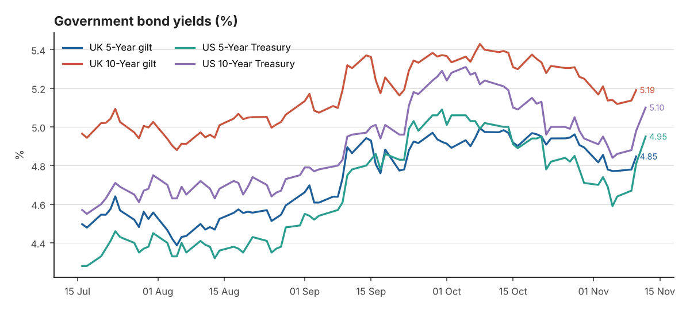
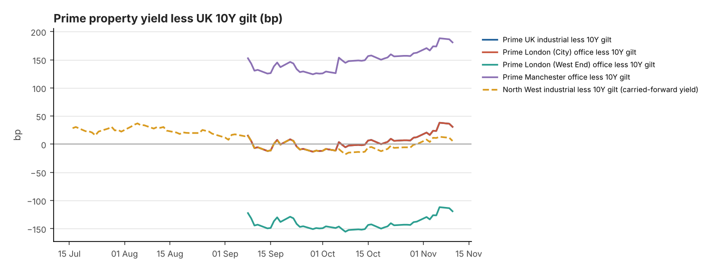

# DAILY FINANCIAL & PROPERTY INVESTMENT BRIEFING

**Date:** 13 November 2026 
**Reporting time:** 06:30 UK time

<small>Generated 2026-11-13 06:30 UTC · run `20261113T063043Z` · commentary: analyst note. Each figure shows its own observation date. Definitions, data-quality notes and full sources are in the appendix.</small>

> **Alerts**
> - Prime yield moves in the last 7 days (Knight Frank Prime Yield Guide, Nov 2026): UK Industrial & Logistics +12.5bp; Prime Distribution Warehouses +12.5bp; South East Industrial +12.5bp; Greater London Industrial +12.5bp; Prime Multi-let Industrial (Rest of UK) +12.5bp; London West End Offices +12.5bp; London City Offices +12.5bp; Manchester Offices +12.5bp; Regional UK Offices +12.5bp.
> - Corporate action — SEGRO: Recommended share offer from Prologis (0.0920 new Prologis shares per SEGRO share, partial cash alternative at 1,031.7p; completion expected H1 2027). Shares trade on deal terms.

## 1. Executive Summary

1. **UK growth in line; yields up again.** Q3 GDP grew 0.7% q/q (1.9% y/y), with September +0.2% and construction −0.7% ([Reuters via Investing.com](https://www.investing.com/news/economy-news/uk-economy-grows-07-in-q3-ons-data-shows-5020475)). The BoE 10Y par yield rose 5bp to 5.19% (10 Nov). The US 10Y rose 12bp to 5.10% and the 2Y 13bp to 4.86% (12 Nov).
2. **Regional office investment recovering.** Avison Young's Big Nine (including Manchester and Liverpool) shows £1.1bn of office deals so far in 2026, up 25% and on course for the best year since 2022 ([Place North West](https://www.placenorthwest.co.uk/regional-cities-on-course-for-highest-investment-volumes-in-four-years/)).
3. **Second grey-belt appeal win in a fortnight.** An inspector overturned Lancaster's refusal of 200 homes on 28 acres at Bolton-le-Sands. It follows the 700,000 sq ft M42 logistics win.
4. **Small-lot capital and secondary pricing.** Rankeilour raised £20m+ to buy £1–6m warehouses across the North. Regional REIT sold assets at an 8.3% NIY, 11% below book value.
5. **Yield cushion thinner.** Prime industrial (5.50%+, carried forward) is about +31bp over the 10Y gilt, down from +36bp. On Prologis's close of $128.55 (−1.1%), the SEGRO share offer is worth about 885p.

## 2. Government Bond Yields — UK and US

| Market | Latest Yield | Daily | 7-Day | 30-Day | Observed | Source |
|---|---|---|---|---|---|---|
| UK 5-Year gilt | 4.85% | +6.8bp | -0.8bp | -12.7bp | 10 Nov 2026 | [Bank of England Database (IADB)](https://www.bankofengland.co.uk/boeapps/database/fromshowcolumns.asp?SeriesCodes=IUDSNPY&UsingCodes=Y) |
| UK 10-Year gilt | 5.19% | +5.4bp | -1.9bp | -20.9bp | 10 Nov 2026 | [Bank of England Database (IADB)](https://www.bankofengland.co.uk/boeapps/database/fromshowcolumns.asp?SeriesCodes=IUDMNPY&UsingCodes=Y) |
| US 5-Year Treasury | 4.95% | +14bp | +36bp | -5bp | 12 Nov 2026 | [US Treasury - Daily Treasury Par Yield Curve Rates](https://home.treasury.gov/resource-center/data-chart-center/interest-rates/TextView?type=daily_treasury_yield_curve&field_tdr_date_value=2026) |
| US 10-Year Treasury | 5.10% | +12bp | +26bp | -11bp | 12 Nov 2026 | [US Treasury - Daily Treasury Par Yield Curve Rates](https://home.treasury.gov/resource-center/data-chart-center/interest-rates/TextView?type=daily_treasury_yield_curve&field_tdr_date_value=2026) |
| UK 2-Year gilt | 4.76% ⚠ stale | Not verified | Not verified | Not verified | 05 Nov 2026 | [News report (rallies.ai) of BoE decision-day trading](https://rallies.ai/news/bank-of-england-delivers-first-rate-hike-in-three-years-gilt-yields-rise-6c4ea0b2eeeccedd) *(secondary)* |
| UK 30-Year gilt | 5.71% | +8bp | Not verified | Not verified | 12 Nov 2026 | [Trading Economics](https://tradingeconomics.com/united-kingdom/30-year-bond-yield) *(secondary)* |
| US 2-Year Treasury | 4.86% | +13bp | +40bp | +7bp | 12 Nov 2026 | [US Treasury - Daily Treasury Par Yield Curve Rates](https://home.treasury.gov/resource-center/data-chart-center/interest-rates/TextView?type=daily_treasury_yield_curve&field_tdr_date_value=2026) |
| US 30-Year Treasury | 5.43% | +8bp | +18bp | -13bp | 12 Nov 2026 | [US Treasury - Daily Treasury Par Yield Curve Rates](https://home.treasury.gov/resource-center/data-chart-center/interest-rates/TextView?type=daily_treasury_yield_curve&field_tdr_date_value=2026) |

**10Y less 5Y:** UK +34.3bp (10 Nov 2026) · US +15bp (12 Nov 2026) 
<small>Changes in basis points. † = comparison crosses sources or instruments (indicative).</small>

## 3. Interest Rates — Bank Rate, SONIA and Fed

| Indicator | Latest | Previous | Date | Change | Source |
|---|---|---|---|---|---|
| BoE Bank Rate | 4.00% | 3.75% | effective 05 Nov 2026 | +25bp | [Bank of England Database (IADB)](https://www.bankofengland.co.uk/boeapps/database/fromshowcolumns.asp?SeriesCodes=IUDBEDR&UsingCodes=Y) |
| SONIA (overnight fixing) | 3.9837% | 3.9842% | 10 Nov 2026 | -0.1bp | [FRED IUDSOIA](https://fred.stlouisfed.org/series/IUDSOIA) |
| 5Y SONIA swap (finance-cost reference) | 4.58% ⚠ stale | 4.74% | 04 Nov 2026 | -16bp | [Knight Frank Prime Yield Guide (Macrobond/ICAP)](https://www.knightfrank.co.uk/site-assets/research/report-pdfs/yield-guide/prime-yield-guide-nov-2026.pdf) *(secondary)* |
| Fed funds target range | 3.75–4.00% | 3.50–3.75% | effective 17 Sep 2026 | +25bp | [FRED DFEDTARU](https://fred.stlouisfed.org/series/DFEDTARU) |

**Next MPC decision:** 17 Dec 2026

**Confirmed:**
- Bank Rate 4.00%; SONIA 3.98% (10 Nov).
- GDP in line at 0.7%; UK labour data on 17 November and CPI on 18 November come before the 17 December MPC.

**Not verified:** market-implied pricing. A press report says markets price another hike before year-end and one more by March ([InstaForex](https://www.instaforex.com/forex-news/3291117)); this has not been checked against OIS data.

**Interpretation:** a 0.7% GDP print and US yields at 5.1% leave the hawkish case intact. The 5Y swap (4.58% on 4 Nov, stale) has probably risen with the 5Y gilt (4.85%), keeping all-in debt costs above prime yields.

## 4. Inflation — UK and US

| Indicator | Latest | Previous | Period | Trend | Source |
|---|---|---|---|---|---|
| UK CPI (12m) | 3.5% | 3.1% | Sep 2026 (pub. 21 Oct) | Accelerating | [ONS MM23](https://www.ons.gov.uk/economy/inflationandpriceindices/timeseries/d7g7/mm23) |
| UK CPIH (12m) | 3.6% | 3.3% | Sep 2026 (pub. 21 Oct) | Accelerating | [ONS MM23](https://www.ons.gov.uk/economy/inflationandpriceindices/timeseries/l55o/mm23) |
| UK core CPI (12m, ex energy, food, alcohol & tobacco) | 2.8% | 2.6% | Sep 2026 (pub. 21 Oct) | Accelerating | [ONS MM23](https://www.ons.gov.uk/economy/inflationandpriceindices/timeseries/dko8/mm23) |
| US CPI-U (12m, NSA) | 3.7% | 3.4% | Sep 2026 | Accelerating | [BLS CPI via FRED CPIAUCNS](https://fred.stlouisfed.org/series/CPIAUCNS) |
| US core CPI-U (12m, NSA) | 2.6% | 2.4% | Sep 2026 | Broadly stable | [BLS CPI via FRED CPILFENS](https://fred.stlouisfed.org/series/CPILFENS) |

**Next ONS inflation release:** see Section 13

## 5. Prime UK Industrial and Office Investment Yields

| Sector | Latest | Basis | Previous | Move | Evidence | Source |
|---|---|---|---|---|---|---|
| UK Industrial & Logistics | 5.50% | NIY | 5.25–5.50% | +12.5bp | Nov 2026 | [Knight Frank Prime Yield Guide](https://www.knightfrank.co.uk/site-assets/research/report-pdfs/yield-guide/prime-yield-guide-nov-2026.pdf) |
| Prime Distribution Warehouses ‡ | 5.50–5.75% | Not stated | 5.50% | +12.5bp | Nov 2026 | [Knight Frank Prime Yield Guide](https://www.knightfrank.co.uk/site-assets/research/report-pdfs/yield-guide/prime-yield-guide-nov-2026.pdf) |
| South East Industrial ‡ | 5.25–5.50% | Not stated | 5.25% | +12.5bp | Nov 2026 | [Knight Frank Prime Yield Guide](https://www.knightfrank.co.uk/site-assets/research/report-pdfs/yield-guide/prime-yield-guide-nov-2026.pdf) |
| Greater London Industrial | 5.25% | Not stated | 5.00–5.25% | +12.5bp | Nov 2026 | [Knight Frank Prime Yield Guide](https://www.knightfrank.co.uk/site-assets/research/report-pdfs/yield-guide/prime-yield-guide-nov-2026.pdf) |
| Prime Multi-let Industrial (Rest of UK) ‡ | 5.25–5.50% | Not stated | 5.25% | +12.5bp | Nov 2026 | [Knight Frank Prime Yield Guide](https://www.knightfrank.co.uk/site-assets/research/report-pdfs/yield-guide/prime-yield-guide-nov-2026.pdf) |
| North West Industrial ‡ | 5.25% | NIY | — | — | Q4 2025 ⚠ carried forward (317d) | [Knight Frank LOGIC: North West 2025 Review](https://www.knightfrank.co.uk/site-assets/research/report-pdfs/logic/2025-review-nw-industrial.pdf) |
| UK Logistics (average of 71 submarkets) ‡ | 5.74% | NIY | 5.59% | +15bp | Q3 2026 | [Cushman & Wakefield UK Industrial MarketBeat](https://www.cushmanwakefield.com/en/united-kingdom/insights/uk-marketbeat/industrial-marketbeat) |
| London West End Offices | 4.00% | Not stated | 3.75–4.00% | +12.5bp | Nov 2026 | [Knight Frank Prime Yield Guide](https://www.knightfrank.co.uk/site-assets/research/report-pdfs/yield-guide/prime-yield-guide-nov-2026.pdf) |
| London City Offices | 5.50% | Not stated | 5.25–5.50% | +12.5bp | Nov 2026 | [Knight Frank Prime Yield Guide](https://www.knightfrank.co.uk/site-assets/research/report-pdfs/yield-guide/prime-yield-guide-nov-2026.pdf) |
| Manchester Offices ‡ | 7.00% | Not stated | 6.75–7.00% | +12.5bp | Nov 2026 | [Knight Frank Prime Yield Guide](https://www.knightfrank.co.uk/site-assets/research/report-pdfs/yield-guide/prime-yield-guide-nov-2026.pdf) |
| Regional UK Offices ‡ | 7.00% | Not stated | 6.75–7.00% | +12.5bp | Nov 2026 | [Knight Frank Prime Yield Guide](https://www.knightfrank.co.uk/site-assets/research/report-pdfs/yield-guide/prime-yield-guide-nov-2026.pdf) |

<small>Published prime yields, carried forward until new evidence appears — not daily valuations. ‡ = substitution; see appendix.</small>

## 6. Property Yield Spreads Versus UK Gilts

| Spread | Property yield | UK 10Y gilt | Latest spread | At evidence date | Previous comparable | Change (property / gilt) | Driver |
|---|---|---|---|---|---|---|---|
| Prime UK industrial less 10Y gilt | 5.50% (NIY, Nov 2026) | 5.19% (10 Nov) | +30.9bp | +38.2bp | +3.8bp (Oct 2026) | +27.1bp (+12.5bp / +14.6bp) | Both (reinforcing) |
| Prime London (City) office less 10Y gilt | 5.50% (Not stated, Nov 2026) | 5.19% (10 Nov) | +30.9bp | +38.2bp | +3.8bp (Oct 2026) | +27.1bp (+12.5bp / +14.6bp) | Both (reinforcing) |
| Prime London (West End) office less 10Y gilt | 4.00% (Not stated, Nov 2026) | 5.19% (10 Nov) | -119.1bp | -111.8bp | -146.2bp (Oct 2026) | +27.1bp (+12.5bp / +14.6bp) | Both (reinforcing) |
| Prime Manchester office less 10Y gilt | 7.00% (Not stated, Nov 2026) | 5.19% (10 Nov) | +180.9bp | +188.2bp | +153.8bp (Oct 2026) | +27.1bp (+12.5bp / +14.6bp) | Both (reinforcing) |
| North West industrial less 10Y gilt | 5.25% (NIY, Q4 2025) | 5.19% (10 Nov) | +5.9bp | +78.4bp | Not verified | Not verified | Not verified |

<small>A simple yield gap (property yield midpoint less 10Y gilt) — not a full measure of risk or relative value.</small>

**Market commentary** <small>(confirmed data points are listed in the appendix)</small>

Bond markets moved against property again this week. Hot US data pushed the 10-year Treasury to 5.10% and the 2-year up 13bp. On official data, UK gilts followed: the 10-year par yield was 5.19% on 10 November and the 5-year 4.85%, with market quotes around 5.2% on 12 November. UK GDP grew 0.7% in Q3, in line with expectations. That does nothing to weaken the case for a further Bank of England hike, which press reports say markets now expect by year-end (not verified).

With Knight Frank's prime distribution yield carried forward at 5.50%+, the simple gap over gilts has narrowed to about 31bp. That is thin by any standard. If gilts hold above 5.2%, early-December agent updates will probably show further outward movement, particularly for long-income and big-box stock, where buyers price most directly off gilts.

The transaction evidence is two-tier:
- Smaller, higher-yielding lots are attracting new capital. Rankeilour has £40m to deploy in £1–6m Northern warehouses, and regional offices have seen £1.1bn of investment so far this year.
- Weaker assets are clearing well below book. Regional REIT's sales averaged an 8.3% NIY and 11% below valuation.

Planning is a modest positive: two grey-belt appeal wins in a fortnight suggest the new test favours applicants.

Interpretation: bond pressure is now the main risk to prime values over the next quarter. Liquidity is concentrated in high-yield, small-lot and value-add assets, where income cover makes higher debt costs tolerable.

## 7. Listed Industrial & Logistics Property Share Prices

| Company | Price | Daily | 5-Day | 1-Month | YTD | Mkt cap | Div. yield | Close | Source |
|---|---|---|---|---|---|---|---|---|---|
| SEGRO (SGRO.L) | 922.6p | — | — | — | — | Not verified | 3.4% | 09 Nov | [StockInvest.us (single dated source)](https://stockinvest.us/stock-price/SGRO.L) *(secondary)* |
| Tritax Big Box REIT (BBOX.L) | 145.4p | — | — | — | — | Not verified | 5.5% | 27 Oct ⚠ stale | [Kalkine Media (dated 27 Oct 2026; single source)](https://kalkinemedia.com/uk/stocks/retail/what-tritax-big-box-reit-lsebbox-says-about-the-current-retail-stocks-story) *(secondary)* |
| LondonMetric Property (LMP.L) | 188.2p | +0.2% | — | — | — | Not verified | 6.7% | 09 Nov | [StockInvest.us; corroborated by AJ Bell last trade 188.2p](https://stockinvest.us/stock-price/LMP.L) *(secondary)* |
| British Land (BLND.L) | Not verified | — | — | — | — | Not verified | — | — | — |
| Landsec (LAND.L) | 659.0p | — | — | — | — | Not verified | — | 27 Oct ⚠ stale | [Kalkine Media (dated 27 Oct 2026; single source)](https://kalkinemedia.com/uk/stocks/industrial/land-securities-lseland-leads-a-fresh-market-look-at-industrial-stocks) *(secondary)* |
| Derwent London (DLN.L) | Not verified | — | — | — | — | Not verified | — | — | — |
| Great Portland Estates (GPE.L) | Not verified | — | — | — | — | Not verified | — | — | — |
| Prologis (PLD) | $128.55 | -1.1% | +0.0% | -3.7% | +0.7% | Not verified | — | 12 Nov | [Nasdaq (official close)](https://www.nasdaq.com/market-activity/stocks/pld/historical) |

*International logistics comparators*

| Company | Price | Daily | 5-Day | 1-Month | YTD | Mkt cap | Div. yield | Close | Source |
|---|---|---|---|---|---|---|---|---|---|
| EastGroup Properties (EGP) | $198.05 | +0.1% | +2.2% | +0.8% | +11.2% | Not verified | — | 12 Nov | [Nasdaq (official close)](https://www.nasdaq.com/market-activity/stocks/egp/historical) |
| First Industrial Realty Trust (FR) | $55.22 | -0.1% | +2.4% | -7.8% | -3.6% | Not verified | — | 12 Nov | [Nasdaq (official close)](https://www.nasdaq.com/market-activity/stocks/fr/historical) |
| Rexford Industrial Realty (REXR) | $37.64 | -0.5% | -1.3% | -0.5% | -2.8% | Not verified | — | 12 Nov | [Nasdaq (official close)](https://www.nasdaq.com/market-activity/stocks/rexr/historical) |
| WDP (Warehouses De Pauw) (WDP.BR) | Not verified | — | — | — | — | Not verified | — | — | — |
| CTP (CTPNV.AS) | Not verified | — | — | — | — | Not verified | — | — | — |

<small>Latest completed trading session before the 06:30 UK briefing; end-of-day data, not real-time. London prices are in pence (GBX); US in USD; Euronext in EUR. Changes are share-price returns only, excluding dividends (not total shareholder return). ⚑ = daily move of 3% or more. Market caps from Nasdaq are as at retrieval. Dividend yield = latest annualised dividend from company reports ÷ price, where on file. "Not verified" = no licensed price feed returned data and no cited close is on file.</small>

**SEGRO — Prologis offer look-through:** 0.0920 × Prologis close $128.55 (12 Nov) ÷ $1.3371/£ (06 Nov, FRED) = **884.5p** per SEGRO share in Prologis stock, vs SEGRO close 922.6p (-4.1% offer spread). Partial cash alternative: 1031.7p (capped). <small>The FX rate lags by several days, so this is indicative only.</small>

**Corporate actions on the watchlist**

- **SEGRO** — Listed - in offer period. Recommended share offer from Prologis (0.0920 new Prologis shares per SEGRO share, partial cash alternative at 1,031.7p; completion expected H1 2027). Shares trade on deal terms. ([source](https://www.slaughterandmay.com/recent-work/advising-segro-on-the-recommended-share-offer-by-prologis/))
- **Prologis** — Listed. Acquirer of SEGRO (recommended offer). ([source](https://www.slaughterandmay.com/recent-work/advising-segro-on-the-recommended-share-offer-by-prologis/))
- **WDP (Warehouses De Pauw)** — Listed. Also admitted on Euronext Amsterdam; Euronext information document dated 26 Oct 2026. ([source](https://live.euronext.com/sites/default/files/2026-10/WDP%20Information%20Document%202026%2010%2026.pdf))

## 8. REIT Valuation and Performance Commentary

| Metric | SEGRO | Tritax Big Box REIT | LondonMetric Property | 
|---|---|---|---|
| EPRA NTA per share | 902p | 185.88p | 200.6p | 
| Loan-to-value | 31% | 32.9% | 36.7% | 
| Average cost of debt | 2.8% | 3.6% | 4.0% | 
| WAULT | — | 9.9 yrs | 16+ yrs | 
| Occupancy | 94.5% | 93.5% | 97.4% | 
| Like-for-like rental growth | 5.3% | 5.1% | 5.8% | 
| ERV growth | 1.8% | 1.9% | 3.3% | 
| Development pipeline | £90m potential rent | 507MW secured power | No direct development | 
| Dividend (annualised) | 31.1p | 8.0p | 12.6p | 
| Report basis | [H1 2026 (30 Jun)](https://www.segro.com/media/xlibxjqh/press-release-full-version-final.pdf) | [H1 2026 (30 Jun)](https://www.investegate.co.uk/announcement/rns/tritax-big-box-reit--bbox/half-year-report/9707045) | [FY 2026 (31 Mar)](https://www.investegate.co.uk/announcement/rns/londonmetric-property--lmp/full-year-results-for-the-year-ended-31-march-2026/9578979) | 
| Premium / (discount) to EPRA NTA | +2.3% <small>(price 09 Nov)</small> | -21.8% <small>(price 27 Oct)</small> | -6.2% <small>(price 09 Nov)</small> | 

<small>Metrics are from each company's latest report (row "Report basis"; some metrics come from later trading updates — full detail in `data/reit_fundamentals.csv`). Share-price dates are shown separately.</small>

Company announcements (last 14 days, routine filings excluded)

| Date | Company | Announcement | Type |
|---|---|---|---|
| 2026-11-05 | DLN | [Third Quarter Business Update](https://www.investegate.co.uk/announcement/rns/derwent-london--dln/third-quarter-business-update-/9859178) | Trading update |
| 2026-11-04 | LMP | [NON-EXECUTIVE DIRECTOR CHANGES](https://www.investegate.co.uk/announcement/rns/londonmetric-property--lmp/non-executive-director-changes/9856840) | Board |
| 2026-11-02 | LMP | [RETIREMENT OF MARTIN MCGANN](https://www.investegate.co.uk/announcement/rns/londonmetric-property--lmp/retirement-of-martin-mcgann/9851889) | Board |

**Verified:**
- No new SEGRO, Tritax or LondonMetric announcements.
- Prologis closed at $128.55 (−1.1%, 12 Nov); the US comparators were broadly flat.
- No new UK closes could be verified for 10–12 November; latest cited SEGRO close 922.6p (9 Nov), LondonMetric 188.2p (9 Nov), Tritax 145.4p (27 Oct, stale).
- Regional REIT: net LTV 38.5%; disposals 11% below book.

**Interpretation:**
- The SEGRO look-through (about 885p) has drifted lower with Prologis. SEGRO's own price needs a current close before the gap means anything.
- Rising gilts typically weigh on long-income REITs such as LondonMetric and Tritax, but this is correlation, not established cause.

**Next:** LondonMetric half-year results on 24 November.

## 9. Top UK Industrial & Logistics Property News

**3. Rankeilour secures over £20m for UK warehouse fund**

`UK INDUSTRIAL` · **new** · <small>[Property Week](https://www.propertyweek.com/news/rankeilour-secures-over-20m-for-uk-warehouse-fund), published 2026-11-12</small>

Rankeilour has raised more than £20m, giving its fund about £40m to buy single and multi-let industrial and retail warehouse assets across Scotland and the North of England. It bought a Cumbernauld asset for about £5.5m off-market, with two more deals close, and targets value-add lots of £1m–6m over the next year.

**Why this matters:** It adds a new buyer for the £1–6m multi-let and secondary warehouse lots that dominate North West agency stock. That supports liquidity and pricing below institutional lot sizes while bank debt remains expensive.

Key figures and relevance

- **Key figures:** £20m+ raised; c.£40m spending power; target lots £1m–6m; Cumbernauld purchase c.£5.5m
- **Relevance:** Private-investor demand for higher-yielding Northern warehouse stock in small lots.

## 10. North West Industrial & Logistics News

**1. Regional cities on course for highest investment volumes in four years**

`PROPERTY INVESTMENT` · **new** · <small>[Place North West](https://www.placenorthwest.co.uk/regional-cities-on-course-for-highest-investment-volumes-in-four-years/), published 2026-11-12</small>

Avison Young's Big Nine report shows £344m of office deals in Q3 across nine regional cities including Manchester and Liverpool, taking 2026 volumes to £1.1bn, 25% ahead of the same period in 2025. Volumes are on track for the highest year since 2022, though further Bank of England rate rises could limit the final total.

**Why this matters:** It is the clearest sign yet that investors are returning to regional offices, including Manchester, after repricing. With Knight Frank's regional prime yield at 7.00%+, buyers see income value, though another BoE hike could stall the recovery.

Key figures and relevance

- **Key figures:** Q3 £344m; YTD £1.1bn (+25% y/y); 2022 total over £2bn; two Birmingham deals totalled £148m
- **Relevance:** Regional office investment recovery, including Manchester and Liverpool; rate rises the main risk.

**2. Wrenman wins Grey Belt appeal against Lancaster**

`PLANNING / DEVELOPMENT` · **new** · <small>[Place North West](https://www.placenorthwest.co.uk/wrenman-wins-grey-belt-appeal-against-lancaster/), published 2026-11-12</small>

The Planning Inspectorate has overturned Lancaster City Council's refusal of Wrenman Strategic Land's outline plans for up to 200 homes on 28 acres of Green Belt at Bolton-le-Sands. The key question was whether the site counted as Grey Belt, land that does not strongly check sprawl or stop towns merging; the inspector sided with the developer against councillors.

**Why this matters:** Two grey-belt appeal wins in a fortnight, one for logistics on the M42 and now this one in Lancashire, suggest inspectors are applying the new test in developers' favour. That improves prospects for Green Belt-edge industrial land on the M6 and M61 corridors and should be priced into land-promotion and option deals.

Key figures and relevance

- **Key figures:** Up to 200 homes; 28 acres; council refusal (Feb 2026) overturned on appeal
- **Relevance:** Second grey-belt appeal win this month after the M42 logistics case; tests Green Belt release in Lancashire.

**5. MSB Solicitors makes 9,500 sq ft Liverpool switch**

`OFFICES` · **new** · <small>[Place North West](https://www.placenorthwest.co.uk/msb-solicitors-makes-9500-sq-ft-liverpool-switch/), published 2026-11-12</small>

MSB Solicitors has moved its Liverpool head office from 6,100 sq ft at No.4 St Paul's to 9,500 sq ft on the seventh floor of Forma Real Estate's No.5 St Paul's, on a 10-year lease at £26.50 per sq ft. It was Liverpool's largest office deal in Q3. Worthington Owen advised both parties.

Key figures and relevance

- **Key figures:** 9,500 sq ft; 10-year lease; £26.50/sq ft; largest Liverpool office letting in Q3
- **Relevance:** Liverpool office rental evidence; occupier upsizing within the core.

**6. Update on £81m Central Docks in Liverpool**

`PLANNING / DEVELOPMENT` · **new** · <small>[Place North West](https://www.placenorthwest.co.uk/update-on-81m-central-docks-in-liverpool/), published 2026-11-12</small>

GRAHAM is on track to finish the infrastructure for Peel Waters' 2,350-home Central Docks neighbourhood in 2028, a year after starting on site. Peel is investing £25.9m and Homes England £55.2m. Central Docks is part of the £5bn Liverpool Waters scheme, planned to include 1.2m sq ft of offices and 6.6m sq ft of residential space.

Key figures and relevance

- **Key figures:** £81m infrastructure (Peel £25.9m, Homes England £55.2m); 2,350 homes; Liverpool Waters 1.2m sq ft offices
- **Relevance:** Long-term Liverpool waterfront supply pipeline, publicly part-funded.

**All Place North West headlines since the last briefing** <small>(Thu 12 Nov 06:00 onwards; stories summarised above are not repeated; industrial items first)</small>

| Published | Headline | |
|---|---|---|
| Thu 14:24 | [Marshall CDP puts in for Daresbury resi](https://www.placenorthwest.co.uk/marshall-cdp-puts-in-for-daresbury-resi/) |  |
| Thu 11:06 | [Liverpool City Region Development Update 2026 | Summary + gallery](https://www.placenorthwest.co.uk/liverpool-city-region-development-update-2026-summary-gallery/) |  |
| Thu 10:41 | [Caddick completes £14m Crewe Youth Zone](https://www.placenorthwest.co.uk/caddick-completes-14m-crewe-youth-zone/) |  |
| Thu 10:00 | [Water: Liverpool City Region’s next development challenge](https://www.placenorthwest.co.uk/water-liverpool-city-regions-next-development-challenge/) |  |
| Thu 08:27 | [First images of Relentless’ Manchester tower double](https://www.placenorthwest.co.uk/first-images-of-relentless-high-end-manchester-twin-towers/) |  |

**North West outlook**

No North West industrial deals were published on Place North West in the past 24 hours. The regional signals are indirect. The Lancaster grey-belt decision, alongside the M42 logistics precedent, improves the outlook for promoting Green Belt-edge employment land along the M6 and M61. Rankeilour's new fund targets exactly the £1–6m multi-let and secondary warehouse lots common across Lancashire, Merseyside and Greater Manchester, which supports liquidity at higher yields. With gilts above 5.1%, prime North West pricing at about 5.50% (not verified; latest published benchmark 5.25%, Q4 2025) faces mild outward pressure. Value-add and smaller lots should keep transacting, and well-located Grade A units should hold rents.

## 11. UK Office and Property Investment News

**4. Regional REIT cuts debt following £32m of disposals**

`FINANCE / CAPITAL MARKETS` · **new** · <small>[Property Week](https://www.propertyweek.com/news/regional-reit-cuts-debt-following-32m-of-disposals), published 2026-11-12</small>

Regional REIT has cut gross borrowings by £33.1m to £233.1m after £32.2m of disposals in the first nine months of 2026, with £8.9m sold at an average 8.3% net initial yield. Sale prices averaged 11% below pre-sale book value. Net LTV fell to 38.5% from 40.4% at end-2025, and gross asset value slipped to £516.6m.

Key figures and relevance

- **Key figures:** Disposals £32.2m YTD; sales at 8.3% NIY; 11% below book; LTV 38.5%; GAV £516.6m
- **Relevance:** Regional secondary office pricing evidence: sales clearing well below book at c.8%+ yields.

## 12. What This Means for the North West Industrial Market

1. **Pricing and yields.** *Verified:* 10Y gilt 5.19%; prime distribution 5.50%+; Regional REIT secondary sales at 8.3% NIY. *Interpretation:* advise vendors of prime long-let North West stock that pricing could soften by 25bp if gilts hold. Secondary multi-let should be priced at 6.5–7.5% to attract the new private capital.
2. **Rents and demand.** *Verified:* Liverpool office letting at £26.50/sq ft; no new North West industrial lettings. *Interpretation:* keep industrial asking rents firm on modern units. Use term certainty, such as 10-year leases with fixed uplifts, rather than headline-rent cuts to secure deals.
3. **Viability and supply.** *Verified:* two grey-belt appeal wins; UK construction output −0.7% in Q3. *Interpretation:* falling construction activity may ease tender prices slightly. Re-run North West speculative appraisals with current tenders and revisit grey-belt land options.
4. **Debt and funding.** *Verified:* 5Y gilt 4.85%; US 2Y up 13bp. *Interpretation:* expect fixed-rate debt quotes to rise this week. For leveraged buyers, close financing early or use shorter fixes while hike risk persists.
5. **Appetite.** *Verified:* Rankeilour (£40m, £1–6m lots); regional office volumes +25%. *Interpretation:* target private and fund buyers for £1–6m North West warehouse lots. Larger prime lots will see thinner bidding until rates stabilise.

## 13. Upcoming Economic and Property Market Events

| Date | Event |
|---|---|
| Fri 13 Nov | [US PPI (October) - 13:30 UK](https://www.bls.gov/schedule/news_release/ppi.htm) |
| Tue 17 Nov | [UK labour market overview - 07:00](https://www.ons.gov.uk/releasecalendar) |
| Wed 18 Nov | [UK consumer price inflation (October) - 07:00](https://www.ons.gov.uk/releasecalendar) |

---

## Appendix — Data quality, definitions and sources

Expand: data quality, definitions and full sources

**Confirmed data points used in the commentary**

- UK 10Y gilt 5.19% on 10 Nov 2026: rose 5.4bp on the day, fell 1.9bp over 7 days, fell 20.9bp over 30 days.
- US 10Y Treasury 5.10% on 12 Nov 2026: rose 12bp on the day, rose 26bp over 7 days, fell 11bp over 30 days.
- Bank Rate 4.00% (effective 05 Nov 2026, changed +25bp from 3.75%).
- UK CPI 3.5% in September 2026 (previous 3.1%); trend: Accelerating.
- US CPI 3.7% in September 2026 (previous 3.4%); trend: Accelerating.
- Latest published prime yield movements: UK Industrial & Logistics +12.5bp to 5.50% (Knight Frank Prime Yield Guide, Nov 2026); Prime Distribution Warehouses +12.5bp to 5.50–5.75% (Knight Frank Prime Yield Guide, Nov 2026); South East Industrial +12.5bp to 5.25–5.50% (Knight Frank Prime Yield Guide, Nov 2026); Greater London Industrial +12.5bp to 5.25% (Knight Frank Prime Yield Guide, Nov 2026); Prime Multi-let Industrial (Rest of UK) +12.5bp to 5.25–5.50% (Knight Frank Prime Yield Guide, Nov 2026); UK Logistics (average of 71 submarkets) +15bp to 5.74% (Cushman & Wakefield UK Industrial MarketBeat, Q3 2026); London West End Offices +12.5bp to 4.00% (Knight Frank Prime Yield Guide, Nov 2026); London City Offices +12.5bp to 5.50% (Knight Frank Prime Yield Guide, Nov 2026); Manchester Offices +12.5bp to 7.00% (Knight Frank Prime Yield Guide, Nov 2026); Regional UK Offices +12.5bp to 7.00% (Knight Frank Prime Yield Guide, Nov 2026).

**Retrieval failures and data gaps**

- All automated sources responded.
- UK 2-Year gilt: latest observation (05 Nov 2026) is stale.
- 5Y SONIA swap rate: latest observation (04 Nov 2026) is stale.
- USD per GBP: latest observation (06 Nov 2026) is stale.
- Discrepancy — UK 10-Year gilt, 2026-10-06: 5.34% (Bank of England Database (IADB)) vs 5.42% ([Knight Frank Prime Yield Guide (Macrobond/ICAP)](https://www.knightfrank.co.uk/site-assets/research/report-pdfs/yield-guide/10.-kf-final-october-2026-prime-yield-guide.pdf)), +8.3bp; often a different instrument.
- Discrepancy — UK 10-Year gilt, 2026-11-06: 5.12% (Bank of England Database (IADB)) vs 5.16% ([Trading Economics](https://tradingeconomics.com/united-kingdom/government-bond-yield)), +4.2bp; often a different instrument.

**Property yield substitutions (‡)**

- **Prime Distribution Warehouses:** 15-year lease with open-market rent reviews (KF does not state the yield basis for this row)
- **South East Industrial:** KF South East multi-let estates
- **Prime Multi-let Industrial (Rest of UK):** KF 'Good Modern Rest of UK Estates' used as the prime multi-let proxy
- **North West Industrial:** Manchester prime (units >50,000 sq ft) used for the North West. No 2026 North West prime yield from KF, Savills, CBRE or C&W was found on 9 Nov 2026, so this Q4 2025 figure is carried forward.
- **UK Logistics (average of 71 submarkets):** An average across 71 submarkets, a wider definition than KF's single prime-distribution benchmark. This is why it reads higher.
- **Manchester Offices:** KF 'Major Regional Cities' (10-year lease) is a composite, not Manchester-specific.
- **Regional UK Offices:** KF 'Major Regional Cities' (10-year lease) is a composite, not Manchester-specific.

**Definitions**

- UK gilts from the Bank of England database are fitted nominal par yields; market quotes (e.g. Trading Economics) are benchmark-gilt yields and are labelled secondary. US yields are Treasury constant-maturity par yields.
- Net initial yield (NIY) = net income ÷ gross price including purchaser's costs. Equivalent yield = IRR assuming rent reverts to market at review/expiry. The two are not interchangeable.
- SONIA is the overnight fixing — not term SONIA or SONIA swaps.
- Inflation trend compares the last three monthly readings (±0.15pp threshold). US annual rates are calculated from the BLS NSA index via FRED.
- Share-price changes exclude dividends. 5-day = five trading sessions; 1-month = last close on or before 30 days earlier; YTD = versus the last close of the previous year.
- Correlation between gilts, property yields and listed property prices does not establish causation.

**Analyst sources**

- Reuters via Investing.com, [UK economy grows 0.7% in Q3](https://www.investing.com/news/economy-news/uk-economy-grows-07-in-q3-ons-data-shows-5020475).
- InstaForex, [UK gilt yields rise from over two-month lows](https://www.instaforex.com/forex-news/3291117): market pricing claim, not verified.
- Trading Economics, [UK 30Y gilt](https://tradingeconomics.com/united-kingdom/30-year-bond-yield) (12 Nov quote).
- Place North West: [Big Nine investment](https://www.placenorthwest.co.uk/regional-cities-on-course-for-highest-investment-volumes-in-four-years/), [Wrenman grey belt](https://www.placenorthwest.co.uk/wrenman-wins-grey-belt-appeal-against-lancaster/), [MSB Liverpool](https://www.placenorthwest.co.uk/msb-solicitors-makes-9500-sq-ft-liverpool-switch/), [Central Docks](https://www.placenorthwest.co.uk/update-on-81m-central-docks-in-liverpool/).
- Property Week: [Rankeilour](https://www.propertyweek.com/news/rankeilour-secures-over-20m-for-uk-warehouse-fund), [Regional REIT](https://www.propertyweek.com/news/regional-reit-cuts-debt-following-32m-of-disposals).
- Knight Frank, [Prime Yield Guide November 2026](https://www.knightfrank.co.uk/site-assets/research/report-pdfs/yield-guide/prime-yield-guide-nov-2026.pdf).

<small>Prepared from public sources for professional information; not investment advice. History: `data/observations.csv`, `data/share_prices.csv`, `data/news_log.csv`, `data/announcements.csv`; audit trail: `data/audit_log.csv`.</small>
